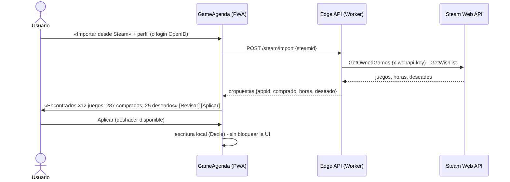

## 10. Integración opcional con la cuenta de Steam (fase posterior al MVP)

**Principio:** la cuenta de Steam es una **ayuda opcional para importar**, nunca un requisito. Apuntar un juego funciona sin cuenta y sin red. La importación solo **propone** estados, y el usuario los confirma con un toque.

### 10.1 Qué se puede importar y cómo

| Dato | Endpoint | ¿Clave? | Se usa para |
|---|---|---|---|
| Juegos en propiedad + horas jugadas | `IPlayerService/GetOwnedGames/v1` (`include_appinfo`, `include_played_free_games`, `skip_unvetted_apps=false`) | Sí (servidor) | Marcar **Comprado** (excepto los `family_shared`, que no son compras) y sugerir **Jugando** según `rtime_last_played` y `playtime_2weeks` |
| Lista de deseados | `IWishlistService/GetWishlist/v1?steamid=` | No (hoy; no documentado) | Sugerir **Quiero jugar** (el usuario confirma) |
| Logros (100 %) | `IPlayerService/GetUserAchievements` + `GetGameAchievements` (no documentados; ≈1 llamada por juego). Alternativa documentada: `ISteamUserStats/GetPlayerAchievements` + `GetSchemaForGame` (con clave) | No / Sí | Sugerir **Platinado** (conjunto base `dlcappid=0` completado) |
| Nombre y avatar | `ISteamUser/GetPlayerSummaries/v2` | Sí | Solo si la interfaz los muestra; no se guardan `realname` ni la ubicación |

**Requisitos y matices verificados:**
- **Privacidad:** el usuario necesita «Detalles de juegos: Público». Si no, `GetOwnedGames` responde `200 {"response":{}}`, sin `game_count`. `communityvisibilitystate` **no** sirve para detectarlo, porque mide la visibilidad del perfil. Se detecta por la respuesta vacía y se muestra una guía corta en español. Además, cada juego puede marcarse como privado, así que la importación puede salir incompleta.
- **Achievement Sets (beta desde el 15/16-10-2026):** Steam ha cambiado la definición del 100 % (los logros archivados no cuentan, los DLC van en conjuntos aparte y un conjunto completado sigue completado). Por eso **Platinado sigue siendo manual** y la importación solo lo sugiere.
- **Coste:** detectar platinados cuesta ≈1 llamada por juego con logros (≈300 en una biblioteca de 500 juegos). Tiene que lanzarlo el usuario, ser incremental (solo los juegos con `rtime_last_played` nuevo), cachear el esquema por `schema_hash` y respetar los 429.

### 10.2 Identificación del usuario

- **Sin login (MVP + 1):** pegar el perfil. `/profiles/<steamid64>` se usa tal cual; `/id/<vanity>` se resuelve con `https://steamcommunity.com/id/<vanity>/?xml=1` (sin clave) o con `ResolveVanityURL` (con clave, en el servidor). Los ToU piden obtener los datos de un usuario *"as requested by the end user"*, así que solo se importa a petición expresa y avisando de que es para su propio perfil.
- **Con login (cuando haya sincronización):** «Iniciar sesión con Steam» (**OpenID 2.0**; Steam no ofrece OIDC ni OAuth a terceros). Checklist obligatorio, porque fallos aquí son un patrón recurrente de CVE (p. ej. CVE-2026-82183):
  1. `check_authentication` con un POST del servidor a la URL **fija** `https://steamcommunity.com/openid/login`.
  2. Exigir que `claimed_id`, `return_to` y `response_nonce` estén dentro de `openid.signed`.
  3. Que `return_to` coincida exactamente con nuestra URL.
  4. Validar `claimed_id` con `^https?://steamcommunity\.com/openid/id/(\d{17})/?$`.
  5. Un `state` aleatorio en `return_to`, ligado a una cookie `HttpOnly` (contra el *login CSRF*).
  6. Rechazar *nonces* reutilizados.
  7. Emitir después **nuestra** sesión.

  Librería recomendada: **`steam-signin` 1.0.5** (no necesita clave y devuelve solo el SteamID). Se descarta `passport-steam`: última versión de 2023.
- **Prohibido:** pedir contraseñas o tokens de Steam (`steam-session` es solo para cuentas propias) y usar PICS o el protocolo del cliente.

### 10.3 Flujo propuesto

