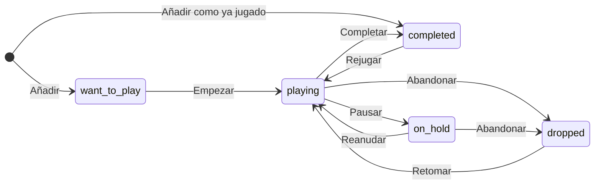
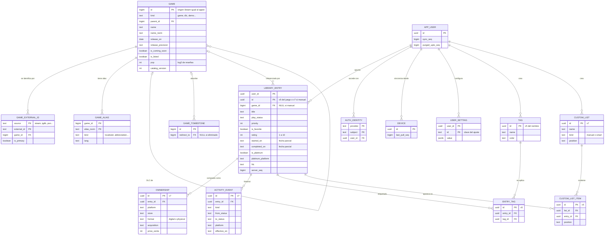

# T2 · Modelo de dominio, taxonomía de estados y esquema de datos

> **Estado:** borrador validado para integrar en `prototipe.md` (2026-10-28).
> **Validación:** el DDL completo se ha ejecutado en SQLite 3.53.4 (`node:sqlite`, Node 24.21). Después se tradujo de forma mecánica y se ejecutó en PostgreSQL 18.6 (PGlite). Los tamaños y tiempos se midieron con un catálogo sintético de 150.000 juegos y con tres perfiles de usuario (§7).
> **Dependencias:** lo que depende de los tracks paralelos (API de Steam, legal, librerías de 2026) figura como supuesto **[S1]–[S6]** (§8). El diseño no presupone ningún stack.
> **Convención:** los identificadores técnicos (tablas, columnas, valores de enumeración) van en inglés. Las etiquetas de la interfaz van en español.

## 0. Resumen

- **Hay cuatro dimensiones ortogonales**:
  - progreso: exclusivo, 5 valores;
  - posesión, «Comprado»: de 0 a n filas;
  - hito, «Platinado / 100 %»: 0 o 1;
  - marcas personales: favorito, prioridad, valoración, notas, etiquetas y listas.
- **Cada juego tiene una sola entrada**, no una por plataforma. Lo que depende de la plataforma se guarda en `ownership` y en atributos (`platinum_platform`, `preferred_platform`, `activity_event.platform`).
- **No se bloquea ninguna transición.** Los efectos (fechas, prioridad, eventos) dependen del estado destino. **Platinado ⇒ Completado** es un efecto por defecto, configurable y con «Deshacer». No es una restricción de la BD.
- **La sincronización es sencilla**:
  - gana la última escritura de cada fila, según su HLC (reloj lógico híbrido);
  - borrar es escribir una lápida;
  - el historial solo admite añadir;
  - las filas con clave natural tienen id determinista (UUIDv5) y el resto UUIDv7;
  - el servidor lleva un cursor `server_seq` por usuario.
- **Catálogo en el cliente:**
  - snapshot en JSON columnar de **≈ 2 MB gzip** para ~150k juegos, más deltas acumulativos (≈ 15 KB por cada 1.000 filas cambiadas);
  - BD local SQLite + FTS5 de ≈ 20 MB;
  - la búsqueda mientras se teclea tarda **0,1-3 ms** en ordenador (medido).
- **Privacidad:** primero en local (local-first) y con cuenta opcional. No se guarda ningún dato personal salvo el identificador de acceso. El catálogo no contiene datos personales.

---

## 1. Taxonomía de estados

### 1.1 Dimensiones

| Dimensión | Cardinalidad | Dónde | Contenido |
|---|---|---|---|
| Progreso | exactamente 1 | `library_entry.play_status` | `want_to_play`, `playing`, `on_hold`, `completed`, `dropped` |
| Posesión («Comprado») | 0..n | tabla `ownership` | plataforma, tienda, formato, tipo de adquisición, fecha, precio opcional |
| Hito «Platinado / 100 %» | 0..1 | `library_entry.is_platinum`, `platinum_on`, `platinum_platform` | sí / no, con fecha y plataforma |
| Marcas personales | independientes | `library_entry`, `tag` + `entry_tag`, `custom_list` + `custom_list_item` | favorito, prioridad 0-3, valoración 1-10, notas, etiquetas, listas |

### 1.2 Progreso (`play_status`)

| Identificador | Etiqueta UI | Significado | Acción principal (1 toque) |
|---|---|---|---|
| `want_to_play` | Quiero jugar | Apuntado; es el valor por defecto al añadir | Empezar |
| `playing` | Jugando | En curso | Completar |
| `on_hold` | En pausa | Empezado y aparcado con intención de volver | Reanudar |
| `completed` | Completado | Terminado (historia principal o lo que el usuario considere) | Rejugar (en menú) |
| `dropped` | Abandonado | Dejado sin intención de volver | Retomar |

Las **vistas derivadas** son filtros, no estados:

| Vista | Filtro |
|---|---|
| Pila pendiente | `want_to_play` y con posesión |
| Lista de deseos | `want_to_play` y sin posesión |
| Rejugando | `playing` y `completed_on` no nulo |
| Próximos lanzamientos | `want_to_play` y juego «próximamente» (o fecha manual futura) |
| Platinados, Favoritos, Comprados | filtro directo sobre cada campo |

### 1.3 Transiciones permitidas

**Se permiten todas las transiciones**, porque el usuario manda. Por ejemplo, si apunta un juego que terminó hace años, usa «Ya lo jugué». El diagrama muestra las transiciones naturales, que son las que la interfaz ofrece con un toque. El resto se hace con el selector de estado (2 toques).



### 1.4 Efectos automáticos

| Acción (estado destino) | Cambios en `library_entry` | Evento | Notas |
|---|---|---|---|
| Añadir (→ `want_to_play`) | crea la fila con `status_changed_at` = ahora | `added` | El id es determinista: repetir el toque, o hacerlo en otro dispositivo, no duplica |
| Añadir como «Ya lo jugué» (→ `completed`) | `completed_on` = NULL (fecha desconocida) | `added` (`to_status = completed`) | Aparece un chip «¿Cuándo?» que no bloquea; basta con el año |
| → `playing` | `started_on` = hoy, si era NULL | `status_changed` | Si viene de `completed`, se muestra «Rejugando» |
| → `on_hold` | — | `status_changed` | |
| → `completed` | `completed_on` = hoy (editable; se sobrescribe en cada compleción) · `priority` = 0 | `status_changed` | Sugerencia opcional «¿Valorar?» |
| → `dropped` | `priority` = 0 | `status_changed` | |
| → `want_to_play` desde otro estado | se conservan las fechas | `status_changed` | Caso típico: «lo quiero rejugar» |
| Platinado ON | `is_platinum` = TRUE, `platinum_on` = hoy, `platinum_platform` = el primer valor no nulo de `preferred_platform`, el ajuste `default_trophy_platform` y `default_platform`. Si `platinum_implies_completed` está activo y el estado no es `completed`, se aplica también «→ completed» | `platinum_earned` (+ `status_changed`) | Un único «Deshacer» revierte las dos cosas |
| Platinado OFF | `is_platinum` = FALSE; `platinum_on` y `platinum_platform` a NULL | lápida en el evento `platinum_earned` | No revierte el estado |
| Comprado | inserta una fila `ownership` con los valores por defecto | `acquired` | Si ya hay posesión, el toque abre el detalle |
| Valorar | `rating` = n | `rated` (`{"rating": n}`) | Se puede en cualquier estado |
| Favorito, prioridad, notas, etiquetas, listas | el campo o la fila correspondiente | ninguno | Son estado, no hitos: no llenan la línea de tiempo |
| Eliminar | `deleted_at` = ahora | ninguno | Queda en una papelera mientras exista la lápida (90 días). Volver a añadir el juego lo restaura (misma id) y ofrece «Empezar de cero» |

Reglas comunes a todas las acciones:
- Cada acción de un toque se ejecuta en una transacción local, escribe un `hlc` nuevo, marca la fila en `sync_outbox` y muestra «Deshacer» durante 5 s.
- Deshacer consiste en reescribir los valores anteriores con un HLC nuevo y poner lápida a los eventos generados.
- **Nunca se inventan fechas**: si no se conocen, quedan en NULL.
- Las fechas de usuario (`*_on`) son **fechas locales y pueden ser parciales** ('2019', '2019-05' o '2019-05-03'). Así se puede registrar «lo terminé en 2019» y no hay desfases de zona horaria a medianoche.

### 1.5 Posesión: «Comprado»

- Hay una fila `ownership` por cada copia o acceso, con estos campos:

  | Campo | Contenido |
  |---|---|
  | `platform` | dónde se juega |
  | `store` | `steam`, `gog`, `epic`, `psn`, `eshop`, `xbox`, `retail`, `other` |
  | `format` | `digital` o `physical` |
  | `acquisition` | `purchase`, `gift`, `free`, `subscription`, `other` |
  | `acquired_on` | fecha parcial |
  | `price_cents` + `currency` | opcionales |

- La posesión es independiente del progreso. Un juego puede estar «Completado» sin haberse comprado (prestado, suscripción caducada) o estar en «Quiero jugar» y comprado (pila pendiente).
- **Un toque** crea la fila con los ajustes `default_platform`, `default_store` y `default_format`, y con la fecha de hoy. Para un juego de Steam, la tienda que se propone es `steam`. Si ya existe alguna posesión, el toque abre el detalle; así no se borran datos sin querer.
- `subscription` cubre Game Pass y PS Plus («lo tengo», aunque no sea una compra). La caducidad queda fuera del prototipo.
- Códigos de plataforma, validados en la app y no con un CHECK, porque la lista crecerá: `pc`, `steam_deck`, `mac`, `linux`, `ps5`, `ps4`, `ps3`, `ps_vita`, `switch2`, `switch`, `xbox_series`, `xbox_one`, `xbox_360`, `ios`, `android`, `meta_quest`, `retro`, `other`.

### 1.6 Hito: «Platinado / 100 %»

**Decisión:** «Platinado» es un hito independiente del progreso, pero marcarlo **pasa el juego a «Completado» por defecto**. Es un efecto automático configurable (`platinum_implies_completed = true`) y tiene «Deshacer». No hay ninguna restricción en la BD: después se puede volver a «Jugando» sin perder el platino.

Justificación:
- En PlayStation, el platino exige terminar el juego en la inmensa mayoría de los casos, y el 100 % de logros de Steam o Xbox también. Sin el efecto harían falta dos toques, y podría quedar la combinación absurda «Quiero jugar + Platinado».
- Como restricción, sería falsa en casos reales:
  - rejugar un juego ya platinado;
  - seguir con un juego como servicio o con un DLC;
  - platinar en PS5 un juego terminado antes en PC;
  - juegos sin final cuyo platino depende de horas o del multijugador.
- Por eso se aplica el efecto, pero no un invariante. Quitar el platino no revierte el estado, porque no se puede saber cuál era el correcto; para eso está «Deshacer».
- Platino y 100 % de logros son un mismo concepto y un mismo campo. La etiqueta depende de `platinum_platform`: con una plataforma PlayStation se muestra «Platinado» y con las demás, «100 % logros».
- El doble platino PS4/PS5 se anota en las notas. Si hiciera falta registrarlo, en la fase 2 se migraría a una tabla `milestone`.

### 1.7 Marcas personales

| Marca | Campo | Reglas |
|---|---|---|
| Favorito | `is_favorite` | Se activa y desactiva con un toque; no genera evento |
| Prioridad | `priority` 0-3 (ninguna, baja, media, alta) | Un toque alterna entre 0 y 3; una pulsación larga permite elegir nivel. Pasa a 0 al completar o abandonar |
| Valoración | `rating` 1-10 (en la UI, 5 estrellas con medias) | Cualquier estado; evento `rated` |
| Notas | `notes` (texto libre) | Autoguardado; no genera evento |
| Etiquetas | `tag` + `entry_tag` | Sin orden; sirven para filtrar («coop», «corto», «con mi pareja») |
| Listas | `custom_list` + `custom_list_item` | Orden manual con clave fraccional (ver abajo) |

Detalles de las listas:
- La posición usa una clave de orden fraccional: mover un juego solo reescribe su propia fila.
- La lista de sistema «A continuación» tiene un id fijo, `UUIDv5(NS_LIST, 'system:up_next')`, para que no se duplique entre dispositivos.
- Las listas «inteligentes» (`kind = 'smart'` + filtro JSON) se dejan para la fase 2.

### 1.8 Acciones de un toque y añadido rápido

| Acción | Dónde | Toques | Deshacer |
|---|---|---|---|
| Añadir a «Quiero jugar» | resultado de búsqueda (o Intro sobre el primero) | 1 | snackbar de 5 s |
| Añadir con otro estado («Ya lo jugué», «Jugando») | pulsación larga sobre el resultado | 2 | snackbar |
| Siguiente paso (Empezar, Completar, Reanudar, Retomar) | botón de la tarjeta o deslizar a la derecha | 1 | snackbar |
| Cualquier otro estado | chip de estado | 2 | snackbar |
| Comprado | chip | 1 | snackbar (el segundo toque abre el detalle) |
| Platinado | chip | 1 | snackbar (revierte también el «Completado» automático) |
| Favorito / Prioridad alta | corazón / bandera | 1 | volver a tocar |
| Valorar | estrellas del detalle o sugerencia al completar | 1 | volver a tocar |

Flujo de añadido rápido, con un objetivo de menos de 3 s:
1. El botón «+» (o la tecla `/` en escritorio) abre el buscador con el foco puesto.
2. Cada pulsación busca en el catálogo local, sin red, y marca los juegos que ya están «en tu agenda».
3. Un toque en un resultado lo añade a «Quiero jugar» y muestra «Deshacer · Cambiar estado».
4. Si no hay resultados, se ofrece «Añadir "texto" como juego manual», también con un toque.

### 1.9 Línea de tiempo: etiquetas derivadas de los eventos

| `kind` | Condición | Etiqueta |
|---|---|---|
| `added` | — | Añadido (a «Quiero jugar» o como «Completado») |
| `status_changed` | `want_to_play` → `playing` | Empezado |
| `status_changed` | `on_hold` → `playing` | Reanudado |
| `status_changed` | `dropped` → `playing` | Retomado |
| `status_changed` | `completed` → `playing` | Rejugando |
| `status_changed` | → `on_hold`, → `completed`, → `dropped` | En pausa, Completado, Abandonado |
| `status_changed` | → `want_to_play` | Vuelve a pendientes |
| `platinum_earned` | plataforma PlayStation u otra | Platinado o 100 % logros |
| `acquired` | según `payload` | Comprado (Steam, físico PS5, regalo…) |
| `rated` | según `payload` | Valorado 8/10 |

---

## 2. Entidades y relaciones

### 2.1 Entidades

| Entidad | Ámbito | Propósito |
|---|---|---|
| `game` | catálogo global (servidor) | Obra canónica que se puede buscar |
| `game_external_id` | catálogo | Identidad multifuente (`steam`, `igdb`, `psn`…) |
| `game_alias` | catálogo | Títulos en español, abreviaturas («GTA V»), nombres antiguos |
| `game_tombstone` | catálogo | Fusiones (`redirect_to`) y eliminaciones |
| `catalog_build` | catálogo | Ficheros publicados (snapshot completo o delta) |
| `library_entry` | usuario | Un juego en la agenda del usuario |
| `ownership` | usuario | «Comprado» (0..n) |
| `activity_event` | usuario | Línea de tiempo (solo admite añadir) |
| `tag`, `entry_tag` | usuario | Etiquetas |
| `custom_list`, `custom_list_item` | usuario | Listas ordenadas |
| `user_setting` | usuario | Ajustes clave-valor que se sincronizan |
| `app_user`, `auth_identity`, `device` | solo servidor | Cuenta, acceso y dispositivos |
| `catalog_game` + `catalog_fts` | solo cliente | Proyección local del snapshot para buscar |
| `sync_state`, `sync_outbox`, `game_detail_cache` | solo cliente | Estado de la sincronización y caché |

### 2.2 Una entrada por juego, no por plataforma

**Decisión:** hay una entrada por juego y usuario, garantizada por `UNIQUE (user_id, game_id)` entre las filas vivas. Lo que depende de la plataforma va en filas hijas y en atributos.

Motivos:
- Es el modelo mental de una agenda: «quiero jugar Elden Ring», no «Elden Ring en PS5». Añadir no exige elegir plataforma, así que basta un toque.
- El estado, la valoración y las notas hablan del juego. Duplicarlos por plataforma ensucia listas y búsquedas.
- Lo que sí depende de la plataforma tiene su sitio:
  - `ownership`: 0..n filas con plataforma, tienda y formato;
  - `platinum_platform`;
  - `preferred_platform`: dónde se juega o se jugará;
  - `activity_event.platform`: dónde ocurrió cada hito.
- Coste asumido: no puede haber dos estados a la vez en plataformas distintas. «Completado en PS4 y jugando en PC» se representa como «Rejugando» más el historial. Si hiciera falta, en la fase 2 se añadiría una tabla `playthrough`.

Ejemplo «platinado en PS5, comprado en Steam», reproducido en la prueba:

| Tabla | Contenido |
|---|---|
| `library_entry` | `game_id = 1245620` (ELDEN RING), `play_status = completed`, `preferred_platform = ps5`, `is_platinum = TRUE`, `platinum_platform = ps5`, `started_on` y `completed_on` rellenos |
| `ownership` | `platform = pc`, `store = steam`, `format = digital`; otra fila `ps5 / retail / physical` si también lo tiene en disco |
| `activity_event` | `added` → `status_changed` (→ `playing`, ps5) → `acquired` (pc, steam) → `platinum_earned` (ps5) → `status_changed` (→ `completed`, ps5) |

### 2.3 Identidad multifuente del catálogo

- **`game.id` es un entero canónico y estable.**
  - Para los juegos que entran por Steam, `id = appid`. Es legible, el snapshot no necesita otra clave y una URL de Steam se resuelve sin consultar nada.
  - Los juegos de otras fuentes (IGDB, PSN…, en la fase 2) toman ids de una secuencia que empieza en 1.000.000.000, muy por encima del rango de los appid (que está en millones).
- **`game_external_id`** relaciona `(source, external_id)` con `game_id` y guarda todas las identidades de un juego (`steam`, `igdb`, `psn`, `xbox`, `nintendo`, `gog`, `epic`).
  - `external_id` es texto porque hay fuentes con ids no numéricos.
  - `is_primary` marca la fuente de metadatos.
- **Fusiones:** cuando al cruzar fuentes aparece un duplicado, el id que pierde pasa a `game_tombstone (id, redirect_to)`. La fusión se publica en el delta y cada cliente reescribe su `library_entry.game_id`.
  - Solo se elimina (sin `redirect_to`) la basura que nunca se ha referenciado.
  - Un juego retirado de la tienda se marca con `is_listed = FALSE` y **no se borra**, porque sigue en las bibliotecas.
- **Juego manual** (el `source = manual` del brief):
  - No vive en el catálogo global, porque es un dato privado del usuario.
  - Es una `library_entry` con `game_id = NULL`, su propio `title` y, opcionalmente, `custom_release_on` y `preferred_platform`.
  - Para «vincularlo» después a un juego del catálogo se rellena `game_id`. Si ya existía una entrada de ese juego, se fusionan.
- `library_entry.title` se rellena siempre al añadir:
  - la lista se puede pintar aunque el catálogo local aún no se haya descargado (dispositivo nuevo);
  - los juegos manuales no necesitan otra tabla;
  - al mostrar se usa el nombre del catálogo y, si falta, `title`.

### 2.4 Diagrama ER



### 2.5 Identidad de las filas

| Tabla | `id` | Motivo |
|---|---|---|
| `library_entry` de catálogo | `UUIDv5(NS_ENTRY, 'game:' + game_id)` | Añadir el mismo juego en dos dispositivos sin conexión converge en una sola fila |
| `library_entry` manual | UUIDv7 | No hay clave natural estable |
| `ownership`, `activity_event`, `custom_list` | UUIDv7 | Entidades propias; UUIDv7 es ordenable por tiempo |
| `tag` | `UUIDv5(NS_TAG, name_norm al crearla)` | Crear «coop» en dos dispositivos da la misma etiqueta |
| `entry_tag` | `UUIDv5(NS_ENTRY_TAG, entry_id + '/' + tag_id)` | Idempotente |
| `custom_list_item` | `UUIDv5(NS_LIST_ITEM, list_id + '/' + entry_id)` | Idempotente |
| `custom_list` «A continuación» | `UUIDv5(NS_LIST, 'system:up_next')` | Lista de sistema sin duplicados |
| `user_setting` | el nombre del ajuste | Clave natural |

Detalles de esta regla:
- **Desviación consciente de «todo UUIDv7»:** con UUIDv7 en todas las filas, el servidor tendría que deduplicar por `(user_id, game_id)` y cambiar la clave de los hijos. Con UUIDv5 no hace falta lógica alguna.
- Los `NS_*` son constantes fijas que se generan una sola vez, por ejemplo `NS_ENTRY = 3c8a5f0e-6b1d-4e2a-9f47-0d5b8c2e7a11`.
- **El id v5 no incluye `user_id`**, así que es igual para todos los usuarios. Por eso la PK es `(user_id, id)` y las FKs son compuestas, lo que además impide referencias entre usuarios.
- Esto permite fusionar los datos de un modo anónimo local con una cuenta existente: las mismas ids se resuelven por LWW.

### 2.6 Ajustes (`user_setting`)

| `id` (clave) | Por defecto | Uso |
|---|---|---|
| `quick_add_status` | `"want_to_play"` | Estado al añadir con un toque |
| `default_platform` / `default_store` / `default_format` | `"pc"` / `"steam"` / `"digital"` | «Comprado» con un toque |
| `default_trophy_platform` | `null` (usa `default_platform`) | Plataforma del platino si la entrada no tiene `preferred_platform` |
| `platinum_implies_completed` | `true` | Efecto de «Platinado» |
| `default_currency` | `"EUR"` | Precio opcional |
| `prefer_localized_titles` | `true` | Mostrar «Los Sims 4» en lugar de «The Sims 4» |
| `show_adult` | `false` | Ocultar en el catálogo el contenido sexual explícito |

Los ajustes propios de cada dispositivo (tema, variante de catálogo `lite` o `rich`, última pestaña) no se sincronizan.

---

## 3. Esquema SQL

### 3.1 Convenciones y equivalencias SQLite → PostgreSQL

El DDL de **datos de usuario es el mismo** en el cliente (SQLite) y en el servidor (PostgreSQL). El catálogo es distinto a propósito: completo en el servidor y una proyección para buscar en el cliente. La traducción a PostgreSQL es **mecánica**, con las reglas siguientes, y está validada en PG 18.6:

| Concepto | SQLite | PostgreSQL |
|---|---|---|
| Ids de usuario (`user_id`, `id`, `entry_id`, `tag_id`, `list_id`) | `TEXT` (UUID en minúsculas) | `uuid` (la clave de `user_setting` sigue siendo `text`) |
| Instantes de sistema `*_at` | `TEXT` ISO-8601 UTC con milisegundos, p. ej. `2026-10-28T09:15:00.000Z` | `timestamptz` |
| Fechas de usuario `*_on` | `TEXT` parcial con `CHECK … LIKE` | `text` con el mismo CHECK (o `date` + precisión) |
| `game.release_on` | `TEXT 'YYYY-MM-DD'` | `date` |
| `hlc`, `position`, `name_norm` | `TEXT` (comparación binaria por defecto) | `text COLLATE "C"`, imprescindible para que el orden sea byte a byte |
| JSON (`payload`, `value`, `filter`, `developers`, `publishers`, `assets`) | `TEXT` | `jsonb` |
| Booleanos | `BOOLEAN … DEFAULT FALSE` (0/1; `TRUE`/`FALSE` desde 3.23) | `boolean` |
| `game.id`, `game_id`, `parent_id`, `redirect_to`, `server_seq` | `INTEGER` | `bigint` |
| Búsqueda | FTS5 + triggers (solo cliente) | `pg_trgm` (GIN) sobre `name_norm` y `alias_norm` |

Otras reglas:
- **Enumeraciones:** las estables (estado, formato, tipo de evento) llevan `CHECK`. Las que crecerán (plataformas, tiendas) se validan en la app, porque en SQLite cambiar un `CHECK` obliga a reconstruir la tabla.
- **Columnas comunes:** todas las tablas de usuario tienen PK `(user_id, id)` y las cinco columnas de sync (`created_at`, `updated_at`, `deleted_at`, `hlc`, `server_seq`).
- **SQLite:** `PRAGMA foreign_keys = ON` al abrir la BD.
- **Servidor:** nunca se fía del `user_id` que envía el cliente; usa el de la sesión.

### 3.2 DDL A — Catálogo global (servidor)

```sql
-- =====================================================================
-- A. CATÁLOGO GLOBAL (servidor). Dialecto SQLite; «PG:» = tipo en PostgreSQL
-- =====================================================================
CREATE TABLE game (
  id                INTEGER PRIMARY KEY,  -- PG: bigint. Origen Steam: id = appid; otras fuentes: secuencia >= 1000000000
  kind              TEXT    NOT NULL DEFAULT 'game'
                            CHECK (kind IN ('game','dlc','demo','software','other')),
  parent_id         INTEGER REFERENCES game (id),           -- DLC/demo -> juego base
  name              TEXT    NOT NULL,                       -- nombre visible, sin ™ ® ©
  name_norm         TEXT    NOT NULL,                       -- normalize(name). PG: text COLLATE "C"
  release_on        TEXT,                                   -- 'YYYY-MM-DD' = inicio del periodo. PG: date
  release_precision TEXT    NOT NULL DEFAULT 'unknown'
                            CHECK (release_precision IN ('day','month','quarter','year','unknown')),
  release_text      TEXT,                                   -- literal de la tienda: «Q1 2027», «Próximamente»
  is_coming_soon    BOOLEAN NOT NULL DEFAULT FALSE,
  is_early_access   BOOLEAN NOT NULL DEFAULT FALSE,
  is_free           BOOLEAN NOT NULL DEFAULT FALSE,
  is_adult          BOOLEAN NOT NULL DEFAULT FALSE,         -- contenido sexual explícito: oculto por defecto
  is_listed         BOOLEAN NOT NULL DEFAULT TRUE,          -- FALSE = retirado de la tienda (nunca se borra)
  review_count      INTEGER,
  pop               INTEGER NOT NULL DEFAULT 0 CHECK (pop BETWEEN 0 AND 31),  -- floor(log2(review_count + 1))
  platforms         INTEGER NOT NULL DEFAULT 0,             -- bits: 1 win, 2 mac, 4 linux, 8 deck verificado, 16 deck jugable
  short_description TEXT,                                   -- es-ES si existe; si no, en
  developers        TEXT,                                   -- JSON array. PG: jsonb
  publishers        TEXT,                                   -- JSON array. PG: jsonb
  assets            TEXT,                                   -- JSON con rutas (con hash) de header/capsule/library_600x900. PG: jsonb
  snapshot_hash     TEXT,                                   -- hash de la proyección que llega al cliente (evita deltas vacíos)
  catalog_version   INTEGER NOT NULL,                       -- versión de catálogo en la que cambió esa proyección
  created_at        TEXT    NOT NULL,                       -- PG: timestamptz
  updated_at        TEXT    NOT NULL                        -- PG: timestamptz
);
CREATE INDEX ix_game_name_norm ON game (name_norm);                         -- PG: + índice GIN pg_trgm (sección 3.7)
CREATE INDEX ix_game_upcoming  ON game (release_on) WHERE is_coming_soon = TRUE;
CREATE INDEX ix_game_version   ON game (catalog_version);                   -- generación de deltas
CREATE INDEX ix_game_parent    ON game (parent_id) WHERE parent_id IS NOT NULL;

CREATE TABLE game_external_id (            -- identidad multi-fuente
  source       TEXT    NOT NULL CHECK (source IN ('steam','igdb','psn','xbox','nintendo','gog','epic')),
  external_id  TEXT    NOT NULL,           -- texto: hay fuentes con ids no numéricos (p. ej. PSN 'PPSA01234')
  game_id      INTEGER NOT NULL REFERENCES game (id) ON DELETE CASCADE,
  is_primary   BOOLEAN NOT NULL DEFAULT FALSE,   -- fuente principal de metadatos de ese juego
  last_seen_at TEXT,                       -- última vez visto en la fuente (detecta retirados)
  PRIMARY KEY (source, external_id)
);
CREATE INDEX ix_game_external_id_game ON game_external_id (game_id);

CREATE TABLE game_alias (                  -- nombres alternativos buscables
  game_id    INTEGER NOT NULL REFERENCES game (id) ON DELETE CASCADE,
  alias      TEXT    NOT NULL,
  alias_norm TEXT    NOT NULL,
  kind       TEXT    NOT NULL CHECK (kind IN ('localized','abbreviation','former_name','other')),
  lang       TEXT,                         -- BCP 47 ('es') si kind = 'localized'
  PRIMARY KEY (game_id, alias_norm)
);
CREATE INDEX ix_game_alias_norm ON game_alias (alias_norm);

CREATE TABLE game_tombstone (              -- juegos fusionados (redirect_to) o eliminados (NULL; solo basura nunca referenciada)
  id              INTEGER PRIMARY KEY,
  redirect_to     INTEGER REFERENCES game (id),
  catalog_version INTEGER NOT NULL,
  created_at      TEXT    NOT NULL
);

CREATE TABLE catalog_build (               -- ficheros publicados en el CDN
  version      INTEGER NOT NULL,
  kind         TEXT    NOT NULL CHECK (kind IN ('full','delta')),
  base_version INTEGER,                    -- delta: snapshot completo desde el que acumula
  row_count    INTEGER NOT NULL,
  byte_size    INTEGER NOT NULL,
  sha256       TEXT    NOT NULL,
  url          TEXT    NOT NULL,
  built_at     TEXT    NOT NULL,
  PRIMARY KEY (version, kind)
);
```

### 3.3 DDL B — Datos de usuario (cliente SQLite y servidor PostgreSQL)

```sql
-- =====================================================================
-- B. DATOS DE USUARIO (idéntico en cliente SQLite y servidor PostgreSQL)
-- Columnas de sync en todas las tablas: created_at, updated_at, deleted_at,
-- hlc, server_seq. Identidad de fila = (user_id, id).
-- =====================================================================
CREATE TABLE library_entry (               -- una fila por juego y usuario
  user_id            TEXT    NOT NULL,     -- PG: uuid REFERENCES app_user (id)
  id                 TEXT    NOT NULL,     -- UUIDv5(NS_ENTRY, 'game:'||game_id) | UUIDv7 si es manual. PG: uuid
  game_id            INTEGER,              -- NULL = juego manual (fuera de catálogo). PG: bigint REFERENCES game (id)
  title              TEXT    NOT NULL,     -- título al añadir (fallback sin catálogo; único título si es manual)
  play_status        TEXT    NOT NULL DEFAULT 'want_to_play'
                             CHECK (play_status IN ('want_to_play','playing','on_hold','completed','dropped')),
  status_changed_at  TEXT    NOT NULL,     -- instante UTC del último cambio de play_status
  priority           INTEGER NOT NULL DEFAULT 0 CHECK (priority BETWEEN 0 AND 3),   -- 0 ninguna · 1 baja · 2 media · 3 alta
  is_favorite        BOOLEAN NOT NULL DEFAULT FALSE,
  rating             INTEGER CHECK (rating BETWEEN 1 AND 10),                      -- NULL = sin valorar
  notes              TEXT,
  preferred_platform TEXT,                 -- código de plataforma ('pc','ps5','switch2'…) donde juego/jugaré
  started_on         TEXT CHECK (started_on   LIKE '____' OR started_on   LIKE '____-__' OR started_on   LIKE '____-__-__'),
  completed_on       TEXT CHECK (completed_on LIKE '____' OR completed_on LIKE '____-__' OR completed_on LIKE '____-__-__'),
  is_platinum        BOOLEAN NOT NULL DEFAULT FALSE,   -- «platinado / 100 % logros»
  platinum_on        TEXT CHECK (platinum_on  LIKE '____' OR platinum_on  LIKE '____-__' OR platinum_on  LIKE '____-__-__'),
  platinum_platform  TEXT,
  custom_release_on  TEXT CHECK (custom_release_on LIKE '____' OR custom_release_on LIKE '____-__' OR custom_release_on LIKE '____-__-__'),
  created_at         TEXT    NOT NULL,     -- PG: timestamptz (todas las *_at)
  updated_at         TEXT    NOT NULL,
  deleted_at         TEXT,                 -- lápida (soft delete)
  hlc                TEXT    NOT NULL,     -- reloj lógico híbrido de la última escritura. PG: text COLLATE "C"
  server_seq         INTEGER,              -- cursor asignado por el servidor (NULL = aún no confirmado). PG: bigint
  PRIMARY KEY (user_id, id),
  CHECK (is_platinum OR (platinum_on IS NULL AND platinum_platform IS NULL))
);
CREATE INDEX ix_entry_status_priority ON library_entry (user_id, play_status, priority DESC, created_at DESC)
  WHERE deleted_at IS NULL;                -- «Quiero jugar» ordenado por prioridad y novedad
CREATE INDEX ix_entry_status_recent   ON library_entry (user_id, play_status, status_changed_at DESC)
  WHERE deleted_at IS NULL;                -- «Jugando», «Completados» por actividad reciente
CREATE UNIQUE INDEX ux_entry_game     ON library_entry (user_id, game_id)
  WHERE game_id IS NOT NULL AND deleted_at IS NULL;   -- red de seguridad: un juego = una entrada viva

CREATE TABLE ownership (                   -- «comprado»: 0..n por entrada (Steam + físico PS5, etc.)
  user_id     TEXT    NOT NULL,
  id          TEXT    NOT NULL,            -- UUIDv7
  entry_id    TEXT    NOT NULL,
  platform    TEXT    NOT NULL,            -- 'pc','ps5','ps4','switch','switch2','xbox_series'…
  store       TEXT,                        -- 'steam','gog','epic','psn','eshop','xbox','retail','other'
  format      TEXT    NOT NULL DEFAULT 'digital'  CHECK (format IN ('digital','physical')),
  acquisition TEXT    NOT NULL DEFAULT 'purchase' CHECK (acquisition IN ('purchase','gift','free','subscription','other')),
  acquired_on TEXT CHECK (acquired_on LIKE '____' OR acquired_on LIKE '____-__' OR acquired_on LIKE '____-__-__'),
  price_cents INTEGER CHECK (price_cents >= 0),     -- opcional
  currency    TEXT    CHECK (length(currency) = 3), -- ISO 4217, opcional
  created_at  TEXT    NOT NULL,
  updated_at  TEXT    NOT NULL,
  deleted_at  TEXT,
  hlc         TEXT    NOT NULL,
  server_seq  INTEGER,
  PRIMARY KEY (user_id, id),
  FOREIGN KEY (user_id, entry_id) REFERENCES library_entry (user_id, id) ON DELETE CASCADE
);
CREATE INDEX ix_ownership_entry ON ownership (user_id, entry_id) WHERE deleted_at IS NULL;

CREATE TABLE activity_event (              -- línea de tiempo; solo-añadir (deshacer = lápida)
  user_id      TEXT NOT NULL,
  id           TEXT NOT NULL,              -- UUIDv7
  entry_id     TEXT NOT NULL,
  kind         TEXT NOT NULL CHECK (kind IN ('added','status_changed','platinum_earned','acquired','rated')),
  from_status  TEXT CHECK (from_status IN ('want_to_play','playing','on_hold','completed','dropped')),
  to_status    TEXT CHECK (to_status   IN ('want_to_play','playing','on_hold','completed','dropped')),
  platform     TEXT,
  payload      TEXT,                       -- JSON opcional: {"rating":8}, {"store":"steam"}… PG: jsonb
  occurred_at  TEXT NOT NULL,              -- instante UTC real de la acción
  effective_on TEXT NOT NULL CHECK (effective_on LIKE '____' OR effective_on LIKE '____-__' OR effective_on LIKE '____-__-__'),
  created_at   TEXT NOT NULL,
  updated_at   TEXT NOT NULL,
  deleted_at   TEXT,
  hlc          TEXT NOT NULL,
  server_seq   INTEGER,
  PRIMARY KEY (user_id, id),
  FOREIGN KEY (user_id, entry_id) REFERENCES library_entry (user_id, id) ON DELETE CASCADE
);
CREATE INDEX ix_event_entry    ON activity_event (user_id, entry_id, occurred_at);
CREATE INDEX ix_event_timeline ON activity_event (user_id, effective_on DESC, occurred_at DESC)
  WHERE deleted_at IS NULL;

CREATE TABLE tag (
  user_id    TEXT NOT NULL,
  id         TEXT NOT NULL,                -- UUIDv5(NS_TAG, name_norm al crearla)
  name       TEXT NOT NULL,
  name_norm  TEXT NOT NULL,
  color      TEXT,                         -- '#RRGGBB' opcional
  created_at TEXT NOT NULL,
  updated_at TEXT NOT NULL,
  deleted_at TEXT,
  hlc        TEXT NOT NULL,
  server_seq INTEGER,
  PRIMARY KEY (user_id, id)
);
CREATE UNIQUE INDEX ux_tag_name ON tag (user_id, name_norm) WHERE deleted_at IS NULL;

CREATE TABLE entry_tag (
  user_id    TEXT NOT NULL,
  id         TEXT NOT NULL,                -- UUIDv5(NS_ENTRY_TAG, entry_id||'/'||tag_id)
  entry_id   TEXT NOT NULL,
  tag_id     TEXT NOT NULL,
  created_at TEXT NOT NULL,
  updated_at TEXT NOT NULL,
  deleted_at TEXT,
  hlc        TEXT NOT NULL,
  server_seq INTEGER,
  PRIMARY KEY (user_id, id),
  FOREIGN KEY (user_id, entry_id) REFERENCES library_entry (user_id, id) ON DELETE CASCADE,
  FOREIGN KEY (user_id, tag_id)   REFERENCES tag (user_id, id)           ON DELETE CASCADE
);
CREATE INDEX ix_entry_tag_entry ON entry_tag (user_id, entry_id) WHERE deleted_at IS NULL;
CREATE INDEX ix_entry_tag_tag   ON entry_tag (user_id, tag_id)   WHERE deleted_at IS NULL;

CREATE TABLE custom_list (
  user_id     TEXT NOT NULL,
  id          TEXT NOT NULL,               -- UUIDv7 (lista de sistema «A continuación»: UUIDv5(NS_LIST,'system:up_next'))
  name        TEXT NOT NULL,
  description TEXT,
  kind        TEXT NOT NULL DEFAULT 'manual' CHECK (kind IN ('manual','smart')),
  filter      TEXT,                        -- JSON del filtro si kind = 'smart' (fase 2). PG: jsonb
  position    TEXT NOT NULL,               -- clave de orden fraccional ('a0','a0V'…). PG: text COLLATE "C"
  created_at  TEXT NOT NULL,
  updated_at  TEXT NOT NULL,
  deleted_at  TEXT,
  hlc         TEXT NOT NULL,
  server_seq  INTEGER,
  PRIMARY KEY (user_id, id)
);

CREATE TABLE custom_list_item (
  user_id    TEXT NOT NULL,
  id         TEXT NOT NULL,                -- UUIDv5(NS_LIST_ITEM, list_id||'/'||entry_id)
  list_id    TEXT NOT NULL,
  entry_id   TEXT NOT NULL,
  position   TEXT NOT NULL,                -- orden fraccional dentro de la lista. PG: text COLLATE "C"
  created_at TEXT NOT NULL,
  updated_at TEXT NOT NULL,
  deleted_at TEXT,
  hlc        TEXT NOT NULL,
  server_seq INTEGER,
  PRIMARY KEY (user_id, id),
  FOREIGN KEY (user_id, list_id)  REFERENCES custom_list (user_id, id)   ON DELETE CASCADE,
  FOREIGN KEY (user_id, entry_id) REFERENCES library_entry (user_id, id) ON DELETE CASCADE
);
CREATE INDEX ix_list_item_order ON custom_list_item (user_id, list_id, position) WHERE deleted_at IS NULL;
CREATE INDEX ix_list_item_entry ON custom_list_item (user_id, entry_id);

CREATE TABLE user_setting (                -- clave-valor: cada ajuste se sincroniza por separado
  user_id    TEXT NOT NULL,
  id         TEXT NOT NULL,                -- nombre del ajuste: 'default_platform', 'platinum_implies_completed'…
  value      TEXT NOT NULL,                -- JSON. PG: jsonb
  created_at TEXT NOT NULL,
  updated_at TEXT NOT NULL,
  deleted_at TEXT,                         -- lápida = volver al valor por defecto
  hlc        TEXT NOT NULL,
  server_seq INTEGER,
  PRIMARY KEY (user_id, id)
);
```

### 3.4 DDL C — Solo cliente (misma BD que los datos de usuario)

```sql
CREATE TABLE sync_state (                  -- device_id, last_pull_seq, hlc_ms, hlc_counter, clock_offset_ms, catalog_version
  key   TEXT PRIMARY KEY,
  value TEXT NOT NULL
);

CREATE TABLE sync_outbox (                 -- filas con cambios locales pendientes de subir
  seq        INTEGER PRIMARY KEY AUTOINCREMENT,
  table_name TEXT NOT NULL,
  row_id     TEXT NOT NULL,
  queued_at  TEXT NOT NULL,
  UNIQUE (table_name, row_id)              -- INSERT OR REPLACE: una marca por fila, al final de la cola
);

CREATE TABLE game_detail_cache (           -- detalle bajo demanda (descripción, imágenes); LRU
  game_id    INTEGER NOT NULL,
  lang       TEXT    NOT NULL,
  payload    TEXT    NOT NULL,             -- JSON
  fetched_at TEXT    NOT NULL,
  PRIMARY KEY (game_id, lang)
);
```

### 3.5 DDL D — Catálogo local (fichero aparte `catalog.db`, montado con `ATTACH … AS cat`)

```sql
CREATE TABLE catalog_game (
  rid               INTEGER PRIMARY KEY,         -- rango local de popularidad (1 = más popular) = rowid de FTS5
  id                INTEGER NOT NULL UNIQUE,     -- = game.id (lo que guarda library_entry.game_id)
  name              TEXT    NOT NULL,            -- nombre original de Steam (sin ™ ® ©)
  name_es           TEXT,                        -- título localizado en español si difiere («Los Sims 4»)
  name_norm         TEXT    NOT NULL,            -- normalize(name), calculado en el propio cliente
  alt_norm          TEXT,                        -- tokens extra: romanos→arábigos, compuestos, alias / nombre ES
  release_on        TEXT,                        -- 'YYYY-MM-DD' (inicio del periodo)
  release_precision INTEGER NOT NULL DEFAULT 0,  -- 0 desconocida · 1 año · 2 trimestre · 3 mes · 4 día
  flags             INTEGER NOT NULL DEFAULT 0,  -- 1 coming_soon · 2 early_access · 4 free · 8 adult · 16 delisted · 32 dlc
  pop               INTEGER NOT NULL DEFAULT 0,  -- 0..20 (log2 de nº de reseñas)
  parent_id         INTEGER,                     -- DLC -> juego base (game.id)
  header            TEXT                         -- solo variante «rica»: hash/ruta de la imagen de cabecera
);
CREATE INDEX ix_catalog_name_norm ON catalog_game (name_norm);                        -- coincidencia exacta / prefijo de título
CREATE INDEX ix_catalog_upcoming  ON catalog_game (release_on) WHERE (flags & 1) = 1; -- próximos lanzamientos

CREATE VIRTUAL TABLE catalog_fts USING fts5 (
  name_norm, alt_norm,
  content = 'catalog_game', content_rowid = 'rid',   -- contenido externo: no duplica el texto
  tokenize = 'unicode61 remove_diacritics 2'          -- minúsculas + sin diacríticos (red de seguridad; ya llega normalizado)
);
CREATE TRIGGER catalog_game_ai AFTER INSERT ON catalog_game BEGIN
  INSERT INTO catalog_fts (rowid, name_norm, alt_norm) VALUES (new.rid, new.name_norm, new.alt_norm);
END;
CREATE TRIGGER catalog_game_ad AFTER DELETE ON catalog_game BEGIN
  INSERT INTO catalog_fts (catalog_fts, rowid, name_norm, alt_norm) VALUES ('delete', old.rid, old.name_norm, old.alt_norm);
END;
CREATE TRIGGER catalog_game_au AFTER UPDATE OF name_norm, alt_norm ON catalog_game BEGIN
  INSERT INTO catalog_fts (catalog_fts, rowid, name_norm, alt_norm) VALUES ('delete', old.rid, old.name_norm, old.alt_norm);
  INSERT INTO catalog_fts (rowid, name_norm, alt_norm) VALUES (new.rid, new.name_norm, new.alt_norm);
END;

CREATE TABLE catalog_meta (                -- version, variant ('lite'|'rich'), built_at, sha256
  key   TEXT PRIMARY KEY,
  value TEXT NOT NULL
);
```

**¿Por qué `rid` es el rango de popularidad?** FTS5 devuelve las coincidencias ordenadas por rowid. Si el rowid 1 es el juego más popular, `ORDER BY rowid LIMIT 200` corta pronto y obtiene los 200 resultados más populares sin ordenar miles de filas. Con prefijos amplios («d», «the», «simulator») la búsqueda baja de 11-27 ms a 0,4-3 ms (§4.6). Al ser una base de datos aparte:
- se reconstruye entera con cada snapshot completo;
- se cambia de forma atómica;
- nunca toca los datos del usuario.

### 3.6 Solo servidor (PostgreSQL)

```sql
CREATE TABLE app_user (
  id              uuid PRIMARY KEY,
  created_at      timestamptz NOT NULL DEFAULT now(),
  deleted_at      timestamptz,
  sync_seq        bigint NOT NULL DEFAULT 0,     -- último server_seq asignado a este usuario
  purged_upto_seq bigint NOT NULL DEFAULT 0      -- lápidas purgadas hasta aquí (clientes por debajo -> resync)
);
CREATE TABLE auth_identity (
  provider   text NOT NULL CHECK (provider IN ('email','passkey','steam','apple','google')),
  subject    text NOT NULL,                      -- email normalizado | id de credencial | SteamID64 | sub OIDC
  user_id    uuid NOT NULL REFERENCES app_user (id) ON DELETE CASCADE,
  created_at timestamptz NOT NULL DEFAULT now(),
  PRIMARY KEY (provider, subject)
);
CREATE TABLE device (
  user_id       uuid NOT NULL REFERENCES app_user (id) ON DELETE CASCADE,
  id            uuid NOT NULL,
  label         text,                            -- opcional, lo escribe el usuario (no se lee del sistema)
  client        text,                            -- 'web' | 'android' | 'ios' | 'windows'…
  created_at    timestamptz NOT NULL DEFAULT now(),
  last_seen_at  timestamptz,
  last_pull_seq bigint NOT NULL DEFAULT 0,
  PRIMARY KEY (user_id, id)
);
ALTER TABLE library_entry ADD FOREIGN KEY (user_id) REFERENCES app_user (id) ON DELETE CASCADE;
ALTER TABLE library_entry ADD FOREIGN KEY (game_id) REFERENCES game (id);
-- índice de sync, uno por tabla de usuario
DO $$ DECLARE t text; BEGIN
  FOREACH t IN ARRAY ARRAY['library_entry','ownership','activity_event','tag','entry_tag','custom_list','custom_list_item','user_setting'] LOOP
    EXECUTE format('CREATE INDEX ix_%s_sync ON %I (user_id, server_seq)', t, t);
  END LOOP; END $$;
CREATE INDEX ix_entry_by_game ON library_entry (game_id, play_status) WHERE deleted_at IS NULL;  -- avisos de lanzamiento
CREATE EXTENSION IF NOT EXISTS pg_trgm;
CREATE INDEX ix_game_name_trgm  ON game       USING gin (name_norm  gin_trgm_ops);
CREATE INDEX ix_alias_name_trgm ON game_alias USING gin (alias_norm gin_trgm_ops);
```

Para un prototipo de un solo proceso, el servidor también podría usar SQLite con el mismo DDL A y B.

### 3.7 Índices y consultas tipo (planes verificados)

| Necesidad | Índice | Plan verificado |
|---|---|---|
| Lista por estado y prioridad | `ix_entry_status_priority` (parcial) | SQLite y PG: búsqueda por índice sin ordenación adicional |
| Lista por actividad reciente | `ix_entry_status_recent` | búsqueda por índice |
| «¿Ya está en mi agenda?» | `ux_entry_game` (único, parcial) | búsqueda por índice |
| Nombre (cliente) | FTS5 `catalog_fts` + `ix_catalog_name_norm` | FTS5 en orden de rowid con corte en 200 |
| Nombre (servidor) | GIN `pg_trgm` + btree `COLLATE "C"` | Bitmap Index Scan sobre `ix_game_name_trgm` |
| Próximos lanzamientos | `ix_catalog_upcoming` / `ix_game_upcoming` (parciales) | rango sobre `release_on` |
| Sync incremental | `ix_<tabla>_sync (user_id, server_seq)` | Index Scan |

En el cliente, los datos de usuario son cientos o miles de filas, así que los índices de lista cuestan poco pero no son críticos. En el servidor, el índice crítico es el de sync.

```sql
-- Lista «Quiero jugar» (plan: SEARCH e USING INDEX ix_entry_status_priority, sin ordenación extra)
SELECT e.id, COALESCE(g.name, e.title) AS name, e.priority
FROM library_entry e LEFT JOIN cat.catalog_game g ON g.id = e.game_id
WHERE e.user_id = :u AND e.play_status = 'want_to_play' AND e.deleted_at IS NULL
ORDER BY e.priority DESC, e.created_at DESC;

-- Mis próximos lanzamientos (catálogo «próximamente» o fecha manual futura)
SELECT COALESCE(g.name, e.title) AS name, COALESCE(g.release_on, e.custom_release_on) AS release_on, g.release_precision
FROM library_entry e LEFT JOIN cat.catalog_game g ON g.id = e.game_id
WHERE e.user_id = :u AND e.deleted_at IS NULL AND e.play_status = 'want_to_play'
  AND ((g.flags & 1) = 1 OR e.custom_release_on >= :today)
ORDER BY release_on IS NULL, release_on;

-- Búsqueda al teclear, paso 1: las 200 coincidencias más populares y luego se reordenan
WITH hits AS (
  SELECT rowid AS rid FROM cat.catalog_fts WHERE catalog_fts MATCH :m ORDER BY rowid LIMIT 200
)
SELECT g.id, g.name, g.release_on,
       EXISTS (SELECT 1 FROM library_entry e
               WHERE e.user_id = :u AND e.game_id = g.id AND e.deleted_at IS NULL) AS in_library
FROM hits JOIN cat.catalog_game g ON g.rid = hits.rid
WHERE (g.flags & 8) = 0                                   -- oculta adultos salvo ajuste
ORDER BY (g.name_norm = :q) DESC,                         -- título exacto
         (substr(g.name_norm, 1, length(:q)) = :q) DESC,  -- empieza por lo tecleado
         (g.flags & 32),                                  -- juegos antes que DLC
         g.pop DESC, length(g.name_norm)
LIMIT 20;
-- Paso 2, consulta aparte (microsegundos): título exacto aunque sea poco popular; se fusiona en código
SELECT id FROM cat.catalog_game WHERE name_norm = :q;
```

Las dos consultas de búsqueda van separadas porque, en una sola sentencia con `UNION`, SQLite pierde el corte temprano de FTS5 (medido: 1,3 ms → 7,5 ms con «the»).

```sql
-- Servidor (o web sin BD local): tolerante a erratas con pg_trgm.
-- "hollow nigth" encuentra Hollow Knight (similitud 0,42)
SELECT id, name FROM game
WHERE name_norm % :q OR name_norm LIKE :q || '%'
ORDER BY (name_norm = :q) DESC, (name_norm LIKE :q || '%') DESC, similarity(name_norm, :q) DESC, pop DESC
LIMIT 20;
```

### 3.8 Normalización de búsqueda (sin distinguir mayúsculas ni tildes)

La normalización se hace **en código**, con la misma función para el índice y para la consulta. En PostgreSQL, `unaccent()` no es IMMUTABLE y no sirve en expresiones de índice; precalcular `name_norm` lo evita y garantiza que cliente y servidor normalizan igual.

```js
const STRIP = /[\u2122\u00AE\u00A9\u2120]/g;      // ™ ® © ℠ — antes de NFKD (si no, ™ pasa a "TM")
const APOS = /['\u2018\u2019\u02BC`\u00B4]/g;
const SPECIAL = { 'æ': 'ae', 'œ': 'oe', 'ø': 'o', 'ł': 'l', 'đ': 'd', 'ð': 'd', 'þ': 'th', 'ß': 'ss', 'ı': 'i' };
function base(s) {
  return s.replace(STRIP, '')
    .normalize('NFKD').replace(/[\u0300-\u036f]/g, '').normalize('NFKC')  // á→a, ñ→n, ü→u; kana intacto
    .toLowerCase()
    .replace(/[æœøłđðþßı]/g, c => SPECIAL[c])
    .replace(/&/g, ' and ')
    .replace(APOS, '')                                  // assassin's → assassins
    .replace(/(?<=\p{L})\.(?=\p{L})/gu, '');            // s.t.a.l.k.e.r → stalker
}
export const normalize = s => base(s).replace(/[^\p{L}\p{N}]+/gu, ' ').trim();

// Tokens extra para alt_norm: romanos→arábigos, compuestos con guion unidos, alias (nombre ES, abreviaturas)
export function searchVariants(name, aliases = []) {
  const tokens = normalize(name).split(' '), extra = new Set();
  for (const m of base(name).matchAll(/\p{L}+(?:-\p{L}+)+/gu)) extra.add(m[0].replace(/-/g, ''));
  for (const t of tokens) { const n = romanToInt(t); if (n) extra.add(String(n)); }   // ii..xxxix, v, x
  for (const a of aliases) for (const t of normalize(a).split(' ')) if (t) extra.add(t);
  for (const t of tokens) extra.delete(t);
  return extra.size ? [...extra].join(' ') : null;
}
const STOP = new Set(['the','of','a','an','and','el','la','los','las','de','del','y','en']);
// Entrada del usuario -> consulta FTS5: cada token como prefijo; las stopwords se ignoran si hay otros tokens
export function ftsQuery(input) {
  const toks = normalize(input).split(' ').filter(Boolean);
  const useful = toks.filter(t => !STOP.has(t));
  return (useful.length ? useful : toks).map(t => `"${t.replace(/"/g, '""')}"*`).join(' ');
}
```

Ejemplos verificados:

| Título | `name_norm` | `alt_norm` |
|---|---|---|
| The Sims™ 4 | the sims 4 | — (alias «Los Sims 4» → `los`) |
| S.T.A.L.K.E.R. 2: Heart of Chornobyl | stalker 2 heart of chornobyl | — |
| Half-Life 2 | half life 2 | halflife |
| FINAL FANTASY VII REMAKE INTERGRADE | final fantasy vii remake intergrade | 7 |
| Grand Theft Auto V | grand theft auto v | 5 (+ alias «GTA V» → `gta`) |
| Assassin's Creed® Unity | assassins creed unity | — |
| Ratchet & Clank: Rift Apart | ratchet and clank rift apart | — |
| Pokémon Legends: Z-A | pokemon legends z a | za |
| ＦＵＬＬＷＩＤＴＨ (ancho completo) | fullwidth | — |

Búsquedas que funcionan:

| Lo que se teclea | Resultado |
|---|---|
| «hollow kni» | Hollow Knight y Hollow Knight: Silksong |
| «ff7», «final fantasy 7» | FF VII Remake |
| «gta 5» | GTA V |
| «halflife», «half life» | Half-Life 2 |
| «stalker 2» | S.T.A.L.K.E.R. 2 |
| «los sims 4» | The Sims 4 |

Opciones de índice que se midieron con 150k juegos:

| Opción | Índice | Qué resuelve | Decisión |
|---|---|---|---|
| FTS5 `unicode61 remove_diacritics 2` | 3,6 MB | prefijos de palabra, AND de tokens, sin tildes | **elegida** |
| + `prefix='2 3'` | +3,3 MB | nada medible (mismos tiempos) | descartada |
| FTS5 `trigram remove_diacritics 1` | 11 MB | subcadenas, títulos CJK | solo si se pide buscar por subcadena |
| PG `pg_trgm` (GIN) | 15,4 MB | erratas y subcadenas | servidor y web sin BD local |
| Sin índice: escaneo en memoria (JS) | 0 | `includes` sobre 150k nombres en ~5 ms | plan B si el stack no tiene FTS5 |

### 3.9 Sincronización y política de conflictos

**Columnas** (todas las tablas de usuario):

| Columna | Contenido |
|---|---|
| `created_at`, `updated_at` | UTC, informativas: no deciden conflictos porque dependen del reloj de cada dispositivo |
| `deleted_at` | lápida |
| `hlc` | reloj lógico híbrido de la última escritura |
| `server_seq` | cursor que asigna el servidor |

**Formato del HLC:** `1793170005000-0000-k3x9p2qa`, es decir, milisegundos con 13 dígitos, contador hexadecimal de 4 dígitos e id de dispositivo de 8 caracteres en base32.
- Se compara como texto. En PostgreSQL la columna lleva `COLLATE "C"`.
- Es monótono aunque el reloj del sistema retroceda.
- Al recibir filas se aplica `recv()`, el algoritmo estándar del HLC.
- Se elige un HLC y no un `version` entero porque un entero empata entre dispositivos y exige una autoridad central.

**Política (5 reglas)**:
1. **Gana la última escritura de cada fila**: la del `hlc` mayor. El servidor arbitra con un único UPSERT condicional, validado en SQLite y en PostgreSQL:
   ```sql
   INSERT INTO library_entry (user_id, id, game_id, title, play_status, /* …resto de columnas… */ hlc, server_seq)
   VALUES (:user_id, :id, :game_id, :title, :play_status, /* … */ :hlc, :server_seq)
   ON CONFLICT (user_id, id) DO UPDATE SET
     game_id = excluded.game_id, title = excluded.title, play_status = excluded.play_status, /* … */
     hlc = excluded.hlc, server_seq = excluded.server_seq
   WHERE excluded.hlc > library_entry.hlc
   RETURNING id;      -- sin fila devuelta = la escritura entrante era más antigua o repetida
   ```
2. **Borrar es escribir** `deleted_at`: se aplica la misma regla. Una edición posterior a un borrado lo deshace, porque gana lo último.
3. **El historial solo admite añadir**. `activity_event` nunca se modifica (salvo la lápida de «Deshacer»), así que no tiene conflictos y conserva lo que un LWW haya podido pisar.
4. **Las claves naturales tienen id determinista** (§2.5): las creaciones concurrentes convergen en una sola fila.
5. **Los hijos de un padre borrado se ocultan, no se borran en cascada**. Si el padre resucita, vuelven. La cascada real solo ocurre en la purga física.

**Protocolo** (independiente del stack):
```text
PUSH  POST /v1/sync/push { device_id, rows:[{table,row}] }  (≤ 200 filas, en el orden de sync_outbox)
      servidor, en una transacción:
        SELECT … FROM app_user WHERE id = :u FOR UPDATE     -- serializa los push de ese usuario
        para cada fila: UPSERT condicional; si se aplica, server_seq = ++sync_seq
      respuesta: aplicadas [{table,id,server_seq}] y rechazadas [{table, row = versión del servidor}]
      cliente: quita esas marcas del outbox y sobrescribe en local las rechazadas
PULL  GET /v1/sync/pull?since=<last_pull_seq>&limit=500
      filas con server_seq > since, de todas las tablas y en orden; el cliente aplica cada una si su hlc
      es mayor que el local (si la local es más nueva, sigue pendiente de subir)
      410 si since < purged_upto_seq → resync completo: subir pendientes, descargar todo, reemplazar
```

- El `server_seq` **es por usuario** y se asigna con la fila del usuario bloqueada, así que ningún lector ve el seq N+1 antes de que se confirme el N. Con una secuencia global podría haber huecos visibles y el cursor saltaría cambios.
- Las lápidas se purgan físicamente a los **90 días**, en cascada, y se actualiza `purged_upto_seq`. Los clientes purgan en local sus lápidas ya confirmadas con la misma antigüedad.
- **Reloj:** el cliente corrige su hora con el desfase respecto al servidor que ve en cada sync. El servidor rechaza un HLC que vaya más de 5 min por delante de su hora.
- **Del modo anónimo a una cuenta:** se suben todas las filas (el servidor impone el `user_id` de la sesión) y después se hace un resync completo. Las ids v5 iguales se fusionan solas.

| Escenario | Resultado |
|---|---|
| El mismo juego se añade en móvil y PC sin red | Misma id v5 → una sola fila; los campos son los de la escritura más reciente |
| Móvil «Completar» sin red; después el PC edita la nota | Gana la fila del PC: la nota se conserva y el estado no (limitación conocida, reproducida en la prueba). El evento `completed` del móvil sí llega al historial y la UI puede ofrecer «¿Aplicar Completado?» |
| Borrado en PC y edición posterior en móvil sin red | Gana la edición → la entrada se restaura |
| Edición en PC y borrado posterior en móvil | Gana el borrado |
| Dos dispositivos crean la etiqueta «coop» | Misma id v5 → una sola etiqueta |
| El mismo push se repite (reintento de red) | Idempotente: un HLC igual se ignora |
| Dispositivo 4 meses sin sincronizar | 410 → sube lo pendiente y hace un resync completo |

**Limitación aceptada y mejora prevista:** si dos dispositivos sin conexión editan campos distintos de la misma fila, se pierde uno. En una agenda personal es raro: online se sincroniza en segundos y el historial conserva lo ocurrido. Si molesta, se pasa a **LWW por campo** con una columna `field_hlc` (JSON campo → HLC) y una función de fusión de unas 30 líneas, sin tocar el resto del esquema.

---

## 4. Snapshot compacto del catálogo para el cliente

### 4.1 Contenido

| Variante | Contenido | Uso |
|---|---|---|
| `lite` (por defecto) | `id`, `name`, `rel` (fecha), `rp` (precisión), `f` (flags), `pop`, y mapas dispersos `es` (título ES), `alias` (abreviaturas) y `parent` (DLC → base) | búsqueda, lista y próximos lanzamientos |
| `rich` (opcional) | lo anterior + `hdr` (hash de la imagen de cabecera) | miniaturas sin red |

Se dejan fuera, a propósito:
- `name_norm`: lo calcula el cliente, y así índice y consulta usan la misma función. Ahorra ~1 MB comprimido.
- Descripciones, desarrolladoras e imágenes: llegan bajo demanda desde nuestro endpoint de detalle (caché de GetItems) a `game_detail_cache` [S2].
- Bandas sonoras, herramientas, demos y DLC no notables [S3].

### 4.2 Codificación (formato `gacat` v1)

| Columna | Codificación |
|---|---|
| Disposición general | JSON columnar («structure of arrays») en UTF-8, ordenado por `id` |
| `id` | diferencia respecto al anterior |
| `rel` | días desde 1970-01-01, inicio del periodo; 0 = sin fecha |
| `f` | campo de bits: 1 próximamente, 2 acceso anticipado, 4 gratis, 8 adulto, 16 retirado, 32 DLC |
| `pop` | `floor(log2(reseñas + 1))` en el rango 0..20; cambia poco y no infla los deltas |

Compresión:
- **gzip** por defecto: es universal (`DecompressionStream('gzip')` en navegadores y nativo en Rust, Kotlin y Swift).
- **brotli** es un 18 % menor si el CDN sirve `Content-Encoding: br`.
- El JSON columnar se elige porque `JSON.parse` es nativo (gunzip + parse de 150k filas: 55 ms), no exige un parser propio, queda a un 2 % del mejor formato de texto propio y ocupa un 41 % menos que el JSON ingenuo.

```json
{
  "format": "gacat", "v": 1, "variant": "lite",
  "catalog_version": 412, "built_at": "2026-10-28T03:00:00Z", "n": 151230,
  "id":   [10, 10, 10, "…"],
  "name": ["Counter-Strike", "Team Fortress Classic", "Day of Defeat", "…"],
  "rel":  [11262, 10682, 12173, "…"],
  "rp":   [4, 4, 4, "…"],
  "f":    [0, 0, 0, "…"],
  "pop":  [17, 12, 11, "…"],
  "es":     { "<índice>": "Los Sims 4" },
  "alias":  { "<índice>": ["GTA V", "GTA 5"] },
  "parent": { "<índice>": 1245620 }
}
```
Los valores de `pop` del ejemplo son ilustrativos.

**Manifiesto**: un fichero pequeño con caché corta (ETag). Los ficheros versionados son inmutables y se cachean para siempre en el CDN.
```json
{
  "format": "gacat", "v": 1, "latest": 412,
  "full":  { "version": 406, "url": "/catalog/406/full-lite.json.gz", "bytes": 2051234, "rows": 151230, "sha256": "…" },
  "delta": { "base": 406, "version": 412, "url": "/catalog/412/delta-from-406.json.gz", "bytes": 61234, "upserts": 2140, "deletes": 3, "sha256": "…" },
  "rich":  { "version": 406, "url": "/catalog/406/full-rich.json.gz", "bytes": 5463000, "sha256": "…" },
  "min_app_version": "0.1.0"
}
```

### 4.3 Deltas incrementales

- **El delta acumula desde el último completo.** Hay un completo semanal (o cuando el delta supera el 25 % del completo) y un delta diario `delta-from-<base>`. Un cliente necesita **como mucho dos descargas**.
- Contenido del delta:
  - `upsert` con la misma disposición columnar;
  - `delete` (ids);
  - `redirect` (pares [antiguo, nuevo] de fusiones).
- Se aplica en una sola transacción y es idempotente:
  - **upsert:** `INSERT … ON CONFLICT (id) DO UPDATE …` conserva el `rid`, y los juegos nuevos reciben `rid = max + 1`;
  - **delete:** `DELETE`; los triggers mantienen FTS5 al día;
  - **redirect:** `UPDATE library_entry SET game_id = :nuevo …`. Es una escritura de usuario sincronizada, determinista e idempotente entre dispositivos.
- Cuándo se publica cada cambio:
  - El job solo incrementa `catalog_version` si cambia `snapshot_hash`.
  - Los cambios que solo afectan a `pop` se publican únicamente en el completo semanal, que además reordena los `rid`.
- **Aviso de lanzamiento:** si un delta pasa de «próximamente» a publicado un juego que el usuario tiene en «Quiero jugar», se muestra la notificación local «Ya disponible».

```text
m = GET manifest
si local == m.latest                         → nada
si local >= m.full.version (y < m.latest)     → GET m.delta, verificar sha256 y aplicar
si no hay catálogo local o es anterior al completo → GET m.full y construir catalog-<v>.db en segundo plano:
   1) gunzip + JSON.parse  2) normalize + variantes (en un Worker o hilo aparte)
   3) ordenar por (pop DESC, id) → rid  4) insertar en 1 transacción sin el trigger AI y luego 'rebuild' de FTS5
   5) cambiar de fichero de forma atómica (DETACH/ATTACH)
```

Alternativa para dispositivos muy lentos: descargar el `.db` ya construido. Ocupa 6,9-8,5 MB gzip, unas cuatro veces más.

### 4.4 Tamaños (medidos con 150k filas sintéticas)

| Formato | Sin comprimir | gzip -9 | brotli 11 | zstd 19 |
|---|---|---|---|---|
| JSON de objetos (ingenuo, referencia) | 29,3 MB | 3,25 MB | 2,31 MB | 2,43 MB |
| TSV por filas | 6,6 MB | 2,55 MB | 2,01 MB | 2,04 MB |
| TSV con ids por diferencia y fechas en días | 5,2 MB | 2,15 MB | 1,70 MB | 1,72 MB |
| Texto columnar | 5,1 MB | 1,88 MB | 1,57 MB | 1,60 MB |
| **JSON columnar `lite` (elegido)** | 5,4 MB | **1,92 MB** | **1,58 MB** | 1,62 MB |
| JSON columnar `rich` (+ hash de 40 hex por juego) | 11,5 MB | 5,21 MB | 4,60 MB | 4,90 MB |
| Solo los nombres | 2,8 MB | 1,22 MB | 1,00 MB | 1,01 MB |

Notas sobre la medida:
- Los nombres sintéticos miden de media 18,5 bytes y los reales probablemente algo más.
- **Estimación real para ~150k juegos:**
  - `lite`: 2,0-2,5 MB gzip;
  - `lite` con ~200k filas (DLC notables y próximos): 2,6-3,3 MB;
  - `rich`: 5-6,5 MB.
- Los hashes de imagen son incompresibles (~3,3 MB). Por eso el `lite` no los lleva.

| Delta | gzip | brotli |
|---|---|---|
| 1.000 filas (≈ un día) | 15 KB | 13 KB |
| 7.000 filas (≈ una semana acumulada) | 90 KB | 77 KB |

Aplicar un delta de 7.000 filas en el cliente tarda 0,8 s en ordenador y FTS5 sigue íntegro.

### 4.5 Catálogo local resultante

| Componente | Tamaño |
|---|---|
| `catalog_game` | 10,1 MB |
| `ix_catalog_name_norm` | 3,9 MB |
| FTS5 | 3,6 MB |
| Índice único sobre `id` | 1,7 MB |
| `ix_catalog_upcoming` | 0,3 MB |
| **Total** | **19,6 MB** (con datos reales, 20-25 MB) |

Construirlo desde el snapshot tarda **≈ 2,2 s en ordenador** (1,1 s normalizar + 1,1 s insertar y construir FTS5). En un móvil de gama media se estiman 5-10 s, en segundo plano: mientras tanto la agenda funciona y la búsqueda muestra «preparando catálogo…».

### 4.6 Rendimiento de búsqueda (ordenador, 150k filas)

| Consulta | Una pasada, ordenando todas las coincidencias | **Dos pasos (elegida)** |
|---|---|---|
| «d» (27k coincidencias) | 22,6 ms | 2,8-3,0 ms |
| «the» (40k) | 27,1 ms | 1,1-1,3 ms |
| «simulator» (14k) | 14,7 ms | 0,5 ms |
| «dark» (8k) | 12,2 ms | 0,4 ms |
| «dark so», «zombie surv», «kari» | 0,2-0,6 ms | 0,2-0,6 ms |
| Sin coincidencias | 0,07 ms | 0,07 ms |

En un móvil se estima un tiempo entre 3 y 5 veces mayor: menos de 15 ms en el peor caso, sin red.

---

## 5. Volumen de datos

### 5.1 Datos de usuario

Medido con el DDL B en SQLite. En PostgreSQL se midió por fila (tabla + índices): `library_entry` 380 B, `activity_event` 342 B, `ownership` 373 B.

| Perfil | Entradas | Eventos | Posesiones | Etiquetas / ítems de lista | SQLite local | PG (estimado) | Primer pull (JSON gzip) |
|---|---|---|---|---|---|---|---|
| Típico | 300 | 805 | 182 | 239 / 127 | 0,96 MB | ≈ 0,55 MB | 91 KB |
| Intensivo | 3.000 | 7.957 | 1.793 | 2.479 / 1.095 | 8,3 MB | ≈ 5,6 MB | 0,86 MB |
| Extremo (coleccionista con importación) | 20.000 | 53.176 | 11.961 | 16.538 / 7.312 | 54,7 MB | ≈ 37 MB | 5,7 MB |

- En el servidor, **cada 1.000 usuarios típicos ocupan ≈ 0,55 GB**, y 10.000 ocupan ≈ 5,5 GB. Los planes gratuitos de Postgres gestionado suelen rondar 0,5 GB (a validar en el track de stack).
- `activity_event` es ~50 % del volumen. Si molesta, se pueden quitar `created_at` y `updated_at` de los eventos, que son inmutables.
- Tráfico de sync incremental: un cambio cuesta unos 0,5-1 KB por petición. Un usuario activo genera ~1.000 eventos al año (≈ 0,35 MB al año en PG).

### 5.2 Catálogo

| Elemento | Medido | Estimación real |
|---|---|---|
| PG: `game` + `game_external_id` + índices (trigram incluido), con descripción corta y rutas de assets | 136 MB (`game` 89,7 MB; GIN trigram 15,4 MB; btree `name_norm` 6,7 MB; `game_external_id` + índices 18,8 MB) | 0,2-0,3 GB con alias, DLC notables y margen. No guardar en la BD las respuestas crudas de la API (+0,5 GB) |
| Snapshot `lite` / delta diario / delta semanal | 1,92 MB / 15 KB / 90 KB (gzip) | 2,0-2,5 MB / 10-40 KB / 70-250 KB |
| BD local | 19,6 MB | 20-25 MB |
| CDN, 10.000 usuarios activos por semana | — | ≈ 1-3 GB por semana (deltas + altas nuevas): despreciable en hosting estático |

---

## 6. Privacidad (datos mínimos)

**Principios:**
- primero en local (local-first) y **con cuenta opcional**: sin cuenta, todo se queda en el dispositivo;
- privado por defecto;
- sin trackers de terceros;
- el catálogo no contiene datos personales.

| Dato | Para qué | ¿Obligatorio? | Dónde | Retención |
|---|---|---|---|---|
| `app_user.id` (UUID aleatorio) | Identificar la cuenta | Sí, con cuenta | Servidor y cliente | Vida de la cuenta |
| Identificador de acceso: email normalizado **o** SteamID64 **o** id de credencial passkey | Iniciar sesión | Uno solo | Servidor (`auth_identity`) | Vida de la cuenta |
| `device`: id aleatorio, etiqueta opcional, tipo de cliente, `last_seen_at` | Sincronización | Sí, con cuenta | Servidor | Se borra tras 180 días sin uso |
| Agenda: estados, fechas, notas, valoraciones, listas, etiquetas | Función principal | — | Cliente y servidor (cifrado en reposo) | Hasta que el usuario lo borre; las lápidas, 90 días |
| Precio de compra | Registro personal | **No**, nunca obligatorio | Igual que la agenda | Igual que la agenda |
| IP y logs técnicos | Seguridad y abuso | — | Fuera de la BD | Retención corta (≤ 30 días, a validar con legal) |

**Qué no se recoge nunca:**
- nombre real, fecha de nacimiento, ubicación, contactos;
- identificadores publicitarios;
- el nombre del dispositivo leído del sistema: «iPhone de Lucas» revelaría un nombre; la etiqueta la escribe el usuario si quiere.

Otras medidas:
- **Derechos (RGPD/LOPDGDD):**
  - **exportación JSON** de todas las tablas, con los appid para que sea portable;
  - **borrado de cuenta real**: se borran las filas, no se ponen lápidas;
  - la rectificación se hace desde la propia app.
  - Las copias de seguridad caducan en el plazo que fije el track legal.
- **Notas:** son texto libre y pueden contener datos personales. No se procesan, no se analizan y no se comparten. El cifrado de extremo a extremo queda como opción futura; no rompe nada, porque no hay búsqueda en servidor sobre las notas.
- **Steam:**
  - la clave de la Web API vive solo en el servidor o en el job de ingesta, nunca en el cliente ni en el snapshot;
  - el SteamID64 es un dato personal: solo se guarda si el usuario elige iniciar sesión con Steam o importar su biblioteca, y de la importación solo se toman appids (y horas de juego, si se aprueba).
- **Futuro:**
  - compartir listas en público exigirá aceptarlo de forma explícita para cada lista, con una proyección pública sin notas ni precios;
  - la telemetría estará desactivada en el prototipo o será opcional y agregada.
- **Pendiente del track legal:** región de alojamiento (UE) y edad mínima (14 años según la LOPDGDD).

---

## 7. Validación realizada y artefactos

Qué se ha comprobado:
- **DDL A + B** en SQLite 3.53.4. **B + C + D** en cliente con `ATTACH`.
- **Restricciones de la BD:**
  - las CHECK rechazan fechas parciales mal formadas y `platinum_on` sin `is_platinum`;
  - `ux_entry_game` rechaza un duplicado con otra id.
- **Ids y efectos:**
  - la id v5 es la misma para el mismo juego;
  - los efectos de «Platinado → Completado» y «Comprado» y la línea de tiempo resultante coinciden con §2.2.
- **Catálogo local:**
  - planes de consulta con índices;
  - el delta conserva el `rid`;
  - `integrity-check` de FTS5 correcto.
- **LWW:** el push antiguo se descarta y el repetido es idempotente.
- **Traducción mecánica a PostgreSQL 18.6 (PGlite):**
  - tipos `uuid`, `timestamptz`, `jsonb`, `date` y `text COLLATE "C"`;
  - UPSERT LWW;
  - `pg_trgm` («hollow nigth» → Hollow Knight);
  - planes con `ix_game_name_trgm`, `ix_game_upcoming`, `ix_library_entry_sync` e `ix_entry_status_priority`;
  - `uuidv7()` nativo de PG 18.
- **Limitación de la medida:** los nombres del catálogo de prueba son sintéticos, aunque con una distribución parecida a la de Steam. Conviene repetir las medidas con el primer volcado real.

Artefactos (carpeta temporal del scratchpad; copiar lo que se quiera conservar):
- `C:\Users\lucas\AppData\Local\Temp\claude\C--Users-lucas-Documents-Programacion-GameAgenda\56497ade-bd80-409d-8199-9f2b9ba10c3e\scratchpad\t2\01_catalog_server.sql`
- `C:\Users\lucas\AppData\Local\Temp\claude\C--Users-lucas-Documents-Programacion-GameAgenda\56497ade-bd80-409d-8199-9f2b9ba10c3e\scratchpad\t2\02_user_data.sql`
- `C:\Users\lucas\AppData\Local\Temp\claude\C--Users-lucas-Documents-Programacion-GameAgenda\56497ade-bd80-409d-8199-9f2b9ba10c3e\scratchpad\t2\03_client_local.sql`
- `C:\Users\lucas\AppData\Local\Temp\claude\C--Users-lucas-Documents-Programacion-GameAgenda\56497ade-bd80-409d-8199-9f2b9ba10c3e\scratchpad\t2\04_client_catalog.sql`
- `C:\Users\lucas\AppData\Local\Temp\claude\C--Users-lucas-Documents-Programacion-GameAgenda\56497ade-bd80-409d-8199-9f2b9ba10c3e\scratchpad\t2\out\pg_schema.sql` (traducción a PostgreSQL)
- `C:\Users\lucas\AppData\Local\Temp\claude\C--Users-lucas-Documents-Programacion-GameAgenda\56497ade-bd80-409d-8199-9f2b9ba10c3e\scratchpad\t2\lib.js` (normalize, UUIDv5/v7, HLC)
- Scripts de prueba y medida en la misma carpeta: `test_ddl.js`, `to_pg.mjs`, `bench_catalog.js`, `bench_rank.js`, `bench_final.mjs`, `bench_delta.js`, `bench_user.js`

No se ha creado ni modificado nada en la carpeta del proyecto.

---

## 8. Supuestos (a confirmar por los tracks paralelos)

- **[S1] Ingesta:** el job de servidor, con la clave de la Web API, enumera los appid (IStoreService/GetAppList) y enriquece por lotes con IStoreBrowseService/GetItems. Se supone que obtiene para cada app:
  - tipo (game, dlc…);
  - nombre (y el localizado ES);
  - fecha y su precisión, y si está «próximamente»;
  - número de reseñas;
  - descriptores de contenido adulto;
  - app padre;
  - rutas de imágenes con hash.

  Si no hay número de reseñas, `pop` sale de otra señal o vale 0, y los prefijos cortos pierden calidad de orden.
- **[S2]** Las URLs de imagen llevan un hash por app, así que van bajo demanda. Si el track de API confirma una URL estable sin hash, las miniaturas se construyen desde el appid sin coste.
- **[S3]** En octubre de 2026 hay unas 150k filas de tipo juego, más DLC notables con un umbral por decidir.
- **[S4]** El cliente dispone de SQLite con FTS5: nativo en Tauri, Expo o Android/iOS, y SQLite WASM + OPFS en web. Si el stack no lo tiene, el mismo snapshot sirve para buscar en memoria (~5 ms medidos).
- **[S5]** El servidor es PostgreSQL ≥ 16 (validado en 18.6) o SQLite de un solo proceso. El cliente nunca llama a Steam para el catálogo, así que CORS y los límites de la API no afectan a este modelo.
- **[S6]** Los términos de la API de Steam permiten redistribuir nombres, fechas y popularidad en nuestro snapshot (track legal). Si no lo permiten, cambia qué columnas se publican, pero no el modelo.

## 9. Preguntas abiertas

Las mismas que figuran en `open_questions`, con prioridad para el prototipo:
1. ¿Hay sync entre dispositivos desde el día 1, o el prototipo empieza solo en local? El esquema ya está preparado.
2. ¿Entran los DLC y las expansiones en el buscador? Propuesta: solo los notables, con `parent_id`.
3. ¿Cuál es la fuente de popularidad y cómo se resuelven las imágenes ([S1], [S2])?
4. ¿Permiten los términos de Steam redistribuir el snapshot ([S6])?
5. ¿Se muestra por defecto el título localizado en español?
6. ¿Se oculta por defecto el contenido adulto?
7. Para juegos sin final, ¿basta con «Jugando» o se añade la marca `endless`?
8. ¿Hace falta seguir cada partida por plataforma (`playthrough`)?
9. ¿Qué escala de valoración se usa?
10. ¿Se muestra el precio de compra?
11. ¿Modo anónimo + cuenta opcional? ¿Qué método de inicio de sesión?
12. ¿LWW por fila o por campo?
13. ¿Juegos de consola fuera de Steam como manuales en el prototipo e IGDB en la fase 2?
14. ¿Cuál es la plataforma de cliente: web/PWA, Tauri o móvil?

---
### Decisiones clave
- Progreso exclusivo con 5 valores e identificadores en inglés (want_to_play, playing, on_hold, completed, dropped; etiquetas UI: Quiero jugar, Jugando, En pausa, Completado, Abandonado), ortogonal a la posesión (0..n filas en ownership), al hito platinado (0..1) y a las marcas personales (favorito, prioridad 0-3, valoración 1-10, notas, etiquetas, listas).
- Se permiten todas las transiciones; los efectos dependen del estado destino: started_on si era NULL, completed_on = hoy, priority = 0 al completar o abandonar, evento status_changed. Deshacer de 5 s. Nunca se inventan fechas: las fechas de usuario son locales y parciales (YYYY, YYYY-MM o YYYY-MM-DD).
- Platinado implica completado como efecto por defecto configurable (platinum_implies_completed = true, con deshacer), no como CHECK. Quitar el platino no revierte el estado. Platino y 100 % logros son un único concepto; la etiqueta depende de platinum_platform.
- Una entrada por juego y usuario (UNIQUE (user_id, game_id) entre filas vivas). Lo específico de plataforma va en ownership (plataforma, tienda, formato), platinum_platform, preferred_platform y activity_event.platform; cubre «platinado en PS5, comprado en Steam».
- game.id es un entero canónico estable: igual al appid para juegos de origen Steam y una secuencia desde 1.000.000.000 para otras fuentes. Las identidades multifuente van en game_external_id(source, external_id) y las fusiones en game_tombstone(redirect_to). Los juegos retirados de la tienda se marcan is_listed = FALSE y no se borran.
- Un juego manual es una library_entry con game_id NULL y title propio: dato privado, no fila del catálogo global. title se desnormaliza siempre al añadir como fallback, por si el catálogo local no se ha descargado.
- Ids: UUIDv5 determinista para filas con clave natural (entrada de catálogo por juego, tag por nombre, entry_tag, custom_list_item, lista de sistema) y UUIDv7 para el resto. PK (user_id, id) con FKs compuestas; el v5 no incluye user_id, lo que permite fusionar el modo anónimo con una cuenta.
- Sync: gana la última escritura de cada fila según un HLC en texto ordenable (COLLATE "C" en PG), con un único UPSERT ... ON CONFLICT DO UPDATE ... WHERE excluded.hlc > hlc. Borrar es escribir una lápida; el historial solo admite añadir; los hijos de un padre borrado se ocultan sin cascada; server_seq es por usuario con push serializado (FOR UPDATE); las lápidas se purgan a 90 días y un cliente atrasado recibe 410 y hace resync.
- El mismo DDL de datos de usuario sirve para SQLite (cliente) y PostgreSQL (servidor); la traducción mecánica (uuid, timestamptz, jsonb, date, text COLLATE "C", bigint) está validada en PostgreSQL 18.6 con PGlite.
- Catálogo local en un fichero SQLite aparte (ATTACH) con FTS5 unicode61 remove_diacritics 2 y sin índices de prefijo (no aportan nada medible). El rowid es el rango de popularidad para cortar pronto; la búsqueda va en dos pasos (top-200 FTS + coincidencia exacta aparte), medida en 0,1-3 ms con 150k juegos.
- La normalización de búsqueda se hace en código y es la misma para índice y consulta: fuera ™®© antes de NFKD, sin diacríticos, & → and, apóstrofos fuera, siglas con puntos unidas, y como tokens extra en alt_norm los romanos convertidos a arábigos, los compuestos con guion unidos y los alias. En PG se usa name_norm precalculado + pg_trgm, sin unaccent en los índices.
- Snapshot gacat v1: JSON columnar gzip (1,92 MB medido; 2,0-2,5 MB esperado para ~150k juegos) con ids por diferencia, fechas en días, flags en bits, pop en log2 y mapas dispersos es/alias/parent. name_norm se calcula en el cliente. Imágenes y descripciones van bajo demanda. Completo semanal + delta diario acumulativo desde el completo (15 KB por cada 1.000 filas) y manifiesto con sha256.
- Privacidad: local-first con cuenta opcional; solo un identificador de acceso (email, passkey o SteamID64); precio y notas opcionales y privados; sin nombre de dispositivo automático; exportación JSON y borrado de cuenta real; la clave de Steam solo en el servidor.

### Preguntas abiertas
- ¿El prototipo sincroniza entre dispositivos desde el día 1 (servidor + cuenta) o empieza solo en local? El esquema ya es apto para sync en ambos casos.
- ¿Entran los DLC y las expansiones en el buscador (por ejemplo Shadow of the Erdtree)? Propuesta: solo DLC notables por umbral de reseñas, con parent_id; afecta al tamaño del snapshot (+0,5-1 MB) y a la UX.
- [Track API] ¿GetItems da el número de reseñas para calcular pop, el tipo de app, la fecha con su precisión y si está próximamente, y los descriptores de contenido adulto? ¿Existe una URL de imagen estable sin hash o hace falta guardar el hash por app (variante rich, +3,3 MB)?
- [Track legal] ¿Los términos de la Steam Web API permiten redistribuir nombres, fechas y popularidad en un snapshot propio servido desde nuestro CDN? ¿Región de alojamiento (UE) y edad mínima (14 años, LOPDGDD)?
- ¿Se muestra por defecto el título localizado en español (Los Sims 4) o el nombre original de Steam? Propuesta: prefer_localized_titles = true.
- ¿Se oculta por defecto el contenido sexual explícito (propuesto, flag adult) y se activa en ajustes?
- Juegos sin final (multijugador o como servicio): ¿basta con dejarlos en «Jugando» o se añade una marca endless que oculte «Completar»?
- ¿Hace falta seguir cada partida por plataforma (completado en PS4 y rejugando en PC a la vez, tabla playthrough) en el prototipo, o basta con «Rejugando» + historial?
- Escala de valoración: ¿1-10 mostrada como 5 estrellas con medias (propuesto), 1-5 o 1-100?
- ¿Se muestra el precio de compra en el prototipo o se oculta (el esquema lo admite como opcional)?
- Cuenta: ¿modo anónimo local-first con cuenta opcional (propuesto)? ¿Login por email mágico, passkey o Steam OpenID? Steam OpenID da el SteamID64 y permitiría importar la biblioteca y la wishlist en la fase 2.
- ¿Basta LWW por fila (pérdida rara de una edición concurrente en otro campo, visible en el historial) o se adelanta LWW por campo con field_hlc si el usuario edita a menudo sin conexión en dos dispositivos?
- Juegos de consola que no están en Steam (exclusivos de PS o Switch): ¿manuales en el prototipo e IGDB en la fase 2? Condiciona lo realista de «Platinado».
- ¿Qué plataforma de cliente se elige (web/PWA, Tauri, móvil)? Confirma SQLite con FTS5; en web implica SQLite WASM + OPFS y construir el catálogo en un Worker.
