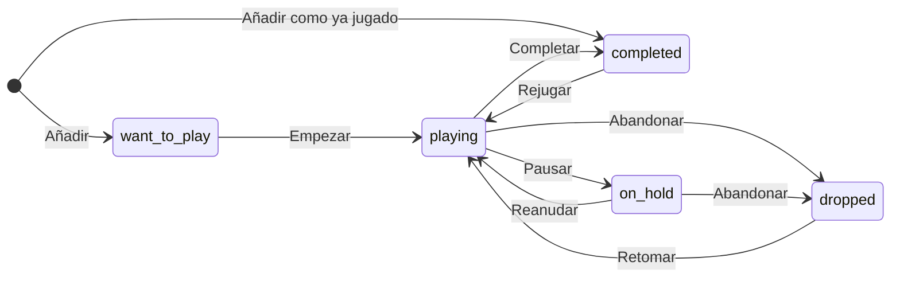
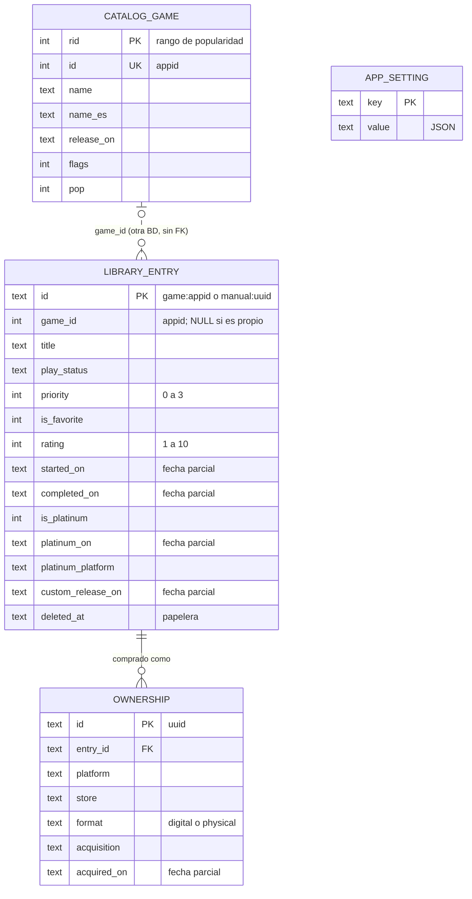

> Revisión: El borrador es técnicamente sólido y casi todas sus afirmaciones medibles se sostienen. Comprobé las versiones: SQLite 3.53.4 con FTS5 en el node:sqlite de Node 24.21, y PostgreSQL 18.6 en PGlite 0.5.12. Con el mismo catálogo sintético reproduje la búsqueda en dos pasos: 0,25-3,7 ms.

Su problema principal es el alcance. Describe un sistema de producción multi-dispositivo de unas 16 tablas, no un prototipo para una persona.

**Defectos graves (3):**
- No separa lo que entra en P0 de la fase 2, y PostgreSQL y Docker no están instalados.
- El id determinista contradice las fusiones y la vinculación de juegos manuales: el id deja de corresponder al juego, lo que duplica filas o atasca la sync.
- La cola de salida y el pull de la sync rompen las FKs al ordenar las filas (reproducido en SQLite y en PG).

**Problemas medios:**
- No se define qué `user_id` lleva el cliente sin cuenta.
- El LWW por fila puede perder un «Completado», justo la función principal.
- El CHECK de fechas parciales acepta basura como 'abcd' o '2019-02-30'.
- «Añadir como juego manual» solo aparece con cero resultados, así que los exclusivos de consola quedan fuera.
- No hay copia de seguridad en un diseño local-first.
- El tráfico de CDN está infravalorado unas 10 veces: ≈ 23-28 GB/semana, no 1-3, porque cada completo semanal obliga a todos a descargar de nuevo.
- Los alias no tienen fuente: «ff7» funcionaba solo con un alias metido a mano.
- El alcance del catálogo está infraespecificado.

**Menores:** fechas inventadas al marcar «Comprado», la vista «Rejugando» es incoherente, `pop` llega a 23 y no a 20, la consulta de próximos lanzamientos tiene dos fallos, la regla de stopwords descarta la palabra que se teclea, hay pequeños errores factuales y se enlazan rutas temporales.

**Versión revisada.** P0 queda en tres tablas de usuario (`library_entry`, `ownership`, `app_setting`), el catálogo local con FTS5 y el estado del job, todo en SQLite y sin instalar nada. Incluye:
- DDL validado: CHECK de fechas reales e id `game:<appid>` impuesto por CHECK;
- SQL validado para las acciones de un toque, la vinculación de un juego propio, la purga, las listas y la búsqueda;
- la normalización probada;
- la búsqueda en memoria para el primer arranque (medida: hasta ~12 ms y +5,9 MiB de heap);
- exportar e importar JSON como copia de seguridad.

La fase 2 queda como cambios aditivos con las correcciones de sync (LWW por campo, FKs diferidas, cliente sin `user_id`), fuentes, deltas y etiquetas.

Al validar apareció otra trampa, que queda documentada: node:sqlite enlaza los números como REAL, así que `'game:' || ?` produce 'game:1245620.0'. El CHECK lo rechaza.

Los scripts y registros de validación están en C:\Users\lucas\AppData\Local\Temp\claude\C--Users-lucas-Documents-Programacion-GameAgenda\56497ade-bd80-409d-8199-9f2b9ba10c3e\scratchpad\t2review (p0_user.sql, p0_catalog.sql, p0_job.sql, p0_validate.js, p0_extra.js, p0_search_final.js, bench_search_compare.js, pg_check.mjs, normalize_final.mjs y sus .log). No he tocado la carpeta del proyecto.

> Problemas detectados (19):
> - [high] Alcance sobredimensionado para un prototipo de una persona. Hay unas 16 tablas: sync con HLC, server_seq, cola de salida, push/pull, 410 y purga; un esquema PostgreSQL; cuentas con 5 proveedores y dispositivos; un catálogo multifuente con fusiones; deltas diarios, manifiesto y variante rich; etiquetas, listas y listas inteligentes; línea de tiempo; y un diseño RGPD de cuentas. Todo sin distinguir qué entra en P0, aunque la pregunta abierta n.º 1 (¿sync desde el día 1?) está sin resolver y PostgreSQL y Docker no están instalados. Esto retrasa semanas validar el bucle principal: buscar, añadir con 1 toque y cambiar estados. → Separar P0 de la fase 2. P0 son 3 tablas de usuario (`library_entry`, `ownership`, `app_setting`), un catálogo local de solo lectura y el estado del job, todo en SQLite: `node:sqlite` viene con Node 24 y trae FTS5 (comprobado: 3.53.4). El resto pasa a la §9 como cambios aditivos (tablas nuevas o ADD COLUMN). Ya en P0 se conservan las decisiones baratas que evitan migraciones: ids deterministas, `updated_at`, `deleted_at`, fechas parciales y una entrada por juego.
> - [high] El id determinista contradice las fusiones y la vinculación. El id de la entrada es UUIDv5('game:'+game_id), pero los redirect del catálogo reescriben `game_id` en segundo plano, y vincular un juego manual rellena `game_id` en una fila con UUIDv7. Desde ese momento el id ya no sale del juego. Si otro dispositivo añade el juego destino, calcula otro id: o se duplica la fila, o `ux_entry_game` la rechaza y la sync se atasca. Si el usuario tenía ya los dos juegos, el UPDATE del redirect viola el índice único. Además, esa escritura automática lleva un HLC nuevo y puede pisar ediciones del usuario con LWW por fila. «Se fusionan» no está especificado. → En P0 hay una sola fuente (el appid, que es estable), así que no hay fusiones ni redirects. El id es `game:<game_id>` o `manual:<uuid>` y lo impone un CHECK. Vincular o fusionar es un procedimiento explícito en una transacción: crear o completar el destino, mover las posesiones y borrar el origen (SQL validado en la §5.1). En la fase 2, las redirecciones del catálogo se resuelven al leer y nunca reescriben filas del usuario.
> - [high] Error en el orden padre/hijo de la sync. La cola de salida usa `INSERT OR REPLACE`, que manda al final un padre editado después de crear su hijo. El pull envía las filas por su último `server_seq`, así que un hijo puede llegar antes que su padre. Las FKs son inmediatas (no son DEFERRABLE en el DDL de PG) y el cliente activa `PRAGMA foreign_keys = ON`. Resultado: push y pull fallan con «FOREIGN KEY constraint failed» y el lote se reintenta sin fin. Reproducido: añadir sin red → «Comprado» → editar la nota deja el orden ownership → library_entry. → En la fase 2, la cola conserva la primera posición de cada fila (`INSERT … ON CONFLICT DO NOTHING`) y sube los padres antes que los hijos. En PG, las FKs son `DEFERRABLE INITIALLY DEFERRED` y cada lote va en una transacción. El cliente aplica el pull completo en una transacción con `PRAGMA defer_foreign_keys = ON`. Validado en SQLite 3.53.4 y en PG 18.6 (PGlite).
> - [medium] La regla «el mismo DDL de usuario en cliente y servidor» obliga a meter `user_id` en la PK de todas las tablas del cliente. Pero en el modo local o anónimo no hay usuario, y no se dice qué valor lleva. Pasar a una cuenta obligaría a reescribir todas las PK y FK locales, aunque el texto dice que las filas «se fusionan solas». → La BD del cliente no tiene `user_id`: hay una `agenda.db` por cuenta o perfil. El servidor añade `user_id` desde la sesión y su PK es `(user_id, id)`. Pasar de local a cuenta consiste en subir las filas tal cual.
> - [medium] La «limitación aceptada» del LWW por fila afecta justo a la función principal. Un «Completado» marcado sin red en el móvil se pierde si después el PC edita una nota del mismo juego; el propio borrador lo reproduce. Que el evento sobreviva en el historial no arregla el estado que ve el usuario. → Si hay sync (fase 2), empezar directamente con LWW por campo: una columna `field_hlc` (JSON campo → HLC) y la fusión en código. Según el propio borrador, cuesta unas 30 líneas y ninguna tabla nueva.
> - [medium] El CHECK de fechas parciales con `LIKE '____'` solo comprueba la forma. Acepta 'abcd', '2019-13', '2019-00', '2019-13-45', '2019-02-30' y '2019-02-29' (comprobado), aunque el texto dice que «las CHECK rechazan fechas mal formadas». La traducción «mecánica» a PG arrastra el mismo fallo. → Usar `length(x) IN (4,7,10) AND date(substr(x || '-01-01', 1, 10)) IS substr(x || '-01-01', 1, 10)`. Valida año, mes y día reales y deja pasar NULL. Va con `IS` y no con `=`, porque `date()` devuelve NULL con una fecha inválida y un CHECK que da NULL pasa. Validado con 14 casos. En PG: una regex de forma más validación en la app.
> - [medium] «Añadir como juego manual» solo se ofrece cuando no hay resultados. Con un catálogo solo de Steam, los exclusivos de PlayStation o Switch (el usuario habla de «platinado») casi siempre devuelven juegos parecidos, nunca cero resultados. La función principal falla justo con esos juegos. → La última fila de resultados es siempre «Añadir “texto” como juego propio», con 1 toque. Funciona aunque el catálogo aún no esté descargado.
> - [medium] El diseño es local-first, con cuenta opcional, pero no prevé ninguna copia de seguridad. En web/PWA el navegador puede desalojar el almacenamiento, o el usuario borrar los datos del sitio, y se pierde la agenda entera. Sin sync, tampoco hay forma de pasar los datos a otro dispositivo. → Desde P0, exportar e importar JSON portable con appids. La importación es un UPSERT por id en el que gana el `updated_at` más reciente; los ids deterministas la hacen idempotente. En web, pedir `navigator.storage.persist()` y recordar de vez en cuando que se exporte. Esto cubre además el derecho de portabilidad.
> - [medium] Con «completo semanal + delta acumulado desde el completo», cada completo nuevo deja a todos los clientes por debajo de `full.version`. Todos vuelven a descargar 2-2,5 MB y a reconstruir la BD, lo que en un móvil lleva 5-10 s. La estimación de CDN («≈ 1-3 GB/semana con 10.000 usuarios») no lo cuenta: con los tamaños del propio borrador salen ≈ 23-28 GB/semana. Además, los juegos nuevos que llegan en un delta reciben `rid = max + 1` y quedan los últimos del ranking hasta el siguiente completo. → P0 no tiene deltas: hay un único snapshot completo, que el cliente descarga cuando cambia la versión (con un usuario, el tráfico es irrelevante). Tampoco hacen falta triggers de FTS5 ni `catalog_build`. En la fase 2, si hay muchos usuarios, se publica también un delta «completo anterior → completo nuevo» y se corrige la cifra (§9.5).
> - [medium] No se define de dónde salen los alias, y Steam no publica abreviaturas. «ff7 → FF VII Remake» y «gta 5 → GTA V» aparecen como búsquedas que funcionan, pero en la prueba solo funcionaron porque se insertaron a mano los alias 'FF7 Remake' y 'GTA V'; la tabla de ejemplos muestra para FF VII solo `7`. El ejemplo de GTA está desfasado: el appid 271590 se llama ahora «Grand Theft Auto V Legacy» y la edición Enhanced es otra app. Además, `romanToInt` no está definida, y la versión probada convierte la 'i' en 1, al contrario de lo que dice su comentario. → Un `aliases.json` curado a mano en el repo, con las abreviaturas más buscadas, que el job fusiona en el mapa `alias` del snapshot. Los nombres en español vienen de Steam [S1]. Indicar de qué depende cada búsqueda de ejemplo y actualizar los ejemplos con nombres reales. Incluir `romanToInt` validada: de 'ii' a 'xxxix', más 'v' y 'x'; la 'i' suelta no se convierte.
> - [medium] El alcance del catálogo está infraespecificado:
- «DLC notables» no tiene umbral;
- `is_adult` no dice qué descriptores de Steam lo activan;
- no se define qué pasa con las apps que desaparecen de GetAppList;
- el job guarda su estado en el DDL A de PostgreSQL, que no está instalado.
Así no se puede implementar la ingesta. → En P0:
- solo apps de tipo juego, incluidas las de «próximamente», acceso anticipado y gratuitas; los DLC quedan fuera y se pueden apuntar como juego propio;
- adultos = descriptores 3 y 4 [S1], incluidos con el bit 8 y ocultos por defecto;
- los retirados llevan el bit 16 y nunca se borran;
- el estado del job va en `catalog-source.db` (SQLite), tabla `steam_app` con `first_seen_at`, `last_seen_at` y `steam_last_modified`.
> - [low] «Nunca se inventan fechas» choca con «Comprado con un toque y la fecha de hoy»: al montar la agenda se marcan sobre todo compras antiguas, así que esa fecha casi siempre es falsa. Lo mismo pasa al añadir un juego directamente como «Jugando». → `acquired_on` = NULL por defecto, y `started_on` = NULL al añadir como «Jugando». «Hoy» solo se usa cuando el gesto y el hecho coinciden: empezar, completar o platinar en ese momento.
> - [low] La vista «Rejugando» (`playing` con `completed_on` no nulo) es incoherente con «Ya lo jugué», que guarda `completed_on` = NULL: esas rejugadas no aparecen. Además, `completed_on` se sobrescribe en cada compleción sin decirlo. → Sacar «Rejugando» de P0 y llevarla a la fase 2 con `activity_event`. Documentar que `completed_on` guarda la última compleción.
> - [low] Hay tres formas de decir «qué juego toca ahora»: prioridad 0-3, la lista de sistema «A continuación» y las listas manuales. Además, la etiqueta («Platinado» o «100 % logros») depende de `platinum_platform`: eso exige el ajuste `default_trophy_platform` y sale mal con el valor por defecto 'pc' para un juego platinado en PS5. Sobran también `quick_add_status` y `default_currency`. → En P0, prioridad (que ordena «Quiero jugar») y favorito; listas y etiquetas pasan a la fase 2. Una sola etiqueta, «Platinado», el término del usuario, con una ayuda que aclara «platino o 100 % de logros». La tienda de «Comprado» se deduce de la plataforma. Se eliminan los ajustes sobrantes.
> - [low] El snapshot y `catalog_game` dicen que `pop` va de 0 a 20. Pero GetItems devuelve hoy 9.953.549 reseñas para Counter-Strike 2 (`floor(log2(n+1))` = 23) y unos 2,8 M para Dota 2 y PUBG (21). → Documentar el rango 0..31 del CHECK y que el máximo actual es 23. El dato sale de `reviews.summary_filtered.review_count` [S1].
> - [low] La consulta «mis próximos lanzamientos» tiene dos fallos:
- `custom_release_on >= :today` excluye en octubre de 2026 un juego anotado como '2026' o '2026-10', porque el texto es más corto que la fecha de hoy;
- `ORDER BY release_on IS NULL, release_on` usa un alias dentro de una expresión. SQLite lo resuelve como la columna `g.release_on` y no como el COALESCE, así que ordena mal las fechas propias (reproducido). PostgreSQL ni siquiera admite alias dentro de expresiones. → Comparar con `substr(:today, 1, length(custom_release_on))`, repetir la expresión en el ORDER BY y dar prioridad a la fecha propia con `COALESCE(e.custom_release_on, g.release_on)`. Validado.
> - [low] `ftsQuery` descarta las stopwords aunque sean la palabra que se está tecleando: «half life a» busca solo «half life» y «the last of» busca solo «last». → No descartar nunca la última palabra y, si todas son stopwords, usarlas todas. Validado con 7 entradas.
> - [low] Pequeños errores factuales:
- «gzip nativo en Rust y Swift» no es exacto: Rust necesita el crate `flate2`, y Compression/NSData de Apple trabajan con deflate o zlib, no con el contenedor gzip;
- «1,92 MB» y «19,6 MB» son MiB (2.014.259 bytes = 2,01 MB) y se mezclan con estimaciones en MB. → Para descomprimir: en web, `DecompressionStream('gzip')`; en Rust, `flate2`; o servir el fichero con `Content-Encoding: gzip` y dejar que descomprima la capa HTTP. Indicar las unidades (MiB o MB) de forma explícita.
> - [low] Higiene del entregable: el plan enlaza como «artefactos» rutas temporales del scratchpad, que van a desaparecer. Usa referencias internas que el lector no tiene: «T2», «el brief», «track», «desviación consciente de todo UUIDv7». Y el resumen presenta como «medido» lo que se midió con datos sintéticos. → Quitar las rutas: los scripts se versionarán en el repo (por ejemplo, `tools/schema-check/`) cuando exista. Usar «línea de trabajo», definir cada término en su primer uso y marcar como sintética cada cifra medida con datos sintéticos.

> Números corregidos: Re-medido o corregido el 2026-10-28 en esta máquina, con otros procesos en paralelo: Node 24.21, SQLite 3.53.4 y el catálogo sintético de 150k filas del borrador.

**Correcciones:**
- **`pop`:** el máximo real es 23, no 20. Reseñas según GetItems (`reviews.summary_filtered.review_count`):

  | Juego | Reseñas | `pop` |
  |---|---|---|
  | CS2 | 9.953.549 | 23 |
  | Dota 2 | 2.806.349 | 21 |
  | PUBG | 2.748.219 | 21 |
  | GTA V Legacy | 1.899.219 | 20 |
  | Apex | 1.075.624 | 20 |

- **CDN con 10.000 usuarios activos por semana**, con el diseño del borrador: ≈ 23-28 GB/semana, no 1-3 GB. Es el completo semanal de 2-2,5 MB que descarga cada cliente, más ≈ 0,3 MB de deltas acumulados.
- **Unidades:** el snapshot lite mide 2.014.259 bytes, es decir, 1,92 MiB = 2,01 MB.

**Re-medido:**
- BD de catálogo con el DDL de P0 (sin triggers ni columna `header`): 19,4 MiB; el borrador daba 19,6.
- Construcción del catálogo:
  - gunzip + JSON.parse: 58 ms;
  - normalizar + variantes + ordenar: 1,20-1,24 s;
  - insertar + FTS5: 1,11-1,12 s;
  - total: ≈ 2,4 s.
- Búsqueda en dos pasos con la consulta de P0, 3 rondas:

  | Entrada | Tiempo |
  |---|---|
  | «d» | 2,8-3,7 ms |
  | «the» | 1,2-1,6 ms |
  | «simulator» | 0,6-0,7 ms |
  | «dark» | 0,45-0,56 ms |
  | «dark so» | 0,66-0,82 ms |
  | «kari» | 0,25-0,31 ms |
  | sin coincidencias | 0,25 ms |

  Coincide con el borrador. Una primera pasada con la máquina cargada llegó a 7 ms con «the».
- Número de coincidencias: d 27.052, the 40.410, simulator 13.847, dark 8.147, dark so 83, kari 125.
- Búsqueda en memoria (no estaba en el borrador): 0,04-0,27 ms con prefijos comunes y 6,6-11,6 ms en el peor caso, que recorre las 150k filas. Ocupa +5,9 MiB de heap.
- BD de usuario de P0, sin eventos ni etiquetas:

  | Entradas | Tamaño | Borrador (esquema completo) |
  |---|---|---|
  | 300 | 0,17 MiB | 0,96 MB |
  | 3.000 | 1,24 MiB | 8,3 MB |
  | 20.000 | 8,05 MiB | 54,7 MB |

**Confirmado sin cambios:** SQLite 3.53.4 con FTS5 en node:sqlite, y PostgreSQL 18.6 en PGlite 0.5.12.

---

# Modelo de dominio, estados y esquema de datos

> **Estado:** versión revisada (2026-10-28) del apartado, para integrar en `prototipe.md`.
> **Alcance:** prototipo (P0) que construye una sola persona en Windows 11 Pro con Node 24 y Rust, sin Docker ni PostgreSQL. Lo que no hace falta para validar la función principal está en la §9 (fase 2): queda diseñado, pero no se implementa en P0.
> **Validación:** el DDL de P0 (§4) y las operaciones y consultas de la §5 se han ejecutado en SQLite 3.53.4 (`node:sqlite` de Node 24.21, que trae FTS5). Los tiempos y tamaños del catálogo se han medido en un ordenador con un catálogo **sintético** de 150.000 juegos; hay que repetirlos con el primer volcado real (§8.3).
> **Dependencias:** lo que depende de las líneas de trabajo paralelas (API de Steam, aspectos legales, stack y librerías) figura como supuesto **[S1]–[S6]** (§10). El modelo no presupone ningún stack de cliente.
> **Convención:** los identificadores técnicos (tablas, columnas, valores de enumeración) van en inglés y las etiquetas de la interfaz, en español. «MiB» equivale a 2²⁰ bytes y «MB», a 10⁶ bytes.

## 0. Resumen

- **Función principal: apuntar un juego en menos de 3 s.** Se busca en el catálogo local, sin red, y un toque (o Intro) lo deja en «Quiero jugar». La última fila de resultados siempre permite añadirlo como juego propio, aunque no esté en Steam.
- **Hay una entrada por juego**, no una por plataforma (`library_entry`).
- **Tres dimensiones independientes y unas marcas personales:**
  - progreso: un estado exclusivo de 5 valores (`play_status`);
  - «Comprado»: de 0 a n filas en `ownership`;
  - «Platinado»: una marca con fecha y plataforma. Por defecto también pasa el juego a «Completado»; es un efecto configurable con «Deshacer», no una restricción de la BD;
  - marcas personales: prioridad, favorito, valoración y notas.
- **P0 es local, sin cuenta ni servidor de datos.** Tiene tres tablas de usuario en SQLite y un catálogo local de solo lectura. La copia de seguridad y el paso a otro dispositivo se hacen exportando e importando JSON.
- **Catálogo de Steam:**
  - una tarea programada (*job*) con la clave de la Web API, que nunca llega al cliente, publica un snapshot estático en JSON columnar con gzip (2,0-2,5 MB estimados para ~150k juegos);
  - el cliente lo convierte en una BD SQLite con FTS5 de unos 20 MiB;
  - la búsqueda mientras se teclea tarda 0,25-3,7 ms (catálogo sintético, en un ordenador).
- **Está preparado para la fase 2 sin reescribir datos.** Los ids son estables y deterministas (`game:<appid>`), y todas las filas tienen `updated_at` y `deleted_at`. La sincronización, las cuentas, las etiquetas, las listas, el historial y otras fuentes de catálogo llegan después como tablas o columnas nuevas (§9).

## 1. Requisitos y decisiones

| Requisito | Decisión del modelo | Dónde |
|---|---|---|
| Apuntar muy rápido los juegos que quiero jugar | Alta con 1 toque; estado por defecto `want_to_play`; id determinista (repetir el toque no duplica); juego propio siempre disponible, también sin catálogo | §2.8, §3.3, §5.3 |
| Completado, platinado, comprado, etc. | Progreso con 5 estados + `is_platinum` + `ownership`, independientes entre sí | §2 |
| Rápida y ágil | Todo es local (SQLite + FTS5); ninguna acción espera a la red; «Deshacer» en lugar de diálogos de confirmación | §2.4, §5 |
| Todos los juegos de Steam para empezar | Snapshot con todas las apps de tipo juego, incluidas las de «próximamente» y las de acceso anticipado | §6, §7 |
| Prototipo profesional para una persona | 3 tablas de usuario y ningún servidor de datos; job en Node con `node:sqlite` (no hay que instalar nada) | §3, §4, §7 |

## 2. Taxonomía de estados

### 2.1 Dimensiones

| Dimensión | Cardinalidad | Dónde | Contenido |
|---|---|---|---|
| Progreso | exactamente 1 | `library_entry.play_status` | `want_to_play`, `playing`, `on_hold`, `completed`, `dropped` |
| Posesión («Comprado») | 0..n | tabla `ownership` | plataforma, tienda, formato, tipo de adquisición y fecha opcional |
| «Platinado» | 0..1 | `is_platinum`, `platinum_on`, `platinum_platform` | sí/no, con fecha y plataforma |
| Marcas personales | independientes | `library_entry` | prioridad 0-3, favorito, valoración 1-10, notas |

### 2.2 Progreso (`play_status`)

| Identificador | Etiqueta | Significado | Acción principal (1 toque) |
|---|---|---|---|
| `want_to_play` | Quiero jugar | Apuntado; es el valor por defecto al añadir | Empezar |
| `playing` | Jugando | En curso | Completar |
| `on_hold` | En pausa | Empezado y aparcado con intención de volver | Reanudar |
| `completed` | Completado | Terminado: la historia principal o lo que el usuario considere | Rejugar (en el menú) |
| `dropped` | Abandonado | Dejado sin intención de volver | Retomar |

Las **vistas** son filtros, no estados:

| Vista | Filtro |
|---|---|
| Quiero jugar | `want_to_play` |
| Pila pendiente | `want_to_play` y con alguna posesión viva |
| Lista de deseos | `want_to_play` y sin posesión |
| Próximos lanzamientos | `want_to_play` y, además, el juego está en «próximamente» en el catálogo o tiene una `custom_release_on` futura |
| Jugando, En pausa, Completados, Abandonados | por estado |
| Platinados, Favoritos, Comprados | por la marca correspondiente |

La vista «Rejugando» necesita historial y pasa a la fase 2 (§9.1).

### 2.3 Transiciones

**Todas las transiciones están permitidas**, porque el usuario manda: por ejemplo, puede apuntar como «Completado» un juego que terminó hace años. El diagrama muestra las transiciones naturales, que la interfaz ofrece con un toque. El resto se hace con el selector de estado (2 toques).



### 2.4 Efectos automáticos

| Acción (estado destino) | Cambios en `library_entry` | Notas |
|---|---|---|
| Añadir (→ `want_to_play`) | crea la fila con `id = 'game:<appid>'`, `title` y `status_changed_at` = ahora | Repetir el toque no duplica. Si el juego estaba en la papelera, se restaura tal cual y se ofrece «Empezar de cero» |
| Añadir como «Ya lo jugué» (→ `completed`) | `completed_on` = NULL (fecha desconocida) · `priority` = 0 | Chip «¿Cuándo?» opcional, que no bloquea; basta con el año |
| Añadir como «Jugando» (→ `playing`) | `started_on` = NULL | Puede haberlo empezado antes; la fecha se rellena si se quiere |
| → `playing` | `started_on` = hoy, si era NULL | Si viene de `completed`, es «Rejugar» y se conservan las fechas |
| → `on_hold` | — | |
| → `completed` | `completed_on` = hoy (guarda la última compleción) · `priority` = 0 | Sugerencia opcional «¿Valorar?» |
| → `dropped` | `priority` = 0 | |
| → `want_to_play` desde otro estado | se conservan las fechas | Caso típico: «lo quiero rejugar» |
| Platinado ON | `is_platinum` = 1, `platinum_on` = hoy, `platinum_platform` = `preferred_platform` o, si falta, el ajuste `default_platform`. Si `platinum_implies_completed` está activo y el estado no es `completed`, se aplica también «→ `completed`» | Un único «Deshacer» revierte las dos cosas |
| Platinado OFF | `is_platinum` = 0; `platinum_on` y `platinum_platform` = NULL | No revierte el estado, porque no se sabe cuál era el correcto; para eso está «Deshacer» |
| Comprado | inserta una fila `ownership` con la plataforma, la tienda deducida de ella, `default_format` y `acquired_on` = NULL | Si ya hay una posesión viva, el toque abre el detalle |
| Valorar | `rating` = n | En cualquier estado |
| Favorito, prioridad, notas | el campo correspondiente | Las notas se guardan solas |
| Eliminar | `deleted_at` = ahora; sus posesiones se ocultan con la entrada | Pasa a la papelera durante 30 días; después se borra físicamente, en cascada |
| Cualquier cambio de estado | `status_changed_at` = ahora | Ordena «Jugando» y «Completados» por actividad reciente |

Reglas comunes:
- Cada acción es una transacción local que pone `updated_at` = ahora. La interfaz se actualiza al instante y nada espera a la red.
- **Deshacer (5 s):** la app guarda en memoria la imagen anterior de las filas que toca y la vuelve a escribir. Si la acción creó la fila (añadir o «Comprado»), la borra físicamente, sin pasar por la papelera.
- **Nunca se inventan fechas.** «Hoy» solo se usa cuando el gesto y el hecho coinciden: empezar, completar o platinar en ese momento. Cuando el gesto suele registrar algo pasado («Comprado», «Ya lo jugué», añadir como «Jugando»), la fecha queda en NULL y se puede rellenar después.
- Las fechas de usuario (`*_on`) son **fechas locales y pueden ser parciales**: `'2019'`, `'2019-05'` o `'2019-05-03'`. Así se puede registrar «lo terminé en 2019» y no hay desfases de zona horaria a medianoche.

### 2.5 «Comprado» (`ownership`)

- Hay una fila por cada copia o acceso:

  | Campo | Contenido |
  |---|---|
  | `platform` | dónde se juega: `pc`, `ps5`, `switch2`… |
  | `store` | opcional: `steam`, `gog`, `epic`, `psn`, `eshop`, `xbox`, `retail`, `other` |
  | `format` | `digital` o `physical` |
  | `acquisition` | `purchase`, `gift`, `free`, `subscription`, `other` |
  | `acquired_on` | fecha parcial; NULL si no se sabe |

- La posesión es independiente del progreso. Un juego puede estar «Completado» sin haberse comprado (prestado, suscripción caducada) o en «Quiero jugar» y comprado (pila pendiente).
- **Un toque** crea la fila con estos valores:
  - plataforma: `preferred_platform` o, si falta, `default_platform`;
  - tienda: se deduce de la plataforma y se puede cambiar en el detalle (`pc` → `steam`, `ps5`/`ps4` → `psn`, `switch`/`switch2` → `eshop`, `xbox_*` → `xbox`; en el resto, NULL);
  - formato: `default_format`.

  Si ya existe una posesión viva, el toque abre el detalle; así no se crean copias por error.
- `subscription` cubre Game Pass y PS Plus: «lo tengo», aunque no sea una compra. La caducidad y el precio quedan fuera de P0.
- Las plataformas y las tiendas se validan en la app y no con un CHECK, porque la lista crecerá. Códigos de plataforma: `pc`, `steam_deck`, `mac`, `linux`, `ps5`, `ps4`, `ps3`, `ps_vita`, `switch2`, `switch`, `xbox_series`, `xbox_one`, `xbox_360`, `ios`, `android`, `meta_quest`, `retro`, `other`.

### 2.6 «Platinado»

**Decisión:** «Platinado» es una marca independiente del progreso, pero marcarlo **pasa el juego a «Completado» por defecto**. Es un efecto automático configurable (`platinum_implies_completed = true`) y tiene «Deshacer». La BD no lo impone: después se puede volver a «Jugando» sin perder el platino.

Justificación:
- En PlayStation, el platino exige terminar el juego en la gran mayoría de los casos, y el 100 % de logros de Steam o Xbox también. Sin el efecto harían falta dos toques y podría quedar la combinación absurda «Quiero jugar + Platinado».
- Como restricción sería falsa en casos reales:
  - rejugar un juego ya platinado;
  - seguir con un juego como servicio o con un DLC;
  - platinar en PS5 un juego terminado antes en PC;
  - juegos sin final cuyo platino depende de horas o del multijugador.
- Quitar el platino no revierte el estado; para eso está «Deshacer».
- **La interfaz usa una sola etiqueta: «Platinado»**, el término del usuario, con una ayuda que aclara «trofeo de platino o 100 % de logros». `platinum_platform` es informativa y no cambia la etiqueta.
- El doble platino PS4/PS5 se anota en las notas. Si hiciera falta registrarlo, la fase 2 añadiría una tabla `milestone`.

### 2.7 Marcas personales

| Marca | Campo | Reglas |
|---|---|---|
| Prioridad | `priority` 0-3 (ninguna, baja, media, alta) | Un toque alterna entre 0 y 3; una pulsación larga permite elegir el nivel. Ordena «Quiero jugar» y vuelve a 0 al completar o abandonar |
| Favorito | `is_favorite` | Un toque lo activa o desactiva |
| Valoración | `rating` 1-10 (en la interfaz, 5 estrellas con medias) | Se puede dar en cualquier estado |
| Notas | `notes` (texto libre) | Se guardan solas |

La prioridad responde a «qué juego toca ahora». Las etiquetas, las listas manuales y la lista de sistema «A continuación» pasan a la fase 2 (§9.4): en P0 serían tres formas distintas de expresar lo mismo.

### 2.8 Acciones de un toque y alta rápida

| Acción | Dónde | Toques | Deshacer |
|---|---|---|---|
| Añadir a «Quiero jugar» | resultado de búsqueda (o Intro sobre el primero) | 1 | aviso inferior (*snackbar*) de 5 s |
| Añadir como juego propio | última fila de los resultados, siempre visible | 1 | aviso inferior |
| Añadir con otro estado («Ya lo jugué», «Jugando») | pulsación larga o clic derecho sobre el resultado | 2 | aviso inferior |
| Siguiente paso (Empezar, Completar, Reanudar, Retomar) | botón de la tarjeta o deslizar a la derecha | 1 | aviso inferior |
| Cualquier otro estado | chip de estado | 2 | aviso inferior |
| Comprado | chip | 1 | aviso inferior (si ya hay una posesión, abre el detalle) |
| Platinado | chip | 1 | aviso inferior (revierte también el «Completado» automático) |
| Favorito / prioridad alta | corazón / bandera | 1 | volver a tocar |
| Valorar | estrellas del detalle o sugerencia al completar | 1 | volver a tocar |

Flujo de alta rápida, con un objetivo de menos de 3 s desde que se abre el buscador:
1. El botón «+» (o la tecla `/` en escritorio) abre el buscador con el foco puesto.
2. Cada pulsación busca en el catálogo local, sin red, y marca los juegos que ya están en la agenda.
3. Un toque en un resultado, o Intro sobre el primero, lo añade a «Quiero jugar» y muestra «Deshacer · Cambiar estado».
4. La última fila siempre ofrece «Añadir "texto" como juego propio», también con un toque. Es imprescindible para los exclusivos de PlayStation o Switch: una búsqueda como «astro bot» devuelve juegos de Steam parecidos, casi nunca cero resultados.

Apuntar nunca depende del catálogo: en el primer arranque, antes de que se haya descargado, el juego propio ya funciona y se puede vincular después (§3.3).

## 3. Entidades e identidad

### 3.1 Entidades de P0

| Base de datos | Tabla | Propósito |
|---|---|---|
| `agenda.db` (cliente, datos del usuario) | `library_entry` | Un juego en la agenda |
| | `ownership` | «Comprado» (0..n por juego) |
| | `app_setting` | Ajustes clave-valor |
| `catalog-<versión>.db` (cliente, solo lectura) | `catalog_game` + `catalog_fts` | Proyección del snapshot para buscar |
| | `catalog_meta` | Versión, fecha y sha256 del snapshot |
| `catalog-source.db` (solo el job) | `steam_app` | Estado de la ingesta de Steam |
| | `job_meta` | Versión publicada y última ejecución |

Quedan fuera de P0 (§9): `activity_event`, `tag`, `entry_tag`, `custom_list`, `custom_list_item`, `game_external_id`, `game_alias`, `game_tombstone`, `catalog_build`, `app_user`, `auth_identity`, `device`, `sync_outbox`, `sync_state` y `game_detail_cache`.

### 3.2 Una entrada por juego, no por plataforma

**Decisión:** hay una fila de `library_entry` por juego. Lo que depende de la plataforma va en atributos y en filas hijas.

Motivos:
- Es el modelo mental de una agenda: «quiero jugar Elden Ring», no «Elden Ring en PS5». Añadir no obliga a elegir plataforma, así que basta un toque.
- El estado, la valoración y las notas hablan del juego. Duplicarlos por plataforma ensucia las listas y la búsqueda.
- Lo que sí depende de la plataforma tiene su sitio:
  - `ownership`: 0..n filas con plataforma, tienda y formato;
  - `preferred_platform`: dónde se juega o se jugará;
  - `platinum_platform`.
- Coste asumido: no puede haber dos estados a la vez en plataformas distintas, como «completado en PS4 y jugando en PC». Si hiciera falta, la fase 2 añadiría una tabla `playthrough`.

Ejemplo «platinado en PS5, comprado en Steam y en disco», reproducido en la validación:

| Tabla | Contenido |
|---|---|
| `library_entry` | `id = 'game:1245620'`, `game_id = 1245620` (ELDEN RING), `play_status = 'completed'`, `preferred_platform = 'ps5'`, `is_platinum = 1`, `platinum_platform = 'ps5'`, `started_on = '2024-03'`, `completed_on = '2024-06-10'` |
| `ownership` | (`pc`, `steam`, `digital`) y (`ps5`, `retail`, `physical`) |

### 3.3 Identidad

- **`game_id` es el appid de Steam.** Es estable y legible, y una URL de la tienda se resuelve sin consultar nada. En P0 solo hay una fuente, así que no existen fusiones ni redirecciones de juegos. Un juego retirado de la tienda conserva su appid y su fila (§6.1).
- **`library_entry.id` es determinista.** Vale `'game:<game_id>'` para los juegos del catálogo y `'manual:<uuid>'` para los juegos propios, y un CHECK de la tabla lo impone.
  - Añadir el mismo juego dos veces, o en dos dispositivos cuyos datos se fusionan después (importación en P0, sincronización en la fase 2), da siempre la misma fila.
  - Ofrece la misma garantía que un UUIDv5, pero sin hash ni espacios de nombres, y es legible en las exportaciones y al depurar.
  - Vale también para la fase 2, donde `game_id` será el id canónico del catálogo, venga de la fuente que venga (§9.3).
- **Ojo con `node:sqlite`:** enlaza los números de JavaScript como REAL, así que `'game:' || ?` produce `'game:1245620.0'`. El CHECK lo rechaza (comprobado). El id se construye en código (`` `game:${appid}` ``) o con `CAST(:g AS INTEGER)` en SQL.
- **`ownership.id`** es un UUID aleatorio: `crypto.randomUUID()` en navegadores y en Node, o el crate `uuid` en Rust. En P0 no hace falta que sea ordenable.
- **Juego propio («manual»).** Es un dato privado del usuario, no una fila del catálogo: una `library_entry` con `game_id` NULL, su propio `title` y, si se quiere, `preferred_platform` y `custom_release_on`.
- **Vincular un juego propio con el catálogo**, cuando aparezca en Steam o si se añadió a mano por error, se hace en una sola transacción (SQL en la §5.1):
  1. si el destino `'game:<appid>'` está en la papelera, se borra;
  2. si el destino no existe, se crea copiando el juego propio. Si existe y está vivo, conserva sus valores y solo se rellenan sus huecos: para la prioridad, el favorito y el platino se toma el máximo, y las notas se concatenan;
  3. las posesiones pasan al destino;
  4. se borra el juego propio.
- **`title` se rellena siempre al añadir** con el nombre visible en ese momento. Así la lista se pinta aunque el catálogo local aún no exista (primer arranque), y los juegos propios no necesitan otra tabla. Al mostrar un juego, el nombre se elige en este orden:
  1. `name_es`, si `prefer_localized_titles` está activo y el nombre existe;
  2. `name`, del catálogo;
  3. `title`.

### 3.4 Diagrama ER de P0



### 3.5 Ajustes (`app_setting`)

| `key` | Por defecto | Uso |
|---|---|---|
| `default_platform` | `"pc"` | Plataforma de «Comprado» con un toque y del platino cuando la entrada no tiene `preferred_platform` |
| `default_format` | `"digital"` | «Comprado» con un toque |
| `platinum_implies_completed` | `true` | Efecto de «Platinado» |
| `prefer_localized_titles` | `true` | Mostrar «Los Sims 4» en lugar de «The Sims 4» cuando exista el nombre en español [S1] |
| `show_adult` | `false` | Mostrar en el buscador el contenido sexual explícito |

El estado interno (el ETag del manifiesto y la fecha de la última comprobación del catálogo) se guarda en la misma tabla, con claves `sys.*`.

## 4. Esquema SQL de P0

### 4.1 Convenciones

- **Todo es SQLite**, tanto el cliente (nativo, o SQLite WASM + OPFS en web [S4]) como el job (`node:sqlite`, incluido en Node 24 y con FTS5). No hay que instalar PostgreSQL ni Docker.
- **Al abrir cada conexión**, `PRAGMA foreign_keys = ON`. La versión del esquema se guarda en `PRAGMA user_version` y las migraciones van numeradas.
- **Instantes de sistema (`*_at`):** TEXT ISO-8601 en UTC con milisegundos, por ejemplo `2026-10-28T09:15:00.000Z`.
- **Fechas de usuario (`*_on`):** TEXT parcial, con un CHECK que valida que el año, el mes y el día existen. El CHECK usa `IS` y no `=` porque `date()` devuelve NULL con una fecha inválida, y un CHECK que da NULL se considera cumplido.
- **Booleanos:** INTEGER 0/1 con CHECK. **JSON:** TEXT con `json_valid`.
- **Enumeraciones:** las estables (estado, formato, tipo de adquisición) llevan CHECK. Las que crecerán (plataformas, tiendas) se validan en la app, porque en SQLite cambiar un CHECK obliga a reconstruir la tabla.

### 4.2 DDL: datos del usuario (`agenda.db`)

```sql
-- Datos del usuario (P0): una BD SQLite local por perfil; sin user_id ni columnas de sincronización.
-- Al abrir cada conexión: PRAGMA foreign_keys = ON;
PRAGMA user_version = 1;                             -- versión del esquema (migraciones numeradas)

CREATE TABLE library_entry (                         -- un juego en la agenda: una fila por juego, no por plataforma
  id                 TEXT    PRIMARY KEY,            -- 'game:<game_id>' (catálogo) | 'manual:<uuid>' (juego propio, fuera del catálogo)
  game_id            INTEGER,                        -- appid de Steam en P0; NULL = juego propio
  title              TEXT    NOT NULL,               -- nombre en el momento de añadir; único título si es propio
  play_status        TEXT    NOT NULL DEFAULT 'want_to_play'
                     CHECK (play_status IN ('want_to_play','playing','on_hold','completed','dropped')),
  status_changed_at  TEXT    NOT NULL,               -- instante UTC (ISO-8601 con ms) del último cambio de estado
  priority           INTEGER NOT NULL DEFAULT 0 CHECK (priority BETWEEN 0 AND 3),   -- 0 ninguna · 1 baja · 2 media · 3 alta
  is_favorite        INTEGER NOT NULL DEFAULT 0 CHECK (is_favorite IN (0, 1)),
  rating             INTEGER CHECK (rating BETWEEN 1 AND 10),                      -- NULL = sin valorar
  notes              TEXT,
  preferred_platform TEXT,                           -- dónde lo juego o lo jugaré ('pc', 'ps5'…); lista validada en la app
  started_on         TEXT CHECK (length(started_on) IN (4, 7, 10)
                       AND date(substr(started_on || '-01-01', 1, 10)) IS substr(started_on || '-01-01', 1, 10)),
  completed_on       TEXT CHECK (length(completed_on) IN (4, 7, 10)
                       AND date(substr(completed_on || '-01-01', 1, 10)) IS substr(completed_on || '-01-01', 1, 10)),
  is_platinum        INTEGER NOT NULL DEFAULT 0 CHECK (is_platinum IN (0, 1)),      -- «Platinado» (platino o 100 % de logros)
  platinum_on        TEXT CHECK (length(platinum_on) IN (4, 7, 10)
                       AND date(substr(platinum_on || '-01-01', 1, 10)) IS substr(platinum_on || '-01-01', 1, 10)),
  platinum_platform  TEXT,
  custom_release_on  TEXT CHECK (length(custom_release_on) IN (4, 7, 10)
                       AND date(substr(custom_release_on || '-01-01', 1, 10)) IS substr(custom_release_on || '-01-01', 1, 10)),
  created_at         TEXT    NOT NULL,
  updated_at         TEXT    NOT NULL,
  deleted_at         TEXT,                           -- papelera (borrado lógico); se purga a los 30 días
  CHECK ((game_id IS NOT NULL AND id = 'game:' || game_id) OR (game_id IS NULL AND id GLOB 'manual:?*')),
  CHECK (is_platinum = 1 OR (platinum_on IS NULL AND platinum_platform IS NULL))
);
CREATE INDEX ix_entry_status_priority ON library_entry (play_status, priority DESC, created_at DESC)
  WHERE deleted_at IS NULL;                          -- «Quiero jugar»: prioridad y después lo último apuntado
CREATE INDEX ix_entry_status_recent   ON library_entry (play_status, status_changed_at DESC)
  WHERE deleted_at IS NULL;                          -- «Jugando», «Completados»: actividad reciente

CREATE TABLE ownership (                             -- «Comprado / lo tengo»: 0..n filas por juego
  id          TEXT    PRIMARY KEY,                   -- UUID aleatorio (crypto.randomUUID() o equivalente)
  entry_id    TEXT    NOT NULL REFERENCES library_entry (id) ON DELETE CASCADE,
  platform    TEXT    NOT NULL,                      -- 'pc', 'ps5', 'switch2'…
  store       TEXT,                                  -- 'steam', 'psn', 'eshop', 'gog', 'epic', 'xbox', 'retail', 'other'
  format      TEXT    NOT NULL DEFAULT 'digital'  CHECK (format IN ('digital', 'physical')),
  acquisition TEXT    NOT NULL DEFAULT 'purchase' CHECK (acquisition IN ('purchase', 'gift', 'free', 'subscription', 'other')),
  acquired_on TEXT CHECK (length(acquired_on) IN (4, 7, 10)
                AND date(substr(acquired_on || '-01-01', 1, 10)) IS substr(acquired_on || '-01-01', 1, 10)),  -- NULL = desconocida
  created_at  TEXT    NOT NULL,
  updated_at  TEXT    NOT NULL,
  deleted_at  TEXT
);
CREATE INDEX ix_ownership_entry ON ownership (entry_id);   -- completo (no parcial): también lo usa el ON DELETE CASCADE

CREATE TABLE app_setting (                           -- ajustes clave-valor
  key        TEXT PRIMARY KEY,
  value      TEXT NOT NULL CHECK (json_valid(value)),
  updated_at TEXT NOT NULL
);
```

### 4.3 DDL: catálogo local (`catalog-<versión>.db`, montado con `ATTACH … AS cat`)

```sql
-- Catálogo local (P0): fichero aparte catalog-<versión>.db, de solo lectura, montado con ATTACH ... AS cat.
-- Se reconstruye entero con cada snapshot (no hay deltas en P0), así que no necesita triggers.
CREATE TABLE catalog_game (
  rid               INTEGER PRIMARY KEY,             -- rango de popularidad (1 = más popular) = rowid de FTS5
  id                INTEGER NOT NULL UNIQUE,         -- game_id (= appid de Steam en P0)
  name              TEXT    NOT NULL,                -- nombre de Steam sin ™ ® ©
  name_es           TEXT,                            -- nombre localizado en español, si existe y difiere [S1]
  name_norm         TEXT    NOT NULL,                -- normalize(name), calculado en el cliente
  alt_norm          TEXT,                            -- tokens extra: romanos→arábigos, compuestos, alias, nombre ES
  release_on        TEXT,                            -- 'YYYY-MM-DD' = inicio del periodo; NULL = sin fecha
  release_precision INTEGER NOT NULL DEFAULT 0 CHECK (release_precision BETWEEN 0 AND 4),  -- 0 desconocida · 1 año · 2 trimestre · 3 mes · 4 día
  flags             INTEGER NOT NULL DEFAULT 0,      -- bits: 1 próximamente · 2 acceso anticipado · 4 gratis · 8 adultos · 16 retirado
  pop               INTEGER NOT NULL DEFAULT 0 CHECK (pop BETWEEN 0 AND 31)   -- floor(log2(reseñas + 1)); hoy llega a 23
);
CREATE INDEX ix_catalog_name_norm ON catalog_game (name_norm);                         -- título exacto (paso 2 de la búsqueda)
CREATE INDEX ix_catalog_upcoming  ON catalog_game (release_on) WHERE (flags & 1) = 1;  -- «Próximos lanzamientos» de Steam

CREATE VIRTUAL TABLE catalog_fts USING fts5 (
  name_norm, alt_norm,
  content = 'catalog_game', content_rowid = 'rid',   -- contenido externo: no duplica el texto
  tokenize = 'unicode61 remove_diacritics 2'
);

CREATE TABLE catalog_meta (                          -- 'version', 'built_at', 'sha256', 'rows'
  key   TEXT PRIMARY KEY,
  value TEXT NOT NULL
);
-- Carga, en una sola transacción: INSERT de todas las filas ordenadas por (pop DESC, id), con rid = 1, 2, 3…
-- y al final: INSERT INTO catalog_fts (catalog_fts) VALUES ('rebuild');
```

**¿Por qué `rid` es el rango de popularidad?** FTS5 puede devolver las coincidencias en orden de rowid sin ordenarlas (el plan lo confirma: `INDEX 64`). Si el rowid 1 es el juego más popular, `ORDER BY rowid LIMIT 200` se detiene pronto y obtiene las 200 coincidencias más populares sin ordenar miles de filas. Por ejemplo, con «the» (40.410 coincidencias en el catálogo sintético) la búsqueda tarda 1,2-1,6 ms, frente a los ~27 ms que midió el borrador ordenando todas.

Que el catálogo sea un fichero aparte tiene tres ventajas:
- se reconstruye entero con cada snapshot;
- se cambia de forma atómica;
- nunca toca los datos del usuario.

### 4.4 DDL: estado del job (`catalog-source.db`)

```sql
-- Estado del job de ingesta (P0): SQLite (node:sqlite de Node 24, sin instalar nada). Solo lo usa el job.
CREATE TABLE steam_app (
  appid               INTEGER PRIMARY KEY,
  name                TEXT    NOT NULL,
  name_es             TEXT,                          -- [S1]
  release_on          TEXT,                          -- 'YYYY-MM-DD' = inicio del periodo
  release_precision   INTEGER NOT NULL DEFAULT 0,    -- misma codificación que catalog_game
  is_coming_soon      INTEGER NOT NULL DEFAULT 0,
  is_early_access     INTEGER NOT NULL DEFAULT 0,
  is_free             INTEGER NOT NULL DEFAULT 0,
  is_adult            INTEGER NOT NULL DEFAULT 0,    -- [S1]: descriptores de contenido sexual
  is_listed           INTEGER NOT NULL DEFAULT 1,    -- 0 = ya no sale en GetAppList; nunca se borra
  review_count        INTEGER,                       -- GetItems: reviews.summary_filtered.review_count
  steam_last_modified INTEGER,                       -- marca de cambio de GetAppList, para enriquecer solo lo cambiado [S1]
  first_seen_at       TEXT    NOT NULL,
  last_seen_at        TEXT    NOT NULL,
  enriched_at         TEXT                           -- última vez enriquecido con GetItems
);
CREATE TABLE job_meta (                              -- 'catalog_version', 'last_run_at'
  key   TEXT PRIMARY KEY,
  value TEXT NOT NULL
);
```

## 5. Operaciones y consultas (validadas)

### 5.1 Acciones de un toque

```sql
-- Añadir desde el catálogo: idempotente; si estaba en la papelera, la restaura
INSERT INTO library_entry (id, game_id, title, status_changed_at, created_at, updated_at)
VALUES ('game:' || CAST(:g AS INTEGER), :g, :title, :now, :now, :now)
ON CONFLICT (id) DO UPDATE SET deleted_at = NULL, updated_at = :now
  WHERE library_entry.deleted_at IS NOT NULL;       -- si ya estaba viva, no cambia nada (changes() = 0)

-- Cambio de estado con sus efectos (a la derecha del SET se leen los valores anteriores)
UPDATE library_entry SET
  play_status       = :to,
  status_changed_at = CASE WHEN play_status <> :to THEN :now ELSE status_changed_at END,
  started_on        = CASE WHEN :to = 'playing'   THEN COALESCE(started_on, :today) ELSE started_on END,
  completed_on      = CASE WHEN :to = 'completed' THEN :today ELSE completed_on END,
  priority          = CASE WHEN :to IN ('completed', 'dropped') THEN 0 ELSE priority END,
  updated_at        = :now
WHERE id = :id AND deleted_at IS NULL;

-- Platinado ON (:imp = ajuste platinum_implies_completed; :dp = ajuste default_platform)
UPDATE library_entry SET
  is_platinum = 1, platinum_on = :today, platinum_platform = COALESCE(preferred_platform, :dp),
  play_status       = CASE WHEN :imp = 1 THEN 'completed' ELSE play_status END,
  completed_on      = CASE WHEN :imp = 1 AND play_status <> 'completed' THEN :today ELSE completed_on END,
  status_changed_at = CASE WHEN :imp = 1 AND play_status <> 'completed' THEN :now ELSE status_changed_at END,
  priority          = CASE WHEN :imp = 1 THEN 0 ELSE priority END,
  updated_at        = :now
WHERE id = :id AND deleted_at IS NULL;

-- «Comprado» con un toque: solo si no hay una posesión viva (changes() = 0 → abrir el detalle)
INSERT INTO ownership (id, entry_id, platform, store, format, created_at, updated_at)
SELECT :oid, :entry, :platform, :store, :format, :now, :now
WHERE NOT EXISTS (SELECT 1 FROM ownership WHERE entry_id = :entry AND deleted_at IS NULL);

-- Purga de la papelera al arrancar (ON DELETE CASCADE borra las posesiones de esas entradas)
DELETE FROM library_entry WHERE deleted_at IS NOT NULL AND deleted_at < :hace_30_dias;
DELETE FROM ownership     WHERE deleted_at IS NOT NULL AND deleted_at < :hace_30_dias;
```

Vincular un juego propio (`:m`) con el juego `:g` del catálogo, todo en una transacción:

```sql
DELETE FROM library_entry WHERE id = 'game:' || CAST(:g AS INTEGER) AND deleted_at IS NOT NULL;
INSERT INTO library_entry (id, game_id, title, play_status, status_changed_at, priority, is_favorite, rating, notes,
                           preferred_platform, started_on, completed_on, is_platinum, platinum_on, platinum_platform,
                           custom_release_on, created_at, updated_at)
SELECT 'game:' || CAST(:g AS INTEGER), :g, title, play_status, status_changed_at, priority, is_favorite, rating, notes,
       preferred_platform, started_on, completed_on, is_platinum, platinum_on, platinum_platform,
       custom_release_on, created_at, :now
FROM library_entry WHERE id = :m
ON CONFLICT (id) DO UPDATE SET                      -- el destino ya existía: se conserva y se rellenan sus huecos
  priority           = max(library_entry.priority, excluded.priority),
  is_favorite        = max(library_entry.is_favorite, excluded.is_favorite),
  rating             = COALESCE(library_entry.rating, excluded.rating),
  notes              = CASE WHEN library_entry.notes IS NULL THEN excluded.notes
                            WHEN excluded.notes IS NULL THEN library_entry.notes
                            ELSE library_entry.notes || char(10) || excluded.notes END,
  preferred_platform = COALESCE(library_entry.preferred_platform, excluded.preferred_platform),
  started_on         = COALESCE(library_entry.started_on, excluded.started_on),
  completed_on       = COALESCE(library_entry.completed_on, excluded.completed_on),
  is_platinum        = max(library_entry.is_platinum, excluded.is_platinum),
  platinum_on        = COALESCE(library_entry.platinum_on, excluded.platinum_on),
  platinum_platform  = COALESCE(library_entry.platinum_platform, excluded.platinum_platform),
  updated_at         = excluded.updated_at;
UPDATE ownership SET entry_id = 'game:' || CAST(:g AS INTEGER), updated_at = :now WHERE entry_id = :m;
DELETE FROM library_entry WHERE id = :m;
```

El `title` del juego propio se queda como nombre de respaldo; en pantalla se ve el nombre del catálogo.

### 5.2 Listas y exploración

```sql
-- «Quiero jugar», con «lo tengo» (plan: SEARCH e USING INDEX ix_entry_status_priority)
SELECT e.id, COALESCE(g.name, e.title) AS name, g.name_es, e.priority, e.is_favorite,
       EXISTS (SELECT 1 FROM ownership o WHERE o.entry_id = e.id AND o.deleted_at IS NULL) AS owned
FROM library_entry e LEFT JOIN cat.catalog_game g ON g.id = e.game_id
WHERE e.play_status = 'want_to_play' AND e.deleted_at IS NULL
ORDER BY e.priority DESC, e.created_at DESC;
-- «Pila pendiente» y «Lista de deseos»: la misma consulta, añadiendo AND EXISTS (…) o AND NOT EXISTS (…) al WHERE

-- Mis próximos lanzamientos: juego «próximamente» en el catálogo o fecha propia futura.
-- Una fecha parcial se compara con el prefijo de hoy de la misma longitud: '2026' sigue siendo futuro en octubre de 2026.
SELECT e.id, COALESCE(g.name, e.title) AS name,
       COALESCE(e.custom_release_on, g.release_on) AS release_on, g.release_precision
FROM library_entry e LEFT JOIN cat.catalog_game g ON g.id = e.game_id
WHERE e.deleted_at IS NULL AND e.play_status = 'want_to_play'
  AND ((g.flags & 1) = 1 OR e.custom_release_on >= substr(:today, 1, length(e.custom_release_on)))
ORDER BY COALESCE(e.custom_release_on, g.release_on) IS NULL, COALESCE(e.custom_release_on, g.release_on);

-- Explorar el catálogo: populares (recorre en orden de rid y se detiene en 50) y próximos de Steam
SELECT id, name FROM cat.catalog_game WHERE (flags & 8) = 0 ORDER BY rid LIMIT 50;
SELECT id, name, release_on FROM cat.catalog_game
WHERE (flags & 1) = 1 AND release_on >= :today ORDER BY release_on LIMIT 50;    -- SEARCH USING INDEX ix_catalog_upcoming
```

En el ORDER BY de los próximos lanzamientos se repite la expresión a propósito. Un alias dentro de una expresión, como `release_on IS NULL`, SQLite lo resuelve como la columna `g.release_on` y no como el COALESCE (comprobado), y PostgreSQL no lo admite.

### 5.3 Búsqueda mientras se teclea

```sql
-- Paso 1: las 200 coincidencias más populares (corte temprano por rowid), reordenadas
WITH hits AS (
  SELECT rowid AS rid FROM cat.catalog_fts WHERE catalog_fts MATCH :m ORDER BY rowid LIMIT 200
)
SELECT g.id, g.name, g.name_es, g.release_on, g.release_precision, g.flags,
       EXISTS (SELECT 1 FROM library_entry e
               WHERE e.id = 'game:' || g.id AND e.deleted_at IS NULL) AS in_library
FROM hits JOIN cat.catalog_game g ON g.rid = hits.rid
WHERE (g.flags & :hide) = 0                                  -- :hide = 8; 0 si show_adult = true
ORDER BY (g.name_norm = :q) DESC,                            -- título exacto
         (substr(g.name_norm, 1, length(:q)) = :q) DESC,     -- empieza por lo tecleado
         g.pop DESC, length(g.name_norm)
LIMIT 20;

-- Paso 2, consulta aparte (microsegundos): el título exacto aunque sea poco popular; se fusiona en código
SELECT id FROM cat.catalog_game WHERE name_norm = :q;
```

- `:m` = `ftsQuery(entrada)` y `:q` = `normalize(entrada)` (§5.4).
- En código: si el título exacto del paso 2 no está entre los resultados del paso 1, se pone el primero. Después se añade siempre la fila «Añadir "texto" como juego propio».
- Las dos consultas van separadas porque, en una sola sentencia con `UNION`, SQLite pierde el corte temprano de FTS5. El borrador lo midió: con «the», de 1,3 ms se pasaba a 7,5 ms.
- **Limitación conocida:** con una sola palabra corta, como «d», solo se consideran las 200 coincidencias más populares. Un juego sin reseñas (por ejemplo, uno que aún no ha salido) puede quedarse fuera hasta que se teclean más letras o una segunda palabra. El título exacto (paso 2) aparece siempre.
- **Primer arranque:**
  - la agenda y «Añadir como juego propio» funcionan desde el primer segundo;
  - la búsqueda en el catálogo está disponible en cuanto se normaliza el snapshot, unos 1,3 s en un ordenador tras la descarga. Conviene normalizar primero lo más popular;
  - mientras `catalog-<v>.db` se construye, la búsqueda se hace en memoria, con los mismos tokens y el mismo corte por popularidad.

Rendimiento (catálogo sintético de 150k juegos, ordenador, 3 rondas):

| Entrada | Coincidencias | FTS5, dos pasos | En memoria (primer arranque) |
|---|---|---|---|
| «d» | 27.052 | 2,8-3,7 ms | 0,05-0,2 ms |
| «the» | 40.410 | 1,2-1,6 ms | < 0,1 ms |
| «simulator» | 13.847 | 0,6-0,7 ms | 0,1-0,2 ms |
| «dark» | 8.147 | 0,45-0,6 ms | 0,15-0,3 ms |
| «dark so» | 83 | 0,7-0,8 ms | 7-11 ms |
| «kari» | 125 | 0,25-0,3 ms | 7-12 ms |
| sin coincidencias | 0 | 0,25 ms | 7-11 ms |

- La búsqueda en memoria ocupa unos 6 MiB de heap.
- En un móvil se esperan tiempos 3-5 veces mayores: con FTS5, menos de 20 ms en el peor caso. La búsqueda en memoria es más lenta con entradas raras, pero solo se usa durante la primera construcción.

### 5.4 Normalización (sin distinguir mayúsculas ni tildes)

La normalización se hace **en código** y es la misma función para el índice y para la consulta, porque el cliente calcula ambos. El código siguiente está probado tal cual:

```js
const STRIP = /[™®©℠]/g;   // ™ ® © ℠, antes de NFKD (si no, ™ se convierte en «TM»)
const APOS = /['‘’ʼ`´]/g;
const SPECIAL = { 'æ': 'ae', 'œ': 'oe', 'ø': 'o', 'ł': 'l', 'đ': 'd', 'ð': 'd', 'þ': 'th', 'ß': 'ss', 'ı': 'i' };
function base(s) {
  return s.replace(STRIP, '')
    .normalize('NFKD').replace(/[̀-ͯ]/g, '').normalize('NFKC')  // á→a, ñ→n, ü→u; respeta el kana
    .toLowerCase()
    .replace(/[æœøłđðþßı]/g, c => SPECIAL[c])
    .replace(/&/g, ' and ')
    .replace(APOS, '')                                  // assassin's → assassins
    .replace(/(?<=\p{L})\.(?=\p{L})/gu, '');            // s.t.a.l.k.e.r → stalker
}
export const normalize = s => base(s).replace(/[^\p{L}\p{N}]+/gu, ' ').trim();

const RV = { i: 1, v: 5, x: 10 };
const toRoman = n => [[10, 'x'], [9, 'ix'], [5, 'v'], [4, 'iv'], [1, 'i']]
  .reduce((s, [v, r]) => { while (n >= v) { s += r; n -= v; } return s; }, '');
function romanToInt(t) {                                // 'ii'..'xxxix', 'v' y 'x'; la 'i' suelta no («I Am Bread»)
  if (!/^[ivx]{2,6}$|^[vx]$/.test(t)) return null;
  let n = 0;
  for (let k = 0; k < t.length; k++) { const v = RV[t[k]], next = RV[t[k + 1]] || 0; n += v < next ? -v : v; }
  return n > 1 && n < 40 && toRoman(n) === t ? n : null;
}

// Tokens extra para alt_norm: romanos → arábigos, compuestos con guion unidos y alias (nombre ES, abreviaturas)
export function searchVariants(name, aliases = []) {
  const tokens = normalize(name).split(' '), extra = new Set();
  for (const m of base(name).matchAll(/\p{L}+(?:-\p{L}+)+/gu)) extra.add(m[0].replace(/-/g, ''));
  for (const t of tokens) { const n = romanToInt(t); if (n) extra.add(String(n)); }
  for (const a of aliases) for (const t of normalize(a).split(' ')) if (t) extra.add(t);
  for (const t of tokens) extra.delete(t);
  return extra.size ? [...extra].join(' ') : null;
}

const STOP = new Set(['the', 'of', 'a', 'an', 'and', 'el', 'la', 'los', 'las', 'de', 'del', 'y', 'en']);
// Entrada del usuario → tokens de prefijo. Las stopwords se descartan, salvo la última palabra
// (es la que se está tecleando) y salvo que solo haya stopwords.
export function searchTokens(input) {
  const toks = normalize(input).split(' ').filter(Boolean), last = toks.length - 1;
  const kept = toks.filter((t, i) => i === last || !STOP.has(t));
  return kept.some(t => !STOP.has(t)) ? kept : toks;
}
export const ftsQuery = input => searchTokens(input).map(t => `"${t}"*`).join(' ');
```

Ejemplos comprobados:

| Título (y alias o nombre ES) | `name_norm` | `alt_norm` |
|---|---|---|
| The Sims™ 4 (nombre ES «Los Sims™ 4») | the sims 4 | los |
| S.T.A.L.K.E.R. 2: Heart of Chornobyl | stalker 2 heart of chornobyl | — |
| Counter-Strike 2 | counter strike 2 | counterstrike |
| Marvel's Spider-Man 2 | marvels spider man 2 | spiderman |
| FINAL FANTASY VII REMAKE INTERGRADE (alias «FF7 Remake») | final fantasy vii remake intergrade | 7 ff7 |
| Grand Theft Auto V Legacy (alias «GTA V», «GTA 5») | grand theft auto v legacy | 5 gta |
| Ratchet & Clank: Rift Apart | ratchet and clank rift apart | — |
| Assassin's Creed® Unity | assassins creed unity | — |
| Ōkami HD | okami hd | — |
| ＦＵＬＬＷＩＤＴＨ (ancho completo) | fullwidth | — |
| I Am Bread | i am bread | — (la «i» suelta no se convierte) |

Qué encuentra cada búsqueda y gracias a qué:

| Lo que se teclea | Encuentra | Gracias a |
|---|---|---|
| «hollow kni» | Hollow Knight y Hollow Knight: Silksong | prefijos de palabra |
| «final fantasy 7» | FINAL FANTASY VII REMAKE INTERGRADE | romanos → arábigos |
| «halflife», «half life» | Half-Life 2 | compuestos con guion |
| «spiderman» | Marvel's Spider-Man 2 | compuestos con guion |
| «stalker 2» | S.T.A.L.K.E.R. 2 | siglas con puntos |
| «los sims 4» | The Sims 4 | «los» es stopword; además, el nombre ES aporta `los` |
| «half life a» | Half-Life: Alyx antes que el resto | la última palabra no se descarta aunque sea stopword |
| «ff7», «gta 5» | FF VII Remake, GTA V | **solo con alias curados** (`aliases.json`), porque Steam no publica abreviaturas |

**Fuente de los alias:** un `aliases.json` curado a mano en el repositorio con las abreviaturas más buscadas («GTA V», «FF7», «RDR2», «BG3», «CS2»…). El job lo fusiona en el mapa `alias` del snapshot. Los nombres en español vienen de Steam [S1]; en la fase 2 se pueden añadir los nombres alternativos de IGDB.

Opciones de índice medidas por el borrador con 150k juegos sintéticos:

| Opción | Tamaño | Qué resuelve | Decisión |
|---|---|---|---|
| FTS5 `unicode61 remove_diacritics 2` | 3,6 MiB | prefijos de palabra, AND de tokens, sin tildes | **elegida** |
| + `prefix='2 3'` | +3,3 MiB | nada medible | descartada |
| FTS5 `trigram` | 11 MiB | subcadenas y títulos CJK (con `unicode61`, un título japonés es un solo token) | solo si se pide buscar por subcadena |
| En memoria (JS o Rust) | ~6 MiB de heap | prefijos de palabra | primer arranque y plan B [S4] |

## 6. Snapshot del catálogo

### 6.1 Qué entra en P0

- **Todas las apps de Steam de tipo juego:** publicadas, «próximamente», de acceso anticipado y gratuitas [S1], [S3].
- **Contenido sexual explícito:** se incluye con el bit 8 y está oculto por defecto (`show_adult`).
- **Retirados de la tienda:** se mantienen con el bit 16 y nunca se borran. Las entradas que los referencian siguen resolviéndose, y el usuario puede seguir apuntándolos (puede que los tenga).
- **Fuera de P0:** DLC, demos, bandas sonoras, software y vídeos. Un DLC o una expansión se puede apuntar como juego propio. En la fase 2 se pueden añadir los DLC notables, con `parent_id`.

### 6.2 Formato `gacat` v1

| Campo | Codificación |
|---|---|
| Disposición | JSON columnar («estructura de arrays») en UTF-8, ordenado por `id` |
| `id` | diferencia respecto al anterior |
| `name` | nombre de Steam sin ™ ® © |
| `rel` | días desde 1970-01-01, contados desde el inicio del periodo; 0 = sin fecha |
| `rp` | precisión: 0 desconocida · 1 año · 2 trimestre · 3 mes · 4 día |
| `f` | bits: 1 próximamente · 2 acceso anticipado · 4 gratis · 8 adultos · 16 retirado |
| `pop` | `floor(log2(reseñas + 1))`, entre 0 y 31. Hoy el máximo es 23: Counter-Strike 2, con ~9,95 M de reseñas |
| `es` | mapa disperso índice → nombre en español (solo si difiere) |
| `alias` | mapa disperso índice → lista de alias curados |

```json
{
  "format": "gacat", "v": 1,
  "catalog_version": 412, "built_at": "2026-10-28T03:00:00Z", "n": 151230,
  "id":    [10, 10, 10, "…"],
  "name":  ["Counter-Strike", "Team Fortress Classic", "Day of Defeat", "…"],
  "rel":   [11262, 10682, 12173, "…"],
  "rp":    [4, 4, 4, "…"],
  "f":     [0, 0, 0, "…"],
  "pop":   [17, 12, 11, "…"],
  "es":    { "<índice>": "Los Sims 4" },
  "alias": { "<índice>": ["GTA V", "GTA 5"] }
}
```

Cómo leer el ejemplo:
- «…» indica que la lista sigue;
- los valores de `pop` son ilustrativos;
- `id` 10, 10, 10 codifica los appid 10, 20 y 30;
- `rel` corresponde al 1-11-2000, el 1-4-1999 y el 1-5-2003.

Otras decisiones del formato:
- **`name_norm` no se envía.** Lo calcula el cliente, así que el índice y la consulta usan la misma función, y el fichero pesa ~1 MB menos comprimido.
- **Imágenes y descripciones** no van en el snapshot: se cargan bajo demanda según [S2] y se apoyan en la caché HTTP.
- **Compresión.** Por defecto es gzip: en web se descomprime con `DecompressionStream('gzip')` y en Rust, con el crate `flate2`. También se puede servir con `Content-Encoding: gzip` y que descomprima la capa HTTP. Brotli ocupa ~18 % menos si el hosting sirve `br`.
- **Por qué JSON columnar.** `JSON.parse` es nativo, así que no hace falta un parser propio: gunzip + parse de 150k filas tarda 58 ms. Queda a un 2 % del mejor formato de texto propio y ocupa un 41 % menos que el JSON de objetos.

### 6.3 Manifiesto y actualización (P0 no tiene deltas)

El manifiesto es un fichero pequeño con caché corta (ETag). Los snapshots van en rutas versionadas e inmutables, que se cachean para siempre.

```json
{
  "format": "gacat", "v": 1, "version": 412,
  "url": "/catalog/412/full.json.gz", "bytes": 2051234, "rows": 151230,
  "sha256": "…", "built_at": "2026-10-28T03:00:00Z",
  "min_app_version": "0.1.0"
}
```

```text
Al arrancar, como mucho una vez al día:
  m = GET manifest (If-None-Match con el ETag guardado)     → 304: nada que hacer
  si m.version == versión local                             → nada que hacer
  si la app es más antigua que m.min_app_version            → seguir con el catálogo local y avisar
  si no:
    GET m.url → comprobar sha256 → en un Worker o hilo aparte:
      1) gunzip + JSON.parse
      2) normalize + searchVariants (primero lo más popular, para poder buscar en memoria cuanto antes)
      3) ordenar por (pop DESC, id) → rid = 1, 2, 3…
      4) INSERT en una transacción + INSERT INTO catalog_fts (catalog_fts) VALUES ('rebuild')
      5) DETACH del catálogo anterior, ATTACH de catalog-<v>.db y borrado del anterior
Mientras no exista ningún catálogo local (primer arranque): búsqueda en memoria (§5.3).
```

El job publica a diario o cada semana. Con un solo usuario, el tráfico es irrelevante: menos de 1 KB al día y 2-2,5 MB cuando cambia la versión. Los deltas se dejan para la fase 2 (§9.5).

### 6.4 Tamaños

Medidos con 150k filas sintéticas, cuyos nombres miden de media 18,5 bytes; los reales probablemente miden algo más.

| Elemento | Medido (sintético) | Estimación real |
|---|---|---|
| Snapshot, gzip -9 | 1,92 MiB (2,01 MB) | 2,0-2,5 MB |
| Snapshot, brotli 11 | 1,58 MiB | 1,7-2,1 MB |
| JSON de objetos (referencia), gzip | 3,25 MiB | — |
| `catalog-<v>.db` | 19,4 MiB | 20-25 MiB |
| Construcción en un ordenador | 2,4 s (parse 0,06 s + normalizar 1,2 s + insertar y FTS5 1,1 s); `integrity-check` de FTS5 correcto | móvil de gama media: 5-10 s, en segundo plano |

## 7. Job de ingesta (lo que afecta al modelo)

Los detalles de la API de Steam (límites, paginación, lotes) son de la línea de trabajo de la API [S1]. Pasos:

1. **Enumerar** los appid de tipo juego con `IStoreService/GetAppList`, con la clave, paginando.
2. **Actualizar `steam_app`:**
   - las apps nuevas se insertan con `first_seen_at`;
   - las que siguen apareciendo actualizan `last_seen_at`;
   - las que ya no aparecen pasan a `is_listed = 0` y nunca se borran.
3. **Enriquecer** por lotes con `IStoreBrowseService/GetItems`, que no necesita clave. Solo se enriquecen las apps nuevas o cambiadas (`steam_last_modified`), y el número de reseñas se refresca cada semana.
4. **Construir el snapshot** con todas las filas de `steam_app`:
   - `flags` y `pop` = `floor(log2(review_count + 1))`;
   - el mapa `es` con los nombres en español;
   - el mapa `alias`, desde `aliases.json`.

   `catalog_version` solo se incrementa si cambia el contenido (hash del snapshot).
5. **Publicar** primero el snapshot (ruta inmutable) y después el manifiesto [S5].

Dónde corre: en el PC del desarrollador, con el Programador de tareas de Windows lanzando `node`, o en un CI con ejecución programada. La clave vive en una variable de entorno o en un secreto del CI, nunca en el repositorio ni en el snapshot.

## 8. Volumen, privacidad y validación

### 8.1 Volumen

Tamaño de `agenda.db` medido con el DDL de P0, con filas sintéticas y notas en el 40 % de las entradas:

| Perfil | Entradas | Posesiones | `agenda.db` |
|---|---|---|---|
| Típico | 300 | 180 | 0,17 MiB |
| Intensivo | 3.000 | 1.800 | 1,24 MiB |
| Extremo (coleccionista) | 20.000 | 12.000 | 8,05 MiB |

Red:
- una comprobación del manifiesto al día (menos de 1 KB; normalmente, una respuesta 304);
- el snapshot completo solo cuando cambia la versión.

### 8.2 Privacidad en P0

- **Sin cuenta ni servidor propio con datos personales:** la agenda solo vive en el dispositivo.
- **Red:** solo se descargan los ficheros estáticos del catálogo (de nuestro hosting) y, según [S2], las imágenes de Steam. Esos servidores ven la IP; la retención de sus registros la fija la línea legal.
- **Sin telemetría ni rastreadores de terceros.**
- **La clave de Steam** solo está en el job.
- **Exportar e importar JSON** (portable, con appids). Sirve como copia de seguridad, para pasar los datos a otro dispositivo y para ejercer el derecho de portabilidad.
  - La importación es un UPSERT por `id`: si la fila ya existe, gana la que tenga el `updated_at` más reciente.
  - Los ids deterministas la hacen idempotente y permiten juntar las agendas de dos dispositivos.
- **Web/PWA:** se pide `navigator.storage.persist()`. Borrar los datos del sitio borra la agenda, así que la app recuerda de vez en cuando que conviene exportarla.
- **Notas:** son texto libre y pueden contener datos personales. En P0 nunca salen del dispositivo.
- **Con cuentas (fase 2):**
  - solo se guarda un identificador de acceso: email, passkey o SteamID64;
  - todo es privado por defecto;
  - se garantizan los derechos del RGPD y la LOPDGDD (exportación y borrado real);
  - quedan para la línea legal la región de alojamiento (UE) y la edad mínima (14 años según la LOPDGDD).

### 8.3 Validación realizada

Todo se ejecutó en SQLite 3.53.4 (`node:sqlite`, Node 24.21).
- **DDL de las §4.2-4.4:** se ejecuta sin errores.
- **CHECK de fechas parciales:**
  - aceptan `'2019'`, `'2019-05'`, `'2019-05-03'` y `'2020-02-29'`;
  - rechazan `'abcd'`, `'2019-13'`, `'2019-00'`, `'2019-13-45'`, `'2019-02-30'`, `'2019-02-29'`, `'2019-5'` y `'2019-05-03T10'`.
- **Otros CHECK:** se rechazan un id que no corresponde a su `game_id`, un juego propio sin prefijo y `platinum_on` sin `is_platinum`.
- **Acciones:**
  - repetir «Añadir» no duplica (`changes() = 0`);
  - «Platinado» pasa a «Completado», con la prioridad de 3 a 0, y «Deshacer» lo restaura todo;
  - el segundo toque de «Comprado» no inserta nada;
  - la vinculación funciona tanto si el destino es nuevo como si ya estaba vivo;
  - la purga borra en cascada.
- **Planes de consulta:**
  - «Quiero jugar» usa `ix_entry_status_priority`;
  - la búsqueda usa FTS5 en orden de rowid con LIMIT (`INDEX 64`) y la PK para `in_library`;
  - el título exacto usa `ix_catalog_name_norm`;
  - los próximos de Steam usan `ix_catalog_upcoming`.
- **Catálogo:** construido desde el snapshot sintético de 150k filas; `integrity-check` de FTS5 correcto; tiempos y tamaños en las §5.3 y §6.4.
- **Pendiente con el primer volcado real:** tamaños, tiempo de construcción y calidad del orden. Los nombres reales son más largos y la distribución de `pop` es distinta.
- Los scripts de esta validación se versionarán en el repositorio (por ejemplo, en `tools/schema-check/`) cuando exista.

## 9. Fase 2: diseño preparado, no se implementa en P0

### 9.1 Qué se añade

| Función | Cambio de esquema | Notas |
|---|---|---|
| Sincronización entre dispositivos | `field_hlc` en cada tabla de usuario; `server_seq` en el servidor; `sync_outbox` y `sync_state` en el cliente | §9.2 |
| Cuenta | `app_user`, `auth_identity`, `device` (solo en el servidor) | email con enlace mágico, passkey o Steam OpenID |
| Historial, «Rejugando», línea de tiempo | `activity_event` (solo admite añadir) | «Deshacer» y «Platinado OFF» ponen una lápida al evento |
| Etiquetas y listas | `tag`, `entry_tag`, `custom_list`, `custom_list_item` | §9.4 |
| Precio de compra | `ownership.price_cents`, `ownership.currency` | opcional y privado |
| DLC notables | `catalog_game.parent_id` + bit 32 en `flags` | umbral por decidir |
| Otras fuentes (IGDB, PSN…) | `game_external_id`, `game_alias` | §9.3 |
| Deltas del catálogo | `catalog_build` + triggers de FTS5 | §9.5 |
| Búsqueda sin BD local (web ligera) | servidor con PostgreSQL + `pg_trgm`, o SQLite | §9.6 |

Ninguno reescribe datos de P0: son tablas nuevas o `ALTER TABLE … ADD COLUMN`. Si se decide sincronizar desde el día 1 (pregunta 1 de la §11), la §9.2 pasa a P0 tal cual, con sus correcciones.

### 9.2 Sincronización

- **El cliente no tiene `user_id`:** hay una `agenda.db` por cuenta o perfil. El servidor añade `user_id` desde la sesión (nunca lo toma del cliente) y su PK es `(user_id, id)`. Pasar de local a cuenta consiste en subir todas las filas; no se reescribe ningún id.
- **Gana la última escritura de cada campo (LWW por campo) desde el principio:** cada fila guarda un `field_hlc` (JSON campo → HLC) y la fusión se hace en código, en el servidor y en el cliente. Con LWW por fila se perdería un «Completado» marcado sin red en el móvil si después el PC edita una nota del mismo juego, y esa es la función principal.
- **HLC (reloj lógico híbrido):** formato `1793170005000-0000-k3x9p2qa`: milisegundos con 13 dígitos, un contador hexadecimal de 4 dígitos y el id del dispositivo.
  - Se compara como texto; en PostgreSQL, con `COLLATE "C"`.
  - Al recibir filas se aplica el algoritmo estándar (`recv`).
  - El servidor rechaza un HLC que vaya más de 5 min por delante de su hora.
- **Orden y FKs:**
  - La cola de salida conserva la primera posición de cada fila (`INSERT … ON CONFLICT DO NOTHING`). Con `INSERT OR REPLACE`, un padre editado acaba detrás de su hijo.
  - Los padres se suben antes que los hijos.
  - En PostgreSQL, las FKs son `DEFERRABLE INITIALLY DEFERRED` y cada lote va en una transacción.
  - El cliente aplica el pull completo en una transacción con `PRAGMA defer_foreign_keys = ON`.

  Comprobado: con FKs inmediatas, ese orden falla en SQLite y en PG, y con FKs diferidas funciona.
- **Cursor:** `server_seq` es por usuario y se asigna con la fila del usuario bloqueada (`SELECT … FOR UPDATE`). Así ningún lector ve el seq N+1 antes de que se confirme el N.
- **Lápidas:** se purgan a los 90 días. Un cliente que se ha quedado por debajo de `purged_upto_seq` recibe un 410 y hace una resincronización completa.
- **Ninguna escritura automática en filas del usuario.** Las fusiones del catálogo se resuelven al leer, con un mapa de redirecciones; nunca se reescribe `library_entry.game_id`. Dos entradas solo se fusionan con el procedimiento explícito de la §5.1.

### 9.3 Otras fuentes de catálogo

- `game_external_id (source, external_id) → game_id`, con `external_id` en texto, porque hay fuentes con ids no numéricos.
- Los juegos sin appid reciben ids canónicos a partir de 1.000.000.000, muy por encima de los appid, que están en el orden de millones.
- `library_entry.id` sigue siendo `'game:<game_id>'`.
- Si se fusionan dos juegos canónicos, el catálogo publica la redirección antiguo → nuevo y el cliente la resuelve al leer. Si los dos juegos están en la agenda, se ofrece fusionarlos (§5.1).

### 9.4 Etiquetas y listas

- **El id de una etiqueta es aleatorio**, no se deriva del nombre. Con `UUIDv5(nombre)`, renombrar «coop» a «cooperativo» y volver a crear «coop» produciría el mismo id que la etiqueta renombrada. Los duplicados por nombre entre dispositivos se fusionan por `name_norm` al sincronizar.
- `entry_tag` y `custom_list_item` sí pueden tener ids deterministas (`list_id/entry_id`): así añadir un juego a una lista es idempotente.
- El orden manual usa claves de orden fraccional; la librería la elige la línea de trabajo de librerías.

### 9.5 Deltas del catálogo (solo con muchos usuarios)

- El diseño «completo semanal + delta diario acumulado desde el completo» obliga a todos los clientes a descargar de nuevo el completo y a reconstruir la BD cada semana:
  - con 10.000 usuarios activos por semana, eso son ≈ 20-25 GB/semana solo de completos, más ≈ 3 GB de deltas, y no 1-3 GB;
  - además, los juegos nuevos de un delta reciben `rid = max + 1` y quedan los últimos del ranking hasta el siguiente completo.
- Si se adoptan deltas:
  - publicar también un delta «completo anterior → completo nuevo»;
  - mantener `rid` estable entre completos;
  - añadir los triggers de FTS5 (inserción, borrado, actualización) y `catalog_build`.

### 9.6 PostgreSQL (solo si hay backend)

El borrador validó una traducción mecánica a PostgreSQL 18.6, con PGlite 0.5.12:
- tipos `uuid` o `text`, `timestamptz` y `jsonb`;
- `text COLLATE "C"` para el HLC, las posiciones y `name_norm`;
- `pg_trgm` para tolerar erratas: «hollow nigth» encuentra Hollow Knight.

Lo que cambia respecto a SQLite:
- **Fechas parciales:** el CHECK pasa a ser una regex, `~ '^\d{4}(-\d{2}(-\d{2})?)?$'`, que solo valida la forma, más una validación en la app.
- **`name_norm`:** se precalcula, porque `unaccent()` no es IMMUTABLE y no sirve en índices.

Un servidor de un solo proceso también puede usar SQLite.

## 10. Supuestos (a confirmar por las líneas de trabajo paralelas)

- **[S1] Datos de Steam.** El job enumera los appid de tipo juego con `IStoreService/GetAppList` (con clave, paginado y con una marca de cambio por app). Después los enriquece por lotes con `IStoreBrowseService/GetItems`, sin clave.
  - Se supone que GetItems da:
    - el nombre, y el nombre en español con `language=spanish`;
    - la fecha con su precisión y si sale próximamente;
    - si es de acceso anticipado o gratuito;
    - los descriptores de contenido: adultos = 3 («contenido sexual solo para adultos») y 4 («desnudos o contenido sexual frecuentes»), a confirmar;
    - el número de reseñas, en `reviews.summary_filtered.review_count`. Esto se ha comprobado de forma puntual el 2026-10-28 con 5 appids.
  - Si falta algún dato, cambian columnas del snapshot, no el modelo. Sin reseñas, `pop` vale 0 y empeora el orden con prefijos cortos.
- **[S2] Imágenes.** Las rutas de imagen llevan un hash por app, así que no van en el snapshot de P0. Se cargan bajo demanda (desde GetItems, o desde una URL estable si la línea de API la confirma) y se apoyan en la caché HTTP.
- **[S3] Tamaño.** En octubre de 2026 hay unas 150k apps de tipo juego; el primer volcado lo confirmará.
- **[S4] SQLite con FTS5 en el cliente:**
  - en Rust/Tauri, `rusqlite` con la feature `bundled`;
  - en Android, iOS o Expo, el SQLite nativo;
  - en web, SQLite WASM + OPFS, construyendo el catálogo en un Worker.

  Si el stack elegido no lo tuviera, la búsqueda en memoria de la §5.3 sobre el mismo snapshot es el plan B.
- **[S5] Hosting estático** para el snapshot y el manifiesto:
  - ficheros versionados e inmutables, con caché larga;
  - el manifiesto, con caché corta y ETag;
  - CORS abierto (`Access-Control-Allow-Origin: *`) si la app no comparte origen.

  El cliente nunca llama a la API de Steam para el catálogo, así que los límites y el CORS de Steam solo afectan al job.
- **[S6] Términos de Steam.** Se supone que permiten redistribuir nombres, fechas y popularidad en nuestro snapshot; lo confirma la línea legal. Si no lo permiten, cambia qué columnas se publican, no el modelo.

## 11. Preguntas abiertas (con la propuesta por defecto para P0)

| # | Pregunta | Propuesta para P0 | Decide |
|---|---|---|---|
| 1 | ¿Hay sincronización entre dispositivos desde el día 1? | No: local más exportar/importar JSON; la sincronización llega en la fase 2 (§9.2) | Usuario |
| 2 | ¿Qué plataforma de cliente: web/PWA, Tauri o móvil? | Abierta; el modelo vale para todas [S4] | Línea de stack |
| 3 | ¿Entran los DLC y las expansiones en el buscador? | No en P0; se apuntan como juego propio | Usuario |
| 4 | ¿Se muestra por defecto el título en español? | Sí, si existe [S1] | Usuario |
| 5 | ¿Se oculta por defecto el contenido adulto? | Sí | Usuario |
| 6 | ¿Qué escala de valoración se usa? | 1-10, mostrada como 5 estrellas con medias | Usuario |
| 7 | ¿Qué se hace con los juegos sin final (multijugador, como servicio)? | Se quedan en «Jugando»; sin marca `endless` | Usuario |
| 8 | ¿Hace falta seguir cada partida por plataforma (`playthrough`)? | No | Usuario |
| 9 | ¿Cómo se registran los juegos de consola que no están en Steam? | Como juego propio; IGDB en la fase 2 | Usuario |
| 10 | ¿Se puede redistribuir el snapshot? | Pendiente [S6] | Línea legal |
| 11 | ¿De dónde salen la popularidad y las imágenes? | Reseñas de GetItems; imágenes bajo demanda [S1], [S2] | Línea de API |
| 12 | ¿Dónde corre el job? | En el PC del desarrollador con el Programador de tareas, o en un CI | Línea de stack |
