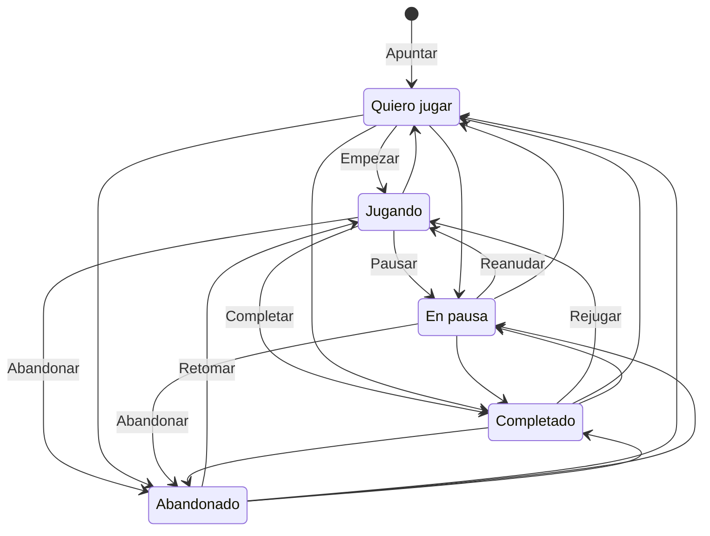

## 3. Requisitos

Prioridad (MoSCoW): **Imprescindible** (sin ello el prototipo no cumple su fin), **Importante** (entra en su hito salvo imprevisto), **Deseable** (si sobra tiempo; p. ej., los filtros del Catálogo en M2, ver §9.1) y **Fuera del prototipo**. Los hitos se detallan en la §15.

### 3.1 Requisitos funcionales

| Id | Requisito | Prioridad | Hito |
|---|---|---|---|
| | **Captura** | | |
| RF-01 | Paleta única para buscar y apuntar: `Ctrl+K` o `/` en escritorio; barra «Apunta un juego…» fija abajo en móvil; resultados en cada tecla (ver §8) | Imprescindible | M1 |
| RF-02 | `Intro` o tocar la fila apunta en Quiero jugar (al final), con aviso y Deshacer; `Ctrl+Intro` apunta y sigue. Un juego ya apuntado muestra su estado y nunca se duplica | Imprescindible | M1 |
| RF-03 | La última fila siempre permite apuntar el texto escrito como juego manual, también sin red y antes de que el índice esté listo | Imprescindible | M1 |
| RF-04 | Pegar en la paleta un enlace de la tienda o `appid:<n>` apunta ese juego; si no está en el catálogo local, queda como juego provisional (título del enlace) hasta que el catálogo lo incluya o lo resuelva la micro-API (M4) | Importante | M1 |
| RF-05 | Vincular un juego manual con Steam (ver §7): solo se propone ante una única coincidencia exacta tras normalizar | Importante | M1 |
| RF-06 | `Alt+Intro` (M1) o pulsación larga (M3): apuntar con otro estado o con marcas | Importante | M1 · M3 |
| RF-07 | Más vías: `Ctrl+V` con un enlace en cualquier pantalla; en Android, «Compartir» y acceso directo «Apuntar juego»; en iOS, chip «Pegar enlace» | Importante | M3 |
| RF-30 | App de escritorio para Windows (envoltorio Tauri de la misma web): `Ctrl+Mayús+Espacio` abre la paleta desde cualquier aplicación (ver §17.3) | Importante | M3 |
| RF-08 | Atajo de iOS que envía el enlace al buzón con un *token* de solo escritura revocable | Importante | M4 |
| | **Mi lista y estados** | | |
| RF-09 | Estado y marcas según la §3.3; cada cambio cuesta una acción y nunca abre un diálogo | Imprescindible | M1 |
| RF-10 | Deshacer: aviso de 8 s (se pausa con foco o puntero), `Ctrl+Z` con varios niveles en escritorio y «Deshacer último cambio» en el menú en móvil | Imprescindible | M1 |
| RF-11 | Vista por defecto «Pendientes»: Jugando, A continuación, Quiero jugar (orden manual) y En pausa plegado | Imprescindible | M1 |
| RF-12 | Filtros por estado (con contador) y por marca, filtro de texto y orden por prioridad (manual), fecha de apuntado, lanzamiento (M2) o nombre. Vista «Próximos» (M2; `/?vista=proximos`): lanzamientos de las entradas agrupados por fecha (ver §9.2); no depende de la marca Próximo | Importante | M1 · M2 |
| RF-13 | Orden manual de Quiero jugar desde el menú de la fila: subir, bajar, al principio | Importante | M1 |
| RF-14 | «Quitar de mi lista», con Deshacer (§3.3) | Imprescindible | M1 |
| RF-15 | Atajos de una tecla desactivables (ver §9); arrastrar y `Alt+↑/↓` para ordenar | Importante | M3 |
| RF-16 | Gestos de deslizamiento en móvil, cada uno con su botón equivalente | Importante | M3 |
| | **Catálogo** | | |
| RF-17 | Todos los juegos de Steam (también «próximamente» y gratuitos; sin DLC) en lista virtual con contador real y filtro de texto; se apunta desde cada fila | Imprescindible | M1 |
| RF-18 | Contenido para adultos oculto por defecto, con opción en Ajustes | Imprescindible | M1 |
| RF-19 | Catálogo actualizado a diario de forma automática; retirados con insignia y al final; «Actualizar catálogo» en Ajustes | Importante | M2 |
| | **Ficha** | | |
| RF-20 | Ficha (`/juego/<id>`; `Mayús+Intro` desde la paleta). Básica (M1): datos del núcleo, todos los campos de la entrada y «Ver en Steam». Completa (M2): portada, lanzamiento o «Por confirmar», reseñas, plataformas y Steam Deck (ver §9.1) | Importante | M1 · M2 |
| RF-21 | Editar en la ficha la nota, «Juego en» y las fechas (ver §7) | Importante | M1 |
| RF-22 | Portadas con portada generada de respaldo (iniciales y color), interruptor «Cargar portadas» y aviso de privacidad de primera capa (ver §11) | Importante | M2 |
| | **Datos y copia de seguridad** | | |
| RF-23 | Exportar e importar en JSON completo (con marcas HLC; importar pasa por `merge()` y no duplica) y en CSV para hojas de cálculo (ver §7) | Imprescindible | M1 |
| RF-24 | «Borrar todos mis datos», la única acción con confirmación | Imprescindible | M1 |
| | **Sincronización** | | |
| RF-25 | Emparejar con QR o texto (*token* de un solo uso que caduca en 10 min), sin email ni contraseña; código de recuperación que se muestra una vez | Importante | M4 |
| RF-26 | Sincronización automática (al ganar foco, recuperar la conexión o cambiar la visibilidad) que nunca pregunta: conflictos por campo (ver §7) | Importante | M4 |
| RF-27 | Ver y desemparejar dispositivos; revocar el *token* del Atajo de iOS | Importante | M4 |
| | **Fase 2** | | |
| RF-28 | «Iniciar sesión con Steam» e importación que solo propone (ver §10) | Fuera del prototipo | Fase 2 |
| RF-29 | IGDB y otras plataformas (ver §17), DLC notables, marcas propias, avisos de lanzamiento e inglés | Fuera del prototipo | Fase 2 |

### 3.2 Requisitos no funcionales

| Id | Requisito | Objetivo medible | Hito |
|---|---|---|---|
| RNF-01 | Captura | Apuntar un juego p50 ≤3 s, desde abrir la paleta hasta ver la confirmación | M1 · M3 |
| RNF-02 | Búsqueda | Tecla → resultados ≤50 ms p95 en el Android de referencia (CPU ×4 en CI) y, en escritorio, ≤16 ms con pantallas de ≥120 Hz y ≤2 fotogramas por debajo (≈33 ms a 60 Hz; ver §8.9), siempre fuera del hilo principal | M1 · M3 |
| RNF-03 | Respuesta | Toque → respuesta visible ≤100 ms; INP p75 ≤200 ms; ninguna tarea del hilo principal >50 ms al teclear o apuntar, con 500 entradas en Mi lista | M1 · M3 |
| RNF-04 | Arranque | Primera visita: LCP ≤2,5 s, con el catálogo descargándose después. Reinicio con caché ≤2 s hasta poder buscar, con Mi lista visible ≤1 s | M1 · M3 |
| RNF-05 | Primera búsqueda | Búsqueda lista ≤1,5 s tras la primera carga, gracias al núcleo de arranque | M3 |
| RNF-06 | Peso | Presupuesto de JS de la §6, con puerta de tamaño en CI | M0 |
| RNF-07 | Sin conexión | Tras la primera visita, abrir, buscar, apuntar, cambiar estados y exportar funcionan sin red (E2E). El cliente nunca llama a las API de Steam; del CDN de Valve solo carga imágenes | M1 |
| RNF-08 | Durabilidad | `persist()` en la primera escritura; exportar → borrar → importar devuelve el mismo estado, HLC incluidos (test en CI); migraciones de Dexie probadas; aviso para exportar tras 30 días sin copia ni sincronización; en iOS se sugiere instalar la app, porque Safari borra los datos de una web no instalada tras 7 días de uso sin visitarla (verificado el 28-10-2026) | M1 |
| RNF-09 | Accesibilidad | WCAG 2.2 AA: axe-core sin violaciones graves ni críticas en cada hito; todo con teclado; pasada con NVDA al cerrar M1 y con NVDA, Narrador, TalkBack y VoiceOver al cerrar M3; estados con icono y texto, no solo color; objetivos táctiles ≥24 px (44 px los principales) | M1 · M3 |
| RNF-10 | Privacidad | Sin cuentas, analítica ni *cookies* no necesarias (sin banner). Los datos del usuario no salen del dispositivo salvo que active la sincronización (M4, D1 en la UE); las portadas envían la IP a Valve (EE. UU.), con aviso e interruptor (ver §11) | M1–M4 |
| RNF-11 | Seguridad | Clave de Steam fuera del cliente: el CI falla si el *build* contiene su valor o `x-webapi-key`. CSP sin `unsafe-inline`, texto de Steam siempre como texto, Zod en toda entrada externa y *manifest* firmado (ver §11) | M0–M4 |
| RNF-12 | Compatibilidad | Prioridad 1: Chrome (Android), Safari (iOS, app en la pantalla de inicio), Chrome y Edge (Windows), en sus dos últimas versiones mayores; mejor esfuerzo: Firefox, Samsung Internet y Safari (macOS). De 320 a 2 560 px; táctil, ratón y teclado. El camino crítico solo usa API Baseline «ampliamente disponibles», salvo la verificación Ed25519 del *manifest* (M2), Baseline 2025 «recién disponible»: Chrome y Edge ≥137, Firefox ≥129 y Safari ≥17 (verificado el 28-10-2026). Sin ella, la app conserva el último catálogo válido y pide actualizar el navegador; apuntar a mano y pegar enlaces siguen funcionando | M1 · M2 |
| RNF-13 | Coste | 0 €/mes (O-5, §2.4), solo con planes gratuitos | M0–M4 |
| RNF-14 | Idioma | Interfaz solo en español de España (`Intl` es-ES); inglés en Fase 2 | M1 |

RNF-01 se mide como indica O-1, y RNF-02 a RNF-05, como O-3 (§2.4; ver §12).

Fuentes: [WCAG 2.2](https://www.w3.org/TR/WCAG22/) · [INP](https://web.dev/articles/inp) · [LCP](https://web.dev/articles/lcp) · [Baseline](https://web.dev/baseline) · [Ed25519 en WebCrypto](https://blog.ipfs.tech/2025-08-ed25519/) · [WebKit, límite de 7 días](https://webkit.org/blog/10218/full-third-party-cookie-blocking-and-more/).

### 3.3 Modelo de estados

Cada entrada tiene siempre **un estado** exclusivo y cualquier combinación de **marcas** independientes (identificadores en inglés, etiquetas en español). «Comprados» (con la marca Comprado) y «Por comprar» (sin ella) son filtros de Mi lista que se combinan con la vista elegida (ver §9); no son estados.

| Estado | Etiqueta | Significado |
|---|---|---|
| `want_to_play` | Quiero jugar | Apuntado y sin empezar (por defecto) |
| `playing` | Jugando | En curso |
| `on_hold` | En pausa | Empezado y aparcado, con intención de volver |
| `completed` | Completado | Terminada la historia principal o el objetivo que el usuario considere |
| `dropped` | Abandonado | Dejado sin intención de terminarlo; la entrada se conserva |

Se permiten todas las transiciones, porque manda el usuario (por ejemplo, puede pasar a Completado un juego terminado hace años). Las flechas con nombre son acciones de un toque; las demás se hacen con el selector de estado.

**Marcas.** Se guardan en el registro abierto `flags` para admitir marcas propias en Fase 2 sin migraciones (ver §7).

| Marca | Etiqueta | Significado | Reglas |
|---|---|---|---|
| `platinum` | Platinado | Trofeo de platino o 100 % de logros | Al marcarla, si el estado no es Completado, pasa a Completado (un solo Deshacer revierte ambas cosas). Quitarla no cambia el estado. Cambiar después el estado (rejugar → Jugando) no la quita |
| `owned` | Comprado | Lo tengo: comprado, regalado o gratis | No afecta al estado |
| `next` | Próximo | Lo siguiente que se va a jugar | Fija el juego en «A continuación», encima de Quiero jugar, mientras el estado es Quiero jugar o En pausa; en los demás estados la marca se conserva sin efecto |

En `merge()`, la regla de Platinado se evalúa con los relojes: si Platinado se marcó después del último cambio de estado, el estado es Completado; si el estado cambió después, se respeta (ver §7).

**Fechas** (automáticas y editables en la ficha):

| Fecha | Se fija automáticamente | ¿Se sobrescribe? |
|---|---|---|
| `addedAt` | Al apuntar | No |
| `startedAt` | La primera vez que pasa a Jugando | No |
| `completedAt` | La primera vez que pasa a Completado, también por Platinado | No |
| `platinumAt` | Al marcar Platinado | Se vacía al quitar la marca |
| `ownedAt` | Nunca (solo si la escribe el usuario) | — |

**Otras reglas**
- Apuntar directamente con otro estado o con marcas (RF-06) aplica las mismas reglas con la fecha del día: con Platinado, por ejemplo, el juego entra en Completado con `completedAt` y `platinumAt`. Si el hecho es anterior, la fecha se corrige en la ficha.
- Deshacer revierte un cambio junto con sus efectos automáticos (fechas y Completado por Platinado).
- «Quitar de mi lista» deja una lápida (ver §7); si el juego se vuelve a apuntar, empieza de cero. Abandonado, en cambio, conserva la entrada.
