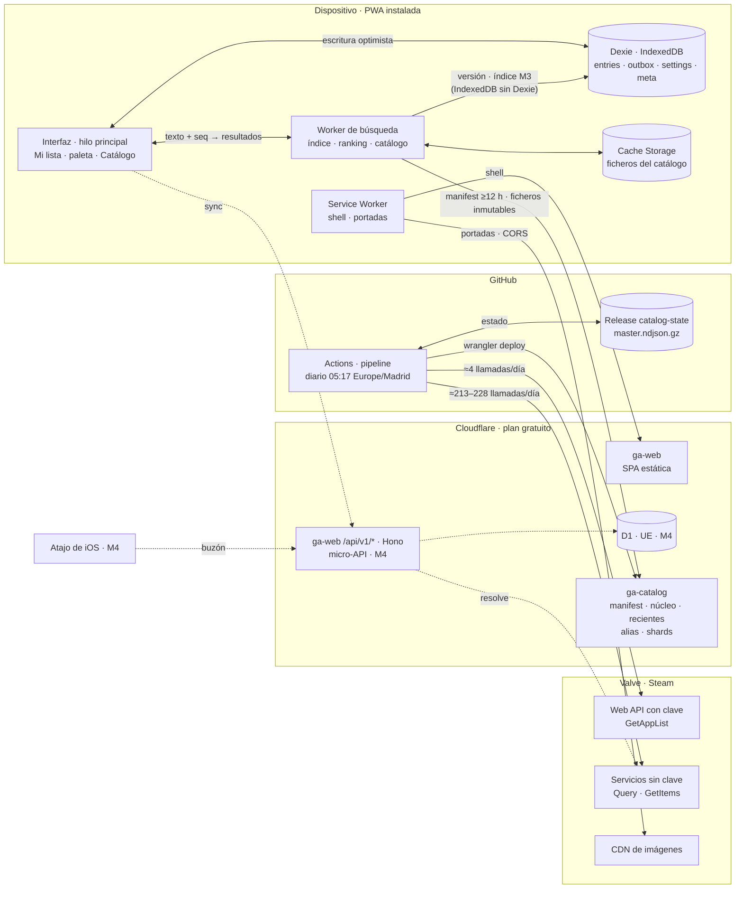
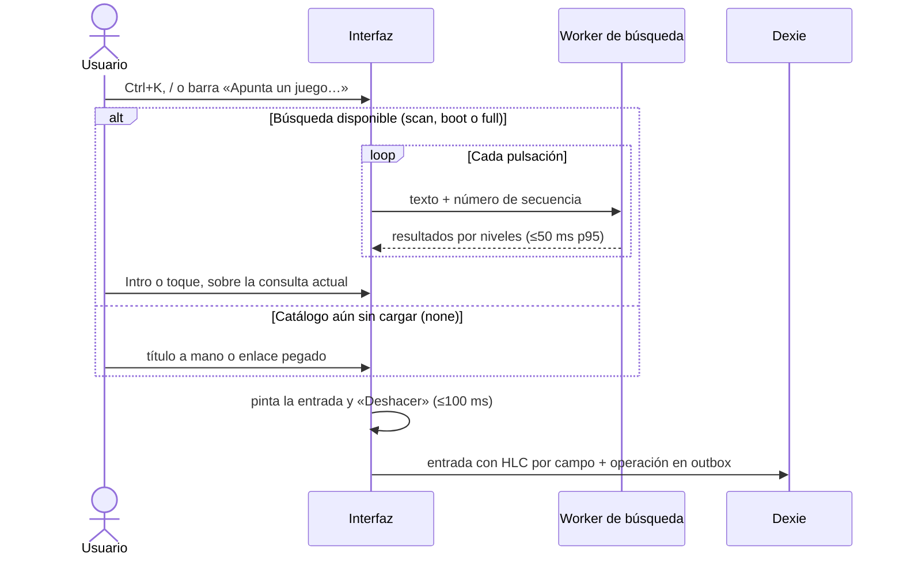
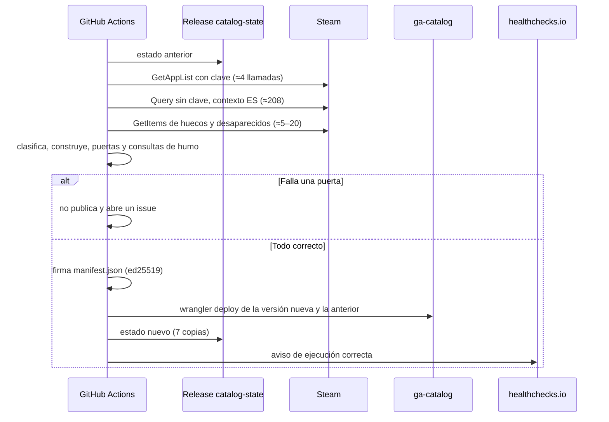
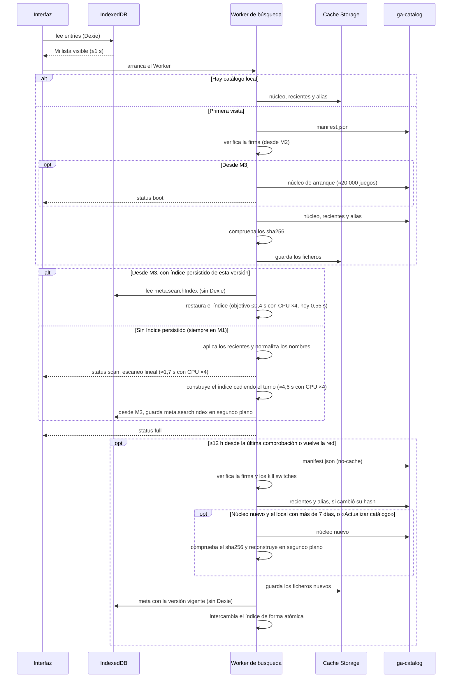
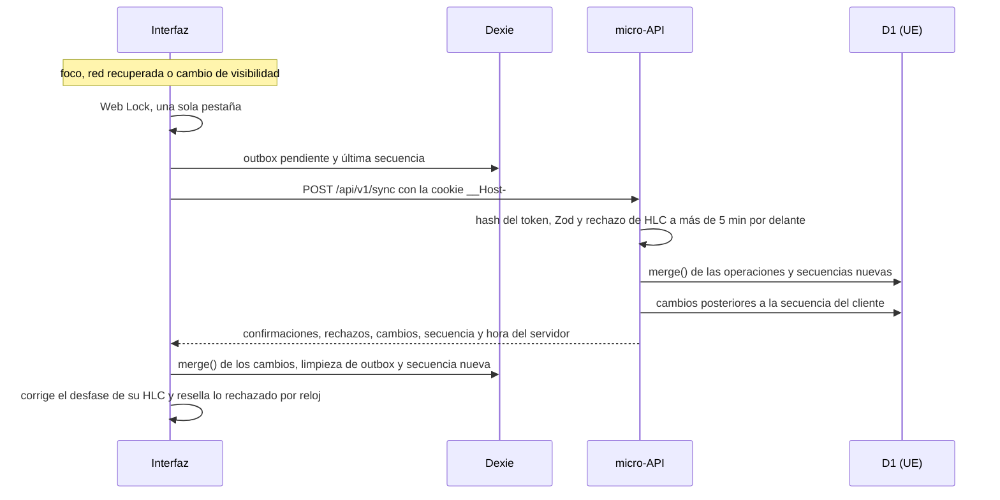

## 5. Arquitectura

GameAgenda es una PWA *local-first*: buscar y apuntar ocurren en el dispositivo y nunca esperan a la red. La nube solo sirve ficheros estáticos y, desde M4, una micro-API de sincronización. Tecnologías y versiones, en la §6.

### 5.1 Vista general

Las flechas discontinuas llegan en M4; la Fase 2 no aparece. El navegador solo habla con `ga-web`, `ga-catalog` y el CDN de imágenes, nunca con las APIs de Steam: no envían CORS y la Web API exige una clave confidencial (ver §4).

### 5.2 Componentes y responsabilidades

| Componente | Dónde | Responsabilidad | Desde |
|---|---|---|---|
| Interfaz | Hilo principal | Pantallas y *router* propio (ver §9); pinta cada cambio antes de guardarlo y nunca espera a la red | M1 |
| Worker de búsqueda | Web Worker de módulo | Ciclo de vida del catálogo (*manifest*, descargas, `sha256`, firma desde M2, intercambio atómico), índice y *ranking* (ver §8), páginas del Catálogo y *shards*; no toca datos del usuario y no importa Dexie (ver abajo) | M1 |
| Almacén local | Dexie (IndexedDB) | `entries`, `outbox`, `settings` y `meta` (ver §7), `persist()`, exportar e importar | M1 |
| Service Worker | Navegador | Precaché del *shell*, actualizaciones y caché LRU de ≈300 portadas; no guarda el catálogo (lo hace el Worker de búsqueda en Cache Storage) | M1; portadas, M2 |
| `packages/core` | Navegador, Node y Cloudflare | Toda la lógica compartida, en una sola implementación (ver §14) | M1 |
| Pipeline del catálogo | GitHub Actions o el PC | Descarga, clasifica, construye, pasa las puertas, firma (desde M2) y despliega (ver §4); guarda el estado en la *Release* `catalog-state` (7 copias) y avisa a healthchecks.io. Desde M2, si hay que lanzarlo en el PC (429 en los *runners* compartidos o falta de minutos), el PC solo descarga, construye y sube el resultado a la *Release* `catalog-staging`; `catalog.yml` (`workflow_dispatch`, `source=staging`) pasa las puertas, firma y publica | M1 en el PC; M2 diario |
| `ga-catalog` | Workers Static Assets | `manifest.json` (`no-cache`) y ficheros inmutables con *hash*; CORS solo para el origen de la app | M0 (*fixture*) |
| `ga-web` | Workers Static Assets | La SPA (`not_found_handling: single-page-application`), desplegada en cada *push* a `main`; desde M4, el *script* solo en `/api/*` | M0 |
| Micro-API | `ga-web` (Hono) | Sincronización, emparejamiento, buzón y `resolve` (rutas en la tabla siguiente); `resolve` usa `GetItems` sin clave | M4 |
| D1 | Cloudflare, UE | Agendas, dispositivos (solo *hashes*), operaciones con secuencia por agenda (ver §7) y caché de `resolve`; la jurisdicción se fija al crear la base y no se puede cambiar | M4 |

**El Worker de búsqueda no importa Dexie.** Dexie 4.4.7 ocupa ≈27 KB brotli (medido el 28-10-2026), dos tercios del presupuesto de 40 KB del Worker (ver §6.2). El Worker lee y escribe sus claves de `meta` (versión del catálogo y, desde M3, el índice persistido; ver §7) con IndexedDB nativo: abre la misma base cuando Dexie ya la ha creado, sin pedir versión, y cierra la conexión ante `versionchange` para no bloquear sus migraciones. La interfaz conoce la versión por el mensaje `status` (ver §8.7).

**Rutas de la micro-API (M4).** Zod en cada entrada y las reglas de petición de la §11.4 (nada cambia por GET); «cookie» es la credencial de dispositivo `__Host-`. Las rutas de la cuenta de Steam (Fase 2) están en la §10.

| Ruta | Para qué | Credencial | Límite |
|---|---|---|---|
| `POST /api/v1/agenda` | Al activar la sincronización: crea la agenda, pone la cookie y devuelve el código de recuperación (se muestra una vez) | Ninguna | Por IP |
| `POST /api/v1/pairing` | Genera un *token* de emparejamiento (un uso, 10 min) | Cookie | — |
| `POST /api/v1/pairing/redeem` | Lo canjea desde la app nueva y pone la cookie | *Token* en el cuerpo | Por IP |
| `POST /api/v1/recovery/redeem` | Canjea el código de recuperación y pone la cookie | Código en el cuerpo | Por IP |
| `GET /api/v1/devices` · `POST /api/v1/devices/<id>/revoke` | Lista y revoca dispositivos, incluido el *token* del buzón | Cookie | — |
| `POST /api/v1/inbox/token` | Crea el *token* del buzón para el Atajo de iOS (se muestra una vez) | Cookie | — |
| `POST /api/v1/inbox` | Deja un enlace de la tienda en el buzón | `Authorization` | Por *token* |
| `POST /api/v1/sync` | Sube `outbox` y baja cambios (ver §7.7) | Cookie | — |
| `GET /api/v1/resolve/<appid>` | Nombre de un `appid` desconocido o retirado, con `GetItems` sin clave | Ninguna | Por IP |
| `POST /api/v1/agenda/delete` | Borra la agenda en cascada («Borrar todos mis datos») | Cookie | — |

La caché de `resolve` es una tabla de D1 (`appid`, nombre, `fetched_at`) con nombres públicos del catálogo, nunca datos de usuarios: Cloudflare solo garantiza una [Cache API](https://developers.cloudflare.com/workers/runtime-apis/cache/) funcional en dominios propios y el prototipo usa `workers.dev` (a verificar en M4).

### 5.3 Flujos principales

**Apuntar un juego sin red.** Es el camino caliente: ninguna llamada de red entre la pulsación y la confirmación. Mientras se construye el índice (`scan`), el Worker responde con un escaneo lineal de los nombres normalizados, con los mismos niveles; en M3, `boot` busca en el núcleo de arranque (estados en la §8.8).

**Publicación diaria del catálogo** (desde M2; 05:17 Europe/Madrid o a mano, una ejecución a la vez; llamadas y puertas en la §4, formatos en la §7).

**Arranque y actualización del catálogo en el cliente.** El *shell* sale de la caché del Service Worker y la comprobación del *manifest* nunca retrasa Mi lista ni la búsqueda (firma y *kill switches*, desde M2). Los tiempos con CPU ×4 son los medidos en la §8.11.

**Sincronización (M4).** Requiere un dispositivo emparejado (credencial en la §11; protocolo y `merge()` en la §7).

### 5.4 Principios de diseño

1. **Steam fuera del camino crítico.** Ningún cliente llama a sus APIs (solo el pipeline y, desde M4, `resolve`); si Steam, GitHub o el pipeline fallan, la app sigue con el último catálogo.
2. **Camino caliente local.** Buscar, apuntar y pintar Mi lista solo usan memoria e IndexedDB; la red trae el catálogo y sincroniza en segundo plano.
3. **Hilo principal libre.** Descargas, índice y *ranking* van en el Worker de búsqueda; ninguna tarea supera 50 ms al teclear o apuntar (ver §12).
4. **Todo inmutable salvo el *manifest*.** Los ficheros llevan su *hash* en el nombre y nunca cambian, así que se cachean sin revalidar; solo `manifest.json` es `no-cache`, va firmado y hace de plano de control. Publicar es atómico. Volver atrás en `ga-catalog` es publicar los ficheros de la versión buena con una `version` nueva, porque el cliente rechaza las anteriores (ver §11.3); `wrangler rollback` solo se usa con `ga-web`.
5. **Mismo origen para la API.** `/api/*` vive en `ga-web`: cookie `__Host-` de primera parte, `connect-src 'self'` y sin CORS. El *script* solo corre en esas rutas (`run_worker_first`): si se agota la cuota gratuita, `/api/*` responde 429 y la app se sigue sirviendo.
6. **Una sola implementación.** `packages/core` sirve a pipeline, Worker, micro-API y tests, con vectores de prueba compartidos.
7. **Convergencia sin coordinación.** Ids naturales y LWW por campo con HLC: dos dispositivos que apuntan el mismo juego acaban en la misma fila (ver §7).
8. **Degradar, no romper.** Si falla el enriquecimiento, se publica con el último conocido; un *kill switch* apaga portadas o detalles sin otra versión de la app; ante un 404 o un fallo de red o de CORS al pedir un fichero con *hash* (un 404 sin `Access-Control-Allow-Origin` llega como fallo de red), el cliente relee el *manifest* una vez y reintenta con la versión vigente.
9. **Fronteras validadas, secretos fuera del cliente.** Zod en cada entrada externa; en el prototipo, la clave de Steam solo la usa el pipeline (ver §11).
10. **0 € y salida fácil.** *Assets* estáticos gratuitos e ilimitados, sin activar la caché de Workers; ficheros planos que sirve cualquier hosting; Hono y el SQL de D1 son portables.

Fuentes (consultadas el 28-10-2026): Cloudflare, [*Billing and limitations*](https://developers.cloudflare.com/workers/static-assets/billing-and-limitations/), [`run_worker_first`](https://developers.cloudflare.com/workers/static-assets/binding/) y [jurisdicción de D1](https://developers.cloudflare.com/d1/configuration/data-location/).

### 5.5 Alternativas evaluadas

Se redactaron tres arquitecturas completas e independientes y se evaluaron con tres criterios, cada uno sobre 60 puntos (seis subcriterios de 0 a 10): **A**, PWA *local-first* con catálogo estático; **B**, escritorio nativo con Tauri 2, núcleo en Rust y SQLite FTS5, con una PWA compañera para el móvil en el cuarto hito; **C**, PWA con API propia, D1 y R2 en la UE y cuentas de invitado desde el primer día.

| Criterio | A | B | C | Orden |
|---|---|---|---|---|
| Velocidad y UX de captura | **48** | 45 | 45 | A > C > B |
| Viabilidad para una persona en este PC | **42** | 25 | 29 | A > C > B |
| Robustez, cumplimiento y futuro | 42,5 | 44 | **48** | C > B > A |

Fallos fatales: **B** no permite apuntar desde el móvil hasta el cuarto hito (tras ≈18 días de desarrollo) y obliga a mantener dos clientes con la misma lógica en Rust y en TypeScript (por eso C queda delante en velocidad pese al empate); **C** exige un backend multiusuario (invitados, sesiones, fusión de cuentas, purgas) antes de apuntar el primer juego; **A**, tal como estaba escrita, importaba con la clave datos de cualquier perfil sin autenticar al usuario, y se corrige exigiendo el login OpenID (Fase 2).

| Subcriterio en el que se separaron | A | B | C |
|---|---|---|---|
| Captura en <3 s en escritorio y móvil | 7 | 4 | 8 |
| Piezas móviles | 7 | 3 | 4 |
| Mantenibilidad para una persona | 7 | 3 | 4 |
| ToU de Steam y confidencialidad de la clave | 6,5 | 8 | 9 |
| Durabilidad de los datos del usuario | 6 | 8 | 8,5 |

Gana A porque se impone en dos criterios, es la más sencilla para una persona y sus dos carencias de robustez (importación sin autenticar y ninguna copia fuera del dispositivo) eran de secuencia: las corrigen el login obligatorio y la sincronización de M4. Cada criterio, por separado, recomendaba partir de A con piezas de B y de C (§5.6). Se descartan el núcleo en Rust de B (la lógica existiría dos veces) y, de C, las cuentas de invitado, R2 y la búsqueda en el servidor para la primera visita (la sustituye el núcleo de arranque de M3).

### 5.6 ADR-001 y registro de decisiones

Las decisiones se registran en `docs/adr/NNN-titulo.md` con el formato [MADR 4.0](https://adr.github.io/madr/), en español. ADR-001 se copia al crear el repositorio (M0).

**ADR-001 · Arquitectura del prototipo: PWA *local-first* con catálogo estático** (aceptada, 28-10-2026)

- **Contexto y problema.** Hay que apuntar en segundos, desde el móvil y el PC, juegos del catálogo completo de Steam (≈196 600). Las APIs de Steam no envían CORS, la Web API key es confidencial y los endpoints sin clave no están documentados; lo construye una persona en Windows 11, sin Docker. ¿Qué arquitectura cumple los presupuestos (ver §3.2) sin poner a Steam ni a un servidor en el camino crítico?
- **Factores de decisión.** Apuntar p50 ≤3 s en móvil y escritorio; tecla → resultados ≤50 ms p95 sin red; viable para una persona; ToU de Steam y RGPD; datos que no dependan de un solo navegador; 0 €/mes.
- **Opciones consideradas.** A, B y C (§5.5).
- **Decisión.** A, con injertos. De B: rigor de búsqueda (orden de normalización, niveles de *ranking*, alias), ids naturales y *manifest* como plano de control (firma ed25519, *kill switches*). De C: contratos de respuesta, puertas con consultas de humo, credencial de dispositivo en cookie `__Host-` `HttpOnly`, una sola `merge()` y sincronización ligera en M4. De A: catálogo estático con *hash*, *shards* de detalles y coste 0 €. Corrección: ninguna llamada a Steam por usuario sin un login OpenID verificado (Fase 2).
- **Consecuencias.**
  - Bien, porque buscar y apuntar funcionan sin red tras la primera visita, con un solo cliente para móvil y escritorio.
  - Bien, porque Steam no está en el camino crítico y el coste es 0 €/mes.
  - Bien, porque con ids naturales, HLC y `outbox` desde M1, la sincronización de M4 es un añadido y no una reescritura.
  - Mal, porque la primera visita descarga el núcleo (de ≈2,6 a ≈3,1 MB comprimido, según cómo lo comprima el CDN; ver §7.6) antes de buscar: entretanto se apunta a mano o con un enlace, después se busca por escaneo lineal mientras se construye el índice, y M3 añade un núcleo de arranque.
  - Mal, porque hasta M4 la agenda vive en un solo navegador (mitigación en la §16).
  - Mal, porque no hay atajo global en Windows hasta el envoltorio Tauri (M3) ni *Web Share Target* en iOS («Pegar enlace» y, en M4, un Atajo de iOS que envía al buzón).
  - Mal, porque el catálogo es como mucho diario y su enriquecimiento depende de endpoints no documentados (plan B y *kill switches*; ver §4).
- **Confirmación.** M1: apuntar en <3 s y buscar sin red con CPU ×4; M3: presupuestos en el Android de referencia y en iPhone (ver §15).
- **Cuándo revisarla.** Captura en escritorio de más de 3 s al cerrar M1: el envoltorio Tauri pasa de M3 a justo después de M1. Cierre de los endpoints sin clave: plan B, sin tocar la arquitectura. Tiempo real, agendas compartidas o un backend para IGDB: ADR nuevo.

Registro inicial, numerado por orden de escritura: cada ADR se escribe al empezar su hito (ver §15.1), ocupa como mucho una página y enlaza la sección que lo desarrolla; una decisión aceptada no se edita, se sustituye por otro ADR.

| ADR | Decisión | Se escribe en | Ver |
|---|---|---|---|
| ADR-001 | Arquitectura: PWA *local-first* con catálogo estático | M0 | §5 |
| ADR-002 | Stack y repositorio: React + Vite como SPA, *router* propio, CSS nativo y versiones exactas | M0 | §6, §14 |
| ADR-003 | *Hosting*, despliegue y CI: Workers Static Assets para `ga-web` y `ga-catalog`, y GitHub Actions (el CDN comprime el TSV: la alternativa no hace falta) | M0 | §5, §12 |
| ADR-004 | Datos del usuario: Dexie, ids naturales, estados y marcas, HLC y `outbox` | M1 | §3, §7 |
| ADR-005 | Búsqueda local en un Web Worker | M1 | §8 |
| ADR-006 | Alcance y formato del catálogo | M1 | §4, §7 |
| ADR-007 | Pipeline diario, *manifest* firmado y plan B sin clave | M2 | §4, §12 |
| ADR-008 | Portadas desde el CDN de Valve y aviso de privacidad | M2 | §9, §11 |
| ADR-009 | Arranque rápido: índice persistido y núcleo de arranque | M3 | §8 |
| ADR-010 | App de escritorio: envoltorio Tauri de `ga-web` con atajo global | M3 | §17 |
| ADR-011 | Sincronización: micro-API, D1 en la UE y emparejamiento | M4 | §7, §11 |
| ADR-012 | Cuenta de Steam con OpenID 2.0 | Fase 2 | §10 |
