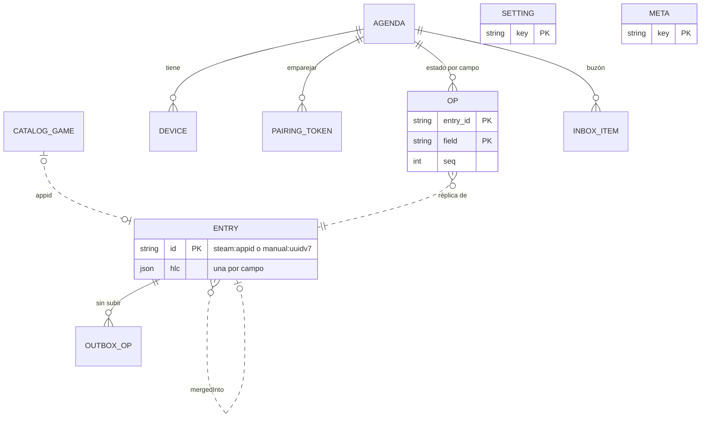

## 7. Modelo de datos

Las reglas de estados y marcas están en la §3; aquí, cómo se guardan, fusionan y publican los datos.

### 7.1 Modelo lógico



En el cliente no hay claves foráneas: una operación puede llegar antes que su entrada (§7.4).

### 7.2 Esquema Dexie

```ts
db.version(1).stores({              // Dexie 4.4.7, base 'gameagenda'
  entries: 'id, [view+rank], lastHlc, deletedAt',
  outbox: 'opId, [entryId+field]',
  settings: 'key',
  meta: 'key', // hlcClock, catalog, searchIndex, syncCursor, backup, errorLog, copyReminder
});
```

Índices: `[view+rank]`, Mi lista por estado en orden manual y «A continuación» (`view = 'next'`); `lastHlc`, cambios recientes; `deletedAt`, lápidas (disperso); `[entryId+field]`, compactar la `outbox`.

```ts
type Day = string | null;       // fecha local AAAA, AAAA-MM o AAAA-MM-DD
interface Entry {
  id: string;                   // §7.3
  status: string;               // want_to_play (defecto), playing, on_hold,
                                // completed, dropped
  flags: Record<string, boolean>; // platinum, owned, next (propias: Fase 2)
  rank: string;                 // orden manual en Quiero jugar
  note: string;                 // ≤2000 caracteres
  platform: string | null;      // pc, steam_deck, ps5, ps4, xbox_series,
                                // xbox_one, switch_2, switch, mobile, other
  addedAt: Day; startedAt: Day; completedAt: Day; platinumAt: Day;
  ownedAt: Day;                 // nunca se rellena sola
  title: string;                // copias para pintar sin catálogo
  cover: string | null;         // asset_url_format sustituido (§7.6)
  deletedAt: string | null;     // lápida: instante ISO 8601 UTC
  mergedInto: string | null;    // §7.3
  hlc: Record<string, string>;  // por campo: 'status', 'flags.owned'…
  view?: string;                // derivado: estado o 'next'; no en lápidas
  lastHlc: string;              // derivado: la mayor HLC
}
```

- `view` es `'next'` si `flags.next` está activo y el estado es `want_to_play` u `on_hold`; si no, es el estado (en los demás estados la marca se conserva sin efecto). No existe en lápidas ni esqueletos, y `viewOf()` lleva vectores de prueba de los cinco estados con y sin Próximo. [IndexedDB](https://www.w3.org/TR/IndexedDB/) no indexa booleanos ni claves con una parte `undefined` (las lápidas salen solas de las listas) y, a igual clave, ordena por `id`.
- `rank` es una [clave fraccionaria](https://observablehq.com/@dgreensp/implementing-fractional-indexing) en base 62 que ordena como texto: lo nuevo va tras la última y mover crea una clave entre vecinos, sin renumerar.
- `navigator.storage.persist()` en la primera escritura; antes de migrar o importar, copia JSON en `meta.backup`.
- `meta.errorLog`: búfer circular con los 100 últimos errores, sin datos personales (ver §12.7); se exporta en JSON desde Ajustes › Datos a partir de M1 y, desde M3, también desde el panel de rendimiento.
- `meta.copyReminder` (desde M1): `{lastCopy, since, snoozedUntil}` en ms, para el aviso de copia de la §9.6 (RNF-08). Es de este dispositivo y no va en la copia exportada.

### 7.3 Identificadores naturales y vinculación

Formatos: `steam:<appid>` (catálogo o provisional; Zod: `^steam:[1-9][0-9]{0,9}$`), `manual:<uuidv7>` (fuera del catálogo) e `igdb:<id>` (Fase 2, solo juegos sin `appid`).

- **El `id` es el juego y nunca cambia.** Un id derivado de otro campo (UUIDv5 de `game_id`) deja de corresponder al juego si una fusión reescribe ese campo, y se duplican filas o se atasca la sincronización. Con ids naturales, dos dispositivos que apuntan el mismo juego sin conexión producen la misma fila.
- **Solo se construye en TypeScript** (`steamEntryId(appid)` exige `Number.isSafeInteger(appid) && appid > 0`): `node:sqlite` enlaza los `number` como REAL (comprobado el 28-10-2026) y [D1 puede hacerlo](https://developers.cloudflare.com/d1/worker-api/), así que en SQL `'steam:' || ?` daría `'steam:730.0'` (el `CHECK` de §7.7 lo rechaza).
- **Provisional**: `steam:<appid>` con `title` del *slug*; se resuelve sin cambiar de id cuando el catálogo local trae el `appid` o, en M4, con `/api/v1/resolve/<appid>`.
- **Vincular** el manual M con T = `steam:<appid>` es una acción explícita con una HLC *h*. T recibe los campos de usuario de M (todos salvo `title`, `cover`, `deletedAt` y `mergedInto`) con su valor y su HLC originales, y LWW decide campo a campo; con *h*, `deletedAt = null`, `title` y `cover` del catálogo y, si ambas notas tienen texto, su concatenación. M recibe `deletedAt` y `mergedInto = T` con *h*; lo que llegue después para M se reenvía a T (§7.4). Solo se propone si el título normalizado (ver §8) coincide con un único juego («Hades» ≠ «Hades II»).

### 7.4 HLC por campo, `outbox` y `merge()`

```text
1793178900000-0000-k3x9p2qa       = 28-10-2026 09:15:00,000 UTC
^\d{13}-[0-9a-f]{4}-[0-9a-z]{8}$  ms desde 1970 · contador hex · nodo
```

Con 27 caracteres fijos, la [HLC](https://cse.buffalo.edu/tech-reports/2014-04.pdf) se compara como texto (también en SQLite). Nodo: 8 caracteres aleatorios por sesión (uno por pestaña). Evento local: `ms = max(ms, Date.now() + desfase)` y, si no avanza, contador + 1 (tras `ffff`, ms + 1); el desfase vale 0 hasta M4. Al recibir, algoritmo estándar. La micro-API rechaza las HLC más de 5 min por delante de su reloj, y la importación, las que van más de 5 min por delante de `Date.now() + desfase`. Cada respuesta de `sync` trae la hora del servidor (`serverTime`): con ella el cliente recalcula el desfase, corrige la parte física de su HLC (si iba más de 5 min por delante, la baja a la hora corregida) y sella de nuevo las operaciones rechazadas. Reloj y desfase se guardan en `meta.hlcClock`.

**Operación de `outbox`**: `{ opId, entryId, field, value, hlc }` (`opId` en uuidv7; `field`, p. ej. `'flags.owned'`; `value` en JSON). Cada acción es una transacción de Dexie que actualiza la entrada y añade sus operaciones, **todas con la misma HLC**; Deshacer es otra acción. Aplicar es conmutativo e idempotente, sin claves foráneas: una operación de una entrada desconocida crea un esqueleto (invisible sin `status` y `title`), así que el orden de llegada da igual: no hay padres que deban ir antes que sus hijos. La `outbox` se compacta por (`entryId`, `field`); un lote nunca parte una acción.

```ts
function merge(prev: Entry | undefined, ops: Op[]) {   // packages/core
  const e = prev                       // copia superficial: basta y
    ? { ...prev, flags: { ...prev.flags }, hlc: { ...prev.hlc } }
    : skeleton(ops[0].entryId);        // evita structuredClone
  for (const o of ops) {               // LWW por campo, en cualquier orden
    const cur = e.hlc[o.field];
    if (cur === undefined || o.hlc > cur ||
        (o.hlc === cur && canon(o.value) > canon(read(e, o.field))))
      apply(e, o);
  }
  const derived: Op[] = [];
  const p = e.hlc['flags.platinum'];   // Platinado ⇒ Completado, por relojes
  if (e.flags.platinum && p > (e.hlc.status ?? '') &&
      e.status !== 'completed')
    derived.push(newOp(e.id, 'status', 'completed', p)); // HLC de la marca
  for (const d of derived) apply(e, d);
  const t = e.mergedInto;              // manual vinculado: reenviar
  if (t) {
    const fwd = t !== prev?.mergedInto // recién vinculado: todo su estado
      ? userFieldOps(e)
      : [...ops.filter((o) => USER_FIELDS.has(o.field)), ...derived];
    for (const o of fwd) derived.push(retarget(o, t));
  }
  e.view = viewOf(e); e.lastHlc = maxHlc(e.hlc);
  return { entry: e, derived };        // derived también va a la outbox
}
```

- **Reenvío de un manual vinculado:** cuando `mergedInto` cambia en esa fusión, se reenvía al destino el estado actual de todos los campos de usuario del manual, no solo las operaciones del lote. También se reenvía la derivada de Platinado. Con el reenvío de solo el lote, el resultado en el destino dependía de si las operaciones del manual llegaban antes o después de la vinculación. `applyOps()` sigue las derivadas entre entradas hasta 8 saltos (ADR-004).

- «Marcar Platinado» escribe siempre `status` con la HLC de la marca, aunque ya fuera Completado: con datos completos la reparación no cambia nada y, con datos incompletos (lote partido, copia antigua), todas las réplicas derivan la misma operación. Un cambio de estado posterior gana y no quita Platinado. Las fechas no se reparan: sería inventarlas. Pruebas de propiedades: ver §12.
- **Lápidas**: borrar es `deletedAt = <instante>` y conserva el resto. Un cambio concurrente no resucita la entrada; solo lo hace `deletedAt = null`. Deshacer un «Quitar» escribe solo eso y la recupera tal como estaba; apuntarla de nuevo es una acción que escribe además los valores por defecto de todos los campos de usuario (`want_to_play`, cada marca a `false`, fechas vacías salvo `addedAt` = hoy, `note` y `platform` vacíos y `rank` al final): empieza de cero. No se purgan antes de M4.
- **Fechas parciales**: validar solo la forma acepta `'2019-02-30'`, así que Zod exige además que la fecha exista (ida y vuelta por `Date.UTC`, años 1900–2100): acepta `'2019'`, `'2019-05'` y `'2020-02-29'`; rechaza `'2019-00'` y `'2019-02-29'`.

### 7.5 Exportación e importación

- **JSON** (desde M1): `{format: "gameagenda-export", version: 1, exportedAt, appVersion, entries, settings}`; cada entrada, lápidas incluidas, lleva los campos de `Entry` salvo los derivados, con su `hlc`.
- **Importar es fusionar**: cada entrada se convierte en operaciones que pasan por `merge()`, y las que ganan se encolan. Importar dos veces no cambia nada y la copia de otro dispositivo se une sin duplicados. Antes, Zod (≤10 MB) y `meta.backup`; al final, recuento de altas, cambios, bajas y rechazos (§7.4).
- **CSV** (hojas de cálculo): `id;title;status;statusLabel;platinum;owned;next;platform;addedAt;startedAt;completedAt;platinumAt;ownedAt;note`, en UTF-8 con BOM, `;`, CRLF y comillas RFC 4180 (Excel en español), booleanos `1`/`0` y `statusLabel` («Quiero jugar») solo para leer; `'` delante de las celdas que empiezan por `=`, `+`, `-` o `@` ([inyección de fórmulas](https://owasp.org/www-community/attacks/CSV_Injection)). Sin HLC, importarlo solo da altas.

### 7.6 Formatos publicados del catálogo

Ficheros UTF-8 inmutables con el prefijo de 16 dígitos hexadecimales de su SHA-256 en el nombre; solo `manifest.json` conserva su ruta (`no-cache`). Los genera el pipeline (ver §4).

**Núcleo**, `core.<hash>.tsv` (⇥ = tabulador; en los nombres, tabuladores, CR y LF pasan a espacio):

```text
#gacat-core v1⇥20261028.1⇥appid⇥name⇥nameEs⇥flags⇥year⇥pop
730⇥Counter-Strike 2⇥⇥8⇥2012⇥46
105600⇥Terraria⇥⇥⇥2011⇥40
247710⇥Battledroid⇥⇥41⇥⇥
```

| Columna | Contenido |
|---|---|
| `appid`, `name` | entero decimal; nombre base de Steam |
| `nameEs` | nombre en español; vacío si coincide |
| `flags` | bits: 1 próximamente · 2 acceso anticipado · 4 adulto (descriptores 3 o 4) · 8 gratis · 16 retirado · 32 fecha por confirmar (Steam no muestra fecha: `text_comingsoon`, `text_tba` o ninguna); vacío si es 0 |
| `year` | año de lanzamiento o el previsto; vacío si no se sabe o con el bit 32 |
| `pop` | `min(63, floor(2·log2(reseñas + 1)))` con `reviews.summary_filtered.review_count` (Counter-Strike 2: 9 953 549 reseñas, 46); vacío si es 0 |

Orden de las filas (rango estático): no retirados por reseñas descendentes (a igualdad, `appid` descendente: lo más reciente primero) y, al final, los retirados, con el mismo criterio. Las claves normalizadas las calcula el cliente (ver §8).

- **Recientes**, `recent.<hash>.tsv`: mismas columnas (`#gacat-recent v1`), altas y renombrados de 14 días (≈4 000 filas: ≈264 altas y ≈17 renombrados al día; ver §4.3). Se aplica siempre y cubre el hueco hasta que el núcleo local se renueva, a los 7 días: cada fila sustituye a la de su `appid` en su sitio o, si es un alta, se inserta delante de la primera fila con menor `pop`, o con igual `pop` y menor `appid` (un alta retirada, al final).
- **Núcleo de arranque** (M3), `boot.<hash>.tsv`: las 20 000 primeras filas del núcleo, mismas columnas (`#gacat-boot v1`); se descarga antes que `core`.
- **Alias**, `aliases.<hash>.tsv`: `#gacat-aliases v1⇥<versión>⇥alias⇥appid` y filas como `bg3⇥1086940` (un alias admite varios `appid`); lista curada más siglas de los ≈5 000 juegos con más reseñas.
- **Detalles**, `details/<nnnn>.<hash>.json`: 1 024 *shards*; `nnnn` = FNV-1a de 32 bits de `String(appid)` mod 1024, con cuatro cifras (`730` → `0765`); los nombres vigentes, en `details/index.<hash>.json`: `{format: "gacat-details-index", v: 1, version, shards}`, con `shards` = los 1 024 *hashes* de 16 dígitos hexadecimales por número de *shard*, o `null` en uno sin juegos (esquemas en `packages/core/src/catalog-format/details.ts`). Por juego, `"730": [fmt, capsule, header, release, [score, reviews, pct], plat, deck]`: `asset_url_format` y los ficheros de `library_capsule` y `header` tal cual (URL: ver §4.10); `release` = `[t, p]`, con `t` en segundos Unix (`null` si no hay fecha) y `p`, su precisión según `coming_soon_display`: `day` (también en los ya publicados), `month`, `quarter`, `year`, `soon` o `tba` (estos dos se muestran como «Por confirmar»); `score` 0–9; `plat` 1 Windows · 2 macOS · 4 Linux; `deck` 0 desconocido · 1 no compatible · 2 jugable · 3 verificado.
- ***Manifest***: `format`, `v`, `version` (`AAAAMMDD.N`), `generatedAt`, `counts`, `files` (`core`, `recent`, `aliases`, `details` y, desde M3, `boot`: `path`, `sha256`, `bytes`), `enrichmentAgeDays`, `minClientVersion`, `killSwitches` (`covers`, `details`) y `sig` (`kid` y firma `ed25519` del JSON canónico sin `sig`, [RFC 8785](https://www.rfc-editor.org/rfc/rfc8785)). El de M1 no lleva `sig`, `killSwitches`, `recent` ni `details`, que el esquema Zod admite como opcionales; desde v0.2.0 la app exige la firma: la verifica con WebCrypto ([`Ed25519`](https://blog.ipfs.tech/2025-08-ed25519/): Chromium 137, Firefox 129, Safari 17) y su clave pública (`kid` permite rotarla) y, si falta o no es válida, descarta el *manifest*. Cada fichero se comprueba con su `sha256`, y cada *shard*, con el *hash* de su nombre.

**Tamaños** (núcleo, núcleo de arranque y alias, medidos el 28-10-2026 con el catálogo real; `recent` y *shards*, estimados, se miden en M2):

| Fichero | Sin comprimir | gzip -9 | brotli 5 | brotli 11 |
|---|---|---|---|---|
| `core` (196 665 filas) | 7,00 MB | 3,05 MB | 2,59 MB | 2,25 MB (2,15 MiB) |
| Núcleo de arranque (M3, 20 000 filas) | 773 KB | 345 KB | 320 KB | 269 KB |
| `aliases` (3 563 pares) | 45 KB | 20 KB | 20 KB | 16 KB |
| `recent` (≈4 000 filas) | ≈0,14 MB | — | — | ≈50 KB |
| *shard* (≈192 juegos) | ≈31 KB | — | — | ≈9 KB (todos: ≈9,4 MB) |

**Compresión.** Cloudflare solo comprime los tipos de [su lista](https://developers.cloudflare.com/speed/optimization/content/compression/), que incluye `text/plain` pero no `text/tab-separated-values`, el tipo que Wrangler [asigna a los `.tsv`](https://developers.cloudflare.com/workers/static-assets/headers/) (verificado el 28-10-2026): `ga-catalog` sirve los TSV con `Content-Type: text/plain; charset=utf-8` por `_headers` (`/core.*`, `/recent.*`, `/aliases.*`, `/boot.*`). En M0 se comprueba que llegan comprimidos y con qué codificación (en el plan gratuito, Zstandard por defecto si el navegador lo admite; CA0.3, §15); si no, el ADR de *hosting* fija la alternativa (p. ej., ficheros con gzip que el Worker descomprime con `DecompressionStream`). La primera visita baja ≈2,6 MB de núcleo con brotli de nivel medio o ≈3,1 MB con gzip.

**Puertas de tamaño:** núcleo ≤3 MiB con brotli 11 (el informe anota también gzip -6: hoy, 3,06 MB) y, por despliegue, ≤20 000 ficheros de ≤25 MiB, los [límites del plan gratuito](https://developers.cloudflare.com/workers/platform/limits/) (hoy, ≤2 060 con los de la versión anterior).

**En el cliente**, Cache Storage guarda el *manifest* válido, núcleo, recientes, alias, índice de *shards* y, en M3, núcleo de arranque (caché `gacat-<versión>`, que sustituye a la anterior), los *shards* pedidos (`gacat-details`) y las portadas (ver §9); IndexedDB, `meta.catalog` (versión y última comprobación) y, desde M3, el índice construido en `meta.searchIndex` (ver §8). El Worker de búsqueda no importa Dexie (ver §5.2): abre la base con la API de IndexedDB, solo toca esas dos claves y la cierra ante `versionchange` para no bloquear migraciones; así, la copia del índice (19,2 MB) no ocupa el hilo principal.

### 7.7 Esquema de D1 (M4)

D1 en la jurisdicción UE; cada `*_hash` (tokens y código de recuperación) es el SHA-256 de un secreto aleatorio de ≥128 bits.

```sql
CREATE TABLE agenda (id TEXT PRIMARY KEY, seq INTEGER NOT NULL DEFAULT 0,
  purged_seq INTEGER NOT NULL DEFAULT 0, recovery_hash TEXT NOT NULL,
  last_sync_at TEXT NOT NULL) STRICT;  -- en cada sync; retención (§11.2)
CREATE TABLE device (id TEXT PRIMARY KEY,
  agenda_id TEXT NOT NULL REFERENCES agenda (id) ON DELETE CASCADE,
  kind TEXT NOT NULL CHECK (kind IN ('app', 'inbox')), -- inbox: Atajo de iOS
  token_hash TEXT NOT NULL UNIQUE, revoked_at TEXT) STRICT;
CREATE TABLE pairing_token (token_hash TEXT PRIMARY KEY,  -- un uso, 10 min
  agenda_id TEXT NOT NULL REFERENCES agenda (id) ON DELETE CASCADE,
  expires_at TEXT NOT NULL, used_at TEXT) STRICT;
CREATE TABLE op (                         -- operación ganadora por campo
  agenda_id TEXT NOT NULL REFERENCES agenda (id) ON DELETE CASCADE,
  entry_id TEXT NOT NULL CHECK ((entry_id GLOB 'steam:[1-9]*' AND
    substr(entry_id, 7) NOT GLOB '*[^0-9]*') OR entry_id GLOB 'manual:?*'),
  field TEXT NOT NULL, value TEXT NOT NULL CHECK (json_valid(value)),
  hlc TEXT NOT NULL CHECK (length(hlc) = 27), seq INTEGER NOT NULL,
  PRIMARY KEY (agenda_id, entry_id, field)) STRICT, WITHOUT ROWID;
CREATE INDEX op_by_seq ON op (agenda_id, seq);
CREATE TABLE inbox_item (id TEXT PRIMARY KEY, url TEXT NOT NULL,  -- buzón
  agenda_id TEXT NOT NULL REFERENCES agenda (id) ON DELETE CASCADE) STRICT;
CREATE TABLE resolve_cache (appid INTEGER PRIMARY KEY,  -- datos públicos
  name TEXT NOT NULL, fetched_at TEXT NOT NULL) STRICT;
```

**Sincronización** (`POST /api/v1/sync`, flujo en la §5): un `batch()` atómico con hasta 500 operaciones, sin partir acciones, reserva *n* secuencias y aplica LWW en SQL ([JSON](https://developers.cloudflare.com/d1/sql-api/query-json/)):

```sql
UPDATE agenda SET seq = seq + ?2 WHERE id = ?1;
INSERT INTO op (agenda_id, entry_id, field, value, hlc, seq)
SELECT ?1, j.value ->> '$.entryId', j.value ->> '$.field',
  j.value -> '$.value', j.value ->> '$.hlc',
  (SELECT seq FROM agenda WHERE id = ?1) - ?2 + j.key + 1
FROM json_each(?3) AS j WHERE true
ON CONFLICT (agenda_id, entry_id, field) DO UPDATE
  SET value = excluded.value, hlc = excluded.hlc, seq = excluded.seq
  WHERE excluded.hlc > op.hlc;       -- idempotente
```

- D1 ejecuta los `batch()` [en serie y de forma atómica](https://developers.cloudflare.com/d1/worker-api/d1-database/): nadie ve la secuencia N+1 sin la N. Luego la micro-API lee en una sola consulta las filas de `op` de las entradas tocadas (`entry_id IN (SELECT value FROM json_each(?))`), pasa `merge()` en memoria y sube las derivadas con las mismas sentencias en otro `batch()`: ≈10 consultas por petición, frente a las [50 por invocación](https://developers.cloudflare.com/d1/platform/limits/) del plan gratuito (cada `batch()` cuenta como una; verificado el 28-10-2026). Al emparejarse, un dispositivo sube todas sus entradas. DDL y subida, validadas en SQLite 3.53.4 (28-10-2026).
- La respuesta trae `seq`, `serverTime` (ms UTC), las filas de `op` con `seq` mayor que el cursor (1 000 por página), `more`, los rechazos (Zod o HLC más de 5 min por delante, que el cliente vuelve a sellar: ver §7.4) y, a los dispositivos `app`, los enlaces del buzón: el cliente los apunta como un enlace pegado y los confirma en la llamada siguiente. Las páginas se aplican en una transacción y el cursor va a `meta.syncCursor`.
- **Purga semanal** (Cron Trigger, un `batch()`): `purged_seq` pasa a la mayor `seq` de las entradas con `deletedAt` (o esqueletos) de más de 90 días y se borran sus filas; los tokens caducados, a diario. Los clientes purgan igual sus lápidas sincronizadas.
- **Cliente atrasado** (cursor menor que `purged_seq`): recibe `reset: true`; tras subir su `outbox` en esa llamada, baja el estado completo desde 0 y borra las entradas que el servidor no tiene: una copia vieja no resucita lo borrado.

### 7.8 Volumen de datos y minimización

| Dato | Volumen estimado |
|---|---|
| Entrada en Dexie | ≈0,8–1,1 KB con sus HLC |
| Catálogo en el cliente | ≈7,2 MB sin comprimir (≈8 MB con el núcleo de arranque) y ≈31 KB por *shard*; índice persistido (M3): 19,2 MB (18,3 MiB), y ≈40 MiB en memoria (ver §8.11) |
| Red | *manifest* y `recent` (≈52 KB al día); núcleo, como mucho semanal |
| D1 (M4) | ≈2–3 KB por entrada (9–13 filas): ≈2–3 MB por agenda de 1 000 juegos (500 MB por base gratuita) |

Solo se guarda lo que el usuario apunta, sin email, nombre, IP ni identificador del hardware. En D1 solo hay agenda, *hashes* de tokens y la caché de `resolve` (ver §5.2), con nombres públicos del catálogo y ningún dato personal; las notas solo salen del dispositivo con la sincronización (ver §11). «Borrar todos mis datos» vacía Dexie y Cache Storage y, en M4, la agenda en cascada (retención: ver §11).
