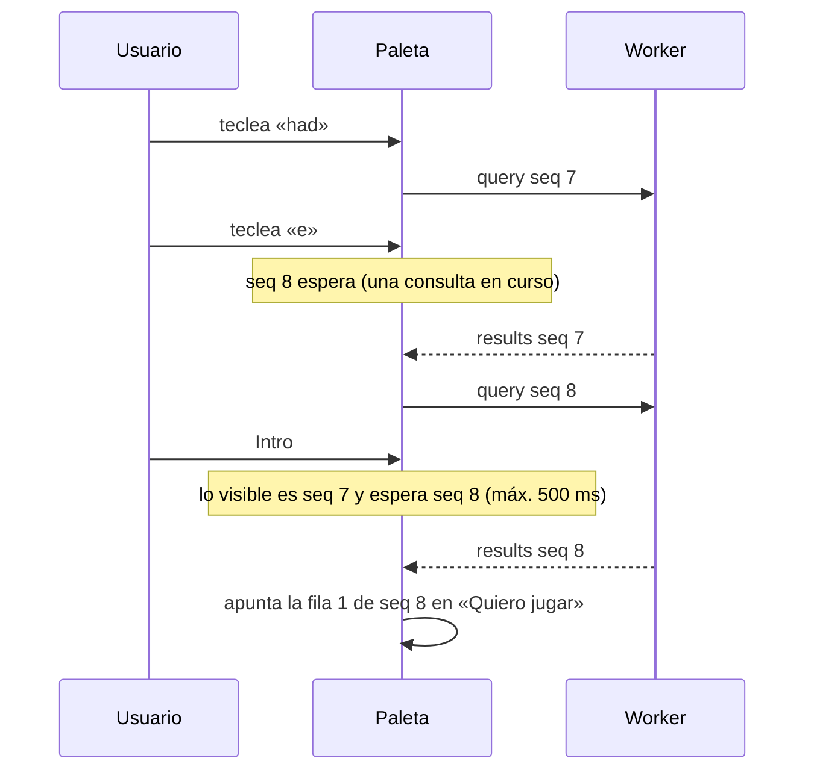
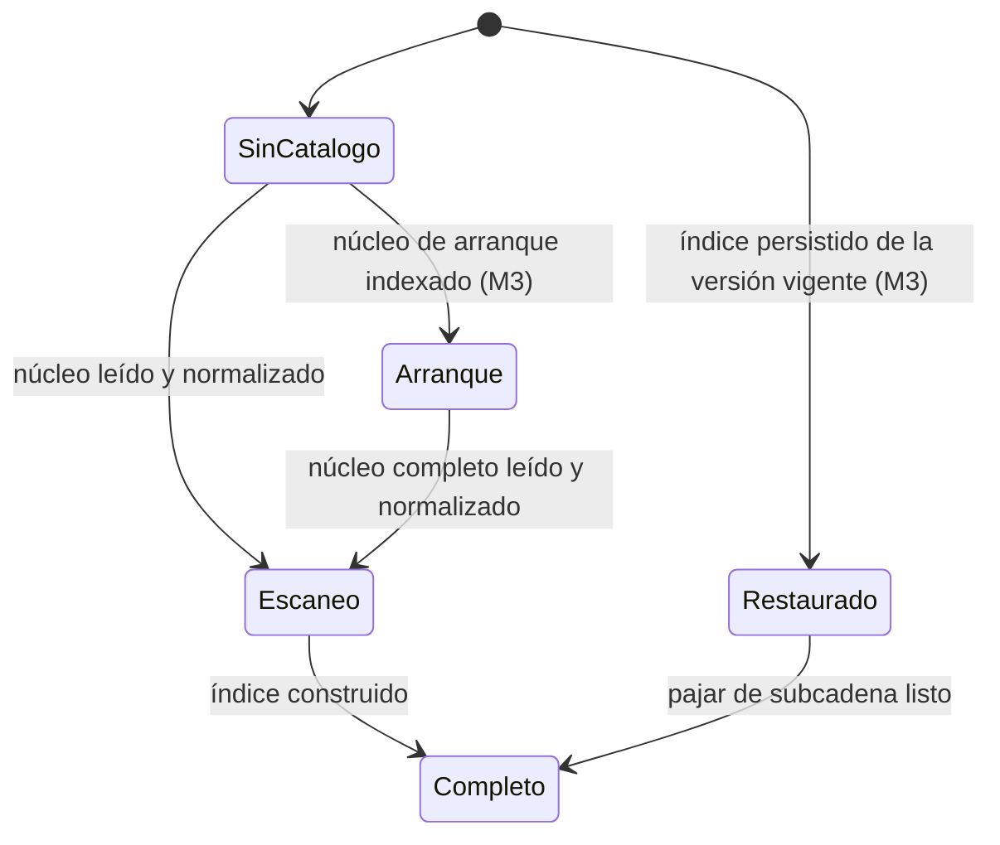

## 8. Búsqueda instantánea

La búsqueda recorre el catálogo completo en el dispositivo, dentro de un *Web Worker* de módulo; el hilo principal solo envía el texto y pinta filas. Normalización, índice y *ranking* viven en `packages/core` y son el mismo código en el Worker, en el pipeline (consultas de humo) y en los tests. Los formatos `core`, `recent` y `aliases` se definen en la §7; los presupuestos, en la §3.2 (RNF-01 a RNF-05).

### 8.1 Normalización

Una sola función `normalize()` para índice y consulta, con vectores de prueba en `packages/core/test/normalize.vectors.json` que comparten Vitest y el pipeline. Pasos, en orden:

1. Quitar ™ ℠ ® © y **todas** las formas de apóstrofo (`'` `’` `‘` `‛` `ʼ` `ʻ` `` ` `` `´` `′` `＇`) **antes** de NFKD. El apóstrofo se elimina, nunca se convierte en espacio.
2. NFKD (ancho completo, ligaduras tipográficas `fi`, `Ⅻ`…).
3. Quitar diacríticos (marcas combinantes U+0300–036F, 1AB0–1AFF, 1DC0–1DFF, 20D0–20FF y FE20–FE2F) y recomponer con NFC, para no partir kana ni hangul.
4. Minúsculas.
5. Ligaduras: ß→ss, æ→ae, œ→oe, ø→o, ł→l, đ→d (y ð→d, þ→th, ı→i).
6. `&` → `and`, rodeado de espacios.
7. Todo lo que no sea letra, número o marca combinante (categoría Unicode M) → espacio; colapsar y recortar.

El 92 % de los nombres es ASCII y pasa por una ruta rápida que debe dar el mismo resultado (lo comprueban los vectores).

| Entrada | Clave normalizada | Qué prueba |
|---|---|---|
| `HELLDIVERS™ 2` | `helldivers 2` | ™ antes de NFKD (si no, «helldiverstm») |
| `Baldur's Gate 3` / `Assassin’s Creed® Unity` | `baldurs gate 3` / `assassins creed unity` | apóstrofos eliminados |
| `Counter-Strike 2` / `NieR:Automata™` | `counter strike 2` / `nier automata` | signos → espacio |
| `ŌKAMI HD` / `Déjà Vu` / `Señorita` | `okami hd` / `deja vu` / `senorita` | diacríticos y ñ |
| `Straße` / `Æon Flux` / `Łódź` | `strasse` / `aeon flux` / `lodz` | ligaduras |
| `Ratchet & Clank: Rift Apart` | `ratchet and clank rift apart` | `&` |
| `ＦＵＬＬＷＩＤＴＨ` / `Ⅻ Legends` | `fullwidth` / `xii legends` | NFKD |
| `S.T.A.L.K.E.R. 2` | `s t a l k e r 2` | puntos (la sigla `stalker2` sale de §8.5) |
| `三国志14` / `가디언 테일즈` | `三国志14` / `가디언 테일즈` | CJK y hangul intactos |

### 8.2 Claves indexadas

| Clave | Origen | Ejemplo |
|---|---|---|
| Tokens del nombre base | `name` | `the witcher 3 wild hunt remastered` |
| Tokens del nombre en español | `nameEs`, solo si difiere tras normalizar (3 110 juegos el 28-10-2026) | «Mafia: Edición Definitiva» |
| Clave sin artículo inicial (the, a, an, el, la, los, las) | derivada; solo para los niveles 0 y 1 | `witcher 3 wild hunt remastered` |
| Romanos 1–20 ↔ arábigos | token extra si la palabra está aislada y no es la primera; la original no se toca | `grand theft auto v` (+`5`), `persona 5 royal` (+`v`), `mega man x` (+`10`); `i am bread` sin extra |
| Alias y siglas | `aliases` (§8.5), en forma compacta | `rdr2`, `cs2`, `ff7` |
| Bigramas CJK, kana y hangul | bigramas solapados + último carácter (en la consulta, solo bigramas) | `三国志` → `三国`, `国志`, `志` |

En la consulta, un artículo inicial seguido de más palabras también se prueba sin él en los niveles 0–2: «los sims 4» encuentra «The Sims™ 4» (Steam no da nombre español para este juego).

### 8.3 Estructura del índice

Los ids internos son la fila del núcleo, ordenado por rango estático: recorrer ids en orden ascendente es recorrer por popularidad.

| Estructura | Tipo | Uso | Tamaño (28-10-2026) |
|---|---|---|---|
| `tokens` | `string[]` ordenado (unidades UTF-16) | búsqueda binaria del rango de un prefijo | 117 849 tokens |
| `post` / `postStart` | `Uint32Array` | ids por token, ascendentes | 614 316 entradas |
| `fwd` / `fwdStart` | `Uint32Array` | tokens de cada juego (3,1 de media) para verificar sin intersectar | 614 316 |
| `fwp` / `fwpStart` | `Uint32Array` | primera palabra de cada clave: nivel 1 completo | 209 560 |
| *Bitsets* de 1 letra | `Uint32Array(⌈N/32⌉)` | prefijos de 1 carácter con ≥1 500 entradas | 29 + 22 (≈1,2 MB) |
| Pajar compacto (todas las claves sin espacios, concatenadas) | 2 `string` (1 byte/carácter y resto) | nivel 3 y escaneo de M1 (§8.8); se construye antes del índice (al restaurar, después) | 3,15 millones de caracteres |

Algoritmo: (1) normalizar; (2) nivel 0 con `fwp` del primer token y el mapa de alias; (3) nivel 1 con `fwp` y (4) nivel 2 recorriendo el token más selectivo (o su *bitset* si es de 1 letra) y comprobando los demás en `fwd`, los dos con **salida temprana** al reunir `limit` candidatos nuevos (las filas van por reseñas descendentes, así que `pop` no crece al recorrerlas y ahí están los `limit` mejores de ambos niveles); (5) ordenar según la §8.4; (6) niveles 3 y 4 solo si faltan.

### 8.4 Niveles de *ranking*

| Nivel | Coincidencia | Cuándo se evalúa |
|---|---|---|
| 0 | Exacta (base, español, con o sin artículo) o alias exacto (consulta sin espacios) | siempre |
| 1 | Empieza por el título (con o sin artículo) | siempre |
| 2 | Todos los tokens como prefijos de palabra | siempre |
| 3 | Subcadena sobre la clave compacta («eldenring», «halflife», «stalker 2») | si 0–2 dan <8 y hay ≥3 caracteres; como mucho 3 filas |
| 4 | Difuso, uFuzzy 1.0.19 (`intraMode: 1`): bloque «¿Quizás buscabas…?» | si 0–2 dan <5, ≥4 caracteres latinos y 150 ms sin teclear; como mucho 3 sugerencias |

- **Orden:** el nivel 0 va siempre primero. Los niveles 1 y 2 se ordenan juntos por puntuación descendente, `pop + 6` (nivel 1) o `pop + 0` (nivel 2), y a igual puntuación por el orden de filas; detrás van el nivel 3 y, en su bloque, el 4. Así, con «wukong», Black Myth: Wukong (nivel 2) pasa del puesto 12 al 2. El modo estricto (la popularidad solo desempata dentro de cada nivel) queda como alternativa documentada; la calidad de los dos, en la §8.11.
- Los retirados van detrás de los juegos vivos de su grupo (nivel 0, niveles 1–2 o nivel 3), aunque tengan `pop` alto. Los «próximamente» no se penalizan; +18 se filtra antes de contar para `limit`, salvo que Ajustes lo permita.
- Los juegos ya apuntados se marcan con su estado y no se duplican; no ganan ni pierden puestos.
- La paleta pide `limit` = 8; el nivel 3 reutiliza el resultado completo de la pulsación anterior si la nueva clave contiene la anterior.

### 8.5 Alias y siglas

- **Fuente:** `pipeline/aliases.curated.tsv` (mantenida a mano: `csgo`, `ff7`, `civ6`, `aoe2`, `re4`, `tlou`…) + siglas generadas para los 5 000 juegos con más reseñas. El pipeline publica la unión como `aliases` (ver §7).
- **Generación:** iniciales del título completo y del título principal (antes de `:` o ` - `), con y sin artículo; los números se copian enteros; los romanos dan dos variantes (`gtav`, `gta5`); también se corta en el primer número del título principal («Grand Theft Auto V Enhanced» → `gta5`). Longitud 3–10 con ≥2 letras. Se descarta la sigla que es un artículo o un token presente en ≥20 nombres («Tom Hates Everyone» no genera `the`).
- **Medido:** 3 549 siglas generadas y 47 alias curados dan 3 563 pares únicos (66 siglas descartadas), 15,8 KB brotli. Las colisiones se conservan (`cs2` → Counter-Strike 2, Cities: Skylines II…) y la popularidad las ordena.

### 8.6 Números y `appid`

Un número suelto es una búsqueda de título: «2077» da Cyberpunk 2077 primero y «1942» da «1942: The Pacific Air War». Un `appid` solo se reconoce en un enlace de la tienda (parser de `packages/core`, ver §9) o con el prefijo explícito `appid:730`.

### 8.7 Protocolo con el Worker

| Mensaje | Sentido | Campos |
|---|---|---|
| `init` | UI → Worker | `catalogVersion`, `showAdult` |
| `status` | Worker → UI | `state` (`none`, `boot` desde M3, `scan` o `full`; ver §8.8), `version`, `count`, `progress`, `error` (código y si admite reintento) |
| `query` | UI → Worker | `seq`, `q`, `limit` |
| `results` | Worker → UI | `seq`, `items` (`appid`, `name`, `nameEs`, `year`, `flags`, `tier`), `strong` (resultados de niveles 0–2), `ms` |
| `suggest` / `suggestions` | UI ↔ Worker | `seq`; hasta 3 `items` del nivel 4 |

- `seq` crece en cada cambio del campo. La UI pinta solo `results` con el `seq` actual y descarta los demás.
- **Otras peticiones** (llevan un `reqId`, que la respuesta repite): `options {showAdult}`, al cambiarlo en Ajustes; `browse {viewId, q, filters}` → `count` y `rows {viewId, from, to}` → `items`, en ventanas de ≤200 filas del Catálogo (el catálogo nunca pasa entero al hilo principal); `game {appid}` → fila del núcleo o `null` (ficha; desde M2, con su *shard*); `lookup {appids}` → `found`, `missing` (juegos provisionales; se repite cuando `status` trae otra `version`); `matchExact {title}` → `appids` con la misma clave exacta, sin alias («Vincular» solo se propone si hay uno); `retry` y `refresh` («Reintentar» y «Actualizar catálogo»).
- Como mucho **una consulta en curso**: mientras tanto la UI guarda solo el último texto (sin *debounce*).
- **Cancelación:** el nivel 4 recorre los nombres en bloques de 20 000 y cede el turno entre bloques; si llega un `seq` mayor, abandona.
- **Carrera de Intro:** Intro actúa sobre la primera fila del `seq` actual; si aún no ha llegado, espera hasta 500 ms; si no llega, no apunta nada y la pista cambia a «Elige un resultado». Intro nunca apunta una sugerencia del nivel 4 que no se haya elegido: si solo hay sugerencias, la pista cambia a «¿Quizás buscabas…? Elige con ↓».

### 8.8 Disponibilidad

| Estado | Qué hace la paleta |
|---|---|
| Sin catálogo (`none`) | busca en Mi lista, apunta a mano y acepta enlaces, con aviso de progreso (ver §9) |
| Núcleo de arranque (`boot`, M3) | busca en los 20 000 más populares (269 KB brotli; se descarga primero) |
| Escaneo (`scan`, desde M1) | busca en todo el catálogo mientras se construye el índice: el nivel 0 y los alias con un mapa de claves exactas; los niveles 1–3, con `indexOf` sobre el pajar en orden de filas y las mismas comprobaciones de clave y el mismo orden (§8.4); el nivel 4, igual |
| Restaurado (`full`, M3) | índice leído de IndexedDB (`meta.searchIndex`, sin Dexie), sin normalizar ni construir; niveles 0–2 al instante, el 3 en cuanto está el pajar |
| Completo (`full`) | todos los niveles |

El índice se construye sobre el núcleo con `recent` ya aplicado. En M1 se construye en cada arranque en frío y, mientras tanto, responde el escaneo: leer el TSV → normalizar las claves → pajar y mapa de exactos y alias → `scan` → diccionario, *postings*, `fwd`, `fwp` y *bitsets* → `full`. La construcción trabaja en bloques de ≤8 ms y cede el turno entre ellos (por ejemplo, con `MessageChannel`), así que una pulsación espera como mucho un bloque. En `scan` rige el presupuesto de la §8.9: el escaneo medido está listo en 1,72 s y da 42 ms p95 con CPU ×4, pero es otro motor (§8.11), así que la latencia y la calidad del puente quedan **a verificar en M1**. En M3 el índice se persiste con la clave `version` del núcleo + *hash* de `recent` y, si cambia, se sigue usando el anterior mientras se reconstruye en segundo plano.

### 8.9 Presupuestos y cómo se miden

| Métrica | Presupuesto (RNF de la §3.2 y propios) | Medición |
|---|---|---|
| Pulsación → resultados, p95 | escritorio: ≤16 ms a ≥120 Hz y ≤2 fotogramas por debajo (≈33 ms a 60 Hz); ≤50 ms con CPU ×4 (RNF-02), también en `scan` | conjunto realista de la §8.11, tecleado carácter a carácter: con ×1, dentro del Worker y de ida y vuelta; con ×4, el núcleo de búsqueda en el hilo principal de una página de prueba; `npm run perf` con Playwright y CDP (ver §12.4) |
| Nivel 4 (diferido) | ≤70 ms con CPU ×4 | mismo banco de pruebas, en las consultas que lo activan |
| Reinicio con caché hasta poder buscar | ≤2 s (RNF-04): en M1, con `scan`; en M3, con el índice restaurado | marca `search:ready` (primer `status` distinto de `none`) |
| Búsqueda lista tras la primera carga (M3) | ≤1,5 s (RNF-05), con `boot` | marca `search:ready` |
| Restaurar índice persistido (M3) | ≤0,4 s con CPU ×4 (hoy 0,55 s; guardar los *bitsets* y decodificar los nombres bajo demanda debería bastar: **a verificar en M3**) | marca `search:index-restored` |
| *Chunk* del Worker | ≤40 KB brotli | puerta de tamaño (ver §6) |

El estrangulamiento de CPU por CDP **no afecta a los Workers dedicados** (medido en Edge 156: p95 interno de 2,4 ms a ×1 y a ×4. En el Chromium de Playwright lo comprueba cada pasada de `npm run perf`: con ×4, el hilo principal va 4,2–5,2 veces más lento y el Worker dedicado, 0,9–1,1. Con `Target.setAutoAttach` el Worker se adjunta, pero `Emulation.setCPUThrottlingRate` responde «Operation is only supported for pages, not workers»; medido el 29 y el 30-10-2026). Por eso la prueba de búsqueda con ×4 ejecuta el núcleo de búsqueda en el hilo principal de una página de prueba y el Worker real se valida en el Android de referencia; INP, toque → respuesta y tareas largas se miden en la app real con ×4 (ver §12.4).

El presupuesto de escritorio se cuenta en fotogramas porque la medida termina en uno (§12.4) y el Worker no es el cuello de botella: responde en 0,2 ms. Chromium retiene el mensaje del Worker hasta el primer fotograma tras la tecla (`DeferRendererTasksAfterInput`) y, aun sin esa retención, el primer fotograma cae en una fase de vsync al azar. A 60 Hz el suelo es p95 ≈17 ms; a 120 Hz, la app da 14,8 ms (medido el 29-10-2026; ver ADR-005). Precalcular en el Worker la siguiente tecla bajaría la cifra, pero gastaría CPU en el móvil por una diferencia que no se nota.

### 8.10 Conjuntos dorados y puertas

- **Lista evaluada:** la que ve el usuario con el índice completo (`full`): hasta 8 filas, las de los niveles 0–3 y, si los niveles 0–2 dan <5, hasta 3 sugerencias del nivel 4 al final; en exactos y prefijos, con +18 visible. El nivel 4 forma parte de la puerta desde M1: sin él, el dorado da 90,8 % / 93,9 %.
- **Dorado:** `packages/core/test/golden.es.tsv`, ≥60 consultas en español con su `appid` esperado (hoy 98: exactas, sin apóstrofo, romanos, siglas, nombres en español, erratas). Puerta: top-1 ≥90 % y top-5 ≥95 %.
- **Exactos:** 2 000 nombres al azar con semilla fija: ≥99 % en el top-5.
- **Prefijos:** las 4 primeras letras de los 1 000 más populares: ≥90 % en el top-10.
- **Negativas:** «pokemon», «zelda», «mario kart»: ningún resultado de nivel 0–1 (se ofrece el alta manual).
- **Dónde:** en CI, con Vitest y sin red, sobre una copia congelada del núcleo real y de sus alias en `fixtures/catalog-frozen/`: `core.20261028.1.tsv.gz` (≈3,05 MB) y `aliases.20261028.1.tsv`, copiados el 28-10-2026, que se renuevan a mano con `npm run fixtures:freeze`, como mucho una vez por hito (ver §12.1 y §14); en `catalog.yml`, como puerta de publicación sobre el núcleo recién construido, junto a las consultas de humo (ver §4). El puente `scan` se mide aparte en M1.

### 8.11 Resultados del benchmark (28-10-2026)

Ryzen 5 3600, Node 24.21.0 y Edge 156 sin interfaz (CDP); las columnas de Edge se midieron con el núcleo de búsqueda en el hilo principal de una página de prueba (ver §8.9); núcleo real de 196 665 juegos; secuencias realistas: 150 nombres tecleados carácter a carácter (2 084 pulsaciones). El reloj del navegador tiene una resolución de 0,1 ms. «—» = no medido.

| Medida | Node 24 | Edge ×1 | Edge ×4 | Edge ×10 |
|---|---|---|---|---|
| Índice listo (`full`): descarga local + lectura del TSV + índice | 0,68 s | 0,86 s | 4,56 s | 11,4 s |
| Escaneo listo (`scan`)\* | — | 0,41 s | 1,72 s | 3,55 s |
| Pajar compacto (construcción aparte) | 0,11 s | 0,14 s | 0,66 s | 1,32 s |
| Memoria (*heap* + *typed arrays*) | 39 MiB | 40 MiB | 40 MiB | 40 MiB |
| Restaurar índice (IndexedDB → 1.ª consulta) | — | 0,15 s | 0,55 s | 1,37 s |
| Pulsación p50 / p95 / máx. | 0,03 / 1,9 / 7,4 ms | <0,1 / 2,1 / 8,4 ms | 0,2 / 8,7 / 25 ms | 0,3 / 17 / 66 ms |
| Nivel 4 diferido p50 / p95 | 10 / 14 ms | 9 / 13 ms | 46 / 62 ms | 110 / 150 ms |
| Escaneo lineal\* p50 / p95 / máx. | 2,6 / 9,8 / 28 ms | 2,5 / 9,3 / 33 ms | 11 / 42 / 109 ms | 24,5 / 96 / 222 ms |

\* Motor de escaneo medido: `indexOf` sobre los nombres normalizados, 100 candidatos y reordenación por reseñas, sin romanos ni nombres en español. El puente de M1 usa los niveles y el orden de la §8.4 (ver §8.8).

| Fichero | Sin comprimir | gzip -9 | brotli 5 | brotli 11 |
|---|---|---|---|---|
| Índice serializado (solo local) | 19,2 MB | 10,6 MB | 9,32 MB | 6,66 MB |

Los tamaños del núcleo, del núcleo de arranque y de los alias están en la §7.6. El índice serializado triplica el núcleo comprimido: no se publica; se construye en el cliente y se guarda en local.

| Calidad | Objetivo | Índice, orden adoptado | Índice, modo estricto | Escaneo\* |
|---|---|---|---|---|
| Dorado (98) top-1 / top-5 | ≥90 % / ≥95 % | 94,9 % / 99,0 % | 94,9 % / 98,0 % | 86,7 % / 87,8 % |
| 2 000 exactos, top-5 | ≥99 % | 99,9 % | 99,9 % | 99,3 % |
| Prefijo de 4 letras, top-10 | ≥90 % | 93,2 % | 93,7 % | 94,6 % |

El orden adoptado se midió con el nivel 3 dentro de la misma ordenación (`pop − 6`) y desempate por nivel y fila; con la regla de la §8.4 (nivel 3 siempre detrás y desempate por fila) da lo mismo salvo los prefijos, 93,1 % (comprobado el 28-10-2026 con el mismo banco de pruebas).

Punto de partida de M1: el prototipo medido (JavaScript puro; uFuzzy en el nivel 4) está en `docs/planificacion/prototipo-busqueda/`, con el código, el dorado, las secuencias de tecleo, los vectores de normalización, los alias curados, la generación de siglas y los resultados; el núcleo medido y sus alias ya están congelados en `fixtures/catalog-frozen/` (ver §8.10). En M1 el prototipo se porta a TypeScript en `packages/core/src/search/` y el dorado pasa a `packages/core/test/golden.es.tsv`.
