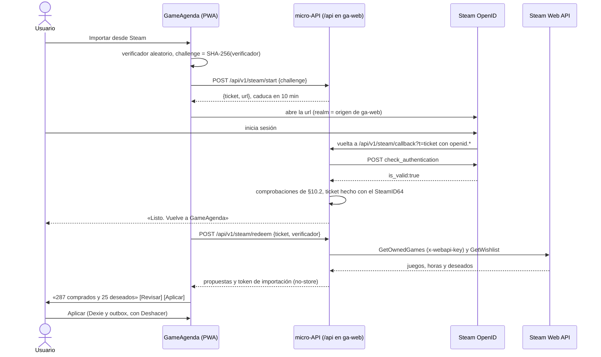

## 10. Integración con la cuenta de Steam

**Fase 2.** La cuenta de Steam es una ayuda opcional para importar, nunca un requisito: apuntar funciona sin cuenta y sin red. Reglas fijas:

- **Ninguna llamada a Steam por usuario, con clave o sin ella, antes de un login OpenID verificado.** El prototipo (M0–M4) no hace ninguna.
- La importación solo **propone**: el usuario revisa y aplica, con Deshacer.
- Las respuestas de Steam no se guardan en D1.

### 10.1 Qué se importa

| Dato | Endpoint | ¿Clave? | Qué propone |
|---|---|---|---|
| Biblioteca y horas | `IPlayerService/GetOwnedGames/v1` (`include_appinfo`, `include_played_free_games`, `skip_unvetted_apps=false`) | Sí | **Comprado** en las entradas existentes; añadir el resto como «Quiero jugar» (p. ej., solo los no jugados) es opcional. Nunca los `family_shared`. Las horas, solo como pista; `ownedAt` queda vacío |
| Lista de deseados | `IWishlistService/GetWishlist/v1` (`steamid`) | No (no documentado) | **Quiero jugar**, al final de la lista |
| Logros | `IPlayerService/GetUserAchievements` + `GetGameAchievements` (no documentados); alternativa con clave: `ISteamUserStats/GetPlayerAchievements` + `GetSchemaForGame` | No / Sí | **Platinado**, solo como sugerencia: conjuntos del juego base (`dlcappid=0`) completados |

No se usa `GetPlayerSummaries`: importar no necesita nombre, avatar ni ubicación. Matices (verificados el 28-10-2026):

- **Privacidad:** hace falta «Detalles de juegos: Público»; si no, `GetOwnedGames` responde `200 {"response":{}}` sin `game_count` y la app muestra una guía corta (`communityvisibilitystate` mide el perfil y no lo detecta). Los juegos marcados como privados no aparecen: la importación puede salir incompleta.
- **Achievement Sets** (beta anunciada el 16-10-2026): los logros archivados no cuentan, los DLC van en conjuntos aparte y un conjunto completado sigue completado. Por eso Platinado sigue siendo manual.
- **Coste:** ≈1 llamada por juego con logros (≈300 en una biblioteca de 500), con los esquemas cacheados por `schema_hash` en el dispositivo. El escaneo lo lanza el usuario, es incremental (solo juegos con `rtime_last_played` nuevo), va en lotes de ≤20 juegos (el plan gratuito de Workers admite 50 subpeticiones por invocación) y respeta los 429; un 401 no se reintenta. Todas las llamadas del servidor cuentan para el límite de los ToU (ver §11.1).

Fuentes: <https://partner.steamgames.com/doc/webapi/IPlayerService> · <https://developers.cloudflare.com/workers/platform/limits/>

### 10.2 Identificación: «Iniciar sesión con Steam»

Steam solo ofrece **OpenID 2.0** a terceros (sin OIDC ni OAuth abierto). La micro-API usa **`steam-signin` 1.0.5**: sin clave, devuelve solo el SteamID64. Como usa `https`, `querystring` y `Buffer` de Node, el Worker necesita `nodejs_compat` (a verificar en Fase 2); si no bastara, se porta su `verifyLogin` (MIT, una función corta) a `fetch`.

Comprobaciones obligatorias (omitirlas es un fallo recurrente, p. ej. CVE-2026-82183):

1. `check_authentication` por POST del servidor a la URL **fija** `https://steamcommunity.com/openid/login`, nunca al `op_endpoint` recibido.
2. `claimed_id`, `return_to` y `response_nonce` dentro de `openid.signed`.
3. `return_to` idéntico al emitido, ticket incluido: `steam-signin` solo compara esquema y host, así que la ruta y el ticket los comprueba la micro-API.
4. `claimed_id` con `^https?://steamcommunity\.com/openid/id/(\d{17})/?$`.
5. Ticket de un solo uso que caduca en 10 min y solo se canjea con su verificador: una aserción capturada no sirve para otro ticket ni para colar un login ajeno (*login CSRF*).

**Canje tipo PKCE:** las apps de la pantalla de inicio de iOS tienen un almacén de cookies distinto del de Safari, donde acaba el login, y una cookie de estado no llegaría a la app. Por eso el ticket se liga a un `challenge` (SHA-256 de un verificador aleatorio de 256 bits que solo conoce la app) y lo canjea la propia app. El envoltorio Tauri (ver §17.3) usa el mismo flujo con el navegador del sistema, sin esquema propio ni puerto local.

**Descartado:**

- **Pegar el perfil, sin login:** cualquiera podría importar un perfil público ajeno; incumple el «solo a petición del usuario» de los ToU y expone la clave, la misma del catálogo, a abuso y revocación.
- Pedir contraseñas o *tokens* de Steam (`steam-session` es solo para cuentas propias) y usar PICS o el protocolo del cliente.
- `passport-steam`: sin versiones desde 2023.

Fuentes: <https://partner.steamgames.com/doc/features/auth> · <https://github.com/DoctorMcKay/node-steam-signin> · <https://openid.net/specs/openid-authentication-2_0.html>

### 10.3 Flujo

### 10.4 Qué se guarda y cómo se prueba

- **Servidor:** las respuestas de Steam solo viajan hasta el dispositivo (`Cache-Control: no-store`, sin registros en `/api/v1/steam/*`). D1 guarda solo el ticket (*hash*, `challenge`, caducidad y, tras el login, el SteamID64) ≤10 min; Time Travel lo conserva 7 días más (ver §11.2). Con las propuestas llega un *token* de importación firmado (HMAC, 15 min, solo en memoria) para los lotes de logros.
- **Dispositivo:** las marcas aceptadas son datos de la agenda y se sincronizan como cualquier cambio. Los metadatos de importación (`rtime_last_played` por `appid`, esquemas) van en `meta` (ver §7); «Desconectar Steam y borrar datos» los elimina.
- **Clave:** pasa a ser también un secreto del Worker (`wrangler secret put`). La búsqueda de nombres (`x-webapi-key` y el de la variable) se limita entonces a los *assets* del cliente; la del valor lo cubre todo (ver §12).
- **Pruebas:** las comprobaciones de la §10.2, con aserciones grabadas en `fixtures/` (firma falsa, campos sin firmar, `return_to` ajeno, ticket repetido) y `app.request()` de Hono; el CI nunca llama a Steam. El login real se prueba a mano con un túnel `cloudflared` (HTTPS en el puerto 443): `steam-signin` descarta el puerto del *realm* y OpenID 2.0 exige el mismo puerto en `return_to`, así que `http://localhost:8787` no sirve. Casos: perfil privado, biblioteca vacía, juego compartido en familia y juego privado.
