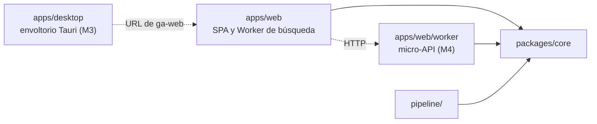

## 14. Estructura del repositorio

Monorepo con *workspaces* de npm (sin pnpm). `packages/core` no se compila: Vite, Vitest y Node (con *type stripping*) usan su código TypeScript tal cual.

### 14.1 Árbol comentado

```text
gameagenda/
├─ apps/web/               @gameagenda/web: la app (React + Vite, PWA)
│  ├─ src/
│  │  ├─ screens/          Mi lista, Catálogo, ficha, Ajustes, paleta
│  │  ├─ router/           router propio sobre la History API
│  │  ├─ db/               Dexie: entries, outbox, settings, meta
│  │  ├─ search-worker/    Web Worker de búsqueda (chunk aparte)
│  │  ├─ i18n/es.ts        todas las cadenas de la interfaz
│  │  └─ sw.ts             Service Worker (vite-plugin-pwa)
│  ├─ worker/              M4: micro-API Hono en /api/v1/* y D1
│  ├─ e2e/                 Playwright, incluido el proyecto perf
│  ├─ public/_headers      CSP y cabeceras de ga-web (ver §11)
│  └─ wrangler.jsonc       Worker ga-web (assets; /api/* desde M4)
├─ apps/desktop/           M3: app de escritorio, envoltorio Tauri
│  └─ src-tauri/           Cargo.toml, tauri.conf.json, capabilities/,
│                          src/main.rs (atajo, bandeja, una instancia)
├─ packages/core/          @gameagenda/core: lógica pura compartida
│  ├─ src/                 normalize/ search/ steam-link/ entries/
│  │                       catalog-format/ sync/ schemas/
│  └─ test/                normalize.vectors.json, golden.es.tsv (§8)
├─ pipeline/               @gameagenda/pipeline: catálogo (ver §4)
│  ├─ build.ts             entrada de npm run catalog:build
│  ├─ steam/               cliente HTTP: ritmo, reintentos, fixtures
│  ├─ record-fixtures.ts   graba respuestas reales y las redacta
│  └─ wrangler.jsonc       Worker ga-catalog (solo assets de out/)
├─ fixtures/
│  ├─ steam/               respuestas grabadas, por endpoint y caso
│  ├─ catalog/             mini-catálogo en el formato publicado
│  ├─ catalog-frozen/      núcleo real congelado (≈3 MB gzip) y sus alias
│  └─ keys/                clave de firma de desarrollo (dev y e2e)
├─ scripts/                setup, puertas de tamaño, búsqueda de clave
├─ docs/adr/               NNN-titulo.md (MADR, en español)
├─ docs/planificacion/prototipo-busqueda/
│                          prototipo de búsqueda medido (ver §8.11)
├─ .github/workflows/      ci.yml, deploy-web.yml, catalog.yml
├─ prototipe.md, README.md, CHANGELOG.md
└─ package.json, .npmrc, .gitattributes, .node-version, biome.json
```

`apps/web/worker/` es el Worker de Cloudflare de la micro-API (M4); no debe confundirse con `src/search-worker/`, que se ejecuta en el navegador.

Ya existen dos carpetas: `fixtures/catalog-frozen/`, con `core.20261028.1.tsv.gz` y `aliases.20261028.1.tsv` (copiados el 28-10-2026), y `docs/planificacion/prototipo-busqueda/`, con el código, el dorado, los vectores y los resultados de la búsqueda medida ese día.

### 14.2 Qué vive en cada paquete

| Paquete | Contenido | Depende de |
|---|---|---|
| `apps/web` | Pantallas, *router*, Dexie, Worker de búsqueda, Service Worker; en M4, micro-API y migraciones de D1 | `core`, React, Dexie, `@tanstack/react-virtual`, `workbox-window`, `uuid`; Hono en M4 |
| `apps/desktop` | Desde M3: ventana Tauri que carga `ga-web`, atajo global, icono en la bandeja, una sola instancia y arranque con Windows opcional; ningún código de la web (ver §17.3) | `@tauri-apps/cli` y los *crates* de la §6; ningún paquete del repositorio |
| `packages/core` | Normalización y sus vectores; claves, índice y *ranking*; parser de enlaces; códecs TSV y *shards*; JSON canónico del *manifest*; reglas de estados y marcas; HLC y `merge()`; esquemas Zod (Steam, exportación, micro-API) | Zod; uFuzzy, solo en el nivel difuso (carga diferida) |
| `pipeline/` | Cliente HTTP de Steam, etapas, puertas, firma ed25519 (`node:crypto`), grabador de *fixtures* | `core`, Zod; `wrangler` para publicar |
| `fixtures/` | Datos: respuestas grabadas, mini-catálogo, copia congelada y comprimida del núcleo real con sus alias (`core.<versión>.tsv.gz` y `aliases.<versión>.tsv`, para las puertas de calidad de búsqueda en CI y `perf`; se renueva a mano, como mucho una vez por hito: ver §12.1) y clave de firma de desarrollo | — |

### 14.3 Reglas de dependencia



1. `core` no depende de otros paquetes del repositorio ni hace E/S (nada de DOM, `node:*`, `fetch`, Dexie ni React), y recibe el reloj y los aleatorios como parámetros. Su `tsconfig` no incluye la `lib` DOM ni `@types/node`: `tsc` falla si se cuela una API de E/S. `structuredClone`, `URL` y `TextEncoder`, que TypeScript solo declara en las `lib` DOM y WebWorker pero existen en el navegador, en Cloudflare Workers y en Node, se declaran en un `globals.d.ts` propio de `core`.
2. `apps/web` y `pipeline/` dependen de `core`, nunca el uno del otro. Lo compartido (formato del catálogo, normalización, esquemas) vive en `core`: pipeline, Worker de búsqueda y pruebas usan la misma implementación.
3. `apps/web/worker/` importa `core` y Hono, nunca `apps/web/src/`; la SPA solo le habla por HTTP, en el mismo origen.
4. El Worker de búsqueda no importa React y su *chunk* tiene presupuesto propio (ver §6).
5. El código de producción nunca importa `fixtures/`: solo lo leen las pruebas, los scripts y el servidor de desarrollo.
6. Solo `pipeline/` lee `STEAM_WEB_API_KEY`; la SPA solo ve variables `VITE_*`.
7. Entre paquetes se importa por nombre (`@gameagenda/core/search`) y solo lo que declara `exports`, nunca con `../`. Los imports relativos llevan la extensión `.ts`, que Node exige. [Node no quita tipos dentro de `node_modules`](https://nodejs.org/api/typescript.html), pero resuelve el enlace simbólico de `core` a su ruta real (a verificar en M0).
8. `apps/desktop` no importa nada del repositorio y la web no importa Tauri: solo se conocen por la URL de `ga-web` (ver §17.3).

Se vigilan con Biome (`noRestrictedImports` por carpeta y `noUndeclaredDependencies`) y con el `tsconfig` de `core`. Las pruebas, los E2E, `perf`, las configuraciones y `scripts/` quedan fuera de `noUndeclaredDependencies`: usan las dependencias de desarrollo de la raíz, que npm sube allí. La regla 6 la vigila la búsqueda de la clave del CI (§12.5).
