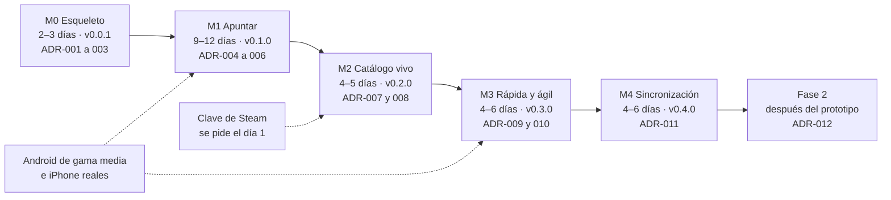

## 15. Roadmap e hitos

Cinco hitos, **M0–M4**, suman **23–32 días ideales** de una persona (día ideal ≈6 h de trabajo concentrado). Cada uno acaba desplegado en `workers.dev`, con etiqueta SemVer y criterios comprobables con una prueba o una medida; lo que no está en ningún hito es Fase 2.

Un hito se cierra con sus criterios demostrados en producción (y en el dispositivo real cuando se pide), la *Definition of Done* de la §12 y sus ADR escritos; un criterio que falla se corrige o pasa a otro hito con un *issue*, nunca se rebaja en silencio.

### 15.1 Orden de los hitos y ADR

- Cada ADR se escribe al empezar su hito, numerado por orden de escritura (títulos y estado en la §5.6).
- **M3 y M4 son independientes:** el orden por defecto es M3 → M4, pero si se apunta en los dos dispositivos desde el principio, o en un iPhone sin instalar la app (ver §16, R-05), M4 va antes (ver §18, PA-01). En ese caso, M4 se etiqueta `v0.3.0` y su ADR es el ADR-009; M3 pasa a `v0.4.0` y a los ADR-010 y 011.

### 15.2 Del día ideal al calendario

Semanas = días ideales × 6 h ÷ horas de trabajo por semana (×0,6 a 10 h/semana, ×0,4 a 15 h y ×0,2 a 30 h). Acumulado al cerrar cada hito:

| Hasta | Días ideales | 10 h/semana | 15 h/semana | Tiempo completo (30 h) |
|---|---|---|---|---|
| M0 | 2–3 | 1,2–1,8 | 0,8–1,2 | 0,4–0,6 |
| M1 | 11–15 | 6,6–9,0 | 4,4–6,0 | 2,2–3,0 |
| M2 | 15–20 | 9,0–12,0 | 6,0–8,0 | 3,0–4,0 |
| M3 | 19–26 | 11,4–15,6 | 7,6–10,4 | 3,8–5,2 |
| M4 | 23–32 | 13,8–19,2 | 9,2–12,8 | 4,6–6,4 |

Sin colchón: para planificar se suma un 20 % (ver §16, R-13). Aparte van las esperas: la clave de Steam (ver §18), los ≥7 días con el cron activo que exige M3 (en paralelo a su trabajo) y tener los móviles reales.

### 15.3 M0 · Esqueleto (`v0.0.1`) · 2–3 días ideales

**Objetivo:** construir, probar y desplegar desde el primer día. **Entra:** repositorio privado con npm workspaces (ver §14); Biome, `tsc`, Vitest y Playwright; `ci.yml`; despliegue de `ga-web` (página mínima con `_headers`) en cada *push* a `main` y de `ga-catalog` con el mini-catálogo de `fixtures/` y su `_headers` (CORS y TSV como `text/plain; charset=utf-8`; ver §7.6); solicitud de la clave; elección del Android de referencia (ver §18, PA-02); las comprobaciones marcadas «a verificar en M0» en el plan; ADR-001 (arquitectura), ADR-002 (stack y repositorio) y ADR-003 (*hosting*, despliegue y CI). **No entra:** datos reales de Steam, Service Worker ni Dexie.

**Criterios de aceptación:**
- CA0.1 Un *push* a `main` pasa el CI en ≤10 min y despliega `ga-web`, que responde por HTTPS con las cabeceras de `_headers` (CSP sin `unsafe-inline`).
- CA0.2 `ga-catalog` sirve el *manifest* con `Cache-Control: no-cache` y `Access-Control-Allow-Origin` solo para el origen de `ga-web`.
- CA0.3 `ga-catalog` sirve núcleo, recientes y alias como `text/plain; charset=utf-8` y llegan comprimidos: la respuesta trae `Content-Encoding` `br`, `gzip` o `zstd`, según lo que anuncie el navegador. Si aun así no se comprimen, se publican ya comprimidos con gzip y el Worker de búsqueda los descomprime con `DecompressionStream` (ver §16, R-16); el ADR-003 recoge la opción y el tamaño transferido.
- CA0.4 El CI falla con un *build* que contiene `x-webapi-key` o una clave falsa, y con un JS inicial de más de 150 KB brotli (ver §6).
- CA0.5 Desde un clon limpio, la app arranca en local en ≤10 min sin acceso a Steam (ver §13); la clave está pedida o se sabe qué falta (ver §18).

**Esfuerzo:** herramientas y CI 0,5–1; despliegues de `ga-web` y `ga-catalog` 0,5; comprobaciones «a verificar en M0» 1–1,5 (p. ej., compresión del TSV, `_headers` y CORS también en los 404, campos de `Query` sin `include_basic_info`, estrangulamiento del Worker e importación de la clave Ed25519), cada una con su resultado en el ADR que corresponda o en un *issue*. **Depende de:** cuentas de GitHub y Cloudflare.

### 15.4 M1 · Apuntar (`v0.1.0`) · 9–12 días ideales

**Objetivo:** buscar y listar todo el catálogo de Steam y apuntar en «Quiero jugar» en <3 s, con los estados y las marcas a mano. Al cerrar M1 la app ya sirve para el día a día.

**Entra:** catálogo construido en el PC sin clave (ver §4), con núcleo, alias y *manifest* sin firma, y una copia congelada y comprimida del núcleo y sus alias en `fixtures/catalog-frozen/` para las puertas de calidad del CI (ver §8.10 y §12.1); Worker de búsqueda con todos sus niveles (ver §8) y, mientras se construye el índice, puente de escaneo lineal con los mismos niveles (estados `none` → `scan` → `full`; ver §8.8); paleta (`Ctrl+K`, `/` —desactivable en Ajustes— y barra inferior en móvil) con Intro, toque, `Ctrl+Intro`, `Alt+Intro` y `Mayús+Intro`; Mi lista con «Pendientes», filtro por estado, estados, marcas, fechas automáticas, orden manual desde el menú de la fila y Deshacer (aviso, `Ctrl+Z` con varios niveles y «Deshacer último cambio» en móvil); ficha básica (`/juego/<id>`: datos del núcleo y todos los campos de la entrada, editables); Catálogo virtual con contador y +18 oculto; juego manual con propuesta de vincular; pegar un enlace (juego provisional si no está); Dexie con `outbox`; exportar e importar JSON y CSV; `persist()`; «Borrar todos mis datos»; aviso de marca en «Acerca de»; PWA sin red tras la primera visita; ADR-004 (datos del usuario), ADR-005 (búsqueda) y ADR-006 (alcance y formato del catálogo). **No entra:** pipeline diario, portadas, ficha completa y vista Próximos (M2); índice persistido, núcleo de arranque, atajos de una tecla, `Alt+↑/↓`, `Ctrl+V` fuera de la paleta, gestos (también la pulsación larga), arrastre y «Compartir» (M3).

**Criterios de aceptación:**
- CA1.1 **Completo:** el núcleo tiene ≥190 000 juegos y pasa las puertas de publicación (ver §4); todo `appid` con nombre del volcado público de `GetAppList` (`jsnli/steamappidlist`, solo en desarrollo) está en el núcleo o en el informe con su motivo (lista negra, SKU regional duplicado…); los 18 sin nombre (27-10-2026) se completan con `GetItems` o se excluyen, y se cuentan.
- CA1.2 **Listable:** con +18 visible, el contador del Catálogo coincide con el *manifest* (con +18 oculto, descuenta los de adultos) y se llega a la última fila con Fin y con la barra, en Chromium y en el Android de referencia.
- CA1.3 **Buscable:** pasan las consultas de humo; ≥99 % de 2 000 nombres exactos al azar quedan en el top 5 y ≥90 % de los prefijos de 4 letras de los 1 000 juegos más populares, en el top 10; el conjunto dorado cumple sus umbrales (ver §8). En CI se comprueba sobre la copia congelada del núcleo.
- CA1.4 **Apuntar en <3 s:** el E2E «apuntar un juego» (ver §12) da una mediana de 5 ejecuciones <3 s en escritorio y en móvil emulado, y p50 ≤3 s en 10 altas en el Android de referencia (`chrome://inspect`).
- CA1.5 **Rendimiento** (`npm run perf`, CPU ×4; ver §12.4): tecla → resultados ≤50 ms p95 (≤16 ms sin estrangular), con el núcleo de búsqueda en el hilo principal de una página de prueba, porque CDP no estrangula los Workers; en la app real, toque → respuesta ≤100 ms, INP p75 ≤200 ms y 0 tareas largas de más de 50 ms al teclear o apuntar; LCP ≤2,5 s, medido con `PerformanceObserver` en el proyecto `perf`; JS inicial ≤150 KB y Worker ≤40 KB brotli.
- CA1.6 **Estados y marcas:** cada uno a ≤2 toques desde Mi lista o desde un resultado (ver §9), con respuesta ≤100 ms; Platinado pasa a Completado y fija `completedAt` si estaba vacío; Deshacer devuelve el estado exacto (reglas de la §3).
- CA1.7 Tecleando sin pausa (`delay: 0`), Intro apunta siempre el resultado de la consulta completa; `Ctrl+Intro` apunta y deja la paleta abierta para el siguiente.
- CA1.8 **Sin red:** tras la primera visita y en modo avión, la app abre, busca en todo el catálogo, apunta, cambia estados y lo conserva al recargar.
- CA1.9 **Datos:** exportar, borrar los datos del sitio e importar deja las entradas idénticas (marcas HLC incluidas) y reimportar no duplica; pegar un enlace de la tienda apunta ese juego y un `appid` desconocido queda provisional con el título del *slug*.
- CA1.10 axe sin violaciones graves ni críticas; apuntar funciona solo con teclado; pasada con NVDA de apuntar → cambiar estado → Deshacer.
- CA1.11 **Puente de búsqueda:** mientras se construye el índice (estado `scan`), la paleta busca en todo el catálogo con los mismos niveles, y al pasar a `full` no se pierde la consulta en curso; en la página de prueba con CPU ×4, el escaneo está listo ≤2 s tras un reinicio con caché y responde con p95 ≤50 ms (el escaneo de la §8.11 dio 1,72 s y 42 ms). En el Android de referencia, el reinicio con caché permite buscar en ≤2 s, con Mi lista visible en ≤1 s.
- CA1.12 **Ficha básica:** se abre con `Mayús+Intro` desde la paleta y con Intro o un toque desde Mi lista y el Catálogo; muestra los datos del núcleo y edita estado, marcas, fechas, nota y «Juego en», con Deshacer.

**Esfuerzo:** catálogo en el PC 1,5–2; normalización, índice, alias y conjuntos dorados 2–2,5, a partir del prototipo medido (`docs/planificacion/prototipo-busqueda/`; ver §8.11); puente de escaneo 0,5–1; Worker, paleta e Intro 1–1,5; Mi lista y Dexie con HLC 1,5–2; ficha básica 0,5; Catálogo, juego manual, enlaces, exportar, Ajustes y PWA 1; arnés de rendimiento (`perf`) y E2E 1–1,5, escritos con cada pieza (ver §12.3 y §12.4). Es el hito más justo: si se desvía más de un 30 % (ver §16, R-12), lo «Importante» de la §3 que pueda esperar (p. ej., «Vincular» u órdenes de Mi lista distintos del manual) pasa a M2 con un *issue*. **Depende de:** M0 y el Android de referencia (modelo fijado en M0; ver §18, PA-02): si al cerrar M1 aún no lo hay, se cierra con `npm run perf` y lo que se mide en ese dispositivo pasa a M3 con un *issue*. No necesita la clave.

### 15.5 M2 · Catálogo vivo (`v0.2.0`) · 4–5 días ideales

**Objetivo:** el catálogo se actualiza solo cada día y la app muestra portadas y la ficha completa.

**Entra:** `catalog.yml` diario con columna vertebral con clave, enriquecimiento sin clave, estado en la *Release* `catalog-state`, puertas (también las de calidad de búsqueda), *manifest* firmado con *kill switches*, recientes, *shards* de detalles, canario y *dead-man switch* (ver §4 y §7); en el cliente, firma, recientes, regla de los 7 días, recuperación ante un 404, portadas con interruptor, ficha completa (portada y datos de los *shards*), vista Próximos de Mi lista (`/?vista=proximos`) y orden por lanzamiento, aviso de primera capa, «Datos de Steam que guardamos» y edad del catálogo; ADR-007 (pipeline) y ADR-008 (portadas). **No entra:** micro-API ni resolución de juegos provisionales (M4).

**Criterios de aceptación:**
- CA2.1 3 ejecuciones programadas seguidas en verde (7 antes de cerrar M3), cada una con ≤10 llamadas con clave, ≤230 en total, ≤0,4 peticiones/s y ≤30 min.
- CA2.2 Con *fixtures* que fuerzan cada fallo de puerta (recuento, centinela, consulta de humo, calidad de búsqueda, tamaño), no se publica nada, la versión anterior sigue servida y se abre un *issue*; si solo falla el enriquecimiento, se publican los nombres y crece `enrichmentAgeDays`.
- CA2.3 El cliente rechaza un *manifest* con firma inválida; el *kill switch* `covers` apaga las portadas en la siguiente comprobación sin publicar otro cliente.
- CA2.4 Un cliente con un núcleo de ≤7 días descarga solo el *manifest*, los recientes y, si cambiaron, los alias y el índice de *shards* (≤200 KB transferidos), sin tareas largas; tras un despliegue, un cliente con el *manifest* anterior sigue funcionando.
- CA2.5 Si pasan 36 h sin una ejecución correcta, el *dead-man switch* avisa por correo (probado deteniendo el cron).
- CA2.6 En una agenda de prueba con 300 juegos reales, ≥99 % de las entradas con `library_capsule` o `header` en su *shard* muestran portada y el resto, un *placeholder*; ninguna URL se construye fuera de `asset_url_format`.
- CA2.7 El aviso de primera capa sale antes de la primera portada; con «Cargar portadas» apagado hay 0 peticiones a `*.steamstatic.com`; 0 violaciones de CSP; la clave no aparece en el *build* ni en los ficheros publicados.
- CA2.8 La ficha completa muestra portada, lanzamiento o «Por confirmar», reseñas, plataformas y Steam Deck; la vista Próximos agrupa las entradas por lanzamiento: Ya disponibles (14 días), Esta semana, por meses, Más adelante y Por confirmar (ver §9.2).

**Esfuerzo:** pipeline con estado, puertas y publicación 2–2,5; firma, *kill switches* y actualización del cliente 1; *shards*, portadas, ficha completa, Próximos y avisos 1–1,5. **Depende de:** M1; la clave (sin ella, el pipeline sigue con el plan B y la columna vertebral queda abierta); una cuenta de healthchecks.io y el par de claves ed25519 (ver §11).

### 15.6 M3 · Rápida y ágil (`v0.3.0`) · 4–6 días ideales

**Objetivo:** cumplir los presupuestos en dispositivos reales y multiplicar las vías de captura, también desde cualquier aplicación de Windows con la app de escritorio.

**Entra:** índice persistido por versión de catálogo y núcleo de arranque con ≈20 000 juegos (estado `boot`; ver §8); atajos de una tecla, desactivables, de la §9.4 (`?`, `G` + letra, `J`/`K`, `1`–`5`, `C`/`P`/`A`, `N`, `Supr`, `V`, `F`) y `Alt+↑/↓`; pulsación larga y demás gestos, con botón equivalente; reordenar «Quiero jugar» arrastrando; «Compartir» en Android y acceso directo «Apuntar juego»; `Ctrl+V` en cualquier pantalla y chip «Pegar enlace» en iOS; panel de rendimiento; WCAG 2.2 AA; prueba guiada (ver §2.4); app de escritorio para Windows (`apps/desktop`; ver §17.3): ventana Tauri que carga `ga-web`, `Ctrl+Mayús+Espacio` desde cualquier aplicación, icono en la bandeja, una sola instancia, arranque con Windows opcional e instalador NSIS sin firma; ADR-009 (arranque rápido) y ADR-010 (app de escritorio). **No entra:** Atajo de iOS (M4), firma de código del instalador ni app de escritorio para macOS o Linux.

**Criterios de aceptación:**
- CA3.1 En el Android de referencia (`chrome://inspect`) y en un iPhone (por HTTPS, con el panel), 3 sesiones de 20 búsquedas y 10 altas cumplen los presupuestos de la §3: tecla → resultados ≤50 ms p95, toque → respuesta ≤100 ms, INP ≤200 ms (p75), apuntar p50 ≤3 s, LCP ≤2,5 s, reinicio con caché ≤2 s (Mi lista ≤1 s) y búsqueda lista ≤1,5 s tras la primera carga. Las cifras quedan en la PR de cierre.
- CA3.2 Con la misma versión de catálogo, el reinicio restaura el índice sin reconstruirlo, en ≤0,4 s con CPU ×4 (hoy 0,55 s; se mide como la búsqueda, ver §8.9); una versión nueva lo invalida.
- CA3.3 Con la PWA instalada en Android, «Compartir» desde la app de Steam o desde Chrome apunta el juego con Deshacer en ≤3 s; el acceso directo abre la paleta con el foco; `Ctrl+V` con un enlace lo apunta desde cualquier pantalla.
- CA3.4 Un E2E solo con teclado recorre el mapa de atajos; ninguno usa `Ctrl+Alt` ni AltGr; cada gesto tiene un botón equivalente y ninguno borra.
- CA3.5 axe sin violaciones graves ni críticas; pasada con NVDA, Narrador, TalkBack y VoiceOver de apuntar → cambiar estado → Deshacer; contraste ≥4,5:1 en texto y ≥3:1 en componentes, en los dos temas.
- CA3.6 **Prueba guiada** (O-1 y O-2; protocolo en la §2.4): ninguna captura pasa de 5 s y ≥80 % se hacen sin flechas ni Deshacer. Las cifras quedan en la PR de cierre.
- CA3.7 **App de escritorio:** con el instalador de `npm run desktop:build`, instalado sin derechos de administrador, `Ctrl+Mayús+Espacio` desde otra aplicación pone delante la ventana con la paleta y el foco, sin recargar la página; apuntar así (de pulsar el atajo a ver la confirmación) da p50 ≤3 s en 10 altas. Volver a pulsarlo oculta la ventana, cerrarla la deja en la bandeja y abrir la app otra vez muestra la que ya está abierta.
- CA3.8 Tras una primera apertura con red, la app de escritorio abre, busca y apunta en modo avión; la página de `ga-web` no puede invocar ninguna orden de Tauri; si otra aplicación ya usa el atajo, el menú del icono de la bandeja lo indica en lugar de fallar en silencio.

**Esfuerzo:** índice y núcleo de arranque 1; captura, atajos, gestos y reordenar 1–1,5; panel, medición y prueba guiada 0,5–1; accesibilidad 0,5; app de escritorio 1–2 (ventana, bandeja y atajo 0,5–1; una sola instancia, arranque con Windows e instalador 0,25–0,5; CA3.7 y CA3.8 0,25–0,5). **Depende de:** M2 (genera el núcleo de arranque) y los dos móviles. La app de escritorio solo depende de M1 y de la ruta `/apuntar`, así que puede ser lo primero del hito.

### 15.7 M4 · Sincronización (`v0.4.0`) · 4–6 días ideales

**Objetivo:** una sola agenda en el móvil y en el PC, con copia fuera del dispositivo.

**Entra:** micro-API Hono en `/api/*` de `ga-web` con D1 en la UE; emparejar por QR o texto, cookie `__Host-` y código de recuperación; `POST /api/v1/sync` con el mismo `merge()` en cliente y servidor; buzón para el Atajo de iOS; `/api/v1/resolve/<appid>`; límites de peticiones; textos legales completos y declaración de edad (ver §5, §7 y §11); ADR-011 (sincronización). **No entra:** cuentas con email o con Steam (Fase 2) ni tiempo real.

**Criterios de aceptación:**
- CA4.1 Pruebas de propiedades (fast-check, ≥1 000 casos): cualquier orden o repetición de las mismas operaciones da el mismo estado, y Platinado ⇒ Completado se cumple tras cada fusión.
- CA4.2 E2E con dos contextos de navegador: sin red, las ediciones de campos distintos sobreviven, en el mismo campo gana el HLC más reciente y el mismo juego apuntado en los dos queda en una sola entrada.
- CA4.3 Borrar solo IndexedDB (DevTools en escritorio) y recargar restaura la agenda, porque la cookie de dispositivo se conserva; borrar los datos del sitio desde el navegador (DevTools en escritorio; Ajustes › Apps › Safari › Avanzado › Datos de sitios web en un iPhone real) y canjear el código de recuperación, también.
- CA4.4 Un *token* de emparejamiento usado, caducado (>10 min) o inventado se rechaza; D1 no guarda *tokens* en claro; las rutas sin autenticar devuelven 429 por encima de su límite.
- CA4.5 El Atajo de iOS deja el enlace en el buzón y el juego aparece en la siguiente sincronización; un *token* revocado recibe 401; un juego ausente del núcleo se guarda al instante como provisional y su nombre llega en ≤1,5 s con red.
- CA4.6 CPU del Worker ≤5 ms por petición en el p99 (el límite gratuito es 10 ms).
- CA4.7 Los textos legales se publican antes de activar la sincronización, que pide la declaración de edad (≥14 años, configurable a 16); «Borrar todos mis datos» vacía la agenda en D1 (comprobado con una consulta) y en local.

**Esfuerzo:** micro-API, D1 y límites 1–1,5; emparejar y recuperación 1–1,5; protocolo y pruebas 1,5–2; buzón, `resolve` y textos legales 0,5–1. **Depende de:** M1 (HLC, `outbox` y `merge()`), los textos legales (ver §11) y un iPhone.

### 15.8 Fase 2

Cada bloque tendrá su ADR (la §5.6 reserva el ADR-012 para la cuenta de Steam) y sus criterios al cerrar M4: «Iniciar sesión con Steam» e importación que solo propone (ver §10); IGDB y otras plataformas (ver §17); DLC notables con insignia; marcas propias; avisos de lanzamiento; interfaz en inglés.
