# GameAgenda — Plan del prototipo

**Versión:** 0.2 · **Fecha:** 29-10-2026 · **Estado:** listo para empezar el hito M0

> Plan profesional para construir el prototipo de GameAgenda: una agenda para apuntar en segundos los juegos que quieres jugar y llevar su estado (completado, platinado, comprado…), empezando por el catálogo completo de Steam. Las decisiones se tomaron tras investigar y verificar las APIs de Steam, medir la búsqueda en este PC y comparar tres arquitecturas.

## Índice

1. [Resumen ejecutivo](#1-resumen-ejecutivo)
2. [Visión, principios y objetivos medibles](#2-visión-principios-y-objetivos-medibles)
3. [Requisitos](#3-requisitos)
4. [Estudio: cómo obtener todos los juegos de Steam](#4-estudio-cómo-obtener-todos-los-juegos-de-steam)
5. [Arquitectura](#5-arquitectura)
6. [Stack con versiones](#6-stack-con-versiones)
7. [Modelo de datos](#7-modelo-de-datos)
8. [Búsqueda instantánea](#8-búsqueda-instantánea)
9. [UX y pantallas](#9-ux-y-pantallas)
10. [Integración con la cuenta de Steam](#10-integración-con-la-cuenta-de-steam)
11. [Seguridad, privacidad y cumplimiento](#11-seguridad-privacidad-y-cumplimiento)
12. [Calidad e ingeniería](#12-calidad-e-ingeniería)
13. [Entorno de desarrollo en este PC](#13-entorno-de-desarrollo-en-este-pc)
14. [Estructura del repositorio](#14-estructura-del-repositorio)
15. [Roadmap e hitos](#15-roadmap-e-hitos)
16. [Riesgos y mitigaciones](#16-riesgos-y-mitigaciones)
17. [Multiplataforma](#17-multiplataforma)
18. [Preguntas abiertas](#18-preguntas-abiertas)
19. [Referencias](#19-referencias)

## 1. Resumen ejecutivo

**GameAgenda** es una agenda personal de videojuegos para quien juega sobre todo en PC, usa a diario el PC y el móvil y tiene más juegos pendientes que tiempo. Su función principal es **apuntar en segundos el juego que se quiere jugar**; después, seguirlo con cinco estados (Quiero jugar, Jugando, En pausa, Completado, Abandonado) y tres marcas de un toque (Platinado, Comprado, Próximo), con «Deshacer» en vez de confirmaciones (ver §2 y §3).

### 1.1 La apuesta

Se apuesta por una **PWA *local-first*** instalable, con un solo código para móvil y escritorio. El catálogo completo de Steam (≈196 600 juegos) se guarda en el dispositivo y se busca al instante en un Web Worker: **apuntar p50 ≤3 s sin red** y **tecla → resultados ≤50 ms p95** en un Android de gama media (ver §3). Con el catálogo real y CPU ×4, el índice responde en 8,7 ms p95 por pulsación; mientras se construye, un escaneo lineal ya busca en todo el catálogo (ver §8). Steam y el servidor nunca están en el camino crítico (ver §5).

### 1.2 Cómo se obtiene el catálogo

La lista sin clave de casi todos los tutoriales (`ISteamApps/GetAppList/v2`) se retiró el 13-11-2025, y las API de Steam no envían CORS. Un pipeline diario en GitHub Actions une `IStoreService/GetAppList` (con clave: la lista autorizada) con `IStoreQueryService/Query` e `IStoreBrowseService/GetItems` (sin clave y no documentados; aportan nombre en español, fechas, reseñas y portadas): ≈220 llamadas/día de las 100 000 permitidas. Si pasa las puertas de publicación, despliega ficheros estáticos con un *manifest* firmado; el núcleo pesa 2,25 MB en brotli. El catálogo de M1 se construye en el PC sin clave, con el mismo modo que sirve de plan B (ver §4 y §7).

### 1.3 Arquitectura y stack

| Pieza | Elección (ver §5 y §6) |
|---|---|
| Interfaz | React 19.3.1 + Vite 8.3.5 (SPA), TypeScript 7.0.2, Service Worker |
| Datos del usuario | Dexie 4.4.7 (IndexedDB); HLC por campo y `outbox` desde M1 |
| Búsqueda | Índice propio en un Web Worker; uFuzzy 1.0.19 para erratas |
| Catálogo y *hosting* | Pipeline en Node 24.21; Cloudflare Workers Static Assets |
| Sincronización (M4) | Micro-API Hono 4.13.14 + D1 en la UE; emparejar sin email |
| Calidad | Biome, Vitest, Playwright (CPU ×4) y CI en GitHub Actions |

### 1.4 Hitos

| Hito | Resultado | Días ideales |
|---|---|---|
| M0 Esqueleto | Construir, probar y desplegar desde el primer día | 2–3 |
| M1 Apuntar | Todo el catálogo de Steam buscable y listable sin red; apuntar en <3 s; estados, marcas, ficha básica y exportar | 9–12 |
| M2 Catálogo vivo | Catálogo diario automático, portadas, ficha completa y vista Próximos | 4–5 |
| M3 Rápida y ágil | Presupuestos cumplidos en móviles reales, más vías de captura y app de escritorio con atajo global | 4–6 |
| M4 Sincronización | Una sola agenda en el móvil y el PC, con copia fuera del dispositivo | 4–6 |

Total: **23–32 días ideales**, 9,2–12,8 semanas a 15 h/semana sin colchón (día ideal ≈6 h; ver §15). El orden por defecto es M3 → M4 (se supone que hasta M4 se apunta sobre todo en un dispositivo); M4 puede ir antes si la app se usa en dos dispositivos desde el principio o en un iPhone sin instalarla (ver §18, PA-01). La app de escritorio para Windows es un envoltorio Tauri de la misma web y llega en M3 (ver §17.3). Fase 2: cuenta de Steam (ver §10) y otras plataformas (ver §17).

### 1.5 Coste, riesgos y qué hace falta

- **Coste:** 0 €/mes, solo con planes gratuitos (Cloudflare, GitHub y healthchecks.io).
- **Riesgos** (ver §16): que `Query` o `GetItems` cambien (plan B, contratos y *kill switches*); que Safari borre los datos si la app no está instalada (instalarla, exportar y M4); lentitud en móviles modestos (Worker, medición en dispositivos reales e índice persistido en M3).
- **Del usuario** (ver §18): una cuenta de Steam con ≥5 US$ gastados y Steam Guard móvil, para pedir la clave el primer día; cuentas gratuitas de GitHub, Cloudflare y healthchecks.io; un Android de gama media y un iPhone (prestado si hace falta) para validar M3 y M4 (ver §15); y saber en qué dispositivos se apuntará al principio, porque decide si M4 va antes que M3.

## 2. Visión, principios y objetivos medibles

### 2.1 Visión

GameAgenda es una agenda personal de videojuegos con una prioridad por encima de todas: **apuntar en segundos el juego que se quiere jugar**, en el momento en que se descubre, desde el móvil o desde el PC. Para lograrlo, la app lleva dentro el catálogo de todos los juegos de Steam (≈196 600, ver §4), busca en el propio dispositivo y guarda sin esperar a la red. Después ayuda a llevar la lista al día con cinco estados y tres marcas que cuestan un toque (ver §3.3), sin formularios, sin registro y sin coste. El prototipo demuestra esa promesa con Steam; otras plataformas llegan en Fase 2 (ver §17).

> **Frase de producto:** «Apunta cualquier juego en 3 segundos y ten siempre a mano qué vas a jugar.»

### 2.2 Para quién

Una persona que juega sobre todo en PC (a menudo también en consola), que tiene más juegos pendientes que tiempo y que usa a diario el PC y el móvil. Descubre juegos en directos de anuncios, en la tienda o por recomendación, y los olvida porque apuntarlos cuesta demasiado. Necesita:

- **Apuntar sin pensar:** unas letras, unas siglas o un enlace, y que el primer resultado sea el bueno.
- **Apuntar en ráfaga:** varios juegos seguidos durante un directo, sin cerrar el buscador.
- **Recordar qué tiene y qué ha terminado:** Comprado, Completado y Platinado en un toque.
- **Decidir qué jugar después:** la lista en el orden que elija, con «A continuación» arriba.
- **La misma agenda en los dos dispositivos** (M4).

En el prototipo, el usuario es el propio desarrollador (sobre probadores externos, ver §18).

### 2.3 Principios

| Principio | Cómo se aplica al decidir |
|---|---|
| **1. La captura primero** | Apuntar está a un atajo (`Ctrl+K` o `/`) o a un toque en cualquier pantalla. Lo que añada un paso a la captura no entra. |
| **2. Sin esperas ni red** | Buscar y apuntar ocurren en el dispositivo: Steam y el servidor nunca están en el camino crítico. La interfaz pinta antes de guardar y nunca bloquea mientras carga. |
| **3. Todo se puede deshacer** | En lugar de pedir confirmación, el cambio se aplica y se ofrece «Deshacer». Solo se confirma «Borrar todos mis datos». |
| **4. Un toque** | Cada cambio frecuente es una sola acción. Lo exclusivo (el estado) va separado de lo que se suma (las marcas), así que no hay combinaciones absurdas. |
| **5. No inventar datos** | Las fechas automáticas son las del cambio en la app (editables); la de compra solo la escribe el usuario. No se adivinan portadas, no se vincula por parecido y lo que se importe de Steam solo se propone. Lo desconocido se muestra como tal («Por confirmar», portada generada). |
| **6. Privacidad por defecto** | Sin cuentas, analítica ni *cookies* no necesarias. Los datos se quedan en el dispositivo hasta que el usuario activa la sincronización, y se avisa de lo único que sale: las peticiones de portadas a Valve. |
| **7. Prototipo pequeño** | Cinco pantallas, un solo cliente web para móvil y escritorio y 0 €/mes. Lo que no ayude a apuntar rápido espera a Fase 2. |

### 2.4 Objetivos medibles

| Id | Objetivo | Meta | Cómo se mide | Hito |
|---|---|---|---|---|
| O-1 | Apuntar en segundos | p50 ≤3 s desde abrir la paleta hasta ver la confirmación (RNF-01); ninguna captura >5 s en la prueba guiada | E2E de Playwright, mediana de 5 juegos (ver §12), y prueba guiada en el móvil y el PC del desarrollador, sin guardar datos de los participantes: 3–5 personas (al menos 2 ajenas al proyecto) × 10 juegos dictados, con los tiempos del panel de rendimiento (ver §12). Como los participantes usan esos dispositivos y no introducen datos propios, no cuentan como probadores externos (los que obligan a tener antes los textos legales; ver §11.2) | M1 (E2E) · M3 (guiada) |
| O-2 | Acertar a la primera | El conjunto de referencia cumple sus umbrales (ver §8); en la prueba guiada, ≥80 % de las capturas sin flechas ni Deshacer | Test en CI con cada cambio del índice o del *ranking*, y prueba guiada (quien dicta anota las flechas y los Deshacer) | M1 · M3 |
| O-3 | Rápida y ágil en dispositivos reales | Todos los presupuestos de RNF-02 a RNF-05 (§3.2) | `npm run perf` en local y medición en un Android de gama media real y en iPhone (ver §12) | M1 · M3 |
| O-4 | Catálogo completo y fresco | Todos los juegos de Steam, con ≤36 h de antigüedad | Puertas de publicación (ver §4) y `generatedAt` del *manifest*; el *dead-man switch* avisa si se superan las 36 h | M2 |
| O-5 | Coste cero | 0 €/mes | Facturación a 0 € en Cloudflare, GitHub y healthchecks.io al cerrar cada hito | M0–M4 |

### 2.5 Qué no es objetivo del prototipo

- Red social, reseñas, valoraciones, descubrimiento o recomendaciones: ya los cubren Steam y otras apps de seguimiento.
- Precios, ofertas o alertas de rebajas.
- Cuentas con email y contraseña, perfiles públicos o listas compartidas.
- Detectar logros o trofeos: Platinado es una marca manual.
- Estadísticas, tiempo jugado o duración estimada de los juegos.
- Lo previsto para Fase 2: iniciar sesión con Steam e importar (ver §10), IGDB y otras plataformas (ver §17), DLC, marcas propias, avisos de lanzamiento e inglés.
- Operar como servicio con compromisos de disponibilidad o soporte, o monetizar (ver §18).

## 3. Requisitos

Prioridad (MoSCoW): **Imprescindible** (sin ello el prototipo no cumple su fin), **Importante** (entra en su hito salvo imprevisto), **Deseable** (si sobra tiempo; p. ej., los filtros del Catálogo en M2, ver §9.1) y **Fuera del prototipo**. Los hitos se detallan en la §15.

### 3.1 Requisitos funcionales

| Id | Requisito | Prioridad | Hito |
|---|---|---|---|
| | **Captura** | | |
| RF-01 | Paleta única para buscar y apuntar: `Ctrl+K` o `/` en escritorio; barra «Apunta un juego…» fija abajo en móvil; resultados en cada tecla (ver §8) | Imprescindible | M1 |
| RF-02 | `Intro` o tocar la fila apunta en Quiero jugar (al final), con aviso y Deshacer; `Ctrl+Intro` apunta y sigue. Un juego ya apuntado muestra su estado y nunca se duplica | Imprescindible | M1 |
| RF-03 | La última fila siempre permite apuntar el texto escrito como juego manual, también sin red y antes de que el índice esté listo | Imprescindible | M1 |
| RF-04 | Pegar en la paleta un enlace de la tienda o `appid:<n>` apunta ese juego; si no está en el catálogo local, queda como juego provisional (título del enlace) hasta que el catálogo lo incluya o lo resuelva la micro-API (M4) | Importante | M1 |
| RF-05 | Vincular un juego manual con Steam (ver §7): solo se propone ante una única coincidencia exacta tras normalizar | Importante | M1 |
| RF-06 | `Alt+Intro` (M1) o pulsación larga (M3): apuntar con otro estado o con marcas | Importante | M1 · M3 |
| RF-07 | Más vías: `Ctrl+V` con un enlace en cualquier pantalla; en Android, «Compartir» y acceso directo «Apuntar juego»; en iOS, chip «Pegar enlace» | Importante | M3 |
| RF-30 | App de escritorio para Windows (envoltorio Tauri de la misma web): `Ctrl+Mayús+Espacio` abre la paleta desde cualquier aplicación (ver §17.3) | Importante | M3 |
| RF-08 | Atajo de iOS que envía el enlace al buzón con un *token* de solo escritura revocable | Importante | M4 |
| | **Mi lista y estados** | | |
| RF-09 | Estado y marcas según la §3.3; cada cambio cuesta una acción y nunca abre un diálogo | Imprescindible | M1 |
| RF-10 | Deshacer: aviso de 8 s (se pausa con foco o puntero), `Ctrl+Z` con varios niveles en escritorio y «Deshacer último cambio» en el menú en móvil | Imprescindible | M1 |
| RF-11 | Vista por defecto «Pendientes»: Jugando, A continuación, Quiero jugar (orden manual) y En pausa plegado | Imprescindible | M1 |
| RF-12 | Filtros por estado (con contador) y por marca, filtro de texto y orden por prioridad (manual), fecha de apuntado, lanzamiento (M2) o nombre. Vista «Próximos» (M2; `/?vista=proximos`): lanzamientos de las entradas agrupados por fecha (ver §9.2); no depende de la marca Próximo | Importante | M1 · M2 |
| RF-13 | Orden manual de Quiero jugar desde el menú de la fila: subir, bajar, al principio | Importante | M1 |
| RF-14 | «Quitar de mi lista», con Deshacer (§3.3) | Imprescindible | M1 |
| RF-15 | Atajos de una tecla desactivables (ver §9); arrastrar y `Alt+↑/↓` para ordenar | Importante | M3 |
| RF-16 | Gestos de deslizamiento en móvil, cada uno con su botón equivalente | Importante | M3 |
| | **Catálogo** | | |
| RF-17 | Todos los juegos de Steam (también «próximamente» y gratuitos; sin DLC) en lista virtual con contador real y filtro de texto; se apunta desde cada fila | Imprescindible | M1 |
| RF-18 | Contenido para adultos oculto por defecto, con opción en Ajustes | Imprescindible | M1 |
| RF-19 | Catálogo actualizado a diario de forma automática; retirados con insignia y al final; «Actualizar catálogo» en Ajustes | Importante | M2 |
| | **Ficha** | | |
| RF-20 | Ficha (`/juego/<id>`; `Mayús+Intro` desde la paleta). Básica (M1): datos del núcleo, todos los campos de la entrada y «Ver en Steam». Completa (M2): portada, lanzamiento o «Por confirmar», reseñas, plataformas y Steam Deck (ver §9.1) | Importante | M1 · M2 |
| RF-21 | Editar en la ficha la nota, «Juego en» y las fechas (ver §7) | Importante | M1 |
| RF-22 | Portadas con portada generada de respaldo (iniciales y color), interruptor «Cargar portadas» y aviso de privacidad de primera capa (ver §11) | Importante | M2 |
| | **Datos y copia de seguridad** | | |
| RF-23 | Exportar e importar en JSON completo (con marcas HLC; importar pasa por `merge()` y no duplica) y en CSV para hojas de cálculo (ver §7) | Imprescindible | M1 |
| RF-24 | «Borrar todos mis datos», la única acción con confirmación | Imprescindible | M1 |
| | **Sincronización** | | |
| RF-25 | Emparejar con QR o texto (*token* de un solo uso que caduca en 10 min), sin email ni contraseña; código de recuperación que se muestra una vez | Importante | M4 |
| RF-26 | Sincronización automática (al ganar foco, recuperar la conexión o cambiar la visibilidad) que nunca pregunta: conflictos por campo (ver §7) | Importante | M4 |
| RF-27 | Ver y desemparejar dispositivos; revocar el *token* del Atajo de iOS | Importante | M4 |
| | **Fase 2** | | |
| RF-28 | «Iniciar sesión con Steam» e importación que solo propone (ver §10) | Fuera del prototipo | Fase 2 |
| RF-29 | IGDB y otras plataformas (ver §17), DLC notables, marcas propias, avisos de lanzamiento e inglés | Fuera del prototipo | Fase 2 |

### 3.2 Requisitos no funcionales

| Id | Requisito | Objetivo medible | Hito |
|---|---|---|---|
| RNF-01 | Captura | Apuntar un juego p50 ≤3 s, desde abrir la paleta hasta ver la confirmación | M1 · M3 |
| RNF-02 | Búsqueda | Tecla → resultados ≤50 ms p95 en el Android de referencia (CPU ×4 en CI) y ≤16 ms en escritorio, siempre fuera del hilo principal | M1 · M3 |
| RNF-03 | Respuesta | Toque → respuesta visible ≤100 ms; INP p75 ≤200 ms; ninguna tarea del hilo principal >50 ms al teclear o apuntar, con 500 entradas en Mi lista | M1 · M3 |
| RNF-04 | Arranque | Primera visita: LCP ≤2,5 s, con el catálogo descargándose después. Reinicio con caché ≤2 s hasta poder buscar, con Mi lista visible ≤1 s | M1 · M3 |
| RNF-05 | Primera búsqueda | Búsqueda lista ≤1,5 s tras la primera carga, gracias al núcleo de arranque | M3 |
| RNF-06 | Peso | Presupuesto de JS de la §6, con puerta de tamaño en CI | M0 |
| RNF-07 | Sin conexión | Tras la primera visita, abrir, buscar, apuntar, cambiar estados y exportar funcionan sin red (E2E). El cliente nunca llama a las API de Steam; del CDN de Valve solo carga imágenes | M1 |
| RNF-08 | Durabilidad | `persist()` en la primera escritura; exportar → borrar → importar devuelve el mismo estado, HLC incluidos (test en CI); migraciones de Dexie probadas; aviso para exportar tras 30 días sin copia ni sincronización; en iOS se sugiere instalar la app, porque Safari borra los datos de una web no instalada tras 7 días de uso sin visitarla (verificado el 28-10-2026) | M1 |
| RNF-09 | Accesibilidad | WCAG 2.2 AA: axe-core sin violaciones graves ni críticas en cada hito; todo con teclado; pasada con NVDA al cerrar M1 y con NVDA, Narrador, TalkBack y VoiceOver al cerrar M3; estados con icono y texto, no solo color; objetivos táctiles ≥24 px (44 px los principales) | M1 · M3 |
| RNF-10 | Privacidad | Sin cuentas, analítica ni *cookies* no necesarias (sin banner). Los datos del usuario no salen del dispositivo salvo que active la sincronización (M4, D1 en la UE); las portadas envían la IP a Valve (EE. UU.), con aviso e interruptor (ver §11) | M1–M4 |
| RNF-11 | Seguridad | Clave de Steam fuera del cliente: el CI falla si el *build* contiene su valor o `x-webapi-key`. CSP sin `unsafe-inline`, texto de Steam siempre como texto, Zod en toda entrada externa y *manifest* firmado (ver §11) | M0–M4 |
| RNF-12 | Compatibilidad | Prioridad 1: Chrome (Android), Safari (iOS, app en la pantalla de inicio), Chrome y Edge (Windows), en sus dos últimas versiones mayores; mejor esfuerzo: Firefox, Samsung Internet y Safari (macOS). De 320 a 2 560 px; táctil, ratón y teclado. El camino crítico solo usa API Baseline «ampliamente disponibles», salvo la verificación Ed25519 del *manifest* (M2), Baseline 2025 «recién disponible»: Chrome y Edge ≥137, Firefox ≥129 y Safari ≥17 (verificado el 28-10-2026). Sin ella, la app conserva el último catálogo válido y pide actualizar el navegador; apuntar a mano y pegar enlaces siguen funcionando | M1 · M2 |
| RNF-13 | Coste | 0 €/mes (O-5, §2.4), solo con planes gratuitos | M0–M4 |
| RNF-14 | Idioma | Interfaz solo en español de España (`Intl` es-ES); inglés en Fase 2 | M1 |

RNF-01 se mide como indica O-1, y RNF-02 a RNF-05, como O-3 (§2.4; ver §12).

Fuentes: [WCAG 2.2](https://www.w3.org/TR/WCAG22/) · [INP](https://web.dev/articles/inp) · [LCP](https://web.dev/articles/lcp) · [Baseline](https://web.dev/baseline) · [Ed25519 en WebCrypto](https://blog.ipfs.tech/2025-08-ed25519/) · [WebKit, límite de 7 días](https://webkit.org/blog/10218/full-third-party-cookie-blocking-and-more/).

### 3.3 Modelo de estados

Cada entrada tiene siempre **un estado** exclusivo y cualquier combinación de **marcas** independientes (identificadores en inglés, etiquetas en español). «Comprados» (con la marca Comprado) y «Por comprar» (sin ella) son filtros de Mi lista que se combinan con la vista elegida (ver §9); no son estados.

| Estado | Etiqueta | Significado |
|---|---|---|
| `want_to_play` | Quiero jugar | Apuntado y sin empezar (por defecto) |
| `playing` | Jugando | En curso |
| `on_hold` | En pausa | Empezado y aparcado, con intención de volver |
| `completed` | Completado | Terminada la historia principal o el objetivo que el usuario considere |
| `dropped` | Abandonado | Dejado sin intención de terminarlo; la entrada se conserva |

Se permiten todas las transiciones, porque manda el usuario (por ejemplo, puede pasar a Completado un juego terminado hace años). Las flechas con nombre son acciones de un toque; las demás se hacen con el selector de estado.

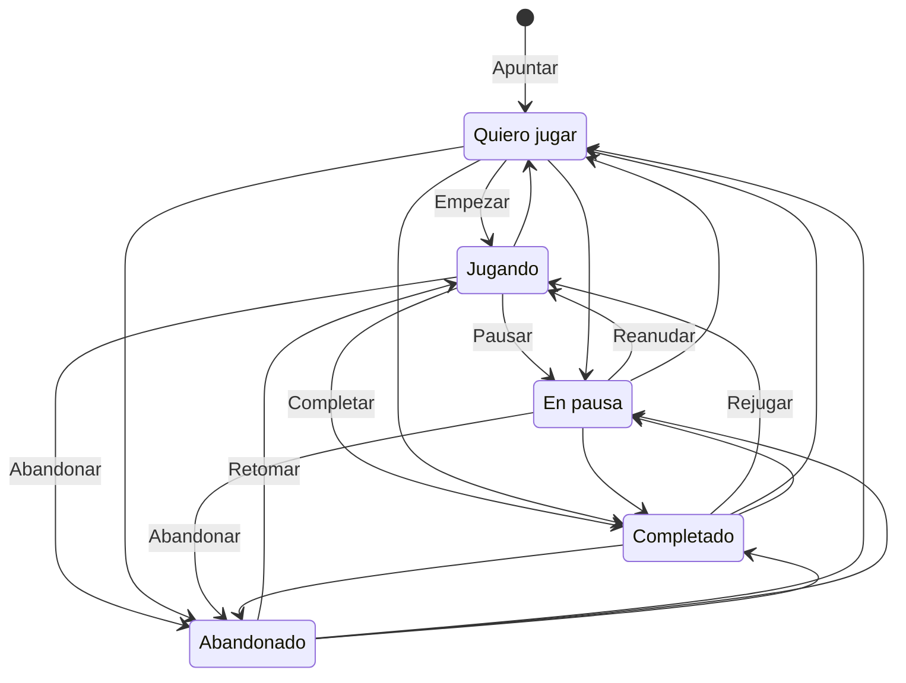

**Marcas.** Se guardan en el registro abierto `flags` para admitir marcas propias en Fase 2 sin migraciones (ver §7).

| Marca | Etiqueta | Significado | Reglas |
|---|---|---|---|
| `platinum` | Platinado | Trofeo de platino o 100 % de logros | Al marcarla, si el estado no es Completado, pasa a Completado (un solo Deshacer revierte ambas cosas). Quitarla no cambia el estado. Cambiar después el estado (rejugar → Jugando) no la quita |
| `owned` | Comprado | Lo tengo: comprado, regalado o gratis | No afecta al estado |
| `next` | Próximo | Lo siguiente que se va a jugar | Fija el juego en «A continuación», encima de Quiero jugar, mientras el estado es Quiero jugar o En pausa; en los demás estados la marca se conserva sin efecto |

En `merge()`, la regla de Platinado se evalúa con los relojes: si Platinado se marcó después del último cambio de estado, el estado es Completado; si el estado cambió después, se respeta (ver §7).

**Fechas** (automáticas y editables en la ficha):

| Fecha | Se fija automáticamente | ¿Se sobrescribe? |
|---|---|---|
| `addedAt` | Al apuntar | No |
| `startedAt` | La primera vez que pasa a Jugando | No |
| `completedAt` | La primera vez que pasa a Completado, también por Platinado | No |
| `platinumAt` | Al marcar Platinado | Se vacía al quitar la marca |
| `ownedAt` | Nunca (solo si la escribe el usuario) | — |

**Otras reglas**
- Apuntar directamente con otro estado o con marcas (RF-06) aplica las mismas reglas con la fecha del día: con Platinado, por ejemplo, el juego entra en Completado con `completedAt` y `platinumAt`. Si el hecho es anterior, la fecha se corrige en la ficha.
- Deshacer revierte un cambio junto con sus efectos automáticos (fechas y Completado por Platinado).
- «Quitar de mi lista» deja una lápida (ver §7); si el juego se vuelve a apuntar, empieza de cero. Abandonado, en cambio, conserva la entrada.

## 4. Estudio: cómo obtener todos los juegos de Steam

> Comprobado el **28-10-2026** con llamadas reales, la documentación de Steamworks y los protobuf de SteamDatabase; se señala lo que viene de la comunidad.

### 4.1 Situación actual (octubre de 2026)

- **El método clásico ya no existe:** `ISteamApps/GetAppList/v2`, la lista sin clave de casi todos los tutoriales, salió de la API el 13-11-2025 y hoy responde 404; según Valve, «*can no longer scale to the number of items available on Steam*».
- **El sustituto oficial, `IStoreService/GetAppList/v1`, exige Web API key** (sin ella, `403 Access is denied`). Sirve una clave de usuario en `api.steampowered.com` (nunca `partner.steam-api.com`); pedirla requiere una cuenta no limitada (≥5 US$ gastados) con Steam Guard en el móvil. Los términos de uso de la Web API (*Terms of Use*, ToU) fijan 100 000 llamadas/día, clave confidencial y licencia «*personal to you and specific to your Application*»: una sola clave, nunca en el cliente (ver §11).
- **Sin CORS** en `api.steampowered.com` ni en `store.steampowered.com`: el navegador no puede leerlas. El CDN de imágenes sí envía `Access-Control-Allow-Origin: *`.
- **Lo que va sin clave no está documentado:** `IStoreQueryService/Query` e `IStoreBrowseService/GetItems` responden sin clave, pero faltan en la lista oficial y `steamcommunity.com/dev` dice que toda la Web API requiere clave: son de mejor esfuerzo, con plan B (§4.8).

Fuentes: <https://partner.steamgames.com/doc/webapi/IStoreService> · <https://steamcommunity.com/dev/apiterms>

### 4.2 Fuentes evaluadas

| Fuente | Clave / documentada | Qué aporta | Límites | Uso |
|---|---|---|---|---|
| `IStoreService/GetAppList/v1` | **Sí / sí** | `appid`, nombre base, `last_modified`, `price_change_number`; 50 000 por página | 100 000 llamadas/día; sin retirados ni demos | **Columna vertebral** desde M2 |
| `IStoreQueryService/Query/v1` | No / no | 1 000 juegos por llamada; orden estable con `sort=2`; filtros por tipo y estado | Filtra por `country_code`; el total varía en plena pasada | **Enriquecimiento** diario; enumeración en M1 y plan B |
| `IStoreBrowseService/GetItems/v1` | No / no | Lo mismo por lotes, más `unlisted` y la restricción por país | `country_code` obligatorio; URL ≤≈8 KB → ≤200 ids | **Huecos y clasificación**; en M4, `appid` desconocidos |
| `appdetails` (tienda) | No / no | Géneros, logros, Metacritic | 1 app por llamada; ≈200/5 min (histórico); no detecta retirados | No se usa |
| `storesearch` / `SearchSuggestions` | No / no | Búsqueda remota | ≈0,3 s; `storesearch`, 10 resultados como mucho | No: búsqueda local (ver §8) |
| `GetTagList` / `GetStoreCategories` | No / no | 446 etiquetas y 72 categorías en español | — | Fase 2 |
| SteamSpy | No / propia | Propietarios estimados | 1 petición/60 s; desfasado (730 aún es «Counter-Strike: Global Offensive») | Descartado |
| PICS (`steam-user`) | No / no | Casi todo, también retirados | Protocolo del cliente: zona gris del Acuerdo de Suscriptor | Descartado |
| SteamDB | — | — | Sin API; prohíbe el *scraping* | Descartado |
| `jsnli/steamappidlist` | — | Volcado diario de `GetAppList` | Sin fichero de licencia; clave de un tercero | Contraste en desarrollo |

### 4.3 Cifras del catálogo (28-10-2026)

| Métrica | Valor | Origen |
|---|---|---|
| **Juegos** | **196 595** (18 sin nombre → 196 577) | `GetAppList`, 27-10-2026 |
| Visibles por país | US 196 621 (133 882 publicados + 62 686 «próximamente» + 53 sin estado); ES 196 615 a las 01:30 y 196 684 a las 12:14 | Query, 28-10-2026 |
| DLC (fuera del prototipo) | 63 919 / 63 079: la primera no filtra por país y es de la víspera | `GetAppList` / Query US |
| Demos / bandas sonoras / software | ≈43 400 / ≈11 600 / ≈2 900 | Query US |
| Solo adultos | ≈9 700 (descriptor 3); 10 214 (3 o 4) | Query US / ES |
| Cambios al día | ≈3 300 juegos; ≈264 altas, ≈8 bajas y ≈17 renombrados | `GetAppList`, 26-10-2026 y 27-10-2026 |
| Nombres | media 17,6 B, máximo 542 B; 985 con ™®©; 8,1 % no ASCII; 6,3 % CJK, kana o hangul | `GetAppList` |
| Índice solo `[appid, nombre]` (referencia) | 5,98 MB JSON · 2,64 MB gzip · 1,91 MB brotli | `GetAppList` |

**Conclusión:** el núcleo publicado, con `nameEs`, `flags`, `year` y `pop`, ocupa 7,00 MB sin comprimir y **2,25 MB con brotli 11** (2,59 MB con brotli 5 y 3,05 MB con gzip, según comprima el CDN; medido el 28-10-2026 con 196 665 juegos; ver §7.6): cabe en el dispositivo y se busca sin red (ver §8).

### 4.4 Estrategia elegida

| Paso | Fuente | Clave | Llamadas/día | Qué aporta |
|---|---|---|---|---|
| 1. Columna vertebral | `GetAppList` (`include_games=true`, `max_results=50000`) | Sí, cabecera `x-webapi-key` | ≈4 | Qué juegos existen, sin depender del país; nombre base y marcas de cambio |
| 2. Enriquecimiento | Query, pasada completa en `spanish`/`ES` | No | ≈208 | Nombre en español, indicadores (`flags`), fecha, reseñas, portadas, plataformas y Steam Deck |
| 3. Huecos y clasificación | `GetItems`, lotes ≤200 | No | ≈5 | Lo que (1) lista y (2) no devuelve, y lo que desaparece |

Se recorre todo a diario, y no solo los cambios con `if_modified_since` (≈45 llamadas), porque las reseñas (la popularidad) cambian cada día y no consta que `last_modified` las refleje; porque el mismo código sirve en M1 y en el plan B; y porque cada ejecución es completa e idempotente, sin cursor.

### 4.5 Algoritmo de ingesta (ejecución diaria)

```text
EJECUCIÓN del catálogo · diaria a las 05:17 (Europe/Madrid) o manual
 0 ESTADO     bajar state/master.ndjson.gz; si no existe, todo es alta
 1 LISTA      con clave (en modo sin clave se salta y L := ids de Q)
              GET /IStoreService/GetAppList/v1/?include_games=true
                  &max_results=50000&last_appid={c}  + x-webapi-key
              repetir con c = last_appid mientras have_more_results
 2 ENRIQUECER sin clave; start = 0, 950, 1900… (solape de 50)
              GET /IStoreQueryService/Query/v1/?input_json={
                query: {start, count: 1000, sort: 2,
                        filters: {type_filters: {include_games: true}}},
                context: {language: "spanish", country_code: "ES"},
                data_request: {include_release, include_assets,
                  include_reviews, include_platforms,
                  include_best_purchase_option: false}}
              Zod; deduplicar por appid; hasta total_matching_records → Q
 3 HUECOS     GetItems sin clave, lotes ≤200, mismo data_request
              H1 = L − Q en ES; si hay restricción de país, en US
              H2 = estado − L (los que desaparecen)
              unlisted:true             → Retirado (se conserva)
              success 15 + appid 0      → se elimina
              restricción en ES y en US → se conserva con su nombre
 4 CONSTRUIR  L ∪ Q; solo type 0; fuera vacíos y lista negra; SKU
              duplicados; nameEs, flags, year, pop → ficheros (§4.6)
 5 PUERTAS    si falla una: no se publica, se abre un issue y error
 6 PUBLICAR   firmar el manifest; wrangler deploy de ga-catalog
              (+ ficheros de la versión anterior); subir el estado;
              ping de vida
```

**Sin `include_basic_info`:** la ficha no muestra descripción ni desarrollador y el núcleo no usa sus campos. `is_free`, `is_early_access`, `is_coming_soon` y `content_descriptorids` van fuera de `basic_info`, pero el 28-10-2026 se pidieron con él: que siguen llegando sin él queda **a verificar en M0**. Que Query respeta `include_best_purchase_option: false` sí se comprobó ese día: ningún precio en los 1 398 juegos publicados de dos páginas, frente a 939 de 1 000 con la opción por defecto.

En GitHub Actions: `schedule` con `timezone`, `workflow_dispatch` y `concurrency`. Si sus *runners* reciben 429 o faltan minutos, el PC solo descarga y construye (pasos 0–4) y sube el resultado, con el estado nuevo, como *asset* de una *Release* de preparación (`catalog-staging`); después se lanza `catalog.yml` con `workflow_dispatch` (`source=staging`), que pasa las puertas, firma y publica (pasos 5 y 6). La clave privada de firma solo está en un secreto de GitHub: desde M2, el PC nunca firma ni despliega `ga-catalog`.

### 4.6 Estado, puertas y ficheros publicados

**Estado:** `state/master.ndjson.gz`, una fila por `appid` con nombre, `last_modified`, `price_change_number`, clasificación (visible, retirado o bloqueado por región) y último enriquecimiento fechado; es un *asset* de la *Release* `catalog-state` de GitHub (7 copias). Da H2, los recientes, las puertas y el enriquecimiento de reserva.

| Puerta de publicación | Se publica si… |
|---|---|
| Recuento | ≥190 000 juegos y entre −2 % y +5 % respecto a la versión anterior (hoy, ≈+0,13 % al día) |
| Renombrados | ≤1 % de nombres cambiados (hoy, ≈0,01 % al día) |
| Centinelas | están 730, 570, 1245620, 1086940 y 367520 |
| Integridad | sin `appid` duplicados ni nombres vacíos; todas las filas se leen; *shards* válidos (Zod) |
| Tamaño | el núcleo no pasa de su máximo (ver §7) |
| Consultas de humo | en el índice construido con `packages/core`: «hollow knight» → 367520 primero; «baldurs gate» → 1086940, «elden» → 1245620 y «counter strike» → 730 entre los 3 primeros (el 1.º será «Counter-Strike», 10: coincidencia exacta) |
| Calidad de búsqueda | en ese mismo índice, el conjunto dorado, los 2 000 nombres exactos y los prefijos de 4 letras cumplen sus umbrales (ver §8.10) |

Si falla **solo el enriquecimiento**, se publican los nombres al día con el último enriquecimiento conocido y `enrichmentAgeDays` crece.

Tras un parón largo (a ≈+0,13 % al día, el +5 % se alcanza en ≈38 días), las comparaciones con la versión anterior bloquearían siempre: se relanza a mano con `--skip-delta-gates` (también como entrada de `workflow_dispatch`), que se las salta como en la primera versión, mantiene el mínimo de 190 000 juegos y lo anota en el informe de la ejecución (ver §12).

**Ficheros** (ver §7): *manifest* firmado, núcleo, recientes (≈4 000 filas en 14 días: ≈264 altas + ≈17 renombrados al día), alias, 1 024 *shards* y su índice; cada despliegue reincluye los de la versión anterior. Secretos: clave de Steam, clave privada de firma, *token* de Cloudflare y URL del *dead-man switch* (healthchecks.io; aviso tras 36 h sin ping).

### 4.7 Presupuesto, volumen y política HTTP

**Medición del 28-10-2026** (páginas de 1 000 juegos, `spanish`/`ES`, sin clave):

| `data_request` | gzip | Sin comprimir | Tiempo |
|---|---|---|---|
| Vacío | 63 KB | 689 KB | 1,4 s |
| `basic_info`, `release`, `reviews` (pasada de 208 páginas) | 218 KB (45,3 MB en total) | 1,15 MB | 1,3 s |
| `basic_info`, `release`, `assets`, `reviews` | 236–488 KB | 1,66–2,18 MB | 0,9–1,0 s |
| `basic_info`, `release`, `assets`, `reviews`, `platforms`, sin precios (descartado) | 306–506 KB | 1,73–2,37 MB | 1,4–1,7 s |
| **El del pipeline:** `release`, `assets`, `reviews`, `platforms`, sin `basic_info` ni precios (estimado) | ≈150–335 KB (media ≈240 KB) | ≈1,2–2,0 MB | A medir en M0 |

La última fila se estima quitando `basic_info` y los precios de las cuatro páginas de las dos filas anteriores y volviéndolas a comprimir. Peso por página: imágenes, 80–283 KB gzip (las rutas con *hash* casi no comprimen); `include_basic_info`, 74–172 KB (sobre todo `short_description`); precios (activados por defecto), 7,8 %; plataformas, ≈6 KB. **Pasada diaria estimada: ≈50 MB gzip** (≈0,3 GB de JSON) con el `data_request` del pipeline; con `include_basic_info` serían ≈80 MB (≈0,4 GB). Manda el ritmo: 208 páginas a una cada 3 s son ≈10,4 min (lo medido el 28-10-2026) y cada ejecución, con `GetAppList`, `GetItems`, la construcción y el despliegue, ≈11–13 min (≈330–400 min/mes de Actions: 30–31 ejecuciones × 11–13 min; ver §12).

**Presupuesto: ≈4 + ≈208 + ≈5 ≈ 220 llamadas/día (≤230, el 0,23 % del límite).** `GetItems` recibe los 234 juegos de `GetAppList` que Query (ES) no devolvió y ≈8 bajas al día (margen: 20 llamadas). Los términos de uso limitan las llamadas del licenciatario, no las de cada clave: también se cuentan las que van sin clave.

**Política HTTP** (todo sale del *runner* o del PC):
- Un único *worker*, con una petición cada 3 s (0,33/s: el ritmo de la pasada medida, sin errores ni 429) y nunca más de 0,4/s, que es justo el límite que mide la comunidad (≈120 cada 5 min por IP); `Accept-Encoding: gzip` y tiempo máximo por petición.
- Se comprueban el código HTTP, `X-eresult` (1 = correcto; 84 = límite superado) y el contrato Zod; si no se cumple, falla la etapa (ver §12).
- **429:** pausa global, *backoff* exponencial con *jitter* de 60 s a 15 min (o `Retry-After`); tras 5 seguidos se aborta la etapa (§4.6).
- **5xx o tiempo agotado:** hasta 5 reintentos (2, 4, 8, 16 y 32 s + *jitter*); un 400 no se reintenta.
- **403 con clave:** parar y alertar (clave revocada o cuenta limitada).

### 4.8 Sin clave: construcción de M1 y plan B

| Situación | Qué juegos existen | Enriquecimiento | Efecto en la app |
|---|---|---|---|
| Normal (desde M2) | `GetAppList` | Query + `GetItems` | — |
| M1, aún sin clave | Query (ES) | Query | Faltan ≈230 (0,12 %), probablemente bloqueados en España; se apuntan pegando el enlace (juego provisional) |
| Clave revocada (403) | Se avisa y se relanza sin clave: Query + estado | Query + `GetItems` | Como M1, sin perder lo ya conocido |
| Query o `GetItems` cambian o piden clave | `GetAppList` | Congelado (`enrichmentAgeDays` crece); *kill switches* si hay datos malos | Nombres al día; lo demás, del último día bueno |
| Steam no responde | — | — | Sigue el último catálogo: buscar y apuntar no dependen de Steam (ver §5) |

- **M1** se construye en el PC con el mismo comando en modo sin clave (≈208 llamadas, ≈10 min) y `ga-catalog` se despliega a mano, con el *manifest* aún sin firma; la primera versión se salta las puertas que comparan con la anterior. Desde M2 solo publica `catalog.yml`, también cuando construye el PC (ver §4.5).
- **`jsnli/steamappidlist`** solo sirve para contrastar en desarrollo; nunca se publica ni se versiona. De sus 196 595 juegos (27-10-2026), 234 no salen en Query (ES) el 28-10-2026, p. ej. 22490 «Fallout: New Vegas» (SKU regional); en M2 entran por H1.
- Si Query llegara a exigir clave, se probaría a enviársela (**a verificar en M2**).

### 4.9 Casos límite y decisiones de producto

| Caso | Decisión |
|---|---|
| **«Próximamente»** (62 642 en ES, 32 %) | Se incluyen, con la precisión de `coming_soon_display`: día (5 068), mes (2 637), trimestre (4 704), año (5 954), «Próximamente» (28 466) o «Por confirmar» (15 583); los 230 restantes no traen `coming_soon_display` (217 de ellos, ninguna fecha) y se tratan como «Por confirmar». No se penalizan en la búsqueda (ver §8). |
| **Retirados** | No salen en `GetAppList` ni en Query; al desaparecer, `GetItems` da `unlisted:true` y se conservan con la insignia «Retirado», al final. Los anteriores a la primera ejecución se apuntan pegando el enlace (se resuelven en M4). |
| **Bloqueados por región** | `GetItems` (ES) da `success 15`, `visible:false` y `unvailable_for_country_restriction:true` (sic), con nombre: se piden en US y se conservan. `success 15` solo nunca es «eliminado». |
| **Inexistentes** | `success 15` + `appid 0` + nombre vacío → se eliminan. |
| **SKU regionales duplicados** | Se prefiere el visible en ES (hay dos «Fallout: New Vegas»). |
| **Adultos** (descriptor 3 o 4: 10 214) | Ocultos por defecto; se muestran desde Ajustes. |
| **Basura** | Fuera los 18 sin nombre. Lista negra **exacta** (`TestApp` 866490, `UNTITLED` 639770…), nunca por prefijo («Untitled Goose Game»). Query cuela 473930 «Steam Gift Cards» (tipo 14): solo entra `type 0`. |
| **Nombres en español** | 3 227 juegos (1,6 %) se llaman distinto en `spanish` («Command & Conquer 3: La Ira de Kane»), ≈3 000 aun tras normalizar: se publica `nameEs` y se indexan ambos (ver §8). |
| **Gratuitos, acceso anticipado y demos de tipo 0** | Se incluyen (23 722 gratuitos y 19 313 en acceso anticipado, cada uno con su bit en `flags`). |
| **DLC** | Fase 2: solo los notables por reseñas (≈2 llamadas más de `GetAppList` y ≈67 de Query). |
| **Popularidad** | 76 040 juegos (39 %) sin reseñas → `pop` 0; máximo actual, 46 (730); tope, 63. |

### 4.10 Imágenes (portadas)

- **URL:** `https://shared.akamai.steamstatic.com/store_item_assets/` + `asset_url_format` con `${FILENAME}` sustituido; para CS2, `steam/apps/730/${FILENAME}?t=1793054556` + `162664aa…/header.jpg`. El `?t=` cambia con el arte: cada URL se cachea sin caducidad.
- **Vertical:** `library_capsule` (600×900), de nombre variable: `library_600x900.jpg`, `portrait.png` (355 de los 1 000 más antiguos; alguno pesa 545 KB, **a verificar en M2**), `<sha1>/library_capsule.jpg` en casi todos los nuevos y variantes por idioma (`…_spanish.jpg`): se guarda la de `spanish`. Si falta (8 de 3 984 en la muestra), `header`; si no, *placeholder* (ver §9).
- **Nunca adivinar rutas sin *hash*:** dan 404 en juegos nuevos (5338720) o arte viejo (el `header.jpg` sin *hash* de CS2 es de 2023).
- **CDN:** `Access-Control-Allow-Origin: *` y caché de ≈10 años; alternativa, `shared.fastly.steamstatic.com`; se evita `shared.cloudflare.steamstatic.com` (301). La IP del usuario llega a Valve (ver §11).

### 4.11 Restricciones que condicionan la arquitectura

1. **Sin CORS:** la app nunca llama a la API de Steam; el catálogo llega como ficheros estáticos propios (ver §5).
2. **Clave confidencial:** solo en un secreto de GitHub y en `.env.local` del PC (ver §11).
3. **Límites por IP sin publicar:** Steam fuera del camino crítico; un solo *worker*, una petición cada 3 s y nunca más de 0,4/s.
4. **Servicios sin clave no documentados:** Zod, *fixtures* y canario diario (ver §12), *kill switches* y plan B.
5. **Query y `GetItems` dependen del país:** manda `GetAppList`; los huecos, en ES y luego en US.

## 5. Arquitectura

GameAgenda es una PWA *local-first*: buscar y apuntar ocurren en el dispositivo y nunca esperan a la red. La nube solo sirve ficheros estáticos y, desde M4, una micro-API de sincronización. Tecnologías y versiones, en la §6.

### 5.1 Vista general

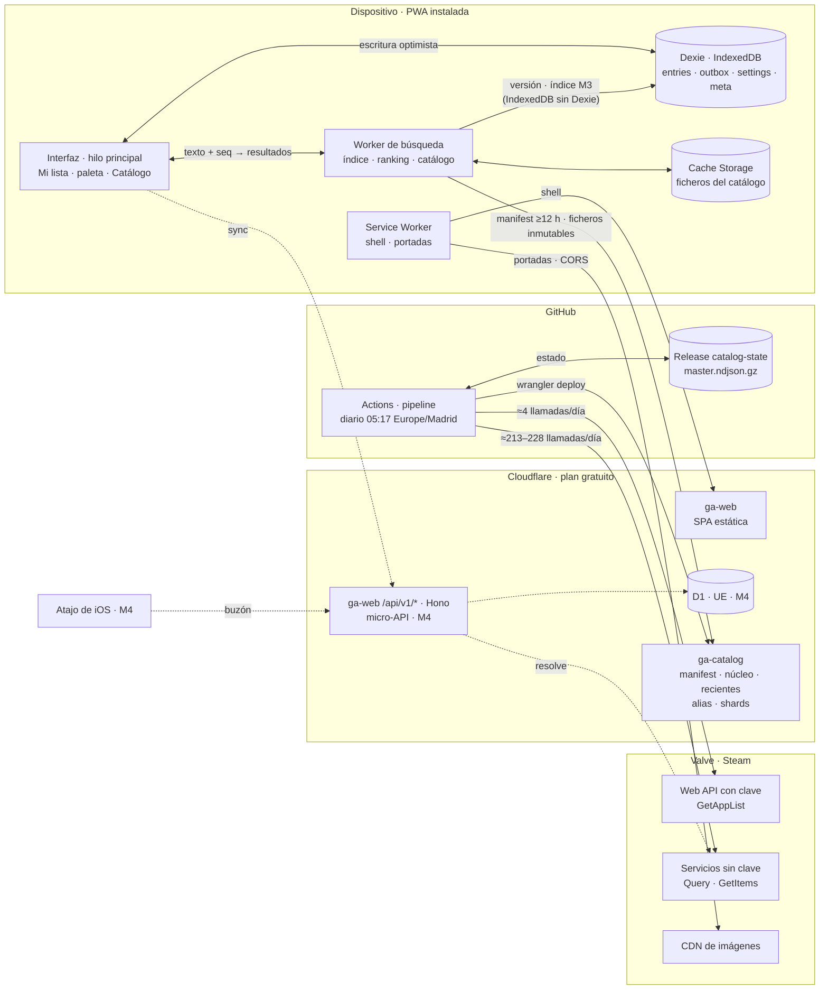

Las flechas discontinuas llegan en M4; la Fase 2 no aparece. El navegador solo habla con `ga-web`, `ga-catalog` y el CDN de imágenes, nunca con las APIs de Steam: no envían CORS y la Web API exige una clave confidencial (ver §4).

### 5.2 Componentes y responsabilidades

| Componente | Dónde | Responsabilidad | Desde |
|---|---|---|---|
| Interfaz | Hilo principal | Pantallas y *router* propio (ver §9); pinta cada cambio antes de guardarlo y nunca espera a la red | M1 |
| Worker de búsqueda | Web Worker de módulo | Ciclo de vida del catálogo (*manifest*, descargas, `sha256`, firma desde M2, intercambio atómico), índice y *ranking* (ver §8), páginas del Catálogo y *shards*; no toca datos del usuario y no importa Dexie (ver abajo) | M1 |
| Almacén local | Dexie (IndexedDB) | `entries`, `outbox`, `settings` y `meta` (ver §7), `persist()`, exportar e importar | M1 |
| Service Worker | Navegador | Precaché del *shell*, actualizaciones y caché LRU de ≈300 portadas; no guarda el catálogo (lo hace el Worker de búsqueda en Cache Storage) | M1; portadas, M2 |
| `packages/core` | Navegador, Node y Cloudflare | Toda la lógica compartida, en una sola implementación (ver §14) | M1 |
| Pipeline del catálogo | GitHub Actions o el PC | Descarga, clasifica, construye, pasa las puertas, firma (desde M2) y despliega (ver §4); guarda el estado en la *Release* `catalog-state` (7 copias) y avisa a healthchecks.io. Desde M2, si hay que lanzarlo en el PC (429 en los *runners* compartidos o falta de minutos), el PC solo descarga, construye y sube el resultado a la *Release* `catalog-staging`; `catalog.yml` (`workflow_dispatch`, `source=staging`) pasa las puertas, firma y publica | M1 en el PC; M2 diario |
| `ga-catalog` | Workers Static Assets | `manifest.json` (`no-cache`) y ficheros inmutables con *hash*; CORS solo para el origen de la app | M0 (*fixture*) |
| `ga-web` | Workers Static Assets | La SPA (`not_found_handling: single-page-application`), desplegada en cada *push* a `main`; desde M4, el *script* solo en `/api/*` | M0 |
| Micro-API | `ga-web` (Hono) | Sincronización, emparejamiento, buzón y `resolve` (rutas en la tabla siguiente); `resolve` usa `GetItems` sin clave | M4 |
| D1 | Cloudflare, UE | Agendas, dispositivos (solo *hashes*), operaciones con secuencia por agenda (ver §7) y caché de `resolve`; la jurisdicción se fija al crear la base y no se puede cambiar | M4 |

**El Worker de búsqueda no importa Dexie.** Dexie 4.4.7 ocupa ≈27 KB brotli (medido el 28-10-2026), dos tercios del presupuesto de 40 KB del Worker (ver §6.2). El Worker lee y escribe sus claves de `meta` (versión del catálogo y, desde M3, el índice persistido; ver §7) con IndexedDB nativo: abre la misma base cuando Dexie ya la ha creado, sin pedir versión, y cierra la conexión ante `versionchange` para no bloquear sus migraciones. La interfaz conoce la versión por el mensaje `status` (ver §8.7).

**Rutas de la micro-API (M4).** Zod en cada entrada y las reglas de petición de la §11.4 (nada cambia por GET); «cookie» es la credencial de dispositivo `__Host-`. Las rutas de la cuenta de Steam (Fase 2) están en la §10.

| Ruta | Para qué | Credencial | Límite |
|---|---|---|---|
| `POST /api/v1/agenda` | Al activar la sincronización: crea la agenda, pone la cookie y devuelve el código de recuperación (se muestra una vez) | Ninguna | Por IP |
| `POST /api/v1/pairing` | Genera un *token* de emparejamiento (un uso, 10 min) | Cookie | — |
| `POST /api/v1/pairing/redeem` | Lo canjea desde la app nueva y pone la cookie | *Token* en el cuerpo | Por IP |
| `POST /api/v1/recovery/redeem` | Canjea el código de recuperación y pone la cookie | Código en el cuerpo | Por IP |
| `GET /api/v1/devices` · `POST /api/v1/devices/<id>/revoke` | Lista y revoca dispositivos, incluido el *token* del buzón | Cookie | — |
| `POST /api/v1/inbox/token` | Crea el *token* del buzón para el Atajo de iOS (se muestra una vez) | Cookie | — |
| `POST /api/v1/inbox` | Deja un enlace de la tienda en el buzón | `Authorization` | Por *token* |
| `POST /api/v1/sync` | Sube `outbox` y baja cambios (ver §7.7) | Cookie | — |
| `GET /api/v1/resolve/<appid>` | Nombre de un `appid` desconocido o retirado, con `GetItems` sin clave | Ninguna | Por IP |
| `POST /api/v1/agenda/delete` | Borra la agenda en cascada («Borrar todos mis datos») | Cookie | — |

La caché de `resolve` es una tabla de D1 (`appid`, nombre, `fetched_at`) con nombres públicos del catálogo, nunca datos de usuarios: Cloudflare solo garantiza una [Cache API](https://developers.cloudflare.com/workers/runtime-apis/cache/) funcional en dominios propios y el prototipo usa `workers.dev` (a verificar en M4).

### 5.3 Flujos principales

**Apuntar un juego sin red.** Es el camino caliente: ninguna llamada de red entre la pulsación y la confirmación. Mientras se construye el índice (`scan`), el Worker responde con un escaneo lineal de los nombres normalizados, con los mismos niveles; en M3, `boot` busca en el núcleo de arranque (estados en la §8.8).

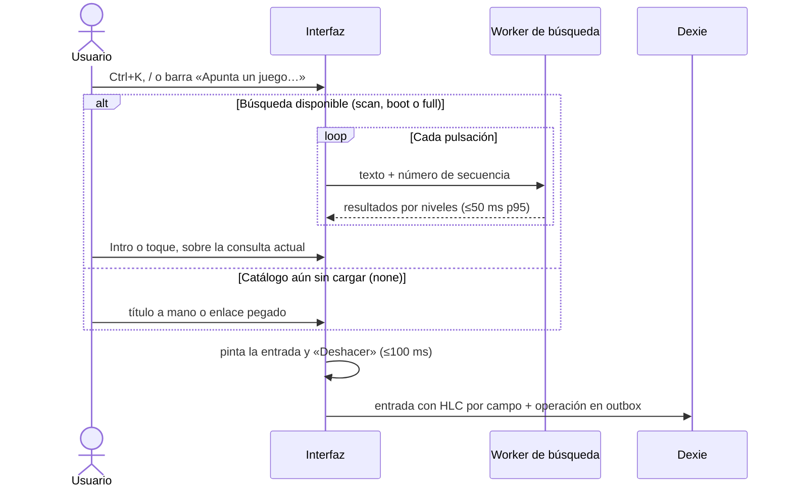

**Publicación diaria del catálogo** (desde M2; 05:17 Europe/Madrid o a mano, una ejecución a la vez; llamadas y puertas en la §4, formatos en la §7).

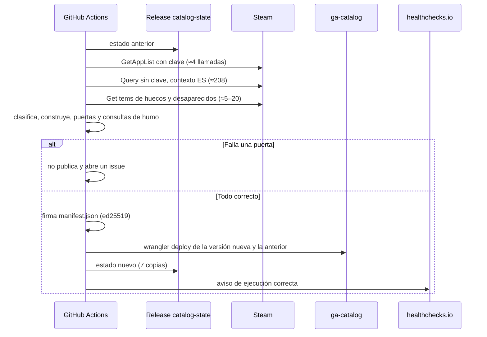

**Arranque y actualización del catálogo en el cliente.** El *shell* sale de la caché del Service Worker y la comprobación del *manifest* nunca retrasa Mi lista ni la búsqueda (firma y *kill switches*, desde M2). Los tiempos con CPU ×4 son los medidos en la §8.11.

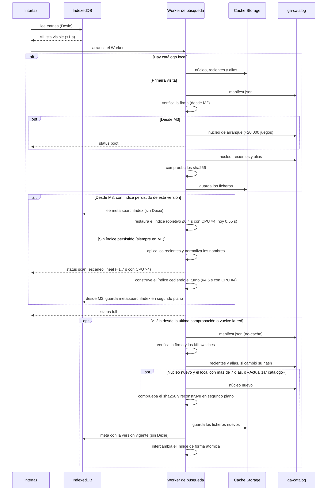

**Sincronización (M4).** Requiere un dispositivo emparejado (credencial en la §11; protocolo y `merge()` en la §7).

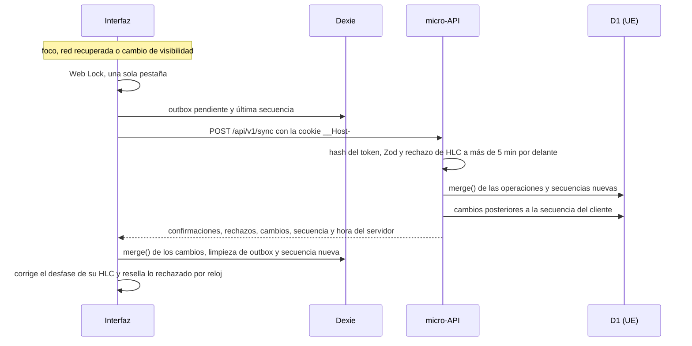

### 5.4 Principios de diseño

1. **Steam fuera del camino crítico.** Ningún cliente llama a sus APIs (solo el pipeline y, desde M4, `resolve`); si Steam, GitHub o el pipeline fallan, la app sigue con el último catálogo.
2. **Camino caliente local.** Buscar, apuntar y pintar Mi lista solo usan memoria e IndexedDB; la red trae el catálogo y sincroniza en segundo plano.
3. **Hilo principal libre.** Descargas, índice y *ranking* van en el Worker de búsqueda; ninguna tarea supera 50 ms al teclear o apuntar (ver §12).
4. **Todo inmutable salvo el *manifest*.** Los ficheros llevan su *hash* en el nombre y nunca cambian, así que se cachean sin revalidar; solo `manifest.json` es `no-cache`, va firmado y hace de plano de control. Publicar es atómico. Volver atrás en `ga-catalog` es publicar los ficheros de la versión buena con una `version` nueva, porque el cliente rechaza las anteriores (ver §11.3); `wrangler rollback` solo se usa con `ga-web`.
5. **Mismo origen para la API.** `/api/*` vive en `ga-web`: cookie `__Host-` de primera parte, `connect-src 'self'` y sin CORS. El *script* solo corre en esas rutas (`run_worker_first`): si se agota la cuota gratuita, `/api/*` responde 429 y la app se sigue sirviendo.
6. **Una sola implementación.** `packages/core` sirve a pipeline, Worker, micro-API y tests, con vectores de prueba compartidos.
7. **Convergencia sin coordinación.** Ids naturales y LWW por campo con HLC: dos dispositivos que apuntan el mismo juego acaban en la misma fila (ver §7).
8. **Degradar, no romper.** Si falla el enriquecimiento, se publica con el último conocido; un *kill switch* apaga portadas o detalles sin otra versión de la app; ante un 404 o un fallo de red o de CORS al pedir un fichero con *hash* (un 404 sin `Access-Control-Allow-Origin` llega como fallo de red), el cliente relee el *manifest* una vez y reintenta con la versión vigente.
9. **Fronteras validadas, secretos fuera del cliente.** Zod en cada entrada externa; en el prototipo, la clave de Steam solo la usa el pipeline (ver §11).
10. **0 € y salida fácil.** *Assets* estáticos gratuitos e ilimitados, sin activar la caché de Workers; ficheros planos que sirve cualquier hosting; Hono y el SQL de D1 son portables.

Fuentes (consultadas el 28-10-2026): Cloudflare, [*Billing and limitations*](https://developers.cloudflare.com/workers/static-assets/billing-and-limitations/), [`run_worker_first`](https://developers.cloudflare.com/workers/static-assets/binding/) y [jurisdicción de D1](https://developers.cloudflare.com/d1/configuration/data-location/).

### 5.5 Alternativas evaluadas

Se redactaron tres arquitecturas completas e independientes y se evaluaron con tres criterios, cada uno sobre 60 puntos (seis subcriterios de 0 a 10): **A**, PWA *local-first* con catálogo estático; **B**, escritorio nativo con Tauri 2, núcleo en Rust y SQLite FTS5, con una PWA compañera para el móvil en el cuarto hito; **C**, PWA con API propia, D1 y R2 en la UE y cuentas de invitado desde el primer día.

| Criterio | A | B | C | Orden |
|---|---|---|---|---|
| Velocidad y UX de captura | **48** | 45 | 45 | A > C > B |
| Viabilidad para una persona en este PC | **42** | 25 | 29 | A > C > B |
| Robustez, cumplimiento y futuro | 42,5 | 44 | **48** | C > B > A |

Fallos fatales: **B** no permite apuntar desde el móvil hasta el cuarto hito (tras ≈18 días de desarrollo) y obliga a mantener dos clientes con la misma lógica en Rust y en TypeScript (por eso C queda delante en velocidad pese al empate); **C** exige un backend multiusuario (invitados, sesiones, fusión de cuentas, purgas) antes de apuntar el primer juego; **A**, tal como estaba escrita, importaba con la clave datos de cualquier perfil sin autenticar al usuario, y se corrige exigiendo el login OpenID (Fase 2).

| Subcriterio en el que se separaron | A | B | C |
|---|---|---|---|
| Captura en <3 s en escritorio y móvil | 7 | 4 | 8 |
| Piezas móviles | 7 | 3 | 4 |
| Mantenibilidad para una persona | 7 | 3 | 4 |
| ToU de Steam y confidencialidad de la clave | 6,5 | 8 | 9 |
| Durabilidad de los datos del usuario | 6 | 8 | 8,5 |

Gana A porque se impone en dos criterios, es la más sencilla para una persona y sus dos carencias de robustez (importación sin autenticar y ninguna copia fuera del dispositivo) eran de secuencia: las corrigen el login obligatorio y la sincronización de M4. Cada criterio, por separado, recomendaba partir de A con piezas de B y de C (§5.6). Se descartan el núcleo en Rust de B (la lógica existiría dos veces) y, de C, las cuentas de invitado, R2 y la búsqueda en el servidor para la primera visita (la sustituye el núcleo de arranque de M3).

### 5.6 ADR-001 y registro de decisiones

Las decisiones se registran en `docs/adr/NNN-titulo.md` con el formato [MADR 4.0](https://adr.github.io/madr/), en español. ADR-001 se copia al crear el repositorio (M0).

**ADR-001 · Arquitectura del prototipo: PWA *local-first* con catálogo estático** (aceptada, 28-10-2026)

- **Contexto y problema.** Hay que apuntar en segundos, desde el móvil y el PC, juegos del catálogo completo de Steam (≈196 600). Las APIs de Steam no envían CORS, la Web API key es confidencial y los endpoints sin clave no están documentados; lo construye una persona en Windows 11, sin Docker. ¿Qué arquitectura cumple los presupuestos (ver §3.2) sin poner a Steam ni a un servidor en el camino crítico?
- **Factores de decisión.** Apuntar p50 ≤3 s en móvil y escritorio; tecla → resultados ≤50 ms p95 sin red; viable para una persona; ToU de Steam y RGPD; datos que no dependan de un solo navegador; 0 €/mes.
- **Opciones consideradas.** A, B y C (§5.5).
- **Decisión.** A, con injertos. De B: rigor de búsqueda (orden de normalización, niveles de *ranking*, alias), ids naturales y *manifest* como plano de control (firma ed25519, *kill switches*). De C: contratos de respuesta, puertas con consultas de humo, credencial de dispositivo en cookie `__Host-` `HttpOnly`, una sola `merge()` y sincronización ligera en M4. De A: catálogo estático con *hash*, *shards* de detalles y coste 0 €. Corrección: ninguna llamada a Steam por usuario sin un login OpenID verificado (Fase 2).
- **Consecuencias.**
  - Bien, porque buscar y apuntar funcionan sin red tras la primera visita, con un solo cliente para móvil y escritorio.
  - Bien, porque Steam no está en el camino crítico y el coste es 0 €/mes.
  - Bien, porque con ids naturales, HLC y `outbox` desde M1, la sincronización de M4 es un añadido y no una reescritura.
  - Mal, porque la primera visita descarga el núcleo (de ≈2,6 a ≈3,1 MB comprimido, según cómo lo comprima el CDN; ver §7.6) antes de buscar: entretanto se apunta a mano o con un enlace, después se busca por escaneo lineal mientras se construye el índice, y M3 añade un núcleo de arranque.
  - Mal, porque hasta M4 la agenda vive en un solo navegador (mitigación en la §16).
  - Mal, porque no hay atajo global en Windows hasta el envoltorio Tauri (M3) ni *Web Share Target* en iOS («Pegar enlace» y, en M4, un Atajo de iOS que envía al buzón).
  - Mal, porque el catálogo es como mucho diario y su enriquecimiento depende de endpoints no documentados (plan B y *kill switches*; ver §4).
- **Confirmación.** M1: apuntar en <3 s y buscar sin red con CPU ×4; M3: presupuestos en el Android de referencia y en iPhone (ver §15).
- **Cuándo revisarla.** Captura en escritorio de más de 3 s al cerrar M1: el envoltorio Tauri pasa de M3 a justo después de M1. Cierre de los endpoints sin clave: plan B, sin tocar la arquitectura. Tiempo real, agendas compartidas o un backend para IGDB: ADR nuevo.

Registro inicial, numerado por orden de escritura: cada ADR se escribe al empezar su hito (ver §15.1), ocupa como mucho una página y enlaza la sección que lo desarrolla; una decisión aceptada no se edita, se sustituye por otro ADR.

| ADR | Decisión | Se escribe en | Ver |
|---|---|---|---|
| ADR-001 | Arquitectura: PWA *local-first* con catálogo estático | M0 | §5 |
| ADR-002 | Stack y repositorio: React + Vite como SPA, *router* propio, CSS nativo y versiones exactas | M0 | §6, §14 |
| ADR-003 | *Hosting*, despliegue y CI (`ga-web`, `ga-catalog`), con la alternativa si el CDN no comprime el TSV | M0 | §5, §12 |
| ADR-004 | Datos del usuario: Dexie, ids naturales, estados y marcas, HLC y `outbox` | M1 | §3, §7 |
| ADR-005 | Búsqueda local en un Web Worker | M1 | §8 |
| ADR-006 | Alcance y formato del catálogo | M1 | §4, §7 |
| ADR-007 | Pipeline diario, *manifest* firmado y plan B sin clave | M2 | §4, §12 |
| ADR-008 | Portadas desde el CDN de Valve y aviso de privacidad | M2 | §9, §11 |
| ADR-009 | Arranque rápido: índice persistido y núcleo de arranque | M3 | §8 |
| ADR-010 | App de escritorio: envoltorio Tauri de `ga-web` con atajo global | M3 | §17 |
| ADR-011 | Sincronización: micro-API, D1 en la UE y emparejamiento | M4 | §7, §11 |
| ADR-012 | Cuenta de Steam con OpenID 2.0 | Fase 2 | §10 |

## 6. Stack con versiones

Versiones exactas comprobadas en el registro de npm el 28-10-2026 (Biome y `wrangler`, el 29-10-2026, al instalarlos en M0); se instalan sin rangos (ver §6.5).

### 6.1 Elecciones

| Capa | Elección | Versión | Por qué | Descartada |
|---|---|---|---|---|
| Entorno de ejecución | Node.js | 24.21.0 | Instalado; LTS de mantenimiento hasta el 30-04-2028; ejecuta el pipeline `.ts` sin compilar | Node 26, de momento |
| Paquetes | npm *workspaces* | 11.19 | Viene con Node (ver §14) | pnpm |
| Lenguaje | TypeScript | 7.0.2 | Compilador nativo; el stack no necesita su API (ver §6.3) | 6.0.3, solo de reserva |
| Interfaz | React + React DOM | 19.3.1 | Ecosistema maduro; admite TS 7 | SvelteKit, Next.js |
| *Build* | Vite + `@vitejs/plugin-react` | 8.3.5 / 6.1.2 | Rolldown; Workers de módulo y CSS Modules sin configurar | — |
| PWA | `vite-plugin-pwa` (`injectManifest`) + `workbox-window` + `workbox-build` | 2.0.0 / 7.4.1 / 7.4.1 | Service Worker propio con la precaché del *build*; `injectRegister: false`: el Service Worker se registra desde la app con `workbox-window`; `workbox-build`, solo en desarrollo (ver §6.3) | — |
| Datos en el cliente | Dexie + `dexie-react-hooks` | 4.4.7 / 4.4.0 | Esquema versionado, índices y `useLiveQuery` | SQLite WASM |
| Lista virtual | `@tanstack/react-virtual` | 3.14.24 | Catálogo de ≈196 600 filas | — |
| Búsqueda | Índice propio + `@leeoniya/ufuzzy` | — / 1.0.19 | p95 de 2,1 ms por pulsación en Edge con el núcleo real (8,7 ms con CPU ×4; ver §8.11); uFuzzy solo para «¿Quizás buscabas…?» (ver §8) | Fuse.js, FlexSearch, Orama, MiniSearch |
| Contratos | Zod | 4.6.7 | Steam, micro-API e importación | — |
| Ids | `uuid` (v7) | 14.0.3 | `manual:<uuidv7>` y `opId` ordenables por tiempo | UUID v4 |
| Hosting | Cloudflare Workers Static Assets, `wrangler`, `@cloudflare/workers-types` | — / 4.155.0 / 5.20261028.1 | *Assets* gratuitos e ilimitados (ver §5.4) | Vercel Hobby, Netlify Free |
| Micro-API (M4) | Hono + D1 en la UE | 4.13.14 / — | Mínima y hecha para Workers; se prueba con `app.request()` | Prisma, Drizzle |
| Login con Steam (Fase 2) | `steam-signin` | 1.0.5 | OpenID 2.0 verificado en el servidor (ver §10) | `passport-steam` |
| Lint y formato | Biome | 2.6.4 | Una sola herramienta, sin la API de TS | ESLint con tipos |
| Pruebas | Vitest, fast-check, `@playwright/test` | 5.0.5 / 4.10.2 / 1.64.1 | Nativo de Vite; propiedades de `merge()`; CPU ×4 y WebKit en Windows (ver §12) | `@cloudflare/vitest-pool-workers` |
| Apoyo a las pruebas | `@axe-core/playwright`, `fake-indexeddb` | 4.14.0 / 6.2.6 | axe-core en cada pantalla de los E2E (ver §12.3); Dexie en Vitest bajo Node: migraciones y exportar → borrar → importar (RNF-08, ver §3.2) | Lighthouse (ver §6.4) |
| Tipos | `@types/react`, `@types/react-dom`, `@types/node` | 19.3.0 / 19.3.0 / 24.19.2 | Para `tsc`; `@types/node` es de la rama 24, como Node, y solo entra en lo que corre en Node (`pipeline/`, `scripts/`, configuración y E2E), nunca en `packages/core` (ver §14.3) | — |
| Escritorio (M3) | `@tauri-apps/cli`; *crates* `tauri`, `tauri-build`, `tauri-plugin-global-shortcut`, `tauri-plugin-single-instance` y `tauri-plugin-autostart` | 2.12.4; 2.12.5 / 2.7.4 / 2.4.1 / 2.5.5 / 2.7.0 | Envuelve la misma web sin lógica propia; requisitos ya instalados (ver §17.3). *Crates* comprobados en crates.io el 29-10-2026 y fijados con `=` en `Cargo.toml`; la web no usa `@tauri-apps/api` | Núcleo nativo propio, Electron |

### 6.2 Presupuesto de JS

Medido el 28-10-2026 con Vite 8.3.5 (*build* de producción):

| Contenido | Sin comprimir | gzip | brotli |
|---|---|---|---|
| React 19.3.1 + React DOM | 219,6 KB | 67,7 KB | 58,5 KB |
| + Dexie 4.4.7, `dexie-react-hooks` y `@tanstack/react-virtual` | 353,4 KB | 108,6 KB | 94,5 KB |

| *Chunk* | Presupuesto (brotli) | Contenido |
|---|---|---|
| Inicial | ≤150 KB | Lo necesario para pintar Mi lista y abrir la paleta |
| Worker de búsqueda | ≤40 KB | Normalización, índice, *ranking* y códecs; sin React ni Dexie (ver §5.2) |
| Diferidos | — | Catálogo (con `@tanstack/react-virtual`), Ajustes, exportar/importar y uFuzzy (lo importa el Worker) |

- Quedan ≥55 KB brotli para el código propio y `workbox-window` (algo más, porque la lista virtual va en el *chunk* del Catálogo).
- El Worker se crea con `new Worker(new URL('./search-worker/index.ts', import.meta.url), { type: 'module' })` y `vite.config` fija `worker: { format: 'es' }`: el formato por defecto de Vite, `iife`, no admite *chunks* diferidos ([`worker.format`](https://vite.dev/config/worker-options)). Así uFuzzy se carga con `import()` dentro del Worker, en un *chunk* propio que queda fuera de sus 40 KB y entra en la precaché; la puerta mide el *chunk* de entrada del Worker (a verificar en M0 con Vite 8.3.5).
- Un objetivo de ≤100 KB gzip es inalcanzable con React + Dexie: la base ya pesa 108,6 KB gzip.
- El CI falla si se supera un presupuesto (ver §12). Si Zod no cabe en el del Worker, se usa `zod/mini`, que exporta el mismo paquete (a verificar en M1).

### 6.3 Compatibilidades comprobadas

Rangos de `peerDependencies` y `engines` en npm (28-10-2026):

- `vite-plugin-pwa` 2.0.0 admite Vite 8 y exige `workbox-build` y `workbox-window` ^7.4.1: los dos se fijan en 7.4.1.
- `@vitejs/plugin-react` 6.1.2 exige Vite ^8.0.0; Vitest 5.0.5 admite Vite ^6.4, ^7 y ^8.
- Vite 8.3.5 pide Node ^20.19 o ≥22.12, y `wrangler` 4.155.0, Node ≥22 y `@cloudflare/workers-types` ≥5.20261023.1.
- `@tanstack/react-virtual` 3.14.23 admite React 19; `dexie-react-hooks` 4.4.0, Dexie ≥4.2 y <5.
- `@axe-core/playwright` 4.14.0 pide `playwright-core` ≥1.0.0 y trae `axe-core` ~4.14.0; `@types/react-dom` 19.3.0 pide `@types/react` ^19.3.0; `fake-indexeddb` 6.2.6, Node ≥18.
- TypeScript 7.0 no tiene API de compilador hasta la 7.1. Biome, Vite y Vitest no la usan; si otra herramienta la pidiera, solo ella usaría 6.0.3 (a verificar en M0).

### 6.4 Qué no se usa y por qué

| Pieza | Motivo |
|---|---|
| SvelteKit 3.1 | Exige TypeScript ^6, como `svelte-check` 4.7.7; Kit 3 (estable desde el 01-10-2026) cambió la configuración y los módulos del Service Worker y dejó obsoletos muchos tutoriales; cinco pantallas no necesitan meta-framework. Su *runtime* pesa menos, pero React cabe en el presupuesto (§6.2) |
| Next.js 16.4 | Sus funciones de servidor sobran: la app es estática y los datos viven en el cliente |
| SQLite WASM en el cliente | Solo el motor ocupa ≈397 KiB gzip, y un índice FTS5 *trigram* del catálogo, 19,2 MiB (11,5 MiB brotli), frente a los 2,25 MB brotli del núcleo (ver §7.6) |
| Fuse.js | ≈394 ms por pulsación en la prueba de uFuzzy con 162 000 frases |
| FlexSearch, Orama, MiniSearch | Retienen 316, 192 y 67 MB de *heap* en esa prueba; el índice propio, ≈40 MiB con todo el catálogo (ver §8.11) |
| Lighthouse | El LCP se mide con `PerformanceObserver` (`largest-contentful-paint`) en el proyecto `perf` de Playwright (ver §12.4): una herramienta menos que fijar y actualizar |
| Prisma, Drizzle | Sin ORM: Dexie en el cliente y SQL directo en D1. El `latest` de Prisma es una RC (8.0.0-rc.28) y Drizzle 1.0 sigue en RC |
| InstantDB | Cerró las altas y apaga su nube el 31-08-2027 |
| `passport-steam` | Sin publicar desde el 18-06-2023 |
| `@cloudflare/vitest-pool-workers` | La 0.23.0 exige Vitest ^4.1 y partiría el repositorio en dos versiones mayores |
| ESLint con reglas de tipos | `typescript-eslint` con tipos necesita la API que TS 7.0 no tiene |
| pnpm | No está instalado y npm basta; Node deja de incluir corepack desde la 25 |
| Librería de enrutado, Redux, Tailwind | Sobran: *router* propio sobre la History API, `useLiveQuery` y CSS con *tokens* |
| Vercel Hobby, Netlify Free | Hobby es solo para uso no comercial; Netlify gasta 15 créditos por despliegue y el catálogo se despliega a diario |

Fuentes (consultadas el 28-10-2026): registro de npm; [uFuzzy](https://github.com/leeoniya/uFuzzy); [SQLite WASM](https://sqlite.org/wasm/doc/trunk/persistence.md); [InstantDB](https://www.instantdb.com/essays/instant_team_joins_openai); [TypeScript 7.0](https://devblogs.microsoft.com/typescript/announcing-typescript-7-0/).

### 6.5 Política de versiones

- `.npmrc` con `save-exact=true`, `package-lock.json` versionado y `npm ci` en CI.
- Dependabot semanal (npm, *actions*, fijadas por SHA, y, desde M3, Cargo); una versión mayor por PR, con el CI en verde y una entrada en el CHANGELOG.
- Nada en RC ni en alfa: antes de añadir un paquete se revisa `npm view <paquete> dist-tags`. Tauri se queda en 2.x (en crates.io ya hay versiones 3.0 alfa): las versiones de la tabla se comprueban de nuevo en crates.io al empezar M3, y `Cargo.lock` se versiona.
- Node se fija en 24.21 (`engines` y `actions/setup-node`). Node 26, Active LTS desde el 28-10-2026, se adopta al cerrar M4 en una PR propia con el CI y `npm run perf` en verde; antes, solo si una dependencia lo exige, y siempre antes del fin de soporte de Node 24 ([calendario](https://nodejs.org/en/about/releases/)).
- Cuando TypeScript 7.1 publique su API, se revisa la reserva 6.0.3. Si una actualización cambia una decisión, se escribe un ADR (ver §5.6).

## 7. Modelo de datos

Las reglas de estados y marcas están en la §3; aquí, cómo se guardan, fusionan y publican los datos.

### 7.1 Modelo lógico

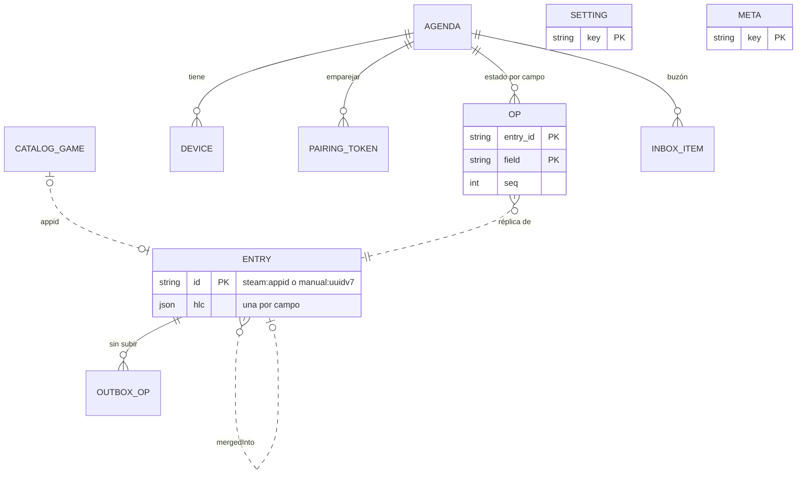

En el cliente no hay claves foráneas: una operación puede llegar antes que su entrada (§7.4).

### 7.2 Esquema Dexie

```ts
db.version(1).stores({              // Dexie 4.4.7, base 'gameagenda'
  entries: 'id, [view+rank], lastHlc, deletedAt',
  outbox: 'opId, [entryId+field]',
  settings: 'key',
  meta: 'key', // hlcClock, catalog, searchIndex, syncCursor, backup, errorLog
});
```

Índices: `[view+rank]`, Mi lista por estado en orden manual y «A continuación» (`view = 'next'`); `lastHlc`, cambios recientes; `deletedAt`, lápidas (disperso); `[entryId+field]`, compactar la `outbox`.

```ts
type Day = string | null;       // fecha local AAAA, AAAA-MM o AAAA-MM-DD
interface Entry {
  id: string;                   // §7.3
  status: string;               // want_to_play (defecto), playing, on_hold,
                                // completed, dropped
  flags: Record<string, boolean>; // platinum, owned, next (propias: Fase 2)
  rank: string;                 // orden manual en Quiero jugar
  note: string;                 // ≤2000 caracteres
  platform: string | null;      // pc, steam_deck, ps5, ps4, xbox_series,
                                // xbox_one, switch_2, switch, mobile, other
  addedAt: Day; startedAt: Day; completedAt: Day; platinumAt: Day;
  ownedAt: Day;                 // nunca se rellena sola
  title: string;                // copias para pintar sin catálogo
  cover: string | null;         // asset_url_format sustituido (§7.6)
  deletedAt: string | null;     // lápida: instante ISO 8601 UTC
  mergedInto: string | null;    // §7.3
  hlc: Record<string, string>;  // por campo: 'status', 'flags.owned'…
  view?: string;                // derivado: estado o 'next'; no en lápidas
  lastHlc: string;              // derivado: la mayor HLC
}
```

- `view` es `'next'` si `flags.next` está activo y el estado es `want_to_play` u `on_hold`; si no, es el estado (en los demás estados la marca se conserva sin efecto). No existe en lápidas ni esqueletos, y `viewOf()` lleva vectores de prueba de los cinco estados con y sin Próximo. [IndexedDB](https://www.w3.org/TR/IndexedDB/) no indexa booleanos ni claves con una parte `undefined` (las lápidas salen solas de las listas) y, a igual clave, ordena por `id`.
- `rank` es una [clave fraccionaria](https://observablehq.com/@dgreensp/implementing-fractional-indexing) en base 62 que ordena como texto: lo nuevo va tras la última y mover crea una clave entre vecinos, sin renumerar.
- `navigator.storage.persist()` en la primera escritura; antes de migrar o importar, copia JSON en `meta.backup`.
- `meta.errorLog`: búfer circular con los 100 últimos errores, sin datos personales (ver §12.7); se exporta en JSON desde Ajustes › Datos a partir de M1 y, desde M3, también desde el panel de rendimiento.

### 7.3 Identificadores naturales y vinculación

Formatos: `steam:<appid>` (catálogo o provisional; Zod: `^steam:[1-9][0-9]{0,9}$`), `manual:<uuidv7>` (fuera del catálogo) e `igdb:<id>` (Fase 2, solo juegos sin `appid`).

- **El `id` es el juego y nunca cambia.** Un id derivado de otro campo (UUIDv5 de `game_id`) deja de corresponder al juego si una fusión reescribe ese campo, y se duplican filas o se atasca la sincronización. Con ids naturales, dos dispositivos que apuntan el mismo juego sin conexión producen la misma fila.
- **Solo se construye en TypeScript** (`steamEntryId(appid)` exige `Number.isSafeInteger(appid) && appid > 0`): `node:sqlite` enlaza los `number` como REAL (comprobado el 28-10-2026) y [D1 puede hacerlo](https://developers.cloudflare.com/d1/worker-api/), así que en SQL `'steam:' || ?` daría `'steam:730.0'` (el `CHECK` de §7.7 lo rechaza).
- **Provisional**: `steam:<appid>` con `title` del *slug*; se resuelve sin cambiar de id cuando el catálogo local trae el `appid` o, en M4, con `/api/v1/resolve/<appid>`.
- **Vincular** el manual M con T = `steam:<appid>` es una acción explícita con una HLC *h*. T recibe los campos de usuario de M (todos salvo `title`, `cover`, `deletedAt` y `mergedInto`) con su valor y su HLC originales, y LWW decide campo a campo; con *h*, `deletedAt = null`, `title` y `cover` del catálogo y, si ambas notas tienen texto, su concatenación. M recibe `deletedAt` y `mergedInto = T` con *h*; lo que llegue después para M se reenvía a T (§7.4). Solo se propone si el título normalizado (ver §8) coincide con un único juego («Hades» ≠ «Hades II»).

### 7.4 HLC por campo, `outbox` y `merge()`

```text
1793178900000-0000-k3x9p2qa       = 28-10-2026 09:15:00,000 UTC
^\d{13}-[0-9a-f]{4}-[0-9a-z]{8}$  ms desde 1970 · contador hex · nodo
```

Con 27 caracteres fijos, la [HLC](https://cse.buffalo.edu/tech-reports/2014-04.pdf) se compara como texto (también en SQLite). Nodo: 8 caracteres aleatorios por sesión (uno por pestaña). Evento local: `ms = max(ms, Date.now() + desfase)` y, si no avanza, contador + 1 (tras `ffff`, ms + 1); el desfase vale 0 hasta M4. Al recibir, algoritmo estándar. La micro-API rechaza las HLC más de 5 min por delante de su reloj, y la importación, las que van más de 5 min por delante de `Date.now() + desfase`. Cada respuesta de `sync` trae la hora del servidor (`serverTime`): con ella el cliente recalcula el desfase, corrige la parte física de su HLC (si iba más de 5 min por delante, la baja a la hora corregida) y sella de nuevo las operaciones rechazadas. Reloj y desfase se guardan en `meta.hlcClock`.

**Operación de `outbox`**: `{ opId, entryId, field, value, hlc }` (`opId` en uuidv7; `field`, p. ej. `'flags.owned'`; `value` en JSON). Cada acción es una transacción de Dexie que actualiza la entrada y añade sus operaciones, **todas con la misma HLC**; Deshacer es otra acción. Aplicar es conmutativo e idempotente, sin claves foráneas: una operación de una entrada desconocida crea un esqueleto (invisible sin `status` y `title`), así que el orden de llegada da igual: no hay padres que deban ir antes que sus hijos. La `outbox` se compacta por (`entryId`, `field`); un lote nunca parte una acción.

```ts
function merge(prev: Entry | undefined, ops: Op[]) {   // packages/core
  const e = prev                       // copia superficial: basta y
    ? { ...prev, flags: { ...prev.flags }, hlc: { ...prev.hlc } }
    : skeleton(ops[0].entryId);        // evita structuredClone
  for (const o of ops) {               // LWW por campo, en cualquier orden
    const cur = e.hlc[o.field];
    if (cur === undefined || o.hlc > cur ||
        (o.hlc === cur && canon(o.value) > canon(read(e, o.field))))
      apply(e, o);
  }
  const derived: Op[] = [];
  const p = e.hlc['flags.platinum'];   // Platinado ⇒ Completado, por relojes
  if (e.flags.platinum && p > (e.hlc.status ?? '') &&
      e.status !== 'completed')
    derived.push(newOp(e.id, 'status', 'completed', p)); // HLC de la marca
  if (e.mergedInto)                    // manual vinculado: reenviar
    for (const o of ops) if (USER_FIELDS.has(o.field))
      derived.push(retarget(o, e.mergedInto));
  for (const d of derived) if (d.entryId === e.id) apply(e, d);
  e.view = viewOf(e); e.lastHlc = maxHlc(e.hlc);
  return { entry: e, derived };        // derived también va a la outbox
}
```

- «Marcar Platinado» escribe siempre `status` con la HLC de la marca, aunque ya fuera Completado: con datos completos la reparación no cambia nada y, con datos incompletos (lote partido, copia antigua), todas las réplicas derivan la misma operación. Un cambio de estado posterior gana y no quita Platinado. Las fechas no se reparan: sería inventarlas. Pruebas de propiedades: ver §12.
- **Lápidas**: borrar es `deletedAt = <instante>` y conserva el resto. Un cambio concurrente no resucita la entrada; solo lo hace `deletedAt = null`. Deshacer un «Quitar» escribe solo eso y la recupera tal como estaba; apuntarla de nuevo es una acción que escribe además los valores por defecto de todos los campos de usuario (`want_to_play`, cada marca a `false`, fechas vacías salvo `addedAt` = hoy, `note` y `platform` vacíos y `rank` al final): empieza de cero. No se purgan antes de M4.
- **Fechas parciales**: validar solo la forma acepta `'2019-02-30'`, así que Zod exige además que la fecha exista (ida y vuelta por `Date.UTC`, años 1900–2100): acepta `'2019'`, `'2019-05'` y `'2020-02-29'`; rechaza `'2019-00'` y `'2019-02-29'`.

### 7.5 Exportación e importación

- **JSON** (desde M1): `{format: "gameagenda-export", version: 1, exportedAt, appVersion, entries, settings}`; cada entrada, lápidas incluidas, lleva los campos de `Entry` salvo los derivados, con su `hlc`.
- **Importar es fusionar**: cada entrada se convierte en operaciones que pasan por `merge()`, y las que ganan se encolan. Importar dos veces no cambia nada y la copia de otro dispositivo se une sin duplicados. Antes, Zod (≤10 MB) y `meta.backup`; al final, recuento de altas, cambios, bajas y rechazos (§7.4).
- **CSV** (hojas de cálculo): `id;title;status;statusLabel;platinum;owned;next;platform;addedAt;startedAt;completedAt;platinumAt;ownedAt;note`, en UTF-8 con BOM, `;`, CRLF y comillas RFC 4180 (Excel en español), booleanos `1`/`0` y `statusLabel` («Quiero jugar») solo para leer; `'` delante de las celdas que empiezan por `=`, `+`, `-` o `@` ([inyección de fórmulas](https://owasp.org/www-community/attacks/CSV_Injection)). Sin HLC, importarlo solo da altas.

### 7.6 Formatos publicados del catálogo

Ficheros UTF-8 inmutables con el prefijo de 16 dígitos hexadecimales de su SHA-256 en el nombre; solo `manifest.json` conserva su ruta (`no-cache`). Los genera el pipeline (ver §4).

**Núcleo**, `core.<hash>.tsv` (⇥ = tabulador; en los nombres, tabuladores, CR y LF pasan a espacio):

```text
#gacat-core v1⇥20261028.1⇥appid⇥name⇥nameEs⇥flags⇥year⇥pop
730⇥Counter-Strike 2⇥⇥8⇥2012⇥46
105600⇥Terraria⇥⇥⇥2011⇥40
247710⇥Battledroid⇥⇥41⇥⇥
```

| Columna | Contenido |
|---|---|
| `appid`, `name` | entero decimal; nombre base de Steam |
| `nameEs` | nombre en español; vacío si coincide |
| `flags` | bits: 1 próximamente · 2 acceso anticipado · 4 adulto (descriptores 3 o 4) · 8 gratis · 16 retirado · 32 fecha por confirmar (Steam no muestra fecha: `text_comingsoon`, `text_tba` o ninguna); vacío si es 0 |
| `year` | año de lanzamiento o el previsto; vacío si no se sabe o con el bit 32 |
| `pop` | `min(63, floor(2·log2(reseñas + 1)))` con `reviews.summary_filtered.review_count` (Counter-Strike 2: 9 953 549 reseñas, 46); vacío si es 0 |

Orden de las filas (rango estático): no retirados por reseñas descendentes (a igualdad, `appid` descendente: lo más reciente primero) y, al final, los retirados, con el mismo criterio. Las claves normalizadas las calcula el cliente (ver §8).

- **Recientes**, `recent.<hash>.tsv`: mismas columnas (`#gacat-recent v1`), altas y renombrados de 14 días (≈4 000 filas: ≈264 altas y ≈17 renombrados al día; ver §4.3). Se aplica siempre y cubre el hueco hasta que el núcleo local se renueva, a los 7 días: cada fila sustituye a la de su `appid` en su sitio o, si es un alta, se inserta delante de la primera fila con menor `pop`, o con igual `pop` y menor `appid` (un alta retirada, al final).
- **Núcleo de arranque** (M3), `boot.<hash>.tsv`: las 20 000 primeras filas del núcleo, mismas columnas (`#gacat-boot v1`); se descarga antes que `core`.
- **Alias**, `aliases.<hash>.tsv`: `#gacat-aliases v1⇥<versión>⇥alias⇥appid` y filas como `bg3⇥1086940` (un alias admite varios `appid`); lista curada más siglas de los ≈5 000 juegos con más reseñas.
- **Detalles**, `details/<nnnn>.<hash>.json`: 1 024 *shards*; `nnnn` = FNV-1a de 32 bits de `String(appid)` mod 1024, con cuatro cifras (`730` → `0765`); los nombres vigentes, en `details/index.<hash>.json`. Por juego, `"730": [fmt, capsule, header, release, [score, reviews, pct], plat, deck]`: `asset_url_format` y los ficheros de `library_capsule` y `header` tal cual (URL: ver §4.10); `release` = `[t, p]`, con `t` en segundos Unix (`null` si no hay fecha) y `p`, su precisión según `coming_soon_display`: `day` (también en los ya publicados), `month`, `quarter`, `year`, `soon` o `tba` (estos dos se muestran como «Por confirmar»); `score` 0–9; `plat` 1 Windows · 2 macOS · 4 Linux; `deck` 0 desconocido · 1 no compatible · 2 jugable · 3 verificado.
- ***Manifest***: `format`, `v`, `version` (`AAAAMMDD.N`), `generatedAt`, `counts`, `files` (`core`, `recent`, `aliases`, `details` y, desde M3, `boot`: `path`, `sha256`, `bytes`), `enrichmentAgeDays`, `minClientVersion`, `killSwitches` (`covers`, `details`) y `sig` (`kid` y firma `ed25519` del JSON canónico sin `sig`, [RFC 8785](https://www.rfc-editor.org/rfc/rfc8785)). El de M1 no lleva `sig`, `killSwitches`, `recent` ni `details`, que el esquema Zod admite como opcionales; desde v0.2.0 la app exige la firma: la verifica con WebCrypto ([`Ed25519`](https://blog.ipfs.tech/2025-08-ed25519/): Chromium 137, Firefox 129, Safari 17) y su clave pública (`kid` permite rotarla) y, si falta o no es válida, descarta el *manifest*. Cada fichero se comprueba con su `sha256`, y cada *shard*, con el *hash* de su nombre.

**Tamaños** (núcleo, núcleo de arranque y alias, medidos el 28-10-2026 con el catálogo real; `recent` y *shards*, estimados, se miden en M2):

| Fichero | Sin comprimir | gzip -9 | brotli 5 | brotli 11 |
|---|---|---|---|---|
| `core` (196 665 filas) | 7,00 MB | 3,05 MB | 2,59 MB | 2,25 MB (2,15 MiB) |
| Núcleo de arranque (M3, 20 000 filas) | 773 KB | 345 KB | 320 KB | 269 KB |
| `aliases` (3 563 pares) | 45 KB | 20 KB | 20 KB | 16 KB |
| `recent` (≈4 000 filas) | ≈0,14 MB | — | — | ≈50 KB |
| *shard* (≈192 juegos) | ≈31 KB | — | — | ≈9 KB (todos: ≈9,4 MB) |

**Compresión.** Cloudflare solo comprime los tipos de [su lista](https://developers.cloudflare.com/speed/optimization/content/compression/), que incluye `text/plain` pero no `text/tab-separated-values`, el tipo que Wrangler [asigna a los `.tsv`](https://developers.cloudflare.com/workers/static-assets/headers/) (verificado el 28-10-2026): `ga-catalog` sirve los TSV con `Content-Type: text/plain; charset=utf-8` por `_headers` (`/core.*`, `/recent.*`, `/aliases.*`, `/boot.*`). En M0 se comprueba que llegan comprimidos y con qué codificación (en el plan gratuito, Zstandard por defecto si el navegador lo admite; CA0.3, §15); si no, el ADR de *hosting* fija la alternativa (p. ej., ficheros con gzip que el Worker descomprime con `DecompressionStream`). La primera visita baja ≈2,6 MB de núcleo con brotli de nivel medio o ≈3,1 MB con gzip.

**Puertas de tamaño:** núcleo ≤3 MiB con brotli 11 (el informe anota también gzip -6: hoy, 3,06 MB) y, por despliegue, ≤20 000 ficheros de ≤25 MiB, los [límites del plan gratuito](https://developers.cloudflare.com/workers/platform/limits/) (hoy, ≤2 060 con los de la versión anterior).

**En el cliente**, Cache Storage guarda el *manifest* válido, núcleo, recientes, alias, índice de *shards* y, en M3, núcleo de arranque (caché `gacat-<versión>`, que sustituye a la anterior), los *shards* pedidos (`gacat-details`) y las portadas (ver §9); IndexedDB, `meta.catalog` (versión y última comprobación) y, desde M3, el índice construido en `meta.searchIndex` (ver §8). El Worker de búsqueda no importa Dexie (ver §5.2): abre la base con la API de IndexedDB, solo toca esas dos claves y la cierra ante `versionchange` para no bloquear migraciones; así, la copia del índice (19,2 MB) no ocupa el hilo principal.

### 7.7 Esquema de D1 (M4)

D1 en la jurisdicción UE; cada `*_hash` (tokens y código de recuperación) es el SHA-256 de un secreto aleatorio de ≥128 bits.

```sql
CREATE TABLE agenda (id TEXT PRIMARY KEY, seq INTEGER NOT NULL DEFAULT 0,
  purged_seq INTEGER NOT NULL DEFAULT 0, recovery_hash TEXT NOT NULL,
  last_sync_at TEXT NOT NULL) STRICT;  -- en cada sync; retención (§11.2)
CREATE TABLE device (id TEXT PRIMARY KEY,
  agenda_id TEXT NOT NULL REFERENCES agenda (id) ON DELETE CASCADE,
  kind TEXT NOT NULL CHECK (kind IN ('app', 'inbox')), -- inbox: Atajo de iOS
  token_hash TEXT NOT NULL UNIQUE, revoked_at TEXT) STRICT;
CREATE TABLE pairing_token (token_hash TEXT PRIMARY KEY,  -- un uso, 10 min
  agenda_id TEXT NOT NULL REFERENCES agenda (id) ON DELETE CASCADE,
  expires_at TEXT NOT NULL, used_at TEXT) STRICT;
CREATE TABLE op (                         -- operación ganadora por campo
  agenda_id TEXT NOT NULL REFERENCES agenda (id) ON DELETE CASCADE,
  entry_id TEXT NOT NULL CHECK ((entry_id GLOB 'steam:[1-9]*' AND
    substr(entry_id, 7) NOT GLOB '*[^0-9]*') OR entry_id GLOB 'manual:?*'),
  field TEXT NOT NULL, value TEXT NOT NULL CHECK (json_valid(value)),
  hlc TEXT NOT NULL CHECK (length(hlc) = 27), seq INTEGER NOT NULL,
  PRIMARY KEY (agenda_id, entry_id, field)) STRICT, WITHOUT ROWID;
CREATE INDEX op_by_seq ON op (agenda_id, seq);
CREATE TABLE inbox_item (id TEXT PRIMARY KEY, url TEXT NOT NULL,  -- buzón
  agenda_id TEXT NOT NULL REFERENCES agenda (id) ON DELETE CASCADE) STRICT;
CREATE TABLE resolve_cache (appid INTEGER PRIMARY KEY,  -- datos públicos
  name TEXT NOT NULL, fetched_at TEXT NOT NULL) STRICT;
```

**Sincronización** (`POST /api/v1/sync`, flujo en la §5): un `batch()` atómico con hasta 500 operaciones, sin partir acciones, reserva *n* secuencias y aplica LWW en SQL ([JSON](https://developers.cloudflare.com/d1/sql-api/query-json/)):

```sql
UPDATE agenda SET seq = seq + ?2 WHERE id = ?1;
INSERT INTO op (agenda_id, entry_id, field, value, hlc, seq)
SELECT ?1, j.value ->> '$.entryId', j.value ->> '$.field',
  j.value -> '$.value', j.value ->> '$.hlc',
  (SELECT seq FROM agenda WHERE id = ?1) - ?2 + j.key + 1
FROM json_each(?3) AS j WHERE true
ON CONFLICT (agenda_id, entry_id, field) DO UPDATE
  SET value = excluded.value, hlc = excluded.hlc, seq = excluded.seq
  WHERE excluded.hlc > op.hlc;       -- idempotente
```

- D1 ejecuta los `batch()` [en serie y de forma atómica](https://developers.cloudflare.com/d1/worker-api/d1-database/): nadie ve la secuencia N+1 sin la N. Luego la micro-API lee en una sola consulta las filas de `op` de las entradas tocadas (`entry_id IN (SELECT value FROM json_each(?))`), pasa `merge()` en memoria y sube las derivadas con las mismas sentencias en otro `batch()`: ≈10 consultas por petición, frente a las [50 por invocación](https://developers.cloudflare.com/d1/platform/limits/) del plan gratuito (cada `batch()` cuenta como una; verificado el 28-10-2026). Al emparejarse, un dispositivo sube todas sus entradas. DDL y subida, validadas en SQLite 3.53.4 (28-10-2026).
- La respuesta trae `seq`, `serverTime` (ms UTC), las filas de `op` con `seq` mayor que el cursor (1 000 por página), `more`, los rechazos (Zod o HLC más de 5 min por delante, que el cliente vuelve a sellar: ver §7.4) y, a los dispositivos `app`, los enlaces del buzón: el cliente los apunta como un enlace pegado y los confirma en la llamada siguiente. Las páginas se aplican en una transacción y el cursor va a `meta.syncCursor`.
- **Purga semanal** (Cron Trigger, un `batch()`): `purged_seq` pasa a la mayor `seq` de las entradas con `deletedAt` (o esqueletos) de más de 90 días y se borran sus filas; los tokens caducados, a diario. Los clientes purgan igual sus lápidas sincronizadas.
- **Cliente atrasado** (cursor menor que `purged_seq`): recibe `reset: true`; tras subir su `outbox` en esa llamada, baja el estado completo desde 0 y borra las entradas que el servidor no tiene: una copia vieja no resucita lo borrado.

### 7.8 Volumen de datos y minimización

| Dato | Volumen estimado |
|---|---|
| Entrada en Dexie | ≈0,8–1,1 KB con sus HLC |
| Catálogo en el cliente | ≈7,2 MB sin comprimir (≈8 MB con el núcleo de arranque) y ≈31 KB por *shard*; índice persistido (M3): 19,2 MB (18,3 MiB), y ≈40 MiB en memoria (ver §8.11) |
| Red | *manifest* y `recent` (≈52 KB al día); núcleo, como mucho semanal |
| D1 (M4) | ≈2–3 KB por entrada (9–13 filas): ≈2–3 MB por agenda de 1 000 juegos (500 MB por base gratuita) |

Solo se guarda lo que el usuario apunta, sin email, nombre, IP ni identificador del hardware. En D1 solo hay agenda, *hashes* de tokens y la caché de `resolve` (ver §5.2), con nombres públicos del catálogo y ningún dato personal; las notas solo salen del dispositivo con la sincronización (ver §11). «Borrar todos mis datos» vacía Dexie y Cache Storage y, en M4, la agenda en cascada (retención: ver §11).

## 8. Búsqueda instantánea

La búsqueda recorre el catálogo completo en el dispositivo, dentro de un *Web Worker* de módulo; el hilo principal solo envía el texto y pinta filas. Normalización, índice y *ranking* viven en `packages/core` y son el mismo código en el Worker, en el pipeline (consultas de humo) y en los tests. Los formatos `core`, `recent` y `aliases` se definen en la §7; los presupuestos, en la §3.2 (RNF-01 a RNF-05).

### 8.1 Normalización

Una sola función `normalize()` para índice y consulta, con vectores de prueba en `packages/core/test/normalize.vectors.json` que comparten Vitest y el pipeline. Pasos, en orden:

1. Quitar ™ ℠ ® © y **todas** las formas de apóstrofo (`'` `’` `‘` `‛` `ʼ` `ʻ` `` ` `` `´` `′` `＇`) **antes** de NFKD. El apóstrofo se elimina, nunca se convierte en espacio.
2. NFKD (ancho completo, ligaduras tipográficas `fi`, `Ⅻ`…).
3. Quitar diacríticos (marcas combinantes U+0300–036F, 1AB0–1AFF, 1DC0–1DFF, 20D0–20FF y FE20–FE2F) y recomponer con NFC, para no partir kana ni hangul.
4. Minúsculas.
5. Ligaduras: ß→ss, æ→ae, œ→oe, ø→o, ł→l, đ→d (y ð→d, þ→th, ı→i).
6. `&` → `and`, rodeado de espacios.
7. Todo lo que no sea letra, número o marca combinante (categoría Unicode M) → espacio; colapsar y recortar.

El 92 % de los nombres es ASCII y pasa por una ruta rápida que debe dar el mismo resultado (lo comprueban los vectores).

| Entrada | Clave normalizada | Qué prueba |
|---|---|---|
| `HELLDIVERS™ 2` | `helldivers 2` | ™ antes de NFKD (si no, «helldiverstm») |
| `Baldur's Gate 3` / `Assassin’s Creed® Unity` | `baldurs gate 3` / `assassins creed unity` | apóstrofos eliminados |
| `Counter-Strike 2` / `NieR:Automata™` | `counter strike 2` / `nier automata` | signos → espacio |
| `ŌKAMI HD` / `Déjà Vu` / `Señorita` | `okami hd` / `deja vu` / `senorita` | diacríticos y ñ |
| `Straße` / `Æon Flux` / `Łódź` | `strasse` / `aeon flux` / `lodz` | ligaduras |
| `Ratchet & Clank: Rift Apart` | `ratchet and clank rift apart` | `&` |
| `ＦＵＬＬＷＩＤＴＨ` / `Ⅻ Legends` | `fullwidth` / `xii legends` | NFKD |
| `S.T.A.L.K.E.R. 2` | `s t a l k e r 2` | puntos (la sigla `stalker2` sale de §8.5) |
| `三国志14` / `가디언 테일즈` | `三国志14` / `가디언 테일즈` | CJK y hangul intactos |

### 8.2 Claves indexadas

| Clave | Origen | Ejemplo |
|---|---|---|
| Tokens del nombre base | `name` | `the witcher 3 wild hunt remastered` |
| Tokens del nombre en español | `nameEs`, solo si difiere tras normalizar (3 110 juegos el 28-10-2026) | «Mafia: Edición Definitiva» |
| Clave sin artículo inicial (the, a, an, el, la, los, las) | derivada; solo para los niveles 0 y 1 | `witcher 3 wild hunt remastered` |
| Romanos 1–20 ↔ arábigos | token extra si la palabra está aislada y no es la primera; la original no se toca | `grand theft auto v` (+`5`), `persona 5 royal` (+`v`), `mega man x` (+`10`); `i am bread` sin extra |
| Alias y siglas | `aliases` (§8.5), en forma compacta | `rdr2`, `cs2`, `ff7` |
| Bigramas CJK, kana y hangul | bigramas solapados + último carácter (en la consulta, solo bigramas) | `三国志` → `三国`, `国志`, `志` |

En la consulta, un artículo inicial seguido de más palabras también se prueba sin él en los niveles 0–2: «los sims 4» encuentra «The Sims™ 4» (Steam no da nombre español para este juego).

### 8.3 Estructura del índice

Los ids internos son la fila del núcleo, ordenado por rango estático: recorrer ids en orden ascendente es recorrer por popularidad.

| Estructura | Tipo | Uso | Tamaño (28-10-2026) |
|---|---|---|---|
| `tokens` | `string[]` ordenado (unidades UTF-16) | búsqueda binaria del rango de un prefijo | 117 849 tokens |
| `post` / `postStart` | `Uint32Array` | ids por token, ascendentes | 614 316 entradas |
| `fwd` / `fwdStart` | `Uint32Array` | tokens de cada juego (3,1 de media) para verificar sin intersectar | 614 316 |
| `fwp` / `fwpStart` | `Uint32Array` | primera palabra de cada clave: nivel 1 completo | 209 560 |
| *Bitsets* de 1 letra | `Uint32Array(⌈N/32⌉)` | prefijos de 1 carácter con ≥1 500 entradas | 29 + 22 (≈1,2 MB) |
| Pajar compacto (todas las claves sin espacios, concatenadas) | 2 `string` (1 byte/carácter y resto) | nivel 3 y escaneo de M1 (§8.8); se construye antes del índice (al restaurar, después) | 3,15 millones de caracteres |

Algoritmo: (1) normalizar; (2) nivel 0 con `fwp` del primer token y el mapa de alias; (3) nivel 1 con `fwp` y (4) nivel 2 recorriendo el token más selectivo (o su *bitset* si es de 1 letra) y comprobando los demás en `fwd`, los dos con **salida temprana** al reunir `limit` candidatos nuevos (las filas van por reseñas descendentes, así que `pop` no crece al recorrerlas y ahí están los `limit` mejores de ambos niveles); (5) ordenar según la §8.4; (6) niveles 3 y 4 solo si faltan.

### 8.4 Niveles de *ranking*

| Nivel | Coincidencia | Cuándo se evalúa |
|---|---|---|
| 0 | Exacta (base, español, con o sin artículo) o alias exacto (consulta sin espacios) | siempre |
| 1 | Empieza por el título (con o sin artículo) | siempre |
| 2 | Todos los tokens como prefijos de palabra | siempre |
| 3 | Subcadena sobre la clave compacta («eldenring», «halflife», «stalker 2») | si 0–2 dan <8 y hay ≥3 caracteres; como mucho 3 filas |
| 4 | Difuso, uFuzzy 1.0.19 (`intraMode: 1`): bloque «¿Quizás buscabas…?» | si 0–2 dan <5, ≥4 caracteres latinos y 150 ms sin teclear; como mucho 3 sugerencias |

- **Orden:** el nivel 0 va siempre primero. Los niveles 1 y 2 se ordenan juntos por puntuación descendente, `pop + 6` (nivel 1) o `pop + 0` (nivel 2), y a igual puntuación por el orden de filas; detrás van el nivel 3 y, en su bloque, el 4. Así, con «wukong», Black Myth: Wukong (nivel 2) pasa del puesto 12 al 2. El modo estricto (la popularidad solo desempata dentro de cada nivel) queda como alternativa documentada; la calidad de los dos, en la §8.11.
- Los retirados van detrás de los juegos vivos de su grupo (nivel 0, niveles 1–2 o nivel 3), aunque tengan `pop` alto. Los «próximamente» no se penalizan; +18 se filtra antes de contar para `limit`, salvo que Ajustes lo permita.
- Los juegos ya apuntados se marcan con su estado y no se duplican; no ganan ni pierden puestos.
- La paleta pide `limit` = 8; el nivel 3 reutiliza el resultado completo de la pulsación anterior si la nueva clave contiene la anterior.

### 8.5 Alias y siglas

- **Fuente:** `pipeline/aliases.curated.tsv` (mantenida a mano: `csgo`, `ff7`, `civ6`, `aoe2`, `re4`, `tlou`…) + siglas generadas para los 5 000 juegos con más reseñas. El pipeline publica la unión como `aliases` (ver §7).
- **Generación:** iniciales del título completo y del título principal (antes de `:` o ` - `), con y sin artículo; los números se copian enteros; los romanos dan dos variantes (`gtav`, `gta5`); también se corta en el primer número del título principal («Grand Theft Auto V Enhanced» → `gta5`). Longitud 3–10 con ≥2 letras. Se descarta la sigla que es un artículo o un token presente en ≥20 nombres («Tom Hates Everyone» no genera `the`).
- **Medido:** 3 549 siglas generadas y 47 alias curados dan 3 563 pares únicos (66 siglas descartadas), 15,8 KB brotli. Las colisiones se conservan (`cs2` → Counter-Strike 2, Cities: Skylines II…) y la popularidad las ordena.

### 8.6 Números y `appid`

Un número suelto es una búsqueda de título: «2077» da Cyberpunk 2077 primero y «1942» da «1942: The Pacific Air War». Un `appid` solo se reconoce en un enlace de la tienda (parser de `packages/core`, ver §9) o con el prefijo explícito `appid:730`.

### 8.7 Protocolo con el Worker

| Mensaje | Sentido | Campos |
|---|---|---|
| `init` | UI → Worker | `catalogVersion`, `showAdult` |
| `status` | Worker → UI | `state` (`none`, `boot` desde M3, `scan` o `full`; ver §8.8), `version`, `count`, `progress`, `error` (código y si admite reintento) |
| `query` | UI → Worker | `seq`, `q`, `limit` |
| `results` | Worker → UI | `seq`, `items` (`appid`, `name`, `nameEs`, `year`, `flags`, `tier`), `strong` (resultados de niveles 0–2), `ms` |
| `suggest` / `suggestions` | UI ↔ Worker | `seq`; hasta 3 `items` del nivel 4 |

- `seq` crece en cada cambio del campo. La UI pinta solo `results` con el `seq` actual y descarta los demás.
- **Otras peticiones** (llevan un `reqId`, que la respuesta repite): `options {showAdult}`, al cambiarlo en Ajustes; `browse {viewId, q, filters}` → `count` y `rows {viewId, from, to}` → `items`, en ventanas de ≤200 filas del Catálogo (el catálogo nunca pasa entero al hilo principal); `game {appid}` → fila del núcleo o `null` (ficha; desde M2, con su *shard*); `lookup {appids}` → `found`, `missing` (juegos provisionales; se repite cuando `status` trae otra `version`); `matchExact {title}` → `appids` con la misma clave exacta, sin alias («Vincular» solo se propone si hay uno); `retry` y `refresh` («Reintentar» y «Actualizar catálogo»).
- Como mucho **una consulta en curso**: mientras tanto la UI guarda solo el último texto (sin *debounce*).
- **Cancelación:** el nivel 4 recorre los nombres en bloques de 20 000 y cede el turno entre bloques; si llega un `seq` mayor, abandona.
- **Carrera de Intro:** Intro actúa sobre la primera fila del `seq` actual; si aún no ha llegado, espera hasta 500 ms; si no llega, no apunta nada y la pista cambia a «Elige un resultado». Intro nunca apunta una sugerencia del nivel 4 que no se haya elegido: si solo hay sugerencias, la pista cambia a «¿Quizás buscabas…? Elige con ↓».

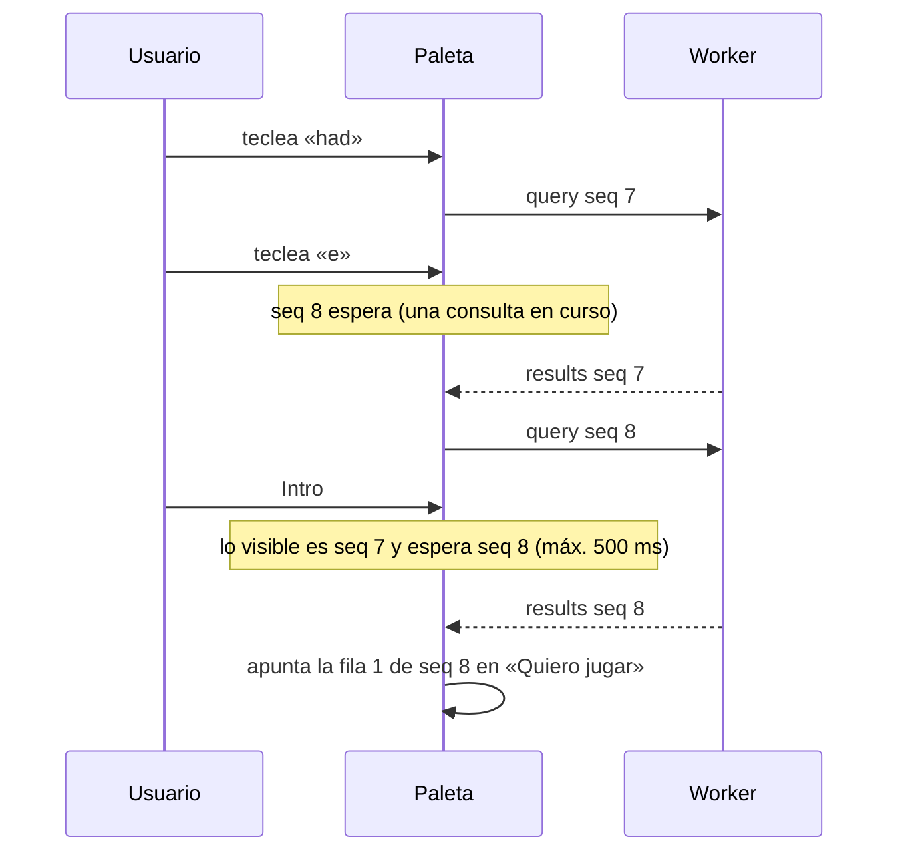

### 8.8 Disponibilidad

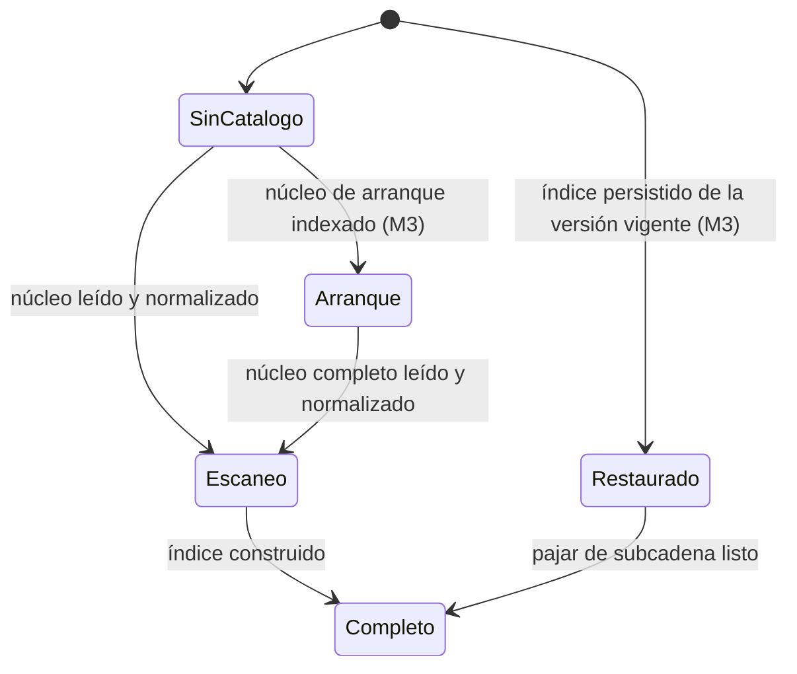

| Estado | Qué hace la paleta |
|---|---|
| Sin catálogo (`none`) | busca en Mi lista, apunta a mano y acepta enlaces, con aviso de progreso (ver §9) |
| Núcleo de arranque (`boot`, M3) | busca en los 20 000 más populares (269 KB brotli; se descarga primero) |
| Escaneo (`scan`, desde M1) | busca en todo el catálogo mientras se construye el índice: el nivel 0 y los alias con un mapa de claves exactas; los niveles 1–3, con `indexOf` sobre el pajar en orden de filas y las mismas comprobaciones de clave y el mismo orden (§8.4); el nivel 4, igual |
| Restaurado (`full`, M3) | índice leído de IndexedDB (`meta.searchIndex`, sin Dexie), sin normalizar ni construir; niveles 0–2 al instante, el 3 en cuanto está el pajar |
| Completo (`full`) | todos los niveles |

El índice se construye sobre el núcleo con `recent` ya aplicado. En M1 se construye en cada arranque en frío y, mientras tanto, responde el escaneo: leer el TSV → normalizar las claves → pajar y mapa de exactos y alias → `scan` → diccionario, *postings*, `fwd`, `fwp` y *bitsets* → `full`. La construcción trabaja en bloques de ≤8 ms y cede el turno entre ellos (por ejemplo, con `MessageChannel`), así que una pulsación espera como mucho un bloque. En `scan` rige el presupuesto de la §8.9: el escaneo medido está listo en 1,72 s y da 42 ms p95 con CPU ×4, pero es otro motor (§8.11), así que la latencia y la calidad del puente quedan **a verificar en M1**. En M3 el índice se persiste con la clave `version` del núcleo + *hash* de `recent` y, si cambia, se sigue usando el anterior mientras se reconstruye en segundo plano.

### 8.9 Presupuestos y cómo se miden

| Métrica | Presupuesto (RNF de la §3.2 y propios) | Medición |
|---|---|---|
| Pulsación → resultados, p95 | ≤16 ms escritorio; ≤50 ms con CPU ×4 (RNF-02), también en `scan` | conjunto realista de la §8.11, tecleado carácter a carácter: con ×1, dentro del Worker y de ida y vuelta; con ×4, el núcleo de búsqueda en el hilo principal de una página de prueba; `npm run perf` con Playwright y CDP (ver §12.4) |
| Nivel 4 (diferido) | ≤70 ms con CPU ×4 | mismo banco de pruebas, en las consultas que lo activan |
| Reinicio con caché hasta poder buscar | ≤2 s (RNF-04): en M1, con `scan`; en M3, con el índice restaurado | marca `search:ready` (primer `status` distinto de `none`) |
| Búsqueda lista tras la primera carga (M3) | ≤1,5 s (RNF-05), con `boot` | marca `search:ready` |
| Restaurar índice persistido (M3) | ≤0,4 s con CPU ×4 (hoy 0,55 s; guardar los *bitsets* y decodificar los nombres bajo demanda debería bastar: **a verificar en M3**) | marca `search:index-restored` |
| *Chunk* del Worker | ≤40 KB brotli | puerta de tamaño (ver §6) |

El estrangulamiento de CPU por CDP **no afecta a los Workers dedicados** (medido en Edge 156: p95 interno de 2,4 ms a ×1 y a ×4; en el Chromium de Playwright, y si `Target.setAutoAttach` permite estrangular el Worker, **a verificar en M0**). Por eso la prueba de búsqueda con ×4 ejecuta el núcleo de búsqueda en el hilo principal de una página de prueba y el Worker real se valida en el Android de referencia; INP, toque → respuesta y tareas largas se miden en la app real con ×4 (ver §12.4).

### 8.10 Conjuntos dorados y puertas

- **Lista evaluada:** la que ve el usuario con el índice completo (`full`): hasta 8 filas, las de los niveles 0–3 y, si los niveles 0–2 dan <5, hasta 3 sugerencias del nivel 4 al final; en exactos y prefijos, con +18 visible. El nivel 4 forma parte de la puerta desde M1: sin él, el dorado da 90,8 % / 93,9 %.
- **Dorado:** `packages/core/test/golden.es.tsv`, ≥60 consultas en español con su `appid` esperado (hoy 98: exactas, sin apóstrofo, romanos, siglas, nombres en español, erratas). Puerta: top-1 ≥90 % y top-5 ≥95 %.
- **Exactos:** 2 000 nombres al azar con semilla fija: ≥99 % en el top-5.
- **Prefijos:** las 4 primeras letras de los 1 000 más populares: ≥90 % en el top-10.
- **Negativas:** «pokemon», «zelda», «mario kart»: ningún resultado de nivel 0–1 (se ofrece el alta manual).
- **Dónde:** en CI, con Vitest y sin red, sobre una copia congelada del núcleo real y de sus alias en `fixtures/catalog-frozen/`: `core.20261028.1.tsv.gz` (≈3,05 MB) y `aliases.20261028.1.tsv`, copiados el 28-10-2026, que se renuevan a mano con `npm run fixtures:freeze`, como mucho una vez por hito (ver §12.1 y §14); en `catalog.yml`, como puerta de publicación sobre el núcleo recién construido, junto a las consultas de humo (ver §4). El puente `scan` se mide aparte en M1.

### 8.11 Resultados del benchmark (28-10-2026)

Ryzen 5 3600, Node 24.21.0 y Edge 156 sin interfaz (CDP); las columnas de Edge se midieron con el núcleo de búsqueda en el hilo principal de una página de prueba (ver §8.9); núcleo real de 196 665 juegos; secuencias realistas: 150 nombres tecleados carácter a carácter (2 084 pulsaciones). El reloj del navegador tiene una resolución de 0,1 ms. «—» = no medido.

| Medida | Node 24 | Edge ×1 | Edge ×4 | Edge ×10 |
|---|---|---|---|---|
| Índice listo (`full`): descarga local + lectura del TSV + índice | 0,68 s | 0,86 s | 4,56 s | 11,4 s |
| Escaneo listo (`scan`)\* | — | 0,41 s | 1,72 s | 3,55 s |
| Pajar compacto (construcción aparte) | 0,11 s | 0,14 s | 0,66 s | 1,32 s |
| Memoria (*heap* + *typed arrays*) | 39 MiB | 40 MiB | 40 MiB | 40 MiB |
| Restaurar índice (IndexedDB → 1.ª consulta) | — | 0,15 s | 0,55 s | 1,37 s |
| Pulsación p50 / p95 / máx. | 0,03 / 1,9 / 7,4 ms | <0,1 / 2,1 / 8,4 ms | 0,2 / 8,7 / 25 ms | 0,3 / 17 / 66 ms |
| Nivel 4 diferido p50 / p95 | 10 / 14 ms | 9 / 13 ms | 46 / 62 ms | 110 / 150 ms |
| Escaneo lineal\* p50 / p95 / máx. | 2,6 / 9,8 / 28 ms | 2,5 / 9,3 / 33 ms | 11 / 42 / 109 ms | 24,5 / 96 / 222 ms |

\* Motor de escaneo medido: `indexOf` sobre los nombres normalizados, 100 candidatos y reordenación por reseñas, sin romanos ni nombres en español. El puente de M1 usa los niveles y el orden de la §8.4 (ver §8.8).

| Fichero | Sin comprimir | gzip -9 | brotli 5 | brotli 11 |
|---|---|---|---|---|
| Índice serializado (solo local) | 19,2 MB | 10,6 MB | 9,32 MB | 6,66 MB |

Los tamaños del núcleo, del núcleo de arranque y de los alias están en la §7.6. El índice serializado triplica el núcleo comprimido: no se publica; se construye en el cliente y se guarda en local.

| Calidad | Objetivo | Índice, orden adoptado | Índice, modo estricto | Escaneo\* |
|---|---|---|---|---|
| Dorado (98) top-1 / top-5 | ≥90 % / ≥95 % | 94,9 % / 99,0 % | 94,9 % / 98,0 % | 86,7 % / 87,8 % |
| 2 000 exactos, top-5 | ≥99 % | 99,9 % | 99,9 % | 99,3 % |
| Prefijo de 4 letras, top-10 | ≥90 % | 93,2 % | 93,7 % | 94,6 % |

El orden adoptado se midió con el nivel 3 dentro de la misma ordenación (`pop − 6`) y desempate por nivel y fila; con la regla de la §8.4 (nivel 3 siempre detrás y desempate por fila) da lo mismo salvo los prefijos, 93,1 % (comprobado el 28-10-2026 con el mismo banco de pruebas).

Punto de partida de M1: el prototipo medido (JavaScript puro; uFuzzy en el nivel 4) está en `docs/planificacion/prototipo-busqueda/`, con el código, el dorado, las secuencias de tecleo, los vectores de normalización, los alias curados, la generación de siglas y los resultados; el núcleo medido y sus alias ya están congelados en `fixtures/catalog-frozen/` (ver §8.10). En M1 el prototipo se porta a TypeScript en `packages/core/src/search/` y el dorado pasa a `packages/core/test/golden.es.tsv`.

## 9. UX y pantallas

Todo gira alrededor de **apuntar un juego en segundos**, en el móvil o en el PC y sin red; cambiar un estado o una marca cuesta uno o dos toques y se deshace en vez de confirmarse. Estados y presupuestos (ver §3), búsqueda y *ranking* (ver §8) y datos de cada entrada (ver §7) tienen su propia sección.

### 9.1 Pantallas, rutas y navegación

| Pantalla | Ruta | Hito |
|---|---|---|
| **Mi lista** (vista «Pendientes») | `/` | M1 |
| **Paleta** (en móvil, hoja con teclado) | `/apuntar` o superpuesta | M1 |
| **Catálogo** | `/catalogo` | M1 |
| **Ficha** (en móvil, pantalla completa) | `/juego/<id>`, p. ej. `/juego/steam:1145350` | M1 básica, M2 completa |
| **Ajustes** | `/ajustes` | M1 |
| Selector de estado y marcas, alta manual y avisos | — | M1 |
| Destino de «Compartir» | `/share` | M3 |

- **Navegación:** barra lateral y cabecera con «Apunta un juego… Ctrl+K»; en móvil, tres pestañas con la barra de captura encima (en Catálogo filtra; en la ficha y en Ajustes, botón `(+)`). Puntos de corte en 768 y 1 280 px, sin desplazamiento horizontal a 320 px. Vista, filtros y orden van en la URL y en `settings` (enrutador propio, ver §6).
- **Mi lista:** «Pendientes» = Jugando ahora → A continuación (marca Próximo con estado Quiero jugar o En pausa) → Quiero jugar (por `rank`; lo nuevo, al final) → En pausa (plegada). Otras vistas: Próximos (M2), una por estado y Todos. Filtros de compra («Comprados» y «Por comprar», ver §3.3) y de texto. Orden: prioridad (el único con secciones y reordenación), fecha de apuntado, lanzamiento (M2) o nombre.
- **Catálogo:** en M1, contador de lo visible (+18 oculto, sin DLC), filtro de texto y `(+)` en cada fila; chips, lanzamiento, años, «Ocultar los de mi lista» y orden son deseables en M2 (solo necesitan el núcleo y Mi lista). Los retirados van al final y «Filtrar el catálogo…» nunca apunta con `Intro`. Altura: 196 577 × 72 px ≈ 14,2 Mpx, bajo el límite de Firefox (≈17,9 Mpx, **a verificar en M1**).
- **Ficha:** en M1, núcleo y campos de la entrada (ver §3); en M2, portada, fecha o «Por confirmar» con cuenta atrás, reseñas, plataformas y Steam Deck. Manual: «Vincular» si hay una única coincidencia exacta (nunca automático). Provisional: insignia hasta que lo resuelve el catálogo o, en M4, la micro-API.
- **Ajustes:** M1, Apariencia, Contenido (+18), Teclado (solo desactivar el atajo `/` de la paleta), Datos (exportar JSON y CSV, importar, «Exportar registro de errores» —`meta.errorLog`, ver §7.2— y borrar todo) y Acerca de; M2, «Actualizar catálogo», «Cargar portadas» y Privacidad, con «Datos de Steam que guardamos» (ver §11); M3, el resto de Teclado y gestos y Rendimiento (ver §12); M4, Sincronización (emparejar, recuperación y Atajo de iOS).

### 9.2 Flujos con recuento de pasos

| Flujo | Teclado (pulsaciones) | Ratón o móvil (toques) | Hito |
|---|---|---|---|
| Apuntar | `Ctrl+K`, 3–5 letras, `Intro` (5–7) | Barra, letras, fila (2) | M1 |
| En ráfaga | `Ctrl+Intro` (1 por juego) | «Seguir apuntando» | M1 |
| Con otro estado o marca | `Alt+Intro` + opción (2) | Pulsación larga (M3) | M1 |
| Cambiar estado | `1`–`5` (1, M3) | Chip o icono → estado (2); deslizar (1, M3) | M1 |
| Alternar marca | `C` `P` `A` (1, M3) | Acción rápida (1); hoja (2) | M1 |
| Revisar y ordenar Mi lista | `Alt+↑/↓` (1, M3) | Vista (1); `[...]` → Subir (2); arrastrar (M3) | M1 |
| Explorar el catálogo | `G` `C` (M3), flechas, `+` | Catálogo, filtros, `(+)` (2) | M1 |
| Ficha | `Mayús+Intro`; `Intro` en listas (1) | Fila (1) | M1 |
| Juego manual | `Ctrl+K`, título, `Intro` (o `↑` `Intro`), `Intro` | 3 + título | M1 |
| Pegar enlace en la paleta | `Ctrl+K` `Ctrl+V` `Intro` (3) | Barra, pegar, fila (3–4) | M1 |
| Pegar enlace con atajo o chip | `Ctrl+V` en cualquier pantalla (1) | Chip «Pegar enlace» (2; 3 en iOS) | M3 |
| Compartir en Android | — | Compartir → GameAgenda (2) | M3 |
| Atajo de iOS | — | Compartir → «Apuntar en GameAgenda» (2) | M4 |
| Desde otra aplicación (Windows) | `Ctrl+Mayús+Espacio`, 3–5 letras, `Intro` (5–7), con la app de escritorio | — | M3 |
| Próximos lanzamientos | — | Chip «Próximos» (1) | M2 |

- **Paleta:** hasta 8 resultados en una sola lista (orden e `Intro`: ver §8), con «En tu lista: `<estado>`» si ya están. Si no bastan, debajo va el bloque «¿Quizás buscabas…?» con hasta 3 sugerencias (ver §8.4). La fila «Apuntar “…” a mano» va siempre al final. `Intro` apunta al final de Quiero jugar (o abre la ficha si ya está) y devuelve el foco. Sin catálogo cargado (estado `none`, ver §8.8), busca en Mi lista y no resalta la fila manual; desde `scan`, ya busca en todo el catálogo.
- **Móvil:** campo siempre montado y `focus()` síncrono en el toque (o iOS no abre el teclado); `autocomplete`, `autocorrect` y `autocapitalize` en `off`, `spellcheck="false"`, `enterkeyhint="go"` y letra ≥16 px. Tocar la fila (≥56 px) apunta.
- **Enlaces:** `store.steampowered.com/app/<appid>[/<slug>]`, `s.team/a/<appid>`, `steamcommunity.com/app/<appid>`, `steam://store/<appid>`, `steamdb.info/app/<appid>` y `appid:730`. El chip y `Ctrl+V` fuera de la paleta (M3) apuntan directamente; un `appid` desconocido queda como juego provisional con el título del *slug* o, si no lo hay (solo lo trae la tienda), «Juego de Steam `<appid>`», que se sustituye al resolverse. El parser de `packages/core` tiene vectores de prueba de los seis formatos (el de la tienda, con y sin *slug*).
- **Fuera de la app:** `share_target` (GET a `/share` con `title`, `text` y `url`) apunta y deja `/` en el historial; sin enlace, abre la paleta con el texto (envío en `text` desde la app de Steam: **a verificar en M3**). Acceso directo «Apuntar juego» → `/apuntar`. El Atajo de iOS manda el enlace al buzón con un *token* revocable (ver §5; **a verificar en M4**). En Windows, `Win+1` abre la PWA anclada y, desde M3, la app de escritorio abre la paleta con `Ctrl+Mayús+Espacio` desde cualquier aplicación (ver §17.3).
- **Próximos:** Ya disponibles (14 días) · Esta semana · por meses · Más adelante · Por confirmar; avisos en Fase 2.

Fuentes: [`share_target`](https://developer.mozilla.org/en-US/docs/Web/Progressive_web_apps/Manifest/Reference/share_target), solo en Chromium (verificado el 28-10-2026); [portapapeles en iOS](https://webkit.org/blog/10855/async-clipboard-api/).

### 9.3 Wireframes

Leyenda: `[img]` portada, `[HK ]` generada, `(+)` apuntar, `(i)` ficha, `::` asa, `[[…]]` elegido, `(s)` guardado; estados `(*)` Quiero jugar, `(>)` Jugando, `(||)` En pausa, `(v)` Completado, `(x)` Abandonado; marcas `[$]` Comprado, `[T]` Platinado, `[^]` Próximo. Prototipo completo (M4) con datos ilustrativos; «(ej.)» = inventado.

**Escritorio · Mi lista** (fila 1 enfocada; Baldur's Gate 3 recién apuntado)

```text
+-----------+----------------------------------------------------------------+
| GameAgenda   [ Apunta un juego...                    Ctrl+K ]    (s)  [...]|
+-----------+----------------------------------------------------------------+
| > Mi lista| Mi lista                                  Orden: [Prioridad v] |
|   Catálogo| [[Pendientes 31]] [Próximos 3] [Quiero jugar 26] [Más v]       |
|   Ajustes | Compra: [[Todos]] [Comprados] [Por comprar]   [Filtrar lista]  |
|           | JUGANDO AHORA (2)                                              |
|           |      [img] Clair Obscur: Expedition… (>) Jugando v      [$]    |
|           |      [img] Stardew Valley            (>) Jugando v      [$]    |
|           | A CONTINUACIÓN (1)                                             |
|           |      [img] Hollow Knight: Silksong   (*) Quiero jugar v [$][^] |
|           | QUIERO JUGAR (25) · arrastra :: o usa Alt+flechas              |
|           | 1 :: [img] Hades II                  (*) Quiero jugar v        |
|           |            2025 · [(>) Empezar] [$] [T] [^] [...]              |
|           | 2 :: [img] Nebula Drift (ej.)        (*) Quiero jugar v        |
|           |            Sale el jue, 19 nov 2026 · dentro de 22 días        |
|           | EN PAUSA (3)                                         [Mostrar] |
| [?] Atajos| [Apuntado en Quiero jugar: Baldur's Gate 3 · Deshacer]         |
+-----------+----------------------------------------------------------------+
```

**Escritorio · Paleta** (superpuesta)

```text
+------------------------------------------------------------------------+
| baldurs|                                                           Esc |
+------------------------------------------------------------------------+
| > [img] Baldur's Gate 3                 2023 · Intro: Apuntar          |
|   [img] Baldur's Gate: Enhanced Edition 2013 · En tu lista: Completado |
|   [img] Baldur's Gate II: Enhanced Ed…  2013                           |
+------------------------------------------------------------------------+
|   Ver los 9 resultados en el Catálogo                                  |
|   Apuntar «baldurs» a mano                                             |
+------------------------------------------------------------------------+
```

**Escritorio · Catálogo** (Hollow Knight, aún con portada generada; chips, filtros y orden: deseables en M2)

```text
+----------------------------------------------------------------+
| Catálogo de Steam                                186 451 juegos|
| [ Filtrar el catálogo...       ]        Orden: [Popularidad v] |
| [Populares] [Próximamente] [Gratis] [Acceso anticipado]        |
| [Lanzamiento v] [Años v]   [ ] Ocultar los de mi lista         |
| [img] Counter-Strike 2     2012 · Gratis                    (+)|
| [img] Cyberpunk 2077       2020                   (||) En pausa|
| [img] Baldur's Gate 3      2023                (*) Quiero jugar|
| [HK ] Hollow Knight        2017                             (+)|
+----------------------------------------------------------------+
```

**Escritorio · Ficha** (junto a la lista desde 1 280 px; superpuesta entre 768 y 1 279 px)

```text
+-------------------------------------------+
| Ficha                         [Cerrar] Esc|
| +--------+  Hades II                      |
| |        |  2025 · Steam Deck: Verificado |
| |  2:3   |  Windows · macOS               |
| +--------+  Reseñas: Muy positivas        |
| Estado [[(*) Quiero jugar]] [(>) Jugando] |
|        [(||) En pausa] [(v) Completado]   |
|        [(x) Abandonado]                   |
| Marcas [ ] Comprado  [ ] Platinado        |
|        [ ] Próximo                        |
| Juego en [Elegir v]    Prioridad 1 de 25  |
| [Subir] [Bajar] [Al principio] [Al final] |
| Nota [                                  ] |
| [Ver en Steam]       [Quitar de mi lista] |
+-------------------------------------------+
```

**Ajustes: escritorio y móvil**

```text
+------------------------------------+  +------------------------------------+
| Ajustes                            |  | Ajustes                        (+) |
|  Apariencia      Datos             |  +------------------------------------+
|  Contenido       Guardado en este  |  | Apariencia                       > |
|  Teclado y       dispositivo       |  | Contenido                        > |
|   gestos         [Exportar JSON]   |  | Teclado y gestos                 > |
| >Datos           [Exportar CSV]    |  | Datos                            > |
|  Privacidad      [Importar]        |  | Privacidad                       > |
|  Sincronización  [Actualizar       |  | Sincronización                   > |
|  Rendimiento      catálogo]        |  | Rendimiento                      > |
|  Acerca de       [Exportar         |  | Acerca de                        > |
|                   registro de      |  +------------------------------------+
|                   errores]         |
|                  [Borrar todo]     |
+------------------------------------+
```

**Móvil · Mi lista y hoja de captura** (ELDEN RING ya está apuntado: tocarlo abre su ficha)

```text
+------------------------------------+  +------------------------------------+
| Mi lista         (s) [Orden] [...] |  | [<] [ elden|           (borrar) ]  |
| [[Pendientes 31]] [Próximos 3] [Q> |  +------------------------------------+
+------------------------------------+  | [img] ELDEN RING             (i)   |
| JUGANDO AHORA (2)                  |  |       2022 · (v) Completado        |
| [img] Clair Obscur: Expe…     (>)  |  | [img] ELDEN RING NIGHTREIGN  (i)   |
|       Jugando · Comprado           |  |       2025                         |
| [img] Stardew Valley          (>)  |  | Apuntar «elden» a mano             |
| A CONTINUACIÓN (1)                 |  | [ ] Seguir apuntando               |
| [img] Hollow Knight: Silk…    (*)  |  +------------------------------------+
|       Quiero jugar · Próximo       |
| QUIERO JUGAR (25)                  |
| [img] Hades II                (*)  |
|  1    2025                         |
| [img] Nebula Drift (ej.)      (*)  |
|  2    Sale dentro de 22 días       |
+------------------------------------+
| [ Apunta un juego...             ] |
+------------------------------------+
| [[Mi lista]]   Catálogo   Ajustes  |
+------------------------------------+
```

**Móvil · Catálogo y ficha de un juego no apuntado** (chips y [Filtros]: deseables en M2)

```text
+------------------------------------+  +------------------------------------+
| Catálogo  186 451 juegos [Filtros] |  | [<] Catálogo              (+) [...]|
| [Populares] [Próximamente] [Grat>  |  | +------+  Terraria                 |
+------------------------------------+  | |      |  2011                     |
| [img] Counter-Strike 2        (+)  |  | | 2:3  |  Windows · macOS · Linux  |
|       2012 · Gratis                |  | |      |  Steam Deck: Verificado   |
| [img] Terraria                (+)  |  | +------+  Reseñas: Muy positivas   |
|       2011                         |  | [    Apuntar en Quiero jugar    ]  |
| [img] Cyberpunk 2077         (||)  |  | [Apuntar como…]   [Ver en Steam]   |
|       2020 · En pausa              |  +------------------------------------+
| [HK ] Hollow Knight           (+)  |
|       2017                         |
+------------------------------------+
| [ Filtrar el catálogo...         ] |
+------------------------------------+
```

### 9.4 Atajos de teclado y gestos

| Contexto | Atajos | Hito |
|---|---|---|
| Global | `Ctrl+K` o `/`: paleta · `Ctrl+Z`: deshacer · `Esc`: cerrar | M1 |
| Global | `?`: ayuda · `G` y luego `L`, `C` o `A`: Mi lista, Catálogo, Ajustes | M3 |
| Paleta | `↑` `↓` · `Intro`: apuntar · `Ctrl+Intro`: y seguir · `Alt+Intro`: estado y marcas · `Mayús+Intro`: ficha | M1 |
| Filas | `↑` `↓` · `Intro`: ficha · `+`: apuntar (Catálogo) | M1 |
| Filas y ficha | `J` `K` · `1`–`5`: estado · `C` `P` `A`: Comprado, Platinado, Próximo · `N`: nota · `Supr`: quitar · `Alt+↑/↓`: prioridad · `V`: Ver en Steam · `F`: filtrar | M3 |

- Nada de `Ctrl+Alt` (es AltGr), de teclas con AltGr (`@ # [ ] { } \ | ~`), de `Alt+Inicio` ni de `Alt+Mayús` (idioma de entrada en Windows); del navegador solo se intercepta `Ctrl+K`. Letras y signos por `event.key` (sin distinguir mayúsculas) y dígitos por `event.code`. Las teclas sueltas no actúan con Ctrl, Alt ni Win/Cmd, en campos de texto ni con `isComposing`; con Mayús sí, porque en el teclado español `/` es `Mayús+7` y `?`, `Mayús+'` (lo prueba un E2E con `key` `/`, `code` `Digit7` y Mayús). Se pueden desactivar (WCAG 2.1.4).
- **Gestos (M3)**, con alternativa en el icono de estado, `[...]` o la ficha: deslizar → avanza el estado; ← muestra las marcas; pulsación larga, selector; arrastrar `::`, reordenar; ↓ cierra la hoja. Se activan al 40 % del ancho, se cancelan volviendo atrás, vibran 10 ms en Android y respetan zonas muertas de ≥24 px en ambos bordes; ninguno borra.

### 9.5 Reglas de respuesta inmediata (M1; portadas desde M2)

1. **Optimista:** se pinta en el mismo fotograma desde una capa en memoria (`Map` id → entrada pendiente con la HLC de la acción), superpuesta a `useLiveQuery` hasta que este la refleja (`lastHlc` ≥ esa HLC, o ya no está si se quitó); después se guarda en Dexie y `outbox` (ver §7.4). Hace falta porque Dexie no aplica sus actualizaciones optimistas a las transacciones `rw` explícitas ([notas de 4.0.1-beta.9](https://github.com/dexie/Dexie.js/releases/tag/v4.0.1-beta.9); **a verificar en M1** con 4.4.7). Filas con `React.memo` que comparan `id` y `lastHlc`, no la referencia (cada emisión trae copias nuevas); el aviso sale del estado local. Si con 500 entradas y CPU ×4 hay tareas de más de 50 ms al apuntar (ver §12), Mi lista se virtualiza por secciones.
2. **Deshacer:** aviso de 8 s, pausable con foco o puntero; después, `Ctrl+Z` (pila de 20) o «Deshacer último cambio» en `[...]`. Los efectos automáticos (fechas, Platinado ⇒ Completado) se deshacen a la vez; solo «Borrar todos mis datos» se confirma, escribiendo BORRAR.
3. **Nada se mueve bajo el cursor:** lo que llega tarde (portadas, detalles, catálogo nuevo, sincronización) ocupa huecos reservados; si una acción del usuario saca una fila de su sección, se pliega en 150 ms, el foco pasa a la siguiente y el aviso dice adónde ha ido.
4. **Esqueletos:** huecos con su tamaño final desde el primer fotograma, rellenos con `--surface-2` solo tras 300 ms; nunca pantallas de carga.
5. **Imágenes diferidas:** texto primero; `loading="lazy"`, 2:3 fijo, `referrerpolicy="no-referrer"` y `crossorigin="anonymous"`; `library_capsule` → `header` → portada generada con CSS (iniciales y color); en la paleta, tras 150 ms sin teclear. Con «Cargar portadas» apagado o el *kill switch* `covers`, siempre la generada.
6. **Arranque y movimiento:** Mi lista sale de Dexie antes de tocar la red; animaciones de 120–200 ms (`transform`, `opacity`), ninguna con `prefers-reduced-motion`.

### 9.6 Estados del sistema

| Situación | Texto | Acción | Hito |
|---|---|---|---|
| Mi lista vacía | Tu agenda está vacía. Apunta el primer juego que quieras jugar: escribe su nombre y pulsa Intro. | Explorar el catálogo | M1 |
| Sin resultados | No hemos encontrado «mario kart» en Steam. | Apuntar «mario kart» a mano | M1 |
| Catálogo sin cargar (estado `none`) | Preparando el catálogo de Steam… 40 %. Mientras, buscamos en tu lista. (Si falla: No hemos podido descargar el catálogo de Steam.) | Apuntar a mano o pegar un enlace · Reintentar | M1 |
| Sin conexión | Sin conexión. Puedes seguir apuntando: tus cambios se guardan en este dispositivo. | — | M1 |
| iOS sin instalar | Safari puede borrar tus datos si lo usas 7 días sin abrir GameAgenda. Añádela a la pantalla de inicio o exporta una copia. | Cómo añadirla · Exportar | M1 |
| Guardado fallido | No hemos podido guardar en este dispositivo. Exporta tu lista para no perderla. | Exportar · Reintentar | M1 |
| Importación no válida | Este archivo no es una copia válida de GameAgenda. No hemos cambiado nada. | Elegir otro | M1 |
| Sincronización fallida | No hemos podido sincronizar 3 cambios. Lo seguiremos intentando. | Reintentar ahora | M4 |

El aviso del catálogo solo sale en `none`: en cuanto el Worker pasa a `scan` (M1) o a `boot` (M3), la paleta busca en el catálogo (en `boot`, en los 20 000 juegos más populares), aunque el índice aún se esté construyendo (ver §8.8). Mensajes junto al elemento, nunca en un modal (`role="alert"` solo para los críticos). [Safari](https://webkit.org/blog/10218/full-third-party-cookie-blocking-and-more/) no aplica el límite de 7 días a las apps de la pantalla de inicio (verificado el 28-10-2026).

### 9.7 Accesibilidad (WCAG 2.2 AA)

Base desde M1; auditoría en M3 (teclado, zoom al 400 %, NVDA, Narrador, VoiceOver, TalkBack y axe-core; ver §12).

- **1.4.1 · 1.4.3 · 1.4.11:** estado con icono, texto y color; texto ≥4,5:1; foco, bordes e iconos ≥3:1.
- **1.4.10 · 1.4.13:** sin desplazamiento horizontal a 320 px; *tooltips* que se cierran con `Esc`; acciones del *hover* también con el foco.
- **2.1.1 · 2.1.4 · 2.2.1:** todo con teclado; teclas sueltas desactivables; Deshacer no caduca con el aviso.
- **2.4.7 · 2.4.11:** anillo de 2 px separado 2 px; `scroll-padding` para que barras y avisos no tapen el foco; al cerrar paleta, diálogos u hojas, el foco vuelve a su origen.
- **2.5.1 · 2.5.7 · 2.5.8:** botón para cada gesto y arrastre; objetivos ≥24 × 24 px (44 × 44 px los principales en táctil, como en RNF-09).
- **2.5.3 · 3.3.1 · 3.3.7 · 3.3.8:** nombre accesible que empieza por el texto visible («Jugando: cambiar estado de…»); errores que dicen qué hacer; lo buscado rellena el título manual; emparejar (M4) con QR o pegando el código.
- **4.1.2 · 4.1.3:** paleta como *combobox* del APG (`(i)` fuera de la `option`); `aria-pressed` en las marcas; *tabindex* itinerante; en la lista virtual, `aria-setsize`/`aria-posinset` y la fila enfocada nunca se desmonta; avisos en `role="status"`.

Fuentes: https://www.w3.org/TR/WCAG22/ · https://www.w3.org/WAI/ARIA/apg/patterns/combobox/

### 9.8 Tokens visuales y colores de estado (M1)

Tema del sistema con selector, neutros fríos y un acento rosa para la identidad de la app, el foco y la acción principal; el color de estado solo tiñe chips e iconos. Letra del sistema (`"Segoe UI Variable Text", system-ui, sans-serif`) con `tabular-nums`; iconos SVG incrustados (p. ej. Lucide, ISC); identidad propia, sin imitar a Steam (ver §11).

*Tokens* (oscuro / claro; contraste sobre `--surface`): `--bg` `#0E1116`/`#F6F7F9` · `--surface` `#161B22`/`#FFFFFF` · `--surface-2` `#1E252E`/`#EEF1F5` · `--control-border` `#6B7787`/`#7A8594` (3,80 / 3,74) · `--text` `#E7EBF0`/`#161B22` (14,45 / 17,30) · `--text-muted` `#A3ADBA`/`#556170` (7,61 / 6,31) · `--accent` `#FF6AA8`/`#C2185B` (6,49 / 5,87).

| Estado o marca | Icono | Oscuro: texto · chip | Claro: texto · chip |
|---|---|---|---|
| Quiero jugar | Marcapáginas | `#5AB0FF` · `#213345` (5,60:1) | `#0B63C5` · `#E2ECF8` (4,88:1) |
| Jugando | *Play* | `#3FCF8E` · `#1D3833` (6,32:1) | `#0D6E43` · `#E2EEE8` (5,30:1) |
| En pausa | Pausa | `#FF9F43` · `#3B3027` (6,28:1) | `#A44F00` · `#F4EAE0` (4,79:1) |
| Completado | Círculo con *check* | `#B395FF` · `#2F2F45` (5,37:1) | `#6A3FC8` · `#EDE8F8` (5,54:1) |
| Abandonado | Círculo tachado | `#9AA5B4` · `#2B3139` (5,26:1) | `#5E6977` · `#ECEDEF` (4,76:1) |
| Platinado | Trofeo | `#E8C35A` · `#38362B` (7,16:1) | `#7A5A00` · `#EFEBE0` (5,36:1) |
| Comprado | Bolsa | `#A3ADBA` · `#2D323A` (5,67:1) | `#556170` · `#EBECEE` (5,33:1) |
| Próximo | Chincheta | `#4DD0E1` · `#1F3841` (6,72:1) | `#006875` · `#E0EDEE` (5,41:1) |

Chip **opaco** (16 % del color en oscuro y 12 % en claro, sobre `--surface`): translúcido, en claro y sobre `--surface-2`, bajaría de 4,5:1. Sin chip, icono y texto dan ≥6,19:1 (oscuro) y ≥4,93:1 (claro). En la fila solo se ven las marcas activas; las insignias son neutras.

### 9.9 Microcopy (español de España)

Tuteo, frases cortas, pretérito perfecto, sin exclamaciones y teclas con su nombre español; el verbo principal es **apuntar**. Fechas con `Intl` es-ES («28 oct 2026», «dentro de 22 días»); millares con espacio fino irrompible desde cinco cifras («186 451», pero «1234»), no con el punto de `Intl`.

| Contexto | Texto |
|---|---|
| Al apuntar o compartir | Apuntado en Quiero jugar: Baldur's Gate 3 · Deshacer |
| Cambio de sección | Hades II pasa a Jugando · Deshacer |
| Platinado | Platinado. También lo hemos marcado como Completado. · Deshacer |
| Provisional | Apuntado: «Hollow Knight Silksong» (provisional). Lo completaremos cuando llegue al catálogo. |
| Vincular | ¿Es «Hades II» de Steam? · Vincular |
| Pista de la paleta con solo sugerencias (ver §8.7) | ¿Quizás buscabas…? Elige con ↓ |
| Aviso de primera capa: portadas (M2; ver §11) | Las portadas se cargan desde servidores de Valve en EE. UU., que reciben tu dirección IP. · Más información · Entendido · Desactivar portadas |

«Más información» abre la pantalla «Datos de Steam que guardamos» (Ajustes › Privacidad, M2).

## 10. Integración con la cuenta de Steam

**Fase 2.** La cuenta de Steam es una ayuda opcional para importar, nunca un requisito: apuntar funciona sin cuenta y sin red. Reglas fijas:

- **Ninguna llamada a Steam por usuario, con clave o sin ella, antes de un login OpenID verificado.** El prototipo (M0–M4) no hace ninguna.
- La importación solo **propone**: el usuario revisa y aplica, con Deshacer.
- Las respuestas de Steam no se guardan en D1.

### 10.1 Qué se importa

| Dato | Endpoint | ¿Clave? | Qué propone |
|---|---|---|---|
| Biblioteca y horas | `IPlayerService/GetOwnedGames/v1` (`include_appinfo`, `include_played_free_games`, `skip_unvetted_apps=false`) | Sí | **Comprado** en las entradas existentes; añadir el resto como «Quiero jugar» (p. ej., solo los no jugados) es opcional. Nunca los `family_shared`. Las horas, solo como pista; `ownedAt` queda vacío |
| Lista de deseados | `IWishlistService/GetWishlist/v1` (`steamid`) | No (no documentado) | **Quiero jugar**, al final de la lista |
| Logros | `IPlayerService/GetUserAchievements` + `GetGameAchievements` (no documentados); alternativa con clave: `ISteamUserStats/GetPlayerAchievements` + `GetSchemaForGame` | No / Sí | **Platinado**, solo como sugerencia: conjuntos del juego base (`dlcappid=0`) completados |

No se usa `GetPlayerSummaries`: importar no necesita nombre, avatar ni ubicación. Matices (verificados el 28-10-2026):

- **Privacidad:** hace falta «Detalles de juegos: Público»; si no, `GetOwnedGames` responde `200 {"response":{}}` sin `game_count` y la app muestra una guía corta (`communityvisibilitystate` mide el perfil y no lo detecta). Los juegos marcados como privados no aparecen: la importación puede salir incompleta.
- **Achievement Sets** (beta anunciada el 16-10-2026): los logros archivados no cuentan, los DLC van en conjuntos aparte y un conjunto completado sigue completado. Por eso Platinado sigue siendo manual.
- **Coste:** ≈1 llamada por juego con logros (≈300 en una biblioteca de 500), con los esquemas cacheados por `schema_hash` en el dispositivo. El escaneo lo lanza el usuario, es incremental (solo juegos con `rtime_last_played` nuevo), va en lotes de ≤20 juegos (el plan gratuito de Workers admite 50 subpeticiones por invocación) y respeta los 429; un 401 no se reintenta. Todas las llamadas del servidor cuentan para el límite de los ToU (ver §11.1).

Fuentes: <https://partner.steamgames.com/doc/webapi/IPlayerService> · <https://developers.cloudflare.com/workers/platform/limits/>

### 10.2 Identificación: «Iniciar sesión con Steam»

Steam solo ofrece **OpenID 2.0** a terceros (sin OIDC ni OAuth abierto). La micro-API usa **`steam-signin` 1.0.5**: sin clave, devuelve solo el SteamID64. Como usa `https`, `querystring` y `Buffer` de Node, el Worker necesita `nodejs_compat` (a verificar en Fase 2); si no bastara, se porta su `verifyLogin` (MIT, una función corta) a `fetch`.

Comprobaciones obligatorias (omitirlas es un fallo recurrente, p. ej. CVE-2026-82183):

1. `check_authentication` por POST del servidor a la URL **fija** `https://steamcommunity.com/openid/login`, nunca al `op_endpoint` recibido.
2. `claimed_id`, `return_to` y `response_nonce` dentro de `openid.signed`.
3. `return_to` idéntico al emitido, ticket incluido: `steam-signin` solo compara esquema y host, así que la ruta y el ticket los comprueba la micro-API.
4. `claimed_id` con `^https?://steamcommunity\.com/openid/id/(\d{17})/?$`.
5. Ticket de un solo uso que caduca en 10 min y solo se canjea con su verificador: una aserción capturada no sirve para otro ticket ni para colar un login ajeno (*login CSRF*).

**Canje tipo PKCE:** las apps de la pantalla de inicio de iOS tienen un almacén de cookies distinto del de Safari, donde acaba el login, y una cookie de estado no llegaría a la app. Por eso el ticket se liga a un `challenge` (SHA-256 de un verificador aleatorio de 256 bits que solo conoce la app) y lo canjea la propia app. El envoltorio Tauri (ver §17.3) usa el mismo flujo con el navegador del sistema, sin esquema propio ni puerto local.

**Descartado:**

- **Pegar el perfil, sin login:** cualquiera podría importar un perfil público ajeno; incumple el «solo a petición del usuario» de los ToU y expone la clave, la misma del catálogo, a abuso y revocación.
- Pedir contraseñas o *tokens* de Steam (`steam-session` es solo para cuentas propias) y usar PICS o el protocolo del cliente.
- `passport-steam`: sin versiones desde 2023.

Fuentes: <https://partner.steamgames.com/doc/features/auth> · <https://github.com/DoctorMcKay/node-steam-signin> · <https://openid.net/specs/openid-authentication-2_0.html>

### 10.3 Flujo

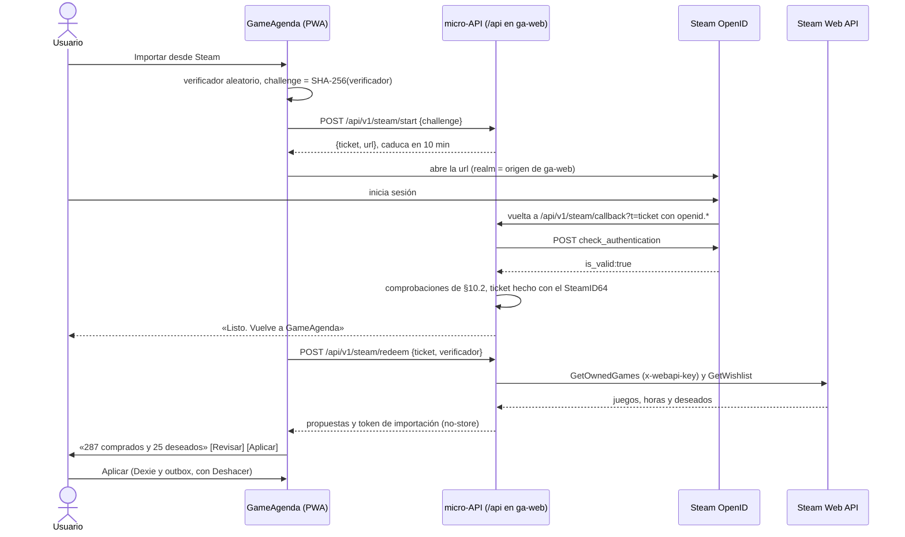

### 10.4 Qué se guarda y cómo se prueba

- **Servidor:** las respuestas de Steam solo viajan hasta el dispositivo (`Cache-Control: no-store`, sin registros en `/api/v1/steam/*`). D1 guarda solo el ticket (*hash*, `challenge`, caducidad y, tras el login, el SteamID64) ≤10 min; Time Travel lo conserva 7 días más (ver §11.2). Con las propuestas llega un *token* de importación firmado (HMAC, 15 min, solo en memoria) para los lotes de logros.
- **Dispositivo:** las marcas aceptadas son datos de la agenda y se sincronizan como cualquier cambio. Los metadatos de importación (`rtime_last_played` por `appid`, esquemas) van en `meta` (ver §7); «Desconectar Steam y borrar datos» los elimina.
- **Clave:** pasa a ser también un secreto del Worker (`wrangler secret put`). La búsqueda de nombres (`x-webapi-key` y el de la variable) se limita entonces a los *assets* del cliente; la del valor lo cubre todo (ver §12).
- **Pruebas:** las comprobaciones de la §10.2, con aserciones grabadas en `fixtures/` (firma falsa, campos sin firmar, `return_to` ajeno, ticket repetido) y `app.request()` de Hono; el CI nunca llama a Steam. El login real se prueba a mano con un túnel `cloudflared` (HTTPS en el puerto 443): `steam-signin` descarta el puerto del *realm* y OpenID 2.0 exige el mismo puerto en `return_to`, así que `http://localhost:8787` no sirve. Casos: perfil privado, biblioteca vacía, juego compartido en familia y juego privado.

## 11. Seguridad, privacidad y cumplimiento

Referencia: OWASP ASVS nivel 1. Hasta M4 no hay servidor propio con datos de usuarios, y el navegador solo contacta con Valve por las portadas.

### 11.1 Condiciones de uso (ToU) de la Steam Web API

Versión de julio de 2010 (verificada el 28-10-2026):

| Obligación | Cómo se cumple |
|---|---|
| ≤100 000 llamadas/día en total, con clave o sin ella | Pipeline ≈220/día (≤230; ver §4); en Fase 2, importaciones a petición, incrementales y con tope por agenda |
| Clave confidencial | Solo en secretos, enviada en `x-webapi-key` (ver §11.3) |
| Política de privacidad; decir qué datos de Steam se guardan y en qué país | Política por capas (ver §11.2) y pantalla «Datos de Steam que guardamos»: qué; dónde (el dispositivo; la red global de Cloudflare, para el catálogo; D1 con jurisdicción UE, para la agenda desde M4; GitHub, en EE. UU., para el estado del pipeline); que la IP llega a Valve (EE. UU.) por las portadas, y botón de borrar |
| Datos de un usuario solo a petición suya | Nada por usuario antes de un login OpenID verificado; sin perfiles pegados (ver §10.2) |
| No insinuar respaldo de Valve; enlaces sin `nofollow` | Sin «Steam» en el nombre ni en el icono; aviso de marca en «Acerca de»; botón oficial de login en Fase 2; enlaces a la tienda sin `rel="nofollow"` |
| Borrar los datos de Steam al terminar | Botón de borrar; si Valve revoca el acceso, se retiran esas funciones |
| Uso comercial | Los ToU no dicen nada: consultar a Valve antes de monetizar |

Aviso de marca: «Steam y el logotipo de Steam son marcas comerciales o registradas de Valve Corporation en EE. UU. y otros países. GameAgenda no está afiliada a Valve ni cuenta con su respaldo». Las portadas se enlazan y nunca se copian a un servidor propio, porque republicar una copia es una nueva comunicación pública (TJUE, Renckhoff, C-161/17).

Fuentes: <https://steamcommunity.com/dev/apiterms> · <https://partner.steamgames.com/doc/marketing/branding>

### 11.2 Privacidad: RGPD, LOPDGDD y LSSI

Sin email, contraseña, analítica de terceros ni cookies no necesarias: **no hay banner** (art. 22.2 LSSI; la guía de cookies de la AEPD aplica lo mismo a `localStorage` e IndexedDB).

| Cuándo | Medidas |
|---|---|
| M1 (todo en el dispositivo) | Exportar (JSON/CSV) y «Borrar todos mis datos» |
| M2 (la IP llega a Valve por las portadas) | Aviso de primera capa, `referrerpolicy="no-referrer"`, interruptor «Cargar portadas» y «Datos de Steam que guardamos» |
| Antes del primer probador externo y de M4 | Política completa por capas, aviso legal y registro de actividades (Facilita RGPD, de la AEPD) |
| M4 (agenda en D1, UE) | Base del art. 6.1.b RGPD, declaración de edad, retención y borrado en el servidor |

Quienes hacen la prueba guiada de M3 (ver §2.4) en el móvil y el PC del desarrollador, sin datos propios, no cuentan como probadores externos.

- **Aviso de primera capa** (texto en la §9.9): sale la primera vez que se cargan portadas, solo informa, ofrece desactivarlas y su «Más información» abre la pantalla «Datos de Steam que guardamos» (M2), que enlazará con la política completa cuando exista. Base propuesta: interés legítimo (art. 6.1.f) con oposición en un toque, a validar al redactar la política. Precedente: condena del LG München I (3 O 17493/20, 2022) por enviar la IP a Google Fonts sin base jurídica.
- **Capas y derechos:** la primera capa (art. 11 LOPDGDD) da identidad y contacto del responsable, finalidad y derechos (arts. 15–22). Acceso y portabilidad = exportar; supresión = borrar en el dispositivo y, en M4, en el servidor; plazo de un mes (art. 12.3 RGPD).
- **Cookie de dispositivo:** es persistente, y el GT29 (WP194) solo exime las de autenticación persistentes si el usuario las pide: la crea un gesto explícito («Activar sincronización» o «Emparejar»), que informa en ese momento.
- **Menores:** al activar la sincronización se declara tener ≥14 años (art. 7 LOPDGDD); es un parámetro, porque el proyecto de ley 121/000052 la subiría a 16.
- **Registro de actividades:** obligatorio, porque la exención del art. 30.5 RGPD no cubre tratamientos habituales.
- **Encargados y transferencias:** Cloudflare (hosting y Workers): la jurisdicción UE de D1 fija dónde se guarda la base, no dónde se ejecuta la micro-API (en el centro de datos más cercano al usuario), y solo se elige al crearla (`--jurisdiction=eu`; plan gratuito, a verificar en M4). La IP llega a Valve en EE. UU. por las portadas. La política nombra a ambos y la base de cada transferencia a EE. UU. (Marco de Privacidad de Datos UE-EE. UU. o cláusulas tipo, a verificar). GitHub (EE. UU.) solo guarda el estado del pipeline, sin datos personales.

**Retención.** Time Travel de D1 está siempre activo: lo borrado se puede restaurar durante 7 días (plan gratuito), y así se declara.

| Dato | Dónde | Retención |
|---|---|---|
| Agenda y ajustes | Dispositivo | Hasta que el usuario los borre |
| Agenda sincronizada | D1 (UE) | Mientras exista; se borra al pedirlo |
| *Hashes* de credenciales (dispositivo, buzón, recuperación) y de emparejamiento | D1 | Hasta revocarlas o borrar la agenda; los de emparejamiento, 10 min |
| Lápidas | Dispositivo | No se purgan antes de M4; después, las ya sincronizadas, 90 días tras el borrado (ver §7.4 y §7.7) |
| Lápidas | D1 | 90 días tras el borrado (purga semanal, ver §7.7) |
| Agenda sin sincronizar en 13 meses | D1 | Se borra (propuesta) |
| Ticket de login con SteamID64 (Fase 2) | D1 | ≤10 min |

Fuentes: <https://www.aepd.es/guias/guia-cookies.pdf> · <https://www.boe.es/buscar/act.php?id=BOE-A-2018-16673> · <https://developers.cloudflare.com/d1/reference/time-travel/> · <https://developers.cloudflare.com/d1/configuration/data-location/>

### 11.3 Seguridad de la app y del catálogo

- **Cabeceras por `_headers`** (fichero estático, ver §14), que no se aplica a lo que genera el Worker (en M4, la micro-API pone las suyas con Hono). CSP sin `unsafe-inline` y, de momento, sin *hashes*: el `index.html` de Vite no lleva *scripts* incrustados (el Service Worker se registra desde el código; verificado el 28-10-2026), así que basta `script-src 'self'`. Si hiciera falta uno (p. ej., para aplicar el tema antes de pintar), se permitiría por su *hash* y el *build* generaría `dist/_headers`. Máximo, 2 000 caracteres por cabecera:

  ```text
  default-src 'self'; script-src 'self'; style-src 'self';
  img-src 'self' https://shared.akamai.steamstatic.com;
  connect-src 'self' https://ga-catalog.<subdominio>.workers.dev;
  object-src 'none'; base-uri 'none'; form-action 'self';
  frame-ancestors 'none'; upgrade-insecure-requests
  ```

  Más `X-Content-Type-Options: nosniff`, `Referrer-Policy: strict-origin-when-cross-origin`, `Cross-Origin-Opener-Policy: same-origin`, HSTS y una `Permissions-Policy` que desactiva lo que no se usa. El Service Worker aplica la CSP de su propio *script*, y sus descargas cuentan, en principio, como `connect-src`: esa CSP añade el CDN de portadas (a verificar en M2). En Fase 2, `img-src` añade `https://images.igdb.com` (ver §17). `ga-catalog` solo envía `Access-Control-Allow-Origin` para el origen de la app. Los e2e fallan ante cualquier violación de CSP (ver §12).
- **Texto de Steam como texto:** Biome prohíbe `dangerouslySetInnerHTML`; las URL se construyen desde el `appid` y rutas validadas. Zod valida cada respuesta de Steam, cada entrada de la micro-API y cada importación (con tamaño máximo).
- **Clave de Steam:** solo en un secreto de GitHub y en `.env.local`; el CI falla si el *build* contiene su valor o la cadena `x-webapi-key` (ver §12). Si se filtra, se revoca, se crea otra y se actualiza el secreto.
- **Cadena de suministro:** `save-exact=true`, *lockfile* y `npm ci`; *actions* fijadas por SHA con `permissions` mínimos; Dependabot semanal; secretos solo en los flujos que los usan (ver §12). El *token* de Cloudflare tiene el mínimo permiso, pero «Workers Scripts: Edit» abarca toda la cuenta: un pipeline comprometido (procesa datos no confiables) podría desplegar `ga-web`. Si en M0 se confirma que no se puede limitar a un *script*, `ga-catalog` pasa a otra cuenta gratuita con su propio *token*.
- **Integridad del catálogo:** *manifest* firmado con ed25519 (privada solo en un secreto de GitHub; pública en la app, con hueco para una segunda para rotarla). Desde M2, el PC nunca firma ni despliega `ga-catalog`: si el pipeline se lanza desde el PC (429 en los *runners* compartidos o falta de minutos), solo descarga y construye, y sube el resultado como *asset* de la *Release* de preparación `catalog-staging`; después, `catalog.yml` (`workflow_dispatch` con `source=staging`) pasa las puertas, firma y publica (ver §4.5). El cliente verifica la firma con WebCrypto (a verificar en M2 en los navegadores objetivo) y el `sha256` de cada fichero antes de sustituir el catálogo, y rechaza una `version` anterior a la suya (volver a un catálogo anterior es republicar sus ficheros con una `version` nueva): ni el CDN ni un *token* de Cloudflare robado cuelan un catálogo o un *kill switch* falsos.

### 11.4 Micro-API y emparejamiento (M4)

- **Credencial de dispositivo:** cookie `__Host-` `HttpOnly` `Secure` `SameSite=Lax` con 256 bits aleatorios; el servidor guarda solo su SHA-256. Ni el JavaScript ni un XSS la leen, y no le afecta la purga de 7 días de WebKit sobre lo que escriben los *scripts* (prueba en un iPhone real, ver §15). Chrome limita las cookies a 400 días: se renueva al sincronizar, como mucho una vez al día. En Ajustes se ven y se revocan los dispositivos.
- **Emparejar:** *token* de un solo uso, ≥128 bits y 10 min, en QR y como texto. Se canjea con un POST desde dentro de la app, nunca con un GET (una vista previa de enlaces lo gastaría); si va en una URL, en el fragmento (`#`), que no llega al servidor. Solo se guarda su *hash*, como el del código de recuperación (128 bits, se muestra una vez).
- **Buzón:** *token* de solo escritura y revocable en la cabecera `Authorization`, nunca en la URL; solo acepta enlaces de la tienda de Steam.
- **Peticiones:** nada cambia por GET; el resto exige `Content-Type: application/json` y `Origin` propio, salvo el buzón: el Atajo de iOS no envía `Origin` (a verificar en M4), así que esa ruta no lo comprueba ni acepta la cookie, solo su *token*. Zod rechaza campos desconocidos, cada ruta tiene tamaño máximo y no se aceptan HLC más de 5 min por delante del servidor: cada respuesta de `sync` trae la hora del servidor, con la que el cliente corrige su desfase y vuelve a sellar lo rechazado (ver §7.4). `Cache-Control: no-store` y registros sin cuerpos ni *tokens*. Solo se llama a `api.steampowered.com` (en Fase 2, también a `steamcommunity.com`): nunca es un *proxy* abierto.
- **Rate limiting** en las rutas sin autenticar (crear agenda, canjear emparejamiento o código, `resolve`; en Fase 2, las de Steam) y por *token* en el buzón, con el *binding* `ratelimits` (10 o 60 s; contadores aproximados por ubicación; plan gratuito a verificar en M4). Adivinar ≥128 bits es inviable: el límite protege la cuota gratuita de 100 000 peticiones/día, y si se agota, buscar y apuntar siguen funcionando (ver §5).

Fuentes: <https://developers.cloudflare.com/workers/static-assets/headers/> · <https://developers.cloudflare.com/workers/runtime-apis/bindings/rate-limit/>

## 12. Calidad e ingeniería

Nivel de prototipo de una persona: se automatiza lo que protege la captura, los datos y la clave de Steam; sin SLO ni entorno de *staging*.

### 12.1 Estrategia de pruebas

| Nivel | Qué cubre | Herramienta |
|---|---|---|
| Unitarias | `packages/core`: normalización con los vectores compartidos (ver §8), niveles de *ranking* sobre el mini-catálogo, parser de enlaces, códecs TSV y *shards*, reglas de estados y marcas (ver §3), HLC | Vitest 5.0.5 |
| Calidad de búsqueda | Dorado, 2 000 exactos, prefijos de 4 letras y negativas, con los umbrales de la §8.10 (exactos y prefijos, con +18 visible). Sin red, sobre una copia congelada y comprimida del núcleo real y sus alias en `fixtures/catalog-frozen/` (≈3 MB gzip; se renueva a mano con `npm run fixtures:freeze`, como mucho una vez por hito). `catalog.yml` aplica las mismas puertas al núcleo recién construido antes de publicar | Vitest |
| Propiedades | `merge()` y normalización (§12.2) | fast-check 4.10.2 en Vitest |
| Contrato | Esquemas Zod 4.6.7 de `GetAppList`, `Query` y `GetItems` contra *fixtures* grabados; formato de exportación | Vitest |
| Pipeline | Ejecución con *fixtures*: clasificación, lógica de las puertas (ver §4), plan B sin clave y determinismo (regenerar el mini-catálogo da los mismos bytes) | Vitest |
| E2E y rendimiento | §12.3 y §12.4, en Chromium de escritorio y móvil emulado (WebKit, en local) | Playwright 1.64.1 |
| Micro-API (M4) | Rutas con `app.request()` de Hono; sincronización con dos contextos de navegador | Vitest, Playwright |

### 12.2 Propiedades, contrato y canario

- **`merge()`** (1 000 casos por propiedad): las mismas operaciones, en cualquier orden o repetidas, dan el mismo estado; `merge(a, b)` = `merge(b, a)`; la reparación de invariantes (Platinado ⇒ Completado, según los relojes) se cumple siempre; importar dos veces el mismo JSON equivale a importarlo una (ver §7).
- **Normalización:** idempotente; la salida no tiene mayúsculas, diacríticos, apóstrofos, ™ ℠ ® © ni espacios sobrantes, y quitar apóstrofos de la entrada no la cambia.
- **Contrato:** los esquemas solo describen los campos usados (ignoran los desconocidos, exigen los obligatorios) y el pipeline valida en vivo con ellos. `npm run fixtures:record` guarda URL, estado HTTP, fecha y cuerpo, nunca cabeceras (la clave va en `x-webapi-key`), y falla si un fichero contiene la clave. Casos: los del mini-catálogo (§13.5), `success 15`, 429 con y sin `Retry-After`, 5xx, JSON roto y lista vacía.
- **Sin red real en CI:** con `STEAM_MODE=fixtures`, el cliente HTTP del pipeline falla ante una petición sin *fixture*; Playwright aborta lo que no vaya al origen local; `ci.yml` no tiene secretos.
- **Canario diario:** el primer paso de `catalog.yml` valida con esos esquemas una petición pequeña a cada endpoint que vaya a usar; si falla, se actúa como ante cualquier violación de contrato (ver §4) y se abre un *issue*.

### 12.3 E2E «apuntar un juego en <3 s»

- **Inicio:** el evento que abre la paleta (`keydown` de `Ctrl+K` o `/`; en móvil, el toque en la barra «Apunta un juego…»). **Fin:** el primer fotograma con la confirmación («Apuntado en Quiero jugar: … · Deshacer», ver §9). La app lo registra como `capture:palette-to-confirm` y el test lee esa medida, no su reloj.
- **Guion y criterio:** 5 juegos distintos del mini-catálogo (`hollow`, `elden`, `baldurs`, `celeste`, `stardew`): abrir la paleta, teclear con `pressSequentially(q, { delay: 100 })`, esperar el nombre accesible del primer `option`, Intro (en móvil, toque en la fila) y esperar al `status`. Pasa si la mediana de las 5 es ≤3 000 ms y `ui:feedback` ≤100 ms en cada una, sin reintentos.
- **Entorno:** *build* del modo `e2e` (el de producción, con el mini-catálogo en el mismo origen y, desde M2, firmado con la clave de desarrollo) servido con las cabeceras de `_headers` por `wrangler dev` (a verificar en M0); falla ante cualquier `securitypolicyviolation`.
- **Otros E2E:** Deshacer, juego ya apuntado, carrera de Intro (con `delay: 0`, Intro apunta el juego de la consulta final), pegar un enlace, juego manual, estado y marca en un toque, sin red, exportar e importar, Catálogo completo, solo teclado, axe-core en cada pantalla (ver §3) y `/share` (M3).

### 12.4 Rendimiento, tamaño y dónde se mide

Las medidas son las mismas en los tests y en el panel: `performance.measure` y, para el INP, Event Timing; «fotograma» es el `requestAnimationFrame` tras el *commit* de React.

| Medida | Desde | Hasta |
|---|---|---|
| `search:keystroke-to-results` | `event.timeStamp` del `input` | Fotograma con los resultados de esa consulta (misma secuencia) |
| `ui:feedback` | Evento que actúa (Intro, `pointerup`) | Fotograma con el cambio visible |
| `capture:palette-to-confirm` | Apertura de la paleta | Fotograma con la confirmación |
| `app:list-visible` · `search:ready` · `search:full` | Inicio de la navegación | Mi lista con datos · primer `status` con estado distinto de `none` (`scan`, `boot` o `full`: ya se busca en el catálogo) · estado `full` |
| `search:index-restored` (M3) | Inicio de la lectura del índice persistido | Índice listo para la primera consulta |
| INP | Inicio de la interacción (`PerformanceObserver` de tipo `event`, agrupado por `interactionId`) | Siguiente pintado |

- **`perf`:** Playwright en Chromium con CPU ×4 (`Emulation.setCPUThrottlingRate` por CDP) y, como umbrales, los presupuestos (ver §3) y los propios de la búsqueda (ver §8.9). Como CDP **no estrangula los Workers dedicados** (medido; ver §8.9), la prueba tiene dos partes:
  1. **Búsqueda:** una página de prueba ejecuta la búsqueda de `packages/core` (índice y *ranking*) en el hilo principal, sobre la copia congelada del núcleo real (§12.1) o sobre `pipeline/out/`. Mide el tiempo hasta poder buscar (`scan`; en M3, `boot`) y hasta el índice completo (`full`) y, desde M3, la restauración del índice; teclea carácter a carácter el conjunto realista (ver §8.11) y calcula p50/p95 de pulsación → resultados y del nivel 4. El Worker real se valida en el Android de referencia (§13.4). **A verificar en M0**, en el Chromium de Playwright, que el Worker tampoco se estrangula allí y si `Target.setAutoAttach` permite estrangularlo.
  2. **App real**, con el mismo catálogo y 500 entradas en Mi lista: teclea 20 nombres, apunta 10 y mide INP, `ui:feedback`, `capture:palette-to-confirm`, el reinicio con caché (`app:list-visible`) y el LCP; sin estrangular, `search:keystroke-to-results` para el presupuesto de escritorio. Falla si un `PerformanceObserver` de `longtask` ve una tarea del hilo principal de más de 50 ms al teclear o apuntar.
- **Tamaño:** `scripts/size-gate.ts` comprime con brotli (calidad 11) el JS inicial, según el `build.manifest` de Vite, y el *chunk* del Worker de búsqueda, y los compara con su presupuesto (ver §6).

| Comprobación | CI | Local | Móvil real |
|---|---|---|---|
| Biome, `tsc`, Vitest (con las puertas de calidad de búsqueda), E2E, tamaño, clave | Bloquea | `npm run check` y `npm run e2e` | — |
| `perf` | Informa (*runners* ruidosos) | **Bloquea** si se toca búsqueda, paleta o Mi lista | — |
| Presupuestos en dispositivo | — | — | Android de referencia (§13.4): **bloquea** el cierre de M1 y M3 (en M1, con la excepción de la §15.4); iPhone, con el panel |

### 12.5 CI/CD

| Flujo | Disparador | Qué hace | Secretos |
|---|---|---|---|
| `ci.yml` (≤10 min, `ubuntu-latest`) | PR y `push` a `main` (salvo cambios solo en documentación) | La columna CI de §12.4 | Ninguno |
| `deploy-web.yml` | `workflow_run` de `ci` (`types: [completed]`, `branches: [main]`), solo si `conclusion` es `success` y `event` es `push`; o manual | *Build* de producción de `workflow_run.head_sha` (el SHA que pasó el CI; con este evento, `GITHUB_SHA` es el último *commit* de `main`), búsqueda de la clave, `wrangler deploy` de `ga-web`, prueba de humo | `CLOUDFLARE_API_TOKEN`, `CLOUDFLARE_ACCOUNT_ID` |
| `catalog.yml` | Diario, 05:17 Europe/Madrid, y manual (ver §4) | Canario, pipeline, puertas (también las de calidad de búsqueda, ver §8.10), firma, `ga-catalog`, estado en la *Release*, *dead-man switch* | `STEAM_WEB_API_KEY`, `CATALOG_SIGNING_KEY`, `CLOUDFLARE_*`, `HEALTHCHECKS_PING_URL` |

- **Repositorio privado (plan Free):** solo hay secretos de repositorio (sin entornos ni protección de ramas; verificado el 28-10-2026), legibles por cualquier flujo. Se acepta con una sola persona con escritura: solo dos flujos los citan, con `permissions` mínimos (`catalog.yml` añade `contents: write` e `issues: write`), *actions* fijadas por SHA y sin `pull_request_target`; el *token* de Cloudflare solo tiene «Workers Scripts: Edit» (y D1 en M4; alcance: ver §11). Con colaboradores: GitHub Pro o repositorio público.
- **Búsqueda de la clave:** `scripts/scan-secrets.ts` falla si `dist/` contiene `x-webapi-key`, `STEAM_WEB_API_KEY` o una palabra de 32 caracteres alfanuméricos cuyo SHA-256 coincida con la variable `STEAM_KEY_SHA256` (formato a verificar en M0): `ci.yml` no necesita la clave. `catalog.yml` revisa `pipeline/out/` con el valor real.
- No se fusiona en rojo y solo se despliega un SHA con el CI en verde: [`workflow_run`](https://docs.github.com/en/actions/reference/workflows-and-actions/events-that-trigger-workflows) se dispara sea cual sea el resultado, también tras el CI de una PR, y de ahí sus condiciones (verificado el 28-10-2026). *Rollback*: [`npx wrangler rollback`](https://developers.cloudflare.com/workers/configuration/versions-and-deployments/rollbacks/).
- **Minutos (estimación):** ≈1 070–1 140 de los 2 000 al mes (`catalog.yml` ≈330–400: 30–31 ejecuciones × ≈11–13 min, ver §4.7; `ci.yml` ≈640 en 80 ejecuciones; despliegues ≈100).
- **App de escritorio (M3):** el CI no compila Rust, así que sigue en ≤10 min y no gasta minutos en *runners* de Windows. El instalador se genera en el PC con `npm run desktop:build` y se publica en la *Release* de la etiqueta del hito (`gh release create v0.3.0 <instalador>`); la parte nativa se prueba a mano con CA3.7 y CA3.8 (ver §15.6).
- **Pipeline desde el PC:** si faltan minutos o los *runners* compartidos reciben 429 (ver §4), el PC solo descarga y construye, y sube el resultado a la *Release* `catalog-staging` (`npm run catalog:stage`, ver §13.3). Después, `gh workflow run catalog.yml -f source=staging` lo toma de ahí, sin canario ni llamadas a Steam, y hace el resto: puertas, búsqueda de la clave, firma, `ga-catalog`, estado y *dead-man switch*. La clave privada de firma solo está en el secreto `CATALOG_SIGNING_KEY`: desde M2, el PC nunca firma ni despliega `ga-catalog`.

### 12.6 Convenciones y definición de terminado

- **Biome 2.6.4** (formato y lint) y **TypeScript 7.0.2**: `tsc --noEmit` por *workspace*, con `strict`, `noUncheckedIndexedAccess`, `erasableSyntaxOnly`, `verbatimModuleSyntax` y `allowImportingTsExtensions`, más `module: nodenext` en `core` y `pipeline`, que también se ejecutan en Node. Así `tsc` rechaza lo que Node no ejecutaría: `enum`, imports relativos sin la extensión `.ts` e imports de tipos sin `type` ([documentación de Node](https://nodejs.org/api/typescript.html), verificado el 28-10-2026).
- **Trunk-based** (`main` siempre desplegable, ramas de ≤2 días, lo incompleto tras una constante de *build*) y **Conventional Commits** con tipo en inglés y descripción en español: `feat(search): añade el nivel de subcadena`.
- **SemVer 0.x por hito:** `v0.0.1` al cerrar M0 y `v0.1.0`, `v0.2.0`… al cerrar cada hito, en el orden en que se cierran (con el orden por defecto, `v0.N.0` = MN); las correcciones, como *patch*. Ajustes muestra versión y SHA; con esa versión se compara `minClientVersion` (ver §7).
- **CHANGELOG.md** en español al cerrar cada hito (Añadido, Cambiado, Corregido, Eliminado, Seguridad). **ADR** en `docs/adr/NNN-titulo.md`, con la plantilla MADR y su estado (lista inicial: ver §5).
- **Definición de terminado** (*Definition of Done*): criterios del hito (ver §15) probados en `ga-web`; pruebas de la lógica nueva y E2E si toca captura, Mi lista o Catálogo; CI en verde, y `npm run perf` si toca búsqueda, paleta o Mi lista; teclado y nombres accesibles (ver §9); dependencia nueva justificada y con versión exacta; ADR y CHANGELOG al día.

### 12.7 Observabilidad mínima, sin telemetría de usuarios

| Dónde | Qué | Aviso |
|---|---|---|
| `catalog.yml` | Resumen en `$GITHUB_STEP_SUMMARY` y `run-report.json` (artefacto): versión, recuentos, llamadas por endpoint y estado HTTP, 429, duraciones, puertas, tamaños y `enrichmentAgeDays` | Fallo: email de GitHub e *issue* con la etiqueta `catalogo` |
| healthchecks.io (gratuito) | Solo el ping del pipeline al terminar bien (`/fail` al fallar); periodo de 24 h y 12 h de gracia | Email a las 36 h sin éxito (cubre un `schedule` retrasado o perdido) |
| Panel de rendimiento (Ajustes, M3) | p50/p95 de §12.4 (500 últimas muestras), versión y antigüedad del catálogo, índice, `persist()` y espacio usado | No envía nada: «Copiar informe» |
| Errores (desde M1) | `console.error` y búfer circular con los 100 últimos en `meta.errorLog` (ver §7.2): `window.onerror`, `unhandledrejection`, Workers y *error boundary*, sin búsquedas ni datos de la lista | Se exporta en JSON desde Ajustes › Datos a partir de M1 y, desde M3, también desde el panel |

## 13. Entorno de desarrollo en este PC

### 13.1 Qué hay y qué falta

Comprobado el 28-10-2026 en el equipo de desarrollo (Windows 11 Pro, AMD Ryzen 5 3600 con 12 hilos, 16 GiB de RAM):

| Herramienta | Estado | Uso o comando (PowerShell) |
|---|---|---|
| Node 24.21.0 y npm 11.19.0 | Instalados | Todo el repositorio. Node ejecuta `.ts` directamente ([*type stripping*](https://nodejs.org/api/typescript.html) estable) y carga `.env.local` con `--env-file-if-exists` |
| git 2.56.0, Chrome, Edge y winget 1.29 | Instalados | `chrome://inspect` para el Android (§13.4) |
| Rust 1.99, VS Build Tools 2022 y WebView2 | Instalados | Solo para la app de escritorio (`apps/desktop`, desde M3; ver §17.3) |
| GitHub CLI | Falta (M0) | `winget install --id GitHub.cli -e` y `gh auth login`: secretos, *releases*, *issues* y `gh workflow run` |
| Navegadores de Playwright | Falta (M0) | `npx playwright install chromium webkit` (lo hace `npm run setup`) |
| Cuenta gratuita de Cloudflare | Necesaria (M0) | `npx wrangler login` una vez para crear `ga-web` y `ga-catalog`; el CI usa un *token* (§12.5) |
| cloudflared | Cuando haga falta | `winget install --id Cloudflare.cloudflared -e`: túnel HTTPS para el iPhone (opcional desde M3), el Atajo de iOS (M4) y OpenID (Fase 2) |
| Docker, Python, PostgreSQL, pnpm, Android SDK, Mac | No hacen falta | Ninguna dependencia de npm compila código nativo (Rust solo compila `apps/desktop`); D1 se emula en local con `wrangler dev` (M4) |

La clave de la Web API de Steam se pide el primer día de M0 (requisitos: ver §4); en el PC solo vive en `.env.local`.

### 13.2 Ajustes de git y npm en Windows

- `git config --global core.longpaths true` (rutas largas de `node_modules`) y `git config --global core.autocrlf false` (Git para Windows trae `true` en la configuración del sistema).
- `.gitattributes` con `* text=auto eol=lf`.
- `.npmrc` con `save-exact=true`; `package.json` con `"engines": { "node": "^24.21.0" }` y `.node-version` con `24.21.0`, que también lee el CI.
- npm ejecuta los scripts con `cmd.exe`: no sirven `VAR=valor comando` ni `rm -rf`, así que la lógica va en scripts `.ts`.
- `.gitignore`: `node_modules/`, `.env.local`, `dist*/`, `pipeline/out/`, `pipeline/state/`, `.wrangler/`, `apps/desktop/src-tauri/target/` y los informes de Playwright.

### 13.3 Scripts npm

| Script | Qué hace |
|---|---|
| `npm run setup` | Comprueba Node, ejecuta `npm ci`, instala Chromium y WebKit para Playwright y crea `.env.local` a partir de `.env.example`. Se puede repetir |
| `npm run dev` | Vite en `http://127.0.0.1:5173` con el mini-catálogo y sin red. Escuchar solo en la interfaz local evita el aviso del cortafuegos de Windows |
| `npm run preview` | *Build* local del modo `e2e` (el de producción, que además acepta la clave de desarrollo; ver §12.3) y `vite preview` en `127.0.0.1:4173`: lo que se abre en los móviles |
| `npm test` | Vitest (`core`, pipeline con *fixtures* y, en M4, la micro-API), sin red |
| `npm run check` | Biome, `tsc`, `npm test`, *build*, puertas de tamaño y búsqueda de la clave: el CI sin los E2E |
| `npm run e2e` / `npm run perf` | Playwright en Chromium y WebKit (§12.3) / proyecto `perf`, puerta dura en local (§12.4) |
| `npm run catalog:build` | `node --env-file-if-exists=.env.local pipeline/build.ts`. Con `STEAM_WEB_API_KEY`, columna vertebral con clave; sin ella, plan B (ver §4). Tarda ≈10–13 min (ver §4.7 y §4.8) y deja el catálogo en `pipeline/out/`. Con `-- --source=fixtures` regenera el mini-catálogo en segundos y sin red; con `-- --compare=<volcado>`, genera el informe de cobertura de CA1.1 frente al volcado público (ver §15; el volcado no se versiona) |
| `npm run catalog:publish` | `wrangler deploy -c pipeline/wrangler.jsonc`: publica `pipeline/out/` en `ga-catalog` (paso 6 de la §4.5). En M1, con el *manifest* sin firma, se lanza a mano desde el PC (ver §4.8); desde M2 solo lo ejecuta `catalog.yml`, después de firmar, y el PC nunca firma ni despliega `ga-catalog` |
| `npm run catalog:stage` | Desde M2, si el pipeline se ejecuta en el PC (falta de minutos o 429 en los *runners*): sube con `gh` el resultado de `catalog:build` (`pipeline/out/` y el estado nuevo) a la *Release* `catalog-staging`. Se publica con `gh workflow run catalog.yml -f source=staging`, que pasa las puertas, firma y despliega (ver §12.5) |
| `npm run fixtures:freeze` | Copia a `fixtures/catalog-frozen/` el núcleo de `pipeline/out/`, comprimido con gzip, y sus alias (ver §12.1 y §14.2); como mucho una vez por hito |
| `npm run fixtures:record -- --appids=…` | Graba respuestas reales en `fixtures/steam/` (§12.2) |
| `npm run desktop:dev` | Desde M3: `tauri dev` con `npm run dev` de fondo; la ventana carga `http://127.0.0.1:5173` |
| `npm run desktop:build` | Desde M3: `tauri build`; deja el instalador NSIS en `apps/desktop/src-tauri/target/release/bundle/nsis/` (la primera compilación de Rust tarda varios minutos; ver §12.5) |

```dotenv
# .env.example → copiar a .env.local (no se versiona)
STEAM_WEB_API_KEY=             # vacía: plan B sin clave
CATALOG_DIR=fixtures/catalog   # pipeline/out para el catálogo real
```

`dev` y `preview` sirven el catálogo de `CATALOG_DIR` en `/catalog-dev/`, en el mismo origen y, desde que el *manifest* se firma (M2), con la clave de desarrollo, que el *build* de producción no acepta.

### 13.4 Probar en el móvil real

**Android (dispositivo de referencia):**
1. Activar las opciones de desarrollador y la depuración USB y conectar el móvil por cable (algunos fabricantes exigen su controlador USB).
2. Ejecutar `npm run preview` (con `CATALOG_DIR=pipeline/out` para medir con el catálogo real); en Chrome del PC, abrir `chrome://inspect/#devices` y añadir en *Port forwarding* el puerto `4173` → `localhost:4173`.
3. En el móvil, abrir `http://localhost:4173`: `localhost` es un contexto seguro, así que funcionan el Service Worker y la instalación (con `http://192.168.x.x`, no). `chrome://inspect` da además las DevTools del móvil, también sobre `ga-web` desplegado.

**iPhone:** sin Mac no hay Web Inspector; se mide con el panel de rendimiento de la app sobre `ga-web` desplegado o sobre un *build* local con `cloudflared tunnel --url http://127.0.0.1:4173`. El túnel rápido no pide cuenta, da una URL `https://….trycloudflare.com` nueva cada vez y no garantiza disponibilidad. Hay que añadir `.trycloudflare.com` a `preview.allowedHosts` y cerrarlo al terminar: mientras está abierto, la URL es pública. Playwright WebKit en Windows detecta fallos del motor, pero no sustituye al iPhone.

Fuentes (consultadas el 28-10-2026): [Quick Tunnels de Cloudflare](https://developers.cloudflare.com/cloudflare-one/networks/connectors/cloudflare-tunnel/do-more-with-tunnels/trycloudflare/) y [`allowedHosts` de Vite](https://vite.dev/config/server-options); los identificadores de winget, comprobados con `winget show`.

### 13.5 Trabajar sin red

Tras un `npm run setup` con conexión, `dev`, `test`, `check`, `e2e` y `perf` funcionan sin Internet:
- `fixtures/steam/`: respuestas grabadas y redactadas de `GetAppList`, `Query` y `GetItems`.
- `fixtures/catalog/`: mini-catálogo de ≈300 juegos en el formato publicado (ver §7) con los casos difíciles: `appid` centinela, Hades y Hades II, romanos, CJK, ™ y ®, retirados, «próximamente», adultos, gratuitos, nombres vacíos y lista negra exacta. Lo genera `catalog:build -- --source=fixtures` y se versiona (§12.1).
- `fixtures/catalog-frozen/`: copia congelada del núcleo real y sus alias (≈3 MB gzip), para las puertas de calidad de búsqueda y `perf` (§12.1 y §12.4). Ya contiene `core.20261028.1.tsv.gz` y `aliases.20261028.1.tsv`, los ficheros con los que se midió la búsqueda (ver §8.11), copiados el 28-10-2026. Se versiona y `npm run fixtures:freeze` la renueva.
- `fixtures/keys/`: clave de firma de desarrollo (desde M2), que aceptan `dev` y el *build* `e2e`, y no el de producción.
- Portadas: sin red se pinta el *placeholder* generado (ver §9).

## 14. Estructura del repositorio

Monorepo con *workspaces* de npm (sin pnpm). `packages/core` no se compila: Vite, Vitest y Node (con *type stripping*) usan su código TypeScript tal cual.

### 14.1 Árbol comentado

```text
gameagenda/
├─ apps/web/               @gameagenda/web: la app (React + Vite, PWA)
│  ├─ src/
│  │  ├─ screens/          Mi lista, Catálogo, ficha, Ajustes, paleta
│  │  ├─ router/           router propio sobre la History API
│  │  ├─ db/               Dexie: entries, outbox, settings, meta
│  │  ├─ search-worker/    Web Worker de búsqueda (chunk aparte)
│  │  ├─ i18n/es.ts        todas las cadenas de la interfaz
│  │  └─ sw.ts             Service Worker (vite-plugin-pwa)
│  ├─ worker/              M4: micro-API Hono en /api/v1/* y D1
│  ├─ e2e/                 Playwright, incluido el proyecto perf
│  ├─ public/_headers      CSP y cabeceras de ga-web (ver §11)
│  └─ wrangler.jsonc       Worker ga-web (assets; /api/* desde M4)
├─ apps/desktop/           M3: app de escritorio, envoltorio Tauri
│  └─ src-tauri/           Cargo.toml, tauri.conf.json, capabilities/,
│                          src/main.rs (atajo, bandeja, una instancia)
├─ packages/core/          @gameagenda/core: lógica pura compartida
│  ├─ src/                 normalize/ search/ steam-link/ entries/
│  │                       catalog-format/ sync/ schemas/
│  └─ test/                normalize.vectors.json, golden.es.tsv (§8)
├─ pipeline/               @gameagenda/pipeline: catálogo (ver §4)
│  ├─ build.ts             entrada de npm run catalog:build
│  ├─ steam/               cliente HTTP: ritmo, reintentos, fixtures
│  ├─ record-fixtures.ts   graba respuestas reales y las redacta
│  └─ wrangler.jsonc       Worker ga-catalog (solo assets de out/)
├─ fixtures/
│  ├─ steam/               respuestas grabadas, por endpoint y caso
│  ├─ catalog/             mini-catálogo en el formato publicado
│  ├─ catalog-frozen/      núcleo real congelado (≈3 MB gzip) y sus alias
│  └─ keys/                clave de firma de desarrollo (dev y e2e)
├─ scripts/                setup, puertas de tamaño, búsqueda de clave
├─ docs/adr/               NNN-titulo.md (MADR, en español)
├─ docs/planificacion/prototipo-busqueda/
│                          prototipo de búsqueda medido (ver §8.11)
├─ .github/workflows/      ci.yml, deploy-web.yml, catalog.yml
├─ prototipe.md, README.md, CHANGELOG.md
└─ package.json, .npmrc, .gitattributes, .node-version, biome.json
```

`apps/web/worker/` es el Worker de Cloudflare de la micro-API (M4); no debe confundirse con `src/search-worker/`, que se ejecuta en el navegador.

Ya existen dos carpetas: `fixtures/catalog-frozen/`, con `core.20261028.1.tsv.gz` y `aliases.20261028.1.tsv` (copiados el 28-10-2026), y `docs/planificacion/prototipo-busqueda/`, con el código, el dorado, los vectores y los resultados de la búsqueda medida ese día.

### 14.2 Qué vive en cada paquete

| Paquete | Contenido | Depende de |
|---|---|---|
| `apps/web` | Pantallas, *router*, Dexie, Worker de búsqueda, Service Worker; en M4, micro-API y migraciones de D1 | `core`, React, Dexie y `dexie-react-hooks`, `@tanstack/react-virtual`, `workbox-window`, `uuid`; Hono en M4 |
| `apps/desktop` | Desde M3: ventana Tauri que carga `ga-web`, atajo global, icono en la bandeja, una sola instancia y arranque con Windows opcional; ningún código de la web (ver §17.3) | `@tauri-apps/cli` y los *crates* de la §6; ningún paquete del repositorio |
| `packages/core` | Normalización y sus vectores; claves, índice y *ranking*; parser de enlaces; códecs TSV y *shards*; JSON canónico del *manifest*; reglas de estados y marcas; HLC y `merge()`; esquemas Zod (Steam, exportación, micro-API) | Zod; uFuzzy, solo en el nivel difuso (carga diferida) |
| `pipeline/` | Cliente HTTP de Steam, etapas, puertas, firma ed25519 (`node:crypto`), grabador de *fixtures* | `core`, Zod; `wrangler` para publicar |
| `fixtures/` | Datos: respuestas grabadas, mini-catálogo, copia congelada y comprimida del núcleo real con sus alias (`core.<versión>.tsv.gz` y `aliases.<versión>.tsv`, para las puertas de calidad de búsqueda en CI y `perf`; se renueva a mano, como mucho una vez por hito: ver §12.1) y clave de firma de desarrollo | — |

### 14.3 Reglas de dependencia

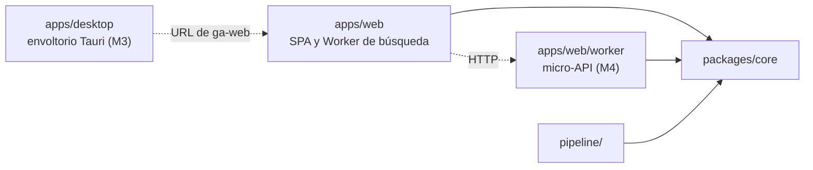

1. `core` no depende de otros paquetes del repositorio ni hace E/S (nada de DOM, `node:*`, `fetch`, Dexie ni React), y recibe el reloj y los aleatorios como parámetros. Su `tsconfig` no incluye la `lib` DOM ni `@types/node`: `tsc` falla si se cuela una API de E/S. `structuredClone`, `URL` y `TextEncoder`, que TypeScript solo declara en las `lib` DOM y WebWorker pero existen en el navegador, en Cloudflare Workers y en Node, se declaran en un `globals.d.ts` propio de `core`.
2. `apps/web` y `pipeline/` dependen de `core`, nunca el uno del otro. Lo compartido (formato del catálogo, normalización, esquemas) vive en `core`: pipeline, Worker de búsqueda y pruebas usan la misma implementación.
3. `apps/web/worker/` importa `core` y Hono, nunca `apps/web/src/`; la SPA solo le habla por HTTP, en el mismo origen.
4. El Worker de búsqueda no importa React y su *chunk* tiene presupuesto propio (ver §6).
5. El código de producción nunca importa `fixtures/`: solo lo leen las pruebas, los scripts y el servidor de desarrollo.
6. Solo `pipeline/` lee `STEAM_WEB_API_KEY`; la SPA solo ve variables `VITE_*`.
7. Entre paquetes se importa por nombre (`@gameagenda/core/search`) y solo lo que declara `exports`, nunca con `../`. Los imports relativos llevan la extensión `.ts`, que Node exige. [Node no quita tipos dentro de `node_modules`](https://nodejs.org/api/typescript.html), pero resuelve el enlace simbólico de `core` a su ruta real (a verificar en M0).
8. `apps/desktop` no importa nada del repositorio y la web no importa Tauri: solo se conocen por la URL de `ga-web` (ver §17.3).

Se vigilan con Biome (`noRestrictedImports` por carpeta y `noUndeclaredDependencies`) y con el `tsconfig` de `core`.

## 15. Roadmap e hitos

Cinco hitos, **M0–M4**, suman **23–32 días ideales** de una persona (día ideal ≈6 h de trabajo concentrado). Cada uno acaba desplegado en `workers.dev`, con etiqueta SemVer y criterios comprobables con una prueba o una medida; lo que no está en ningún hito es Fase 2.

Un hito se cierra con sus criterios demostrados en producción (y en el dispositivo real cuando se pide), la *Definition of Done* de la §12 y sus ADR escritos; un criterio que falla se corrige o pasa a otro hito con un *issue*, nunca se rebaja en silencio.

### 15.1 Orden de los hitos y ADR

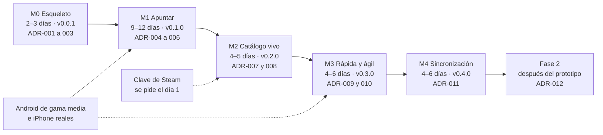

- Cada ADR se escribe al empezar su hito, numerado por orden de escritura (títulos y estado en la §5.6).
- **M3 y M4 son independientes:** el orden por defecto es M3 → M4, pero si se apunta en los dos dispositivos desde el principio, o en un iPhone sin instalar la app (ver §16, R-05), M4 va antes (ver §18, PA-01). En ese caso, M4 se etiqueta `v0.3.0` y su ADR es el ADR-009; M3 pasa a `v0.4.0` y a los ADR-010 y 011.

### 15.2 Del día ideal al calendario

Semanas = días ideales × 6 h ÷ horas de trabajo por semana (×0,6 a 10 h/semana, ×0,4 a 15 h y ×0,2 a 30 h). Acumulado al cerrar cada hito:

| Hasta | Días ideales | 10 h/semana | 15 h/semana | Tiempo completo (30 h) |
|---|---|---|---|---|
| M0 | 2–3 | 1,2–1,8 | 0,8–1,2 | 0,4–0,6 |
| M1 | 11–15 | 6,6–9,0 | 4,4–6,0 | 2,2–3,0 |
| M2 | 15–20 | 9,0–12,0 | 6,0–8,0 | 3,0–4,0 |
| M3 | 19–26 | 11,4–15,6 | 7,6–10,4 | 3,8–5,2 |
| M4 | 23–32 | 13,8–19,2 | 9,2–12,8 | 4,6–6,4 |

Sin colchón: para planificar se suma un 20 % (ver §16, R-13). Aparte van las esperas: la clave de Steam (ver §18), los ≥7 días con el cron activo que exige M3 (en paralelo a su trabajo) y tener los móviles reales.

### 15.3 M0 · Esqueleto (`v0.0.1`) · 2–3 días ideales

**Objetivo:** construir, probar y desplegar desde el primer día. **Entra:** repositorio privado con npm workspaces (ver §14); Biome, `tsc`, Vitest y Playwright; `ci.yml`; despliegue de `ga-web` (página mínima con `_headers`) en cada *push* a `main` y de `ga-catalog` con el mini-catálogo de `fixtures/` y su `_headers` (CORS y TSV como `text/plain; charset=utf-8`; ver §7.6); solicitud de la clave; elección del Android de referencia (ver §18, PA-02); las comprobaciones marcadas «a verificar en M0» en el plan; ADR-001 (arquitectura), ADR-002 (stack y repositorio) y ADR-003 (*hosting*, despliegue y CI). **No entra:** datos reales de Steam, Service Worker ni Dexie.

**Criterios de aceptación:**
- CA0.1 Un *push* a `main` pasa el CI en ≤10 min y despliega `ga-web`, que responde por HTTPS con las cabeceras de `_headers` (CSP sin `unsafe-inline`).
- CA0.2 `ga-catalog` sirve el *manifest* con `Cache-Control: no-cache` y `Access-Control-Allow-Origin` solo para el origen de `ga-web`.
- CA0.3 `ga-catalog` sirve núcleo, recientes y alias como `text/plain; charset=utf-8` y llegan comprimidos: la respuesta trae `Content-Encoding` `br`, `gzip` o `zstd`, según lo que anuncie el navegador. Si aun así no se comprimen, se publican ya comprimidos con gzip y el Worker de búsqueda los descomprime con `DecompressionStream` (ver §16, R-16); el ADR-003 recoge la opción y el tamaño transferido.
- CA0.4 El CI falla con un *build* que contiene `x-webapi-key` o una clave falsa, y con un JS inicial de más de 150 KB brotli (ver §6).
- CA0.5 Desde un clon limpio, la app arranca en local en ≤10 min sin acceso a Steam (ver §13); la clave está pedida o se sabe qué falta (ver §18).

**Esfuerzo:** herramientas y CI 0,5–1; despliegues de `ga-web` y `ga-catalog` 0,5; comprobaciones «a verificar en M0» 1–1,5 (p. ej., compresión del TSV, `_headers` y CORS también en los 404, campos de `Query` sin `include_basic_info`, estrangulamiento del Worker e importación de la clave Ed25519), cada una con su resultado en el ADR que corresponda o en un *issue*. **Depende de:** cuentas de GitHub y Cloudflare.

### 15.4 M1 · Apuntar (`v0.1.0`) · 9–12 días ideales

**Objetivo:** buscar y listar todo el catálogo de Steam y apuntar en «Quiero jugar» en <3 s, con los estados y las marcas a mano. Al cerrar M1 la app ya sirve para el día a día.

**Entra:** catálogo construido en el PC sin clave (ver §4), con núcleo, alias y *manifest* sin firma, y una copia congelada y comprimida del núcleo y sus alias en `fixtures/catalog-frozen/` para las puertas de calidad del CI (ver §8.10 y §12.1); Worker de búsqueda con todos sus niveles (ver §8) y, mientras se construye el índice, puente de escaneo lineal con los mismos niveles (estados `none` → `scan` → `full`; ver §8.8); paleta (`Ctrl+K`, `/` —desactivable en Ajustes— y barra inferior en móvil) con Intro, toque, `Ctrl+Intro`, `Alt+Intro` y `Mayús+Intro`; Mi lista con «Pendientes», filtro por estado, estados, marcas, fechas automáticas, orden manual desde el menú de la fila y Deshacer (aviso, `Ctrl+Z` con varios niveles y «Deshacer último cambio» en móvil); ficha básica (`/juego/<id>`: datos del núcleo y todos los campos de la entrada, editables); Catálogo virtual con contador y +18 oculto; juego manual con propuesta de vincular; pegar un enlace (juego provisional si no está); Dexie con `outbox`; exportar e importar JSON y CSV; `persist()`; «Borrar todos mis datos»; aviso de marca en «Acerca de»; PWA sin red tras la primera visita; ADR-004 (datos del usuario), ADR-005 (búsqueda) y ADR-006 (alcance y formato del catálogo). **No entra:** pipeline diario, portadas, ficha completa y vista Próximos (M2); índice persistido, núcleo de arranque, atajos de una tecla, `Alt+↑/↓`, `Ctrl+V` fuera de la paleta, gestos (también la pulsación larga), arrastre y «Compartir» (M3).

**Criterios de aceptación:**
- CA1.1 **Completo:** el núcleo tiene ≥190 000 juegos y pasa las puertas de publicación (ver §4); todo `appid` con nombre del volcado público de `GetAppList` (`jsnli/steamappidlist`, solo en desarrollo) está en el núcleo o en el informe con su motivo (lista negra, SKU regional duplicado…); los 18 sin nombre (27-10-2026) se completan con `GetItems` o se excluyen, y se cuentan.
- CA1.2 **Listable:** con +18 visible, el contador del Catálogo coincide con el *manifest* (con +18 oculto, descuenta los de adultos) y se llega a la última fila con Fin y con la barra, en Chromium y en el Android de referencia.
- CA1.3 **Buscable:** pasan las consultas de humo; ≥99 % de 2 000 nombres exactos al azar quedan en el top 5 y ≥90 % de los prefijos de 4 letras de los 1 000 juegos más populares, en el top 10; el conjunto dorado cumple sus umbrales (ver §8). En CI se comprueba sobre la copia congelada del núcleo.
- CA1.4 **Apuntar en <3 s:** el E2E «apuntar un juego» (ver §12) da una mediana de 5 ejecuciones <3 s en escritorio y en móvil emulado, y p50 ≤3 s en 10 altas en el Android de referencia (`chrome://inspect`).
- CA1.5 **Rendimiento** (`npm run perf`, CPU ×4; ver §12.4): tecla → resultados ≤50 ms p95 (≤16 ms sin estrangular), con el núcleo de búsqueda en el hilo principal de una página de prueba, porque CDP no estrangula los Workers; en la app real, toque → respuesta ≤100 ms, INP p75 ≤200 ms y 0 tareas largas de más de 50 ms al teclear o apuntar; LCP ≤2,5 s, medido con `PerformanceObserver` en el proyecto `perf`; JS inicial ≤150 KB y Worker ≤40 KB brotli.
- CA1.6 **Estados y marcas:** cada uno a ≤2 toques desde Mi lista o desde un resultado (ver §9), con respuesta ≤100 ms; Platinado pasa a Completado y fija `completedAt` si estaba vacío; Deshacer devuelve el estado exacto (reglas de la §3).
- CA1.7 Tecleando sin pausa (`delay: 0`), Intro apunta siempre el resultado de la consulta completa; `Ctrl+Intro` apunta y deja la paleta abierta para el siguiente.
- CA1.8 **Sin red:** tras la primera visita y en modo avión, la app abre, busca en todo el catálogo, apunta, cambia estados y lo conserva al recargar.
- CA1.9 **Datos:** exportar, borrar los datos del sitio e importar deja las entradas idénticas (marcas HLC incluidas) y reimportar no duplica; pegar un enlace de la tienda apunta ese juego y un `appid` desconocido queda provisional con el título del *slug*.
- CA1.10 axe sin violaciones graves ni críticas; apuntar funciona solo con teclado; pasada con NVDA de apuntar → cambiar estado → Deshacer.
- CA1.11 **Puente de búsqueda:** mientras se construye el índice (estado `scan`), la paleta busca en todo el catálogo con los mismos niveles, y al pasar a `full` no se pierde la consulta en curso; en la página de prueba con CPU ×4, el escaneo está listo ≤2 s tras un reinicio con caché y responde con p95 ≤50 ms (el escaneo de la §8.11 dio 1,72 s y 42 ms). En el Android de referencia, el reinicio con caché permite buscar en ≤2 s, con Mi lista visible en ≤1 s.
- CA1.12 **Ficha básica:** se abre con `Mayús+Intro` desde la paleta y con Intro o un toque desde Mi lista y el Catálogo; muestra los datos del núcleo y edita estado, marcas, fechas, nota y «Juego en», con Deshacer.

**Esfuerzo:** catálogo en el PC 1,5–2; normalización, índice, alias y conjuntos dorados 2–2,5, a partir del prototipo medido (`docs/planificacion/prototipo-busqueda/`; ver §8.11); puente de escaneo 0,5–1; Worker, paleta e Intro 1–1,5; Mi lista y Dexie con HLC 1,5–2; ficha básica 0,5; Catálogo, juego manual, enlaces, exportar, Ajustes y PWA 1; arnés de rendimiento (`perf`) y E2E 1–1,5, escritos con cada pieza (ver §12.3 y §12.4). Es el hito más justo: si se desvía más de un 30 % (ver §16, R-12), lo «Importante» de la §3 que pueda esperar (p. ej., «Vincular» u órdenes de Mi lista distintos del manual) pasa a M2 con un *issue*. **Depende de:** M0 y el Android de referencia (modelo fijado en M0; ver §18, PA-02): si al cerrar M1 aún no lo hay, se cierra con `npm run perf` y lo que se mide en ese dispositivo pasa a M3 con un *issue*. No necesita la clave.

### 15.5 M2 · Catálogo vivo (`v0.2.0`) · 4–5 días ideales

**Objetivo:** el catálogo se actualiza solo cada día y la app muestra portadas y la ficha completa.

**Entra:** `catalog.yml` diario con columna vertebral con clave, enriquecimiento sin clave, estado en la *Release* `catalog-state`, puertas (también las de calidad de búsqueda), *manifest* firmado con *kill switches*, recientes, *shards* de detalles, canario y *dead-man switch* (ver §4 y §7); en el cliente, firma, recientes, regla de los 7 días, recuperación ante un 404, portadas con interruptor, ficha completa (portada y datos de los *shards*), vista Próximos de Mi lista (`/?vista=proximos`) y orden por lanzamiento, aviso de primera capa, «Datos de Steam que guardamos» y edad del catálogo; ADR-007 (pipeline) y ADR-008 (portadas). **No entra:** micro-API ni resolución de juegos provisionales (M4).

**Criterios de aceptación:**
- CA2.1 3 ejecuciones programadas seguidas en verde (7 antes de cerrar M3), cada una con ≤10 llamadas con clave, ≤230 en total, ≤0,4 peticiones/s y ≤30 min.
- CA2.2 Con *fixtures* que fuerzan cada fallo de puerta (recuento, centinela, consulta de humo, calidad de búsqueda, tamaño), no se publica nada, la versión anterior sigue servida y se abre un *issue*; si solo falla el enriquecimiento, se publican los nombres y crece `enrichmentAgeDays`.
- CA2.3 El cliente rechaza un *manifest* con firma inválida; el *kill switch* `covers` apaga las portadas en la siguiente comprobación sin publicar otro cliente.
- CA2.4 Un cliente con un núcleo de ≤7 días descarga solo el *manifest*, los recientes y, si cambiaron, los alias y el índice de *shards* (≤200 KB transferidos), sin tareas largas; tras un despliegue, un cliente con el *manifest* anterior sigue funcionando.
- CA2.5 Si pasan 36 h sin una ejecución correcta, el *dead-man switch* avisa por correo (probado deteniendo el cron).
- CA2.6 En una agenda de prueba con 300 juegos reales, ≥99 % de las entradas con `library_capsule` o `header` en su *shard* muestran portada y el resto, un *placeholder*; ninguna URL se construye fuera de `asset_url_format`.
- CA2.7 El aviso de primera capa sale antes de la primera portada; con «Cargar portadas» apagado hay 0 peticiones a `*.steamstatic.com`; 0 violaciones de CSP; la clave no aparece en el *build* ni en los ficheros publicados.
- CA2.8 La ficha completa muestra portada, lanzamiento o «Por confirmar», reseñas, plataformas y Steam Deck; la vista Próximos agrupa las entradas por lanzamiento: Ya disponibles (14 días), Esta semana, por meses, Más adelante y Por confirmar (ver §9.2).

**Esfuerzo:** pipeline con estado, puertas y publicación 2–2,5; firma, *kill switches* y actualización del cliente 1; *shards*, portadas, ficha completa, Próximos y avisos 1–1,5. **Depende de:** M1; la clave (sin ella, el pipeline sigue con el plan B y la columna vertebral queda abierta); una cuenta de healthchecks.io y el par de claves ed25519 (ver §11).

### 15.6 M3 · Rápida y ágil (`v0.3.0`) · 4–6 días ideales

**Objetivo:** cumplir los presupuestos en dispositivos reales y multiplicar las vías de captura, también desde cualquier aplicación de Windows con la app de escritorio.

**Entra:** índice persistido por versión de catálogo y núcleo de arranque con ≈20 000 juegos (estado `boot`; ver §8); atajos de una tecla, desactivables, de la §9.4 (`?`, `G` + letra, `J`/`K`, `1`–`5`, `C`/`P`/`A`, `N`, `Supr`, `V`, `F`) y `Alt+↑/↓`; pulsación larga y demás gestos, con botón equivalente; reordenar «Quiero jugar» arrastrando; «Compartir» en Android y acceso directo «Apuntar juego»; `Ctrl+V` en cualquier pantalla y chip «Pegar enlace» en iOS; panel de rendimiento; WCAG 2.2 AA; prueba guiada (ver §2.4); app de escritorio para Windows (`apps/desktop`; ver §17.3): ventana Tauri que carga `ga-web`, `Ctrl+Mayús+Espacio` desde cualquier aplicación, icono en la bandeja, una sola instancia, arranque con Windows opcional e instalador NSIS sin firma; ADR-009 (arranque rápido) y ADR-010 (app de escritorio). **No entra:** Atajo de iOS (M4), firma de código del instalador ni app de escritorio para macOS o Linux.

**Criterios de aceptación:**
- CA3.1 En el Android de referencia (`chrome://inspect`) y en un iPhone (por HTTPS, con el panel), 3 sesiones de 20 búsquedas y 10 altas cumplen los presupuestos de la §3: tecla → resultados ≤50 ms p95, toque → respuesta ≤100 ms, INP ≤200 ms (p75), apuntar p50 ≤3 s, LCP ≤2,5 s, reinicio con caché ≤2 s (Mi lista ≤1 s) y búsqueda lista ≤1,5 s tras la primera carga. Las cifras quedan en la PR de cierre.
- CA3.2 Con la misma versión de catálogo, el reinicio restaura el índice sin reconstruirlo, en ≤0,4 s con CPU ×4 (hoy 0,55 s; se mide como la búsqueda, ver §8.9); una versión nueva lo invalida.
- CA3.3 Con la PWA instalada en Android, «Compartir» desde la app de Steam o desde Chrome apunta el juego con Deshacer en ≤3 s; el acceso directo abre la paleta con el foco; `Ctrl+V` con un enlace lo apunta desde cualquier pantalla.
- CA3.4 Un E2E solo con teclado recorre el mapa de atajos; ninguno usa `Ctrl+Alt` ni AltGr; cada gesto tiene un botón equivalente y ninguno borra.
- CA3.5 axe sin violaciones graves ni críticas; pasada con NVDA, Narrador, TalkBack y VoiceOver de apuntar → cambiar estado → Deshacer; contraste ≥4,5:1 en texto y ≥3:1 en componentes, en los dos temas.
- CA3.6 **Prueba guiada** (O-1 y O-2; protocolo en la §2.4): ninguna captura pasa de 5 s y ≥80 % se hacen sin flechas ni Deshacer. Las cifras quedan en la PR de cierre.
- CA3.7 **App de escritorio:** con el instalador de `npm run desktop:build`, instalado sin derechos de administrador, `Ctrl+Mayús+Espacio` desde otra aplicación pone delante la ventana con la paleta y el foco, sin recargar la página; apuntar así (de pulsar el atajo a ver la confirmación) da p50 ≤3 s en 10 altas. Volver a pulsarlo oculta la ventana, cerrarla la deja en la bandeja y abrir la app otra vez muestra la que ya está abierta.
- CA3.8 Tras una primera apertura con red, la app de escritorio abre, busca y apunta en modo avión; la página de `ga-web` no puede invocar ninguna orden de Tauri; si otra aplicación ya usa el atajo, el menú del icono de la bandeja lo indica en lugar de fallar en silencio.

**Esfuerzo:** índice y núcleo de arranque 1; captura, atajos, gestos y reordenar 1–1,5; panel, medición y prueba guiada 0,5–1; accesibilidad 0,5; app de escritorio 1–2 (ventana, bandeja y atajo 0,5–1; una sola instancia, arranque con Windows e instalador 0,25–0,5; CA3.7 y CA3.8 0,25–0,5). **Depende de:** M2 (genera el núcleo de arranque) y los dos móviles. La app de escritorio solo depende de M1 y de la ruta `/apuntar`, así que puede ser lo primero del hito.

### 15.7 M4 · Sincronización (`v0.4.0`) · 4–6 días ideales

**Objetivo:** una sola agenda en el móvil y en el PC, con copia fuera del dispositivo.

**Entra:** micro-API Hono en `/api/*` de `ga-web` con D1 en la UE; emparejar por QR o texto, cookie `__Host-` y código de recuperación; `POST /api/v1/sync` con el mismo `merge()` en cliente y servidor; buzón para el Atajo de iOS; `/api/v1/resolve/<appid>`; límites de peticiones; textos legales completos y declaración de edad (ver §5, §7 y §11); ADR-011 (sincronización). **No entra:** cuentas con email o con Steam (Fase 2) ni tiempo real.

**Criterios de aceptación:**
- CA4.1 Pruebas de propiedades (fast-check, ≥1 000 casos): cualquier orden o repetición de las mismas operaciones da el mismo estado, y Platinado ⇒ Completado se cumple tras cada fusión.
- CA4.2 E2E con dos contextos de navegador: sin red, las ediciones de campos distintos sobreviven, en el mismo campo gana el HLC más reciente y el mismo juego apuntado en los dos queda en una sola entrada.
- CA4.3 Borrar solo IndexedDB (DevTools en escritorio) y recargar restaura la agenda, porque la cookie de dispositivo se conserva; borrar los datos del sitio desde el navegador (DevTools en escritorio; Ajustes › Apps › Safari › Avanzado › Datos de sitios web en un iPhone real) y canjear el código de recuperación, también.
- CA4.4 Un *token* de emparejamiento usado, caducado (>10 min) o inventado se rechaza; D1 no guarda *tokens* en claro; las rutas sin autenticar devuelven 429 por encima de su límite.
- CA4.5 El Atajo de iOS deja el enlace en el buzón y el juego aparece en la siguiente sincronización; un *token* revocado recibe 401; un juego ausente del núcleo se guarda al instante como provisional y su nombre llega en ≤1,5 s con red.
- CA4.6 CPU del Worker ≤5 ms por petición en el p99 (el límite gratuito es 10 ms).
- CA4.7 Los textos legales se publican antes de activar la sincronización, que pide la declaración de edad (≥14 años, configurable a 16); «Borrar todos mis datos» vacía la agenda en D1 (comprobado con una consulta) y en local.

**Esfuerzo:** micro-API, D1 y límites 1–1,5; emparejar y recuperación 1–1,5; protocolo y pruebas 1,5–2; buzón, `resolve` y textos legales 0,5–1. **Depende de:** M1 (HLC, `outbox` y `merge()`), los textos legales (ver §11) y un iPhone.

### 15.8 Fase 2

Cada bloque tendrá su ADR (la §5.6 reserva el ADR-012 para la cuenta de Steam) y sus criterios al cerrar M4: «Iniciar sesión con Steam» e importación que solo propone (ver §10); IGDB y otras plataformas (ver §17); DLC notables con insignia; marcas propias; avisos de lanzamiento; interfaz en inglés.

## 16. Riesgos y mitigaciones

Probabilidad (P) e impacto (I) en tres niveles: B = bajo, M = medio, A = alto. Se revisan al cerrar cada hito (ver §15).

| Id | Riesgo | P | I | Mitigación | Señal de alarma |
|---|---|---|---|---|---|
| R-01 | Los servicios sin clave (`IStoreQueryService/Query`, `IStoreBrowseService/GetItems`) cambian, piden clave o desaparecen: no están documentados y `ISteamApps/GetAppList/v2` ya se retiró el 13-11-2025 | M | M | Nombres y `appid` salen de la columna vertebral con clave; si falla el enriquecimiento, se publican los nombres con el último enriquecimiento conocido; contratos Zod, *fixtures* y canario diario; *kill switches* `covers` y `details` | Falla el canario o un contrato; `enrichmentAgeDays` ≥2 |
| R-02 | La clave de Steam no llega (cuenta limitada o sin Steam Guard móvil) o Valve la revoca | M | M | Se pide en M0 y M1 no la necesita; sin clave, plan B con `Query` (ver §4); los clientes conservan el último catálogo; un 403 con clave detiene el pipeline y avisa | Sin clave al empezar M2; 403 en `GetAppList` |
| R-03 | 429 o bloqueo por IP en los *runners* compartidos de GitHub | M | B | Un solo *worker* a ≤0,4 peticiones/s, *backoff* con *jitter* y pausa global; ≈220 llamadas/día (≤230); si persisten, el PC descarga y construye el catálogo y lo sube a la *Release* `catalog-staging`, y `catalog.yml` (`workflow_dispatch` con `source=staging`) pasa las puertas, firma y publica (ver §4.5) | 429 en el resumen del *job*; ejecución de más de 30 min |
| R-04 | El cron de GitHub se retrasa, se pierde o se desactiva (60 días sin actividad, solo en repos públicos) | M | B | Repo privado; `workflow_dispatch`; *dead-man switch*; la app funciona con cualquier versión y pegar un enlace cubre lo nuevo; si se repite, un Cron Trigger de Cloudflare (el plan gratuito admite 5 por cuenta) lanza `workflow_dispatch` con un *token* de GitHub de permiso mínimo, guardado como secreto del Worker (a verificar en M2) | Aviso de healthchecks.io a las 36 h; catálogo de más de 2 días en Ajustes |
| R-05 | Safari borra IndexedDB tras 7 días de uso del navegador sin interacción con el sitio, salvo si la app está en la pantalla de inicio | M | A | `persist()`, invitación a instalar y exportación con recordatorio; en M4, copia en el servidor con cookie `HttpOnly` y código de recuperación | `persist()` denegado; más de 20 entradas y 30 días sin exportar |
| R-06 | Búsqueda o arranque lentos en móviles de gama baja: el índice tarda 4,56 s en estar listo con CPU ×4 y, mientras, responde el escaneo lineal (p95 42 ms con ×4 y 96 ms con ×10; el índice, 8,7 y 17 ms) | M | A | Índice de la §8 en un Web Worker y puente de escaneo en M1; `npm run perf` en local (núcleo de búsqueda con CPU ×4 en el hilo principal de una página de prueba, porque CDP no estrangula los Workers; INP y tareas largas, en la app real); medición en el Android de referencia en M1 y M3; índice persistido y núcleo de arranque (M3) | p95 tecla → resultados >50 ms; reinicio >2 s |
| R-07 | El *ranking* no acierta (siglas, romanos, nombres en español, CJK, «próximamente» sin reseñas) | M | M | Niveles y alias de la §8; conjuntos dorados en CI; consultas de humo como puerta de publicación; alta manual siempre disponible y Deshacer | Un conjunto dorado baja de su umbral; Deshacer frecuente justo tras apuntar |
| R-08 | Cloudflare cambia el plan gratuito (hoy: *assets* estáticos gratis e ilimitados; Workers con 100 000 peticiones/día y 10 ms de CPU) | B | M | El camino crítico son ficheros estáticos que sirve cualquier *hosting* con cabeceras propias; micro-API pequeña y portable (Hono corre en Node); sin caché de Workers sobre los *assets* | Cambio de condiciones; 429 en `/api/*` o CPU cerca de 10 ms |
| R-09 | Los términos de la Web API (2010) no hablan de uso comercial y licencian los datos para el uso personal de los usuarios | B | A | Prototipo personal y gratuito; sin marcas de Valve en nombre ni icono; aviso de marca; consultar a Valve antes de monetizar (ver §18); catálogo independiente de la fuente (IGDB en Fase 2) | Decisión de monetizar; contacto de Valve |
| R-10 | La edad de consentimiento digital sube de 14 a 16 años: un proyecto de ley orgánica está en el Congreso desde 2025, sin aprobación definitiva conocida a 28-10-2026 (a verificar en M4) | M | B | Declaración de edad configurable al activar la sincronización (M4); ninguna cuenta antes | Aprobación publicada en el BOE |
| R-11 | La beta de Achievement Sets (octubre de 2026) cambia qué es el 100 % (logros archivados fuera, conjuntos de DLC aparte) | A | B | Platinado manual en el prototipo; en Fase 2, solo sugerencia que el usuario confirma (ver §10) | Cambios en la beta o en los campos `groups` de la API |
| R-12 | El alcance crece (DLC, otras plataformas, precios, avisos…) | A | M | Criterios cerrados por hito; lo no listado va a Fase 2; cada cambio de alcance, con su ADR | Un hito se desvía más de un 30 % de su estimación |
| R-13 | Un solo desarrollador: disponibilidad irregular y pérdida de contexto | A | M | Hitos cortos con valor visible; CI, pipeline y despliegue automáticos; ADR breves; 20 % de colchón en el calendario | Dos semanas sin cerrar ninguna tarea |
| R-14 | Se filtra la clave de Steam (*build*, *logs* o *fixtures*) | B | A | Solo en un secreto de GitHub y en `.env.local`; el CI falla si el *build* contiene la clave o `x-webapi-key`; *fixtures* redactados; revocarla y crear otra | Salta la comprobación del CI |
| R-15 | La sincronización pierde o duplica cambios (M4) | M | A | Ids naturales, LWW por campo con HLC, un solo `merge()`, pruebas de propiedades y E2E con dos contextos; exportación siempre disponible; Time Travel de D1 (7 días) | Un contraejemplo en las pruebas; dispositivos distintos tras sincronizar |
| R-16 | El CDN no comprime los TSV del catálogo y la primera visita bajaría 7,00 MB de núcleo en vez de 2,59–3,05 MB (brotli 5 o gzip; ver §7.6): Cloudflare solo comprime los tipos de su lista, que no incluye `text/tab-separated-values`, el que Wrangler asigna a los `.tsv` | B | M | Desde M0, `_headers` sirve núcleo, recientes y alias como `text/plain; charset=utf-8`, que sí está en la lista (ver §7.6), y CA0.3 comprueba el `Content-Encoding` (`br`, `gzip` o `zstd`; ver §15); si aun así no llegan comprimidos, se publican ya comprimidos con gzip y el Worker de búsqueda los descomprime con `DecompressionStream` (ADR-003) | El núcleo llega sin `Content-Encoding` |
| R-17 | El *chunk* del Worker de búsqueda supera sus 40 KB brotli (Zod, uFuzzy o una dependencia que se cuela) | M | B | Puerta de tamaño en CI desde M0; el Worker no importa React ni Dexie (ver §5.2); uFuzzy en un *chunk* diferido; `zod/mini` si Zod no cabe (ver §6.2) | Falla la puerta de tamaño del Worker |
| R-18 | Hasta M4, la app de escritorio y el navegador del PC guardan agendas distintas (WebView2 no comparte datos con Edge ni con Chrome) y se apunta en la que no se consulta | M | M | En el PC se apunta en una sola de las dos (ver §17.3); para cambiar, exportar e importar (M1); en M4 se emparejan como dos dispositivos | Un juego apuntado en una no aparece en Mi lista de la otra |

Fuentes (consultadas el 28-10-2026): términos de la Steam Web API (https://steamcommunity.com/dev/apiterms); requisitos de la clave (https://help.steampowered.com/en/faqs/view/71D3-35C2-AD96-AA3A); `schedule` de GitHub Actions (https://docs.github.com/en/actions/reference/workflows-and-actions/events-that-trigger-workflows); almacenamiento en WebKit (https://webkit.org/blog/10218/full-third-party-cookie-blocking-and-more/); límites de Workers, con los Cron Triggers (https://developers.cloudflare.com/workers/platform/limits/), de los *assets* estáticos (https://developers.cloudflare.com/workers/static-assets/billing-and-limitations/) y compresión de Cloudflare (https://developers.cloudflare.com/speed/optimization/content/compression/); LOPDGDD, art. 7 (https://www.boe.es/buscar/act.php?id=BOE-A-2018-16673) y proyecto de ley (https://www.congreso.es/public_oficiales/L15/CONG/BOCG/A/BOCG-15-A-52-1.PDF); Achievement Sets (https://partner.steamgames.com/doc/features/achievements/ach_guide).

## 17. Multiplataforma

Las plataformas de juego (consolas y otras tiendas) son de **Fase 2**; la app de escritorio para Windows, de **M3** (§17.3). «Platinado» evoca PlayStation, y el usuario debe poder apuntar **cualquier** juego.

### 17.1 Tres niveles

1. **Juego manual (desde M1):** solo el título y, si se quiere, «Juego en», al instante y sin red, con id `manual:<uuidv7>`. Vincularlo con el catálogo es fusionar sus campos (LWW por campo) en la entrada de destino y dejarlo como lápida con `mergedInto` (ver §7). Nunca se vincula por similitud: solo se propone con exactamente una coincidencia exacta tras normalizar («Hades» ≠ «Hades II»).
2. **IGDB, catálogo multiplataforma:** la única fuente con PC, PlayStation, Xbox, Nintendo y retro a la vez; gratis también para uso comercial (con una *partnership* gratuita) y prefiere que se guarden sus datos. Se muestra siempre la atribución «Datos de juegos: IGDB.com». Exige credenciales de Twitch y no admite llamadas del navegador (4 peticiones/s, 8 simultáneas, 500 ítems por petición), así que entra como **etapa del pipeline**: credenciales en un secreto de GitHub, barrido diario por `updated_at` y ficheros estáticos en `ga-catalog`. La búsqueda sigue siendo local. Un barrido completo son ≈860 peticiones (≈428 000 fichas en marzo de 2023; a medir en Fase 2), y el tamaño decidirá si va en un fichero aparte que solo se descarga al activar otras plataformas.
   - **Identidad:** gracias a `external_games` (`external_game_source = 1`, `uid` = `appid`), los juegos de Steam conservan `steam:<appid>` y solo los que no están en Steam reciben `igdb:<id>` (id numérico). Si uno llega luego a Steam, se propone vincularlo como un manual.
   - **Duración:** `game_time_to_beats` (*hastily*, *normally*, *completely*) da estimaciones con licencia para «Completado» y «Platinado»; se ocultan si hay pocas aportaciones.
3. **Wikidata (CC0), cruce de ids por lotes**, nunca en el camino de búsqueda: ≈129 000 ítems con `appid` de Steam, el 91 % también con IGDB. Los ids de consola escasean (≈6 000 de cada tienda: PS Store, eShop, Microsoft Store) y a veces son *slugs* con varios valores (Hades tiene tres ids de MobyGames), así que el cruce del pipeline es **muchos a muchos**, nunca 1:1.

Portadas: Steam para los juegos de Steam e IGDB (`t_cover_big`) para el resto (ver §11.3).

### 17.2 Otras fuentes

| Fuente | Decisión | Motivo |
|---|---|---|
| IGDB | Sí (Fase 2) | Cobertura, licencia y permiso para guardar datos |
| Wikidata | Sí, por lotes | CC0; enlaces salientes (HowLongToBeat, PS Store, eShop) |
| IsThereAnyDeal | Opcional; preguntar antes | Precios para lo que no está «Comprado»; sus términos prohíben apps que «compitan» con sus proyectos (Waitlist, Collection) |
| Trofeos de PSN (NPSSO) | No | API no oficial; el NPSSO equivale a la contraseña y choca con los términos de PSN (5.1 y 10.7). Platinado, manual |
| Xbox (OpenXBL), RetroAchievements | Opcional, más adelante | Importación con la clave del propio usuario |
| HowLongToBeat | Solo enlace | Sin API; *endpoints* internos cambiantes y 429 desde septiembre de 2026 |
| Giant Bomb | No | API fuera de servicio |
| RAWG | No como espejo | Prohíbe redistribuir y exige enlace en cada página |
| SteamGridDB | No | Sus términos prohíben el uso automatizado |
| MobyGames | No | De pago (≈99,99 US$/mes para uso comercial) |
| PCGamingWiki | Solo enlace | Licencia CC BY-NC-SA |
| SteamSpy | No | Datos desfasados (aún llama «Counter-Strike: Global Offensive» al 730) |
| GOG, Epic | No para funciones clave | Sin API oficial de catálogo; sus ids llegan por IGDB |

Verificado el 28-10-2026. Fuentes: <https://api-docs.igdb.com/> · <https://www.wikidata.org/wiki/Wikidata:Licensing> · <https://docs.isthereanydeal.com/> · <https://www.playstation.com/en-us/legal/terms-of-use-march-2025/>

### 17.3 App de escritorio (envoltorio Tauri, M3)

Decidida el 29-10-2026 (ADR-010; criterios CA3.7 y CA3.8 en la §15.6): Tauri 2 (versiones en la §6) envuelve la misma web y nunca es un segundo motor. Aporta el atajo global `Ctrl+Mayús+Espacio`, que abre la paleta desde cualquier aplicación de Windows; la PWA instalada en el PC sigue siendo válida, pero sin ese atajo.

- **Carga el origen de `ga-web`**, no ficheros empaquetados (`frontendDist` es la URL de producción y `devUrl`, `http://127.0.0.1:5173`), para que la cookie `__Host-`, `connect-src 'self'` y el Service Worker funcionen igual y cada despliegue de `ga-web` actualice también la app de escritorio. La primera apertura necesita red; después, el Service Worker de WebView2 la sirve sin red (a verificar en M3).
- **Parte nativa mínima** (`apps/desktop/src-tauri/src/main.rs`): registra el atajo; muestra la ventana, la pone delante y abre la paleta en `/apuntar` sin recargar la página (lanza en ella un evento fijo que atiende el *router*; a verificar en M3 que la CSP lo permite); con la ventana delante, el mismo atajo la oculta. Al cerrar la ventana, la app sigue en la bandeja, con «Abrir», «Iniciar con Windows» (desactivado por defecto) y «Salir»; una segunda instancia muestra la primera.
- **Permisos:** la página de `ga-web` no recibe ninguna orden de Tauri: ninguna *capability* declara `remote` y la web no usa `@tauri-apps/api`. El login de Steam de Fase 2 va por el navegador del sistema (ver §10.2).
- **Datos hasta M4:** WebView2 guarda los suyos aparte de Edge y de Chrome, así que la app de escritorio tiene su propia agenda. Hasta la sincronización, en el PC se apunta en ella o en el navegador, no en los dos; para cambiar, se exporta y se importa (ver §16, R-18). En M4 se empareja como un dispositivo más.
- **Instalador:** NSIS por usuario, sin derechos de administrador, generado en el PC (ver §12.5). Sin firma de código, SmartScreen avisa al instalar («Más información» → «Ejecutar de todas formas»); firmar tiene coste y se decide en Fase 2. Rust 1.99, VS Build Tools 2022 y WebView2 ya están instalados (ver §13).

## 18. Preguntas abiertas

Solo lo que el plan aún no resuelve. Ninguna impide empezar: mientras no haya respuesta, se aplica el supuesto.

| Id | Pregunta | A quién | Supuesto mientras tanto | Qué cambia según la respuesta |
|---|---|---|---|---|
| PA-01 | ¿Apuntarás sobre todo en el móvil o en el PC? ¿Usarás los dos desde el principio? | Usuario | Los dos, pero hasta M4 se apunta sobre todo en uno; orden por defecto M3 → M4 | Si se apunta en los dos desde el principio, o en un iPhone sin instalar la app (ver §16, R-05), M4 va antes que M3 (ver §15.1); si casi todo es PC, la app de escritorio con atajo global (M3; ver §17.3) pasa a justo después de M1 |
| PA-02 | ¿Tu móvil es iPhone o Android, y qué modelo? | Usuario | Un Android de gama media como referencia de rendimiento, con el modelo fijado en M0; el iPhone se comprueba por HTTPS con el panel de rendimiento | Con iPhone, «Pegar enlace» y el Atajo de iOS (M4) son la vía principal y sube R-05 (ver §16), así que conviene adelantar M4; sin un Android de gama media a mano, hay que conseguir uno o recalibrar la referencia antes de cerrar M1 (si no, sus mediciones pasan a M3 con un *issue*; ver §15) |
| PA-03 | ¿Tienes una cuenta de Steam con ≥5 US$ gastados y Steam Guard móvil? | Usuario | Sí: la clave se pide en M0 y M1 no la necesita | Si no, el pipeline sigue con el plan B sin clave (ver §4) y R-01 pasa a impacto alto; se resuelve gastando 5 US$ en la tienda y activando el autenticador |
| PA-04 | ¿«Platinado» es el 100 % del juego base o incluye los DLC? | Usuario | Marca manual; en Fase 2, la sugerencia usa el conjunto base de logros | Cambia la regla de la sugerencia al importar (ver §10) y si hace falta una marca «100 % con DLC» |
| PA-05 | ¿Quieres los DLC y expansiones en el catálogo (≈63 000)? | Usuario | No en el prototipo; en Fase 2, solo los notables (umbral de reseñas) con insignia «DLC» | Todos los DLC suman ≈32 % de filas al núcleo y obligan a revisar los presupuestos de tamaño y memoria (ver §6 y §8) |
| PA-06 | ¿Piensas monetizar (anuncios, suscripción, afiliados)? | Usuario; después, Valve | Uso personal y gratuito | Consultar a Valve antes de cobrar (ver §16, R-09), asociación con atribución si se usa IGDB, más obligaciones legales (ver §11) y quizá un plan de pago |
| PA-07 | ¿Cuántas horas por semana dedicarás? | Usuario | 15 h/semana: M0–M4 en 9,2–12,8 semanas sin colchón (ver §15.2) | Solo el calendario, no el alcance |
| PA-08 | ¿Habrá probadores externos antes de M4? ¿Quieres dominio propio? | Usuario | No; `workers.dev` | La política completa, el aviso legal y el registro de actividades se adelantan al primer probador (ver §11); un dominio propio obliga a revisar los orígenes de la CSP |
| PA-09 | ¿Qué más quieres guardar por juego: otras marcas (Favorito, «Sin final»), valoración, precio pagado o precio actual? | Usuario | Solo Platinado, Comprado, Próximo y nota; `flags` admite marcas nuevas sin migración | Una marca fija cabe en cualquier hito; valoración y precio pagado son campos nuevos de la ficha; el precio actual exige datos diarios en los *shards* |
| PA-10 | ¿Se puede registrar, sin asociarlo a nadie, el texto de las búsquedas sin resultados? | Usuario y asesoría legal | No se envía nada; el panel de rendimiento es local | Haría falta una ruta en la micro-API (M4), aviso de privacidad y base jurídica (ver §11) |

## 19. Referencias

Fuentes externas del plan, consultadas el 28-10-2026.

### 19.1 Steam y Valve

- Steam Web API, condiciones de uso: https://steamcommunity.com/dev/apiterms
- Steam Web API, desarrolladores: https://steamcommunity.com/dev
- Steamworks:
  - Web API Overview: https://partner.steamgames.com/doc/webapi_overview
  - `IStoreService`: https://partner.steamgames.com/doc/webapi/IStoreService
  - `ISteamApps` (`GetAppList` v2): https://partner.steamgames.com/doc/webapi/isteamapps
  - `IPlayerService`: https://partner.steamgames.com/doc/webapi/IPlayerService
  - Autenticación y OpenID: https://partner.steamgames.com/doc/features/auth
  - Guía de logros: https://partner.steamgames.com/doc/features/achievements/ach_guide
  - Recursos de biblioteca: https://partner.steamgames.com/doc/store/assets/libraryassets
  - Uso de las marcas: https://partner.steamgames.com/doc/marketing/branding
- Soporte de Steam, cuentas limitadas: https://help.steampowered.com/en/faqs/view/71D3-35C2-AD96-AA3A
- OpenID Authentication 2.0: https://openid.net/specs/openid-authentication-2_0.html
- CVE-2026-82183 (OpenID de Steam): https://www.sentinelone.com/vulnerability-database/cve-2026-82183/
- SteamTracking, retirada de `GetAppList` v2: https://github.com/SteamTracking/SteamTracking/commit/1978dcc003ebf42cfffbbbe7e0ce30e43fd94c52
- SteamDatabase, `service_storequery.proto`: https://github.com/SteamDatabase/Protobufs/blob/master/webui/service_storequery.proto
- SteamDatabase, `common.proto`: https://github.com/SteamDatabase/Protobufs/blob/master/webui/common.proto

### 19.2 Normativa, privacidad y seguridad

- LOPDGDD, texto consolidado: https://www.boe.es/buscar/act.php?id=BOE-A-2018-16673
- Proyecto de ley de menores en entornos digitales: https://www.congreso.es/public_oficiales/L15/CONG/BOCG/A/BOCG-15-A-52-1.PDF
- AEPD, guía sobre el uso de las cookies: https://www.aepd.es/guias/guia-cookies.pdf
- Renckhoff (TJUE, C-161/17), comentario: https://legalblogs.wolterskluwer.com/copyright-blog/the-renckhoff-judgment-the-cjeu-swivels-the-faces-of-the-copyright-rubiks-cube-part-i/
- OWASP, CSV Injection: https://owasp.org/www-community/attacks/CSV_Injection

### 19.3 Plataformas y hosting

- Cloudflare Workers:
  - Límites: https://developers.cloudflare.com/workers/platform/limits/
  - Static Assets, facturación y límites: https://developers.cloudflare.com/workers/static-assets/billing-and-limitations/
  - Static Assets, `run_worker_first`: https://developers.cloudflare.com/workers/static-assets/binding/
  - Static Assets, `_headers`: https://developers.cloudflare.com/workers/static-assets/headers/
  - Cache API: https://developers.cloudflare.com/workers/runtime-apis/cache/
  - Rate Limiting: https://developers.cloudflare.com/workers/runtime-apis/bindings/rate-limit/
  - *Rollbacks*: https://developers.cloudflare.com/workers/configuration/versions-and-deployments/rollbacks/
- Cloudflare, compresión de respuestas: https://developers.cloudflare.com/speed/optimization/content/compression/
- Cloudflare D1:
  - Límites: https://developers.cloudflare.com/d1/platform/limits/
  - Jurisdicción: https://developers.cloudflare.com/d1/configuration/data-location/
  - Time Travel: https://developers.cloudflare.com/d1/reference/time-travel/
  - API de Workers: https://developers.cloudflare.com/d1/worker-api/
  - `batch()`: https://developers.cloudflare.com/d1/worker-api/d1-database/
  - JSON en SQL: https://developers.cloudflare.com/d1/sql-api/query-json/
- Cloudflare Quick Tunnels: https://developers.cloudflare.com/cloudflare-one/networks/connectors/cloudflare-tunnel/do-more-with-tunnels/trycloudflare/
- GitHub Actions, `schedule`: https://docs.github.com/en/actions/reference/workflows-and-actions/events-that-trigger-workflows
- WebKit, límite de 7 días: https://webkit.org/blog/10218/full-third-party-cookie-blocking-and-more/
- WebKit, Async Clipboard API: https://webkit.org/blog/10855/async-clipboard-api/
- MDN, `share_target`: https://developer.mozilla.org/en-US/docs/Web/Progressive_web_apps/Manifest/Reference/share_target
- web.dev, INP: https://web.dev/articles/inp
- web.dev, LCP: https://web.dev/articles/lcp
- web.dev, Baseline: https://web.dev/baseline
- W3C, Indexed Database API: https://www.w3.org/TR/IndexedDB/
- W3C, WCAG 2.2: https://www.w3.org/TR/WCAG22/
- W3C, patrón *combobox* (APG): https://www.w3.org/WAI/ARIA/apg/patterns/combobox/
- Ed25519 en los navegadores: https://blog.ipfs.tech/2025-08-ed25519/

### 19.4 Librerías, herramientas y técnicas

- Registro de npm: https://registry.npmjs.org/
- Node.js, calendario de versiones: https://nodejs.org/en/about/releases/
- Node.js, *type stripping*: https://nodejs.org/api/typescript.html
- TypeScript 7.0: https://devblogs.microsoft.com/typescript/announcing-typescript-7-0/
- Vite, `server.allowedHosts`: https://vite.dev/config/server-options
- Vite, `worker.format`: https://vite.dev/config/worker-options
- Dexie 4.0.1-beta.9, notas de la versión: https://github.com/dexie/Dexie.js/releases/tag/v4.0.1-beta.9
- uFuzzy y su comparativa: https://github.com/leeoniya/uFuzzy
- SQLite WASM, persistencia: https://sqlite.org/wasm/doc/trunk/persistence.md
- InstantDB, cierre de su nube: https://www.instantdb.com/essays/instant_team_joins_openai
- `steam-signin`: https://github.com/DoctorMcKay/node-steam-signin
- MADR 4.0: https://adr.github.io/madr/
- RFC 8785, JSON canónico: https://www.rfc-editor.org/rfc/rfc8785
- Relojes lógicos híbridos (HLC): https://cse.buffalo.edu/tech-reports/2014-04.pdf
- Claves fraccionarias: https://observablehq.com/@dgreensp/implementing-fractional-indexing

### 19.5 Otras fuentes de datos de juegos

- IGDB API v4: https://api-docs.igdb.com/
- Wikidata, licencias (CC0): https://www.wikidata.org/wiki/Wikidata:Licensing
- IsThereAnyDeal API: https://docs.isthereanydeal.com/
- PlayStation Network, condiciones de uso: https://www.playstation.com/en-us/legal/terms-of-use-march-2025/
- SteamSpy API: https://steamspy.com/api.php
- SteamDB, FAQ: https://steamdb.info/faq
- `jsnli/steamappidlist`: https://github.com/jsnli/steamappidlist
- `mparmol/Removed_Steam_Games`: https://github.com/mparmol/Removed_Steam_Games
- `node-steam-user` (PICS): https://github.com/DoctorMcKay/node-steam-user

Las decisiones de arquitectura se registran como ADR en `docs/adr/` (ver §5.6); el prototipo de búsqueda medido el 28-10-2026 está en `docs/planificacion/prototipo-busqueda/`.
